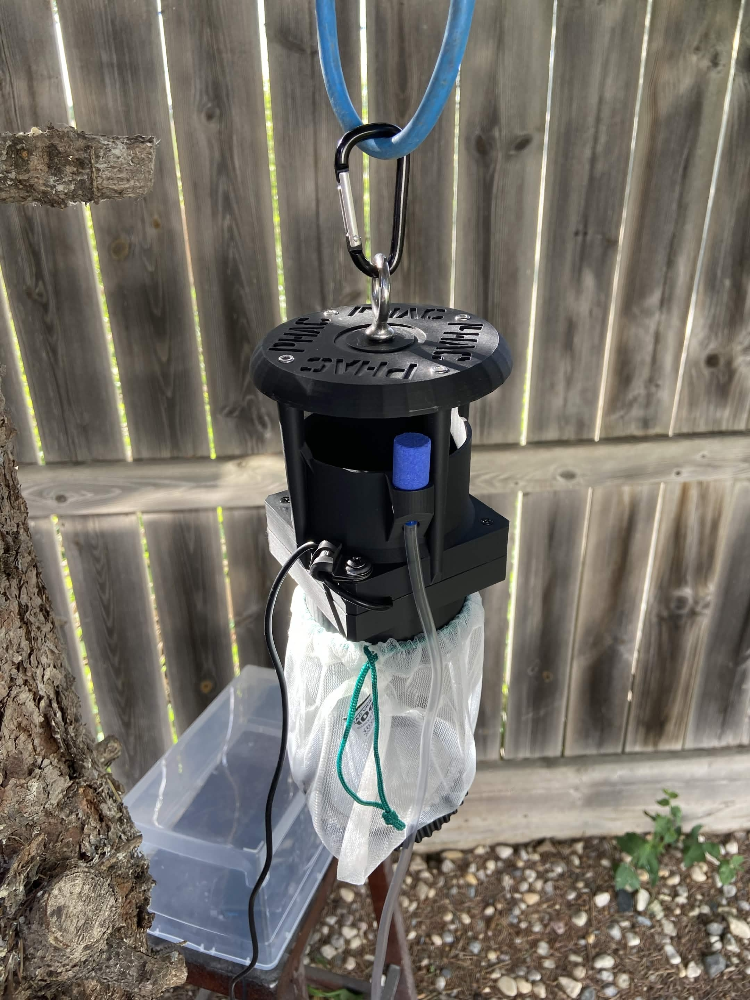
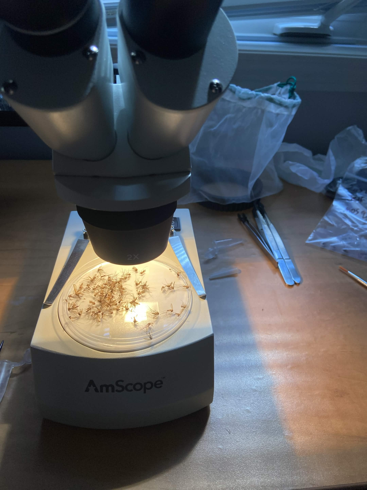
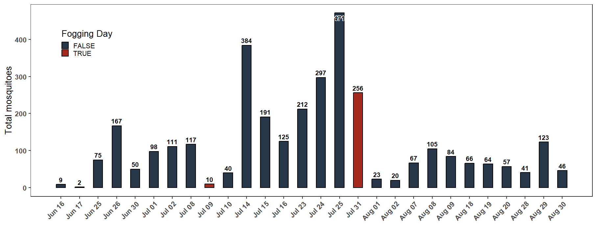
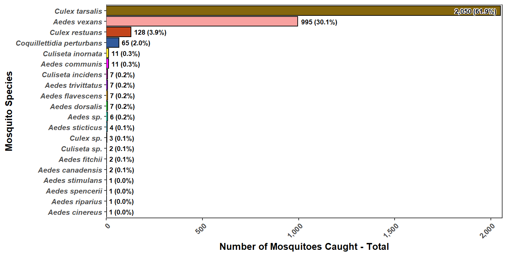
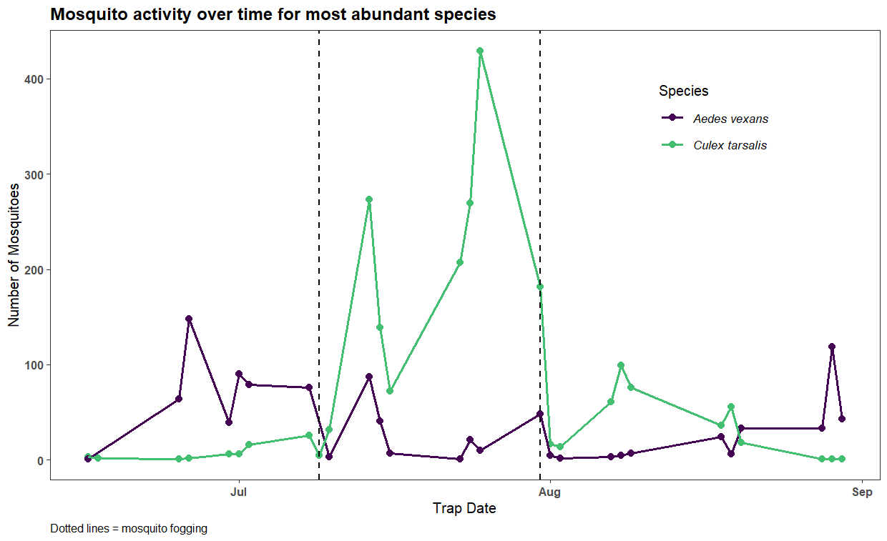
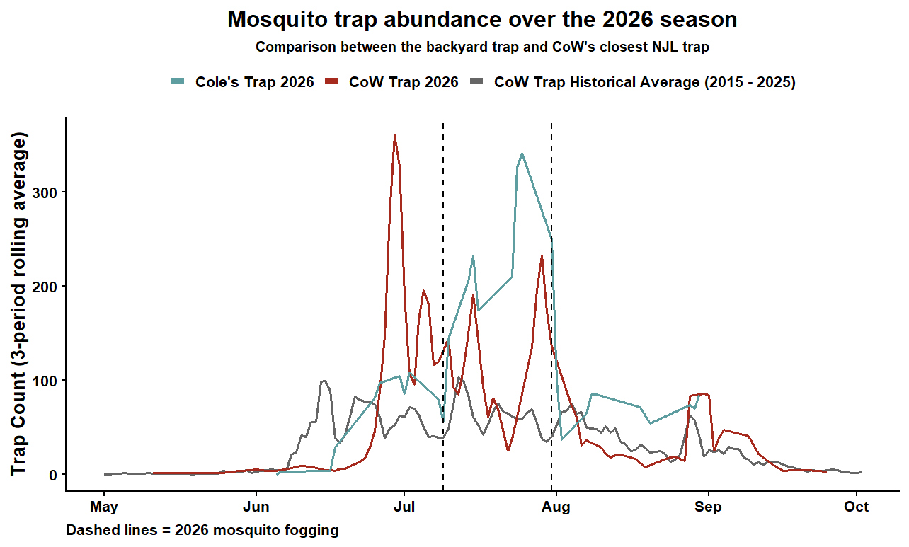

## You trap mosquitoes... in your backyard? 

Understandably, this is the first question everyone asks when I explain that I am collecting mosquitoes from my backyard. The short answer: curiosity. I often drive or walk past a wetland, ditch or patch of trees and wonder: *what mosquitoes are there? How many?* This summer, I realized that with the right equipment, I could start answering those questions myself. Science doesn't have to stay at the door when I leave my place or work or study.

I also wanted to explore questions like:

- How does weather affect mosquito abundance and species composition?
- What happens to mosquito populations after the city carries out mosquito fogging?
- Can I consistently trap and identify mosquitoes in my own backyard?
- Will I find any unexpected species?
- Establish a baseline and track how developments in the area impact mosquito fauna. 

This blog post follows my backyard mosquito trapping project throughout the summer, sharing what I found, what surprised me, and what I learned along the way.

## Citizen Science 

To get started with mosquito trapping, I first needed a trap. When I ran a mosquito surveillance program in Western Manitoba for two years, we used the [CDC Miniature Light Trap](https://www.johnwhock.com/products/mosquito-sandfly-traps/cdc-miniature-light-trap/) (with the light removed to reduce non-mosquito bycatch). The CDC Light Trap is the gold standard for adult mosquito surveillance and is very effective at attracting host-seeking female mosquitoes. 

However, they are very expensive and cost-prohibitive for hobbyist entomologists as a DIY option. After a bit of research, I discovered that CDC Light Traps can be 3D printed. [This publication](https://journals.plos.org/plosntds/article?id=10.1371/journal.pntd.0011899) describes their process in detail. At the same time, by sheer serendipity, my work colleague was presenting on her work involving 3D printed mosquito traps. I reached out to ask about the 3D print files, and not only did she graciously send me the print files, but she offered to send me an assembled trap if in return, I provide mosquito identification data throughout the summer which I was thrilled to do! 

  
  <small>TIMO-CS study logo</small>

Thus, I joined the [Tiger Mosquito Citizen Science (TIMO-CS) study](https://letstalkscience.ca/outreach/uwindsor/local-programs/timo-cs). The TIMO-CS study, a Public Health Agency of Canada and Let's Talk Science initiative that enlists volunteers to help monitor the spread of the invasive Asian tiger mosquito (*Aedes albopictus*). Since the initial index event in Windsor-Essex in 2016, *Ae. albopictus* has been considered to be established in the region of Canada. The project expands mosquito surveillance by collecting observations from areas where routine traps aren't located. 

Study participants receive a mosquito trap and supplies to collect mosquitoes in their backyards. Study participants range from citizens, academics, and government organizations. 

While *Aedes albopictus* has not been identified in Manitoba and is not known to exist in the province, my data serves as a negative control to validate statistical models (assuming I do not find *Aedes albopictus*). 

## Trapping and Identification

  
  <small>SLC trap setup</small>

To trap mosquitoes, I use a modified [Salt Lake City (SLC) trap](https://journals.plos.org/plosntds/article?id=10.1371/journal.pntd.0011899), which is a 3D printed version of the CDC Miniature Light Trap. Briefly, a compartment houses a fan below an opening. Carbon dioxide is used as bait (female mosquitoes are attracted to carbon dioxide as it indicates the presence of a bloodmeal) and is released via the tubing via the blue airstone. The fan pushes the carbon dioxide down to create a trail. When mosquitoes get close to the opening, the fan also functions to push the mosquitoes downwards into the bag and prevents mosquitoes from escaping (like Finding Nemo for mosquitoes). 

For a source of carbon dioxide, I buy dry ice nuggets by the kilogram. It is relatively cheap; about $5 per trap night. I try to trap 2-3x per week weather and time permitting. The trap is allowed to run for 24 hours or until the dry ice runs out. I try to time trapping with ideal weather conditions: warmer overnight temperatures, low wind, and no rain or stormy conditions. However, weather conditions can change without warning. 

After trapping, I bring the mosquitoes inside and keep the catch in the freezer for at least an hour to ensure mosquitoes are killed before identification. 

  
  <small>Microscope setup used for mosquito identification</small>

To identify mosquitoes, traps are emptied into a petri dish and are sorted and counted by species. I refer to a great resource by Aynsley Thielman and Fiona Hunter: [the Photographic Key to the Adult Female Mosquitoes (Diptera: Culicidae) of Canada](https://cjai.biologicalsurvey.ca/articles/th-04/). 

If there are any specimens too damaged identify, or missing diagnostic parts, they are left at the genus level (e.g., *Aedes sp.*). 

I use a relative cheap dissecting microscope I purchased off Amazon to identify mosquitoes, the [AmScope SE306R-PZ Forward Binocular Stereo Microscope](https://www.amazon.ca/dp/B005B1TR16?ref=ppx_yo2ov_dt_b_fed_asin_title). While not ideal for mass sorting, it does the job just fine and can magify at 20X, 40X, 60X and 80X. This comes in handy for viewing fine details such as tarsal claws. 

My general process is to sort mosquitoes by easy-to-identify mosquitoes (e.g., *Culex tarsalis*, *Aedes vexans*) that I can identify very quickly, and more difficult to ID mosquitoes. I'll then key out the difficult to ID mosquitoes after all of the "easy" ones are identified. For easy-to-identify mosquitoes, I spend a couple seconds looking at the specimen whereas the difficult species can take up to a couple minutes depending on the quality of the specimen. I'll then count all the specimens as I put them into tubes and log them into my electronic data sheet.

## Overview

From June 5, 2026 to August 30, 2026, there were <strong>30 trapping events</strong>; two events yielded zero mosquitoes. As expected, mosquito counts rose and fell throughout the summer season with peak counts occuring from mid June through to the end of July (Figure 1). In total, I caught <strong>3,311 mosquitoes</strong> with the highest number of mosquitoes in one trap being <strong>471</strong> on June 25. I identified <strong>17 unique mosquito species</strong> from four mosquito genera. All but 11 mosquitoes could be identified to species (Figure 2). Those that could not be identified to species were a result of significant damage to the specimen or missing diagnostic features.

The City of Winnipeg fogged for mosquitoes in my area two times in 2026. The first fogging event occurred on July 9 and was triggered by a "high" adulticide factor analysis (AFA). The AFA is a metric used to determine when fogging occurs for nuissance mosqutioes. It takes into account factors such as trap counts and weather. Fogging triggerd by a high AFA is subject to buffer zone regulations. The second trapping event occurred on July 31 and was triggered by a Ministerial "*Culex tarsalis* Order" ("Order" from here on out), which triggers fogging in response to a high risk of West Nile Virus (WNV). When an Order is issued, municipalities may ignore buffer zones. An Order takes into account mosquito pools positive for WNV, number of *Culex tarsalis* mosquitoes in traps, positive birds, horses, human cases, and weather factors that impact mosquito and virus activity.

After both fogging events, trap counts declined immediately. However, the effects of the first fogging event did not last long. However, after fogging, the trap composition switched from primarily *Aedes vexans* to *Culex tarsalis* (Figure 3). After the second fogging event, mosquito counts did drop drastically, however, the weather cooled significantly and likely contributed to the the decrease. My thinking is supported by the fact that counts stabilized shortly after fogging. Thus, if fogging did not occur, I hypothesize that counts would have dropped by the same degree. 

  
  
  
  

    <small>
      <strong>Figure 1</strong>. Bar plot showing trapping date on the x axis and the total number 
      of mosquitoes caught on the y axis. Bars are coloured by whether a fogging 
      event occurred on that date or not.
    </small>
  

  

## Species Composition

*Culex tarsalis* made up the majority of mosquitoes caught (61.9%; 2,050) while *Aedes vexans* came in second (30.1%; 995). *Culex restuans* (3.9%; 128) and *Coquillettidia perturbans* (2.0%; 65) made up the majority of the remaining specimens caught. The remainder of specimens made up an array of *Aedes* (woodland, salt-marsh and snowmelt species; many broad-banded *Aedes*) and *Culiseta* species. 

The composition was a bit surprising to me. Normally, I would expect the percentages of *Culex tarsalis* and *Aedes vexans* to be flipped, however, I suspect *Culex tarsalis* was so abundant this year due to the extreme heat Winnipeg experienced for much of the summer. *Culex tarsalis* thrives in hotter weather, while *Aedes vexans* thrives in more moderate temperatures ([Baril et al., 2023](https://doi.org/10.1186/s13071-023-05760-x)). 

I was also surprised to have not caught a single *Anopheles* mosquito. While I did not expect to get many, I did expect to at least get a few. 

  
  
  
  

    <small>
      <strong>Figure 2</strong>. Bar plot showing the total number of each species caught over the season.
    </small>
  

  

## Mosquito Activity 

The season started off with primarily *Aedes vexans* mosquitoes. After the first fogging event, *Aedes vexans* drops off while *Culex tarsalis* numbers increase considerably. While the *Culex tarsalis* increase and presence generally coincides with the WNV risk period, the large number of *Culex tarsalis* and the relatively low number of *Aedes vexans* is likely due to the extreme heat wave Winnipeg experienced (Figure 3).

After the second fogging event, both species decrease and *Culex tarsalis* bounces back slightly, and continues to decrease as temperatures cool into late August. Interestingly, *Aedes vexans* rises slowly as temperatures cool (Figure 3). 

  
  
  
  

    <small>
      <strong>Figure 3</strong>. Line plot showing trap counts over time for the two most abundant species in my trap. Dotted lines indicate mosquito fogging events.
    </small>
  

  

Figure 4 shows 3-period rolling means for my trap (blue), the City's trap in 2026, and the 2015-2025 historical average for the City trap (grey). The city trap closest to me, I believe, is located in Kildonan park, roughly 2 kilometres from where I live. Mosquito traps are generally only indicative of mosquito activity in a 1 city block radius. Thus, trap counts and compositions can differ drastically for traps even relatively close together and comparing traps at such a distance is futile. 

In 2026, the city trap peaks in early July, whereas mine peaks in August. However, for both my trap and the city trap, trap counts were drastically higher than the 10-year historical average. What I would gleam from this is that in the immediate vicinity of either trap, mosquito activity was different at different times of the year. Whereas the city trap is in an urban park with a lot of tree and ground cover, mine if half surrounded by housing developments and half by a large open undeveloped field which could account for differences in composition. 

  
  
  
  

    <small>
      <strong>Figure 4</strong>. 3-period rolling mean trap counts for my trap (blue), the City 2026 trap (red) and the City's 10-year historical average for the same trap (grey).
    </small>
  

  

## Exploratory Weather Analysis 

One thing I wanted to attempt to answer was which weather variables and preceding weather windows show associations with mosquito trap counts, and if so, what direction and magnitude are these associations?

Thus, I conducted an exploratory analysis to examine potential relationships between weather conditions and mosquito abundance. The analysis included 30 trapping events conducted at a single location during one mosquito season. Because of the relatively small sample size and limited spatial and temporal coverage, the analysis was intended to identify patterns and generate hypotheses rather than establish causal relationships or develop a predictive model.

For each trapping event, mosquito abundance was calculated as the total number of mosquitoes collected (or species for the specific-specific analysis). Weather conditions during the 0 to 28 days preceding each trapping event were evaluated to investigate whether recent or longer-term weather conditions were associated with mosquito abundance. Weather variables included measures of temperature, precipitation, relative humidity, wind speed, and accumulated degree days.

Each weather variable and preceding weather window was examined separately using simple linear regression, with mosquito abundance as the response variable and the weather measurement as the explanatory variable. Separate models were used rather than a multivariable model because the limited number of trapping events would not support reliable estimation of the independent effects of numerous, often highly correlated weather variables.

The regression coefficient (slope) was used as a measure of the direction and magnitude of each relationship. For example, a coefficient of +5 for mean temperature would indicate that a one-degree increase in mean temperature was associated with an estimated increase of five mosquitoes per trapping event. Positive coefficients therefore indicate associations with increased mosquito abundance, while negative coefficients indicate associations with decreased abundance.

For each regression, a p-value was calculated to assess the statistical evidence for a relationship between the weather variable and mosquito abundance. Relationships with p < 0.05 were identified as statistically significant. Because the same weather variable was examined across multiple overlapping weather windows, conducting many statistical tests increases the probability of identifying an apparently significant relationship by chance. Benjamini–Hochberg correction was therefore applied across the 29 weather windows for each weather variable to control the false discovery rate. Results that remained significant following this correction were identified separately.

The weather windows are not independent; for example, weather summarized over the preceding 14 and 15 days contains largely the same observations. Consequently, patterns occurring across several neighbouring windows were considered more informative than an isolated significant result at a single window.


These analyses should be interpreted as exploratory associations. Weather variables are themselves correlated, mosquito abundance varies seasonally, and trapping was conducted at only one location during one season. The results therefore do not demonstrate that an individual weather variable caused a change in mosquito abundance or represents an independent predictor of mosquito abundance.



Weather data was obtained from the closest Environment and Climate Change Canada weather station (Winnipeg A CS), which is approximately 11 kilometres away from the trapping location. It is possible that weather is experienced at the trapping location that is not measured, or that weather that is measured at the weather station does not occur at the trapping location.



When all mosquitoes are aggregated, there are few statistically significant relationships, which makes sense as different species and genera have different biology. Thus, I analyzed the two most prominent species, *Culex tarsalis* and *Aedes vexans*. 


### *Culex tarsalis*


For *Culex tarsalis* there is a temperature pattern at the 1-2 day window preceding trapping. There are also associations between temperature 11-14 days preceding the trapping date. This effect is consistent with [models in literature](https://link.springer.com/article/10.1186/s13071-023-05760-x) and what we know in general about the biology of *Culex tarsalis*: they like it hot. Positive precipitation associations were also observed at the 26-day window.


  
  <table class="gt_table" data-quarto-disable-processing="false" data-quarto-bootstrap="false" style="-webkit-font-smoothing: antialiased; -moz-osx-font-smoothing: grayscale; font-family: system-ui, 'Segoe UI', Roboto, Helvetica, Arial, sans-serif, 'Apple Color Emoji', 'Segoe UI Emoji', 'Segoe UI Symbol', 'Noto Color Emoji'; display: table; border-collapse: collapse; line-height: normal; margin-left: auto; margin-right: auto; color: #333333; font-size: 13px; font-weight: normal; font-style: normal; background-color: #FFFFFF; width: 100%; border-top-style: solid; border-top-width: 2px; border-top-color: #A8A8A8; border-right-style: none; border-right-width: 2px; border-right-color: #D3D3D3; border-bottom-style: solid; border-bottom-width: 2px; border-bottom-color: #A8A8A8; border-left-style: none; border-left-width: 2px; border-left-color: #D3D3D3;" width="100%" bgcolor="#FFFFFF">
  <thead style="border-style: none;">
    <tr class="gt_heading" style="border-style: none; background-color: #FFFFFF; text-align: center; border-bottom-color: #FFFFFF; border-left-style: none; border-left-width: 1px; border-left-color: #D3D3D3; border-right-style: none; border-right-width: 1px; border-right-color: #D3D3D3;" bgcolor="#FFFFFF" align="center">
      <td colspan="11" class="gt_heading gt_title gt_font_normal" style="border-style: none; color: #333333; font-size: 18px; padding-top: 4px; padding-bottom: 4px; padding-left: 5px; padding-right: 5px; border-bottom-width: 0; background-color: #FFFFFF; text-align: center; border-bottom-color: #FFFFFF; border-left-style: none; border-left-width: 1px; border-left-color: #D3D3D3; border-right-style: none; border-right-width: 1px; border-right-color: #D3D3D3; font-weight: normal;" bgcolor="#FFFFFF" align="center"><strong style="margin-top: 0; margin-bottom: 0;">Weather Relationships with Mosquito Trap Counts - <i>Culex tarsalis</i></strong></td>
    </tr>
    <tr class="gt_heading" style="border-style: none; background-color: #FFFFFF; text-align: center; border-bottom-color: #FFFFFF; border-left-style: none; border-left-width: 1px; border-left-color: #D3D3D3; border-right-style: none; border-right-width: 1px; border-right-color: #D3D3D3;" bgcolor="#FFFFFF" align="center">
      <td colspan="11" class="gt_heading gt_subtitle gt_font_normal gt_bottom_border" style="border-style: none; color: #333333; font-size: 13px; padding-top: 3px; padding-bottom: 5px; padding-left: 5px; padding-right: 5px; border-top-color: #FFFFFF; border-top-width: 0; background-color: #FFFFFF; text-align: center; border-left-style: none; border-left-width: 1px; border-left-color: #D3D3D3; border-right-style: none; border-right-width: 1px; border-right-color: #D3D3D3; border-bottom-style: solid; border-bottom-width: 2px; border-bottom-color: #D3D3D3; font-weight: normal;" bgcolor="#FFFFFF" align="center">Estimated change in mosquito count per 1-unit increase in each weather variable</td>
    </tr>
    <tr class="gt_col_headings" style="border-style: none; border-top-style: solid; border-top-width: 2px; border-top-color: #D3D3D3; border-bottom-style: solid; border-bottom-width: 2px; border-bottom-color: #D3D3D3; border-left-style: none; border-left-width: 1px; border-left-color: #D3D3D3; border-right-style: none; border-right-width: 1px; border-right-color: #D3D3D3;">
      <th class="gt_col_heading gt_columns_bottom_border gt_left" rowspan="1" colspan="1" scope="col" id="a::stub" style="border-style: none; color: #333333; background-color: #FFFFFF; font-size: 12px; font-weight: normal; text-transform: inherit; border-left-style: none; border-left-width: 1px; border-left-color: #D3D3D3; border-right-style: none; border-right-width: 1px; border-right-color: #D3D3D3; vertical-align: bottom; padding-top: 5px; padding-bottom: 6px; padding-left: 5px; padding-right: 5px; overflow-x: hidden; text-align: left;" bgcolor="#FFFFFF" valign="bottom" align="left">Days</th>
      <th class="gt_col_heading gt_columns_bottom_border gt_center" rowspan="1" colspan="1" style="border-style: none; color: #333333; background-color: #FFFFFF; font-size: 12px; text-transform: inherit; border-left-style: none; border-left-width: 1px; border-left-color: #D3D3D3; border-right-style: none; border-right-width: 1px; border-right-color: #D3D3D3; vertical-align: bottom; padding-top: 5px; padding-bottom: 6px; padding-left: 5px; padding-right: 5px; overflow-x: hidden; text-align: center; font-weight: bold;" scope="col" id="Degree-Days-(base-10°C)" bgcolor="#FFFFFF" valign="bottom" align="center">Degree Days (base 10°C)</th>
      <th class="gt_col_heading gt_columns_bottom_border gt_center" rowspan="1" colspan="1" style="border-style: none; color: #333333; background-color: #FFFFFF; font-size: 12px; text-transform: inherit; border-left-style: none; border-left-width: 1px; border-left-color: #D3D3D3; border-right-style: none; border-right-width: 1px; border-right-color: #D3D3D3; vertical-align: bottom; padding-top: 5px; padding-bottom: 6px; padding-left: 5px; padding-right: 5px; overflow-x: hidden; text-align: center; font-weight: bold;" scope="col" id="Largest-Rainfall-Event-(mm)" bgcolor="#FFFFFF" valign="bottom" align="center">Largest Rainfall Event (mm)</th>
      <th class="gt_col_heading gt_columns_bottom_border gt_center" rowspan="1" colspan="1" style="border-style: none; color: #333333; background-color: #FFFFFF; font-size: 12px; text-transform: inherit; border-left-style: none; border-left-width: 1px; border-left-color: #D3D3D3; border-right-style: none; border-right-width: 1px; border-right-color: #D3D3D3; vertical-align: bottom; padding-top: 5px; padding-bottom: 6px; padding-left: 5px; padding-right: 5px; overflow-x: hidden; text-align: center; font-weight: bold;" scope="col" id="Max-Temperature-(°C)" bgcolor="#FFFFFF" valign="bottom" align="center">Max Temperature (°C)</th>
      <th class="gt_col_heading gt_columns_bottom_border gt_center" rowspan="1" colspan="1" style="border-style: none; color: #333333; background-color: #FFFFFF; font-size: 12px; text-transform: inherit; border-left-style: none; border-left-width: 1px; border-left-color: #D3D3D3; border-right-style: none; border-right-width: 1px; border-right-color: #D3D3D3; vertical-align: bottom; padding-top: 5px; padding-bottom: 6px; padding-left: 5px; padding-right: 5px; overflow-x: hidden; text-align: center; font-weight: bold;" scope="col" id="Mean-Relative-Humidity-(%)" bgcolor="#FFFFFF" valign="bottom" align="center">Mean Relative Humidity (%)</th>
      <th class="gt_col_heading gt_columns_bottom_border gt_center" rowspan="1" colspan="1" style="border-style: none; color: #333333; background-color: #FFFFFF; font-size: 12px; text-transform: inherit; border-left-style: none; border-left-width: 1px; border-left-color: #D3D3D3; border-right-style: none; border-right-width: 1px; border-right-color: #D3D3D3; vertical-align: bottom; padding-top: 5px; padding-bottom: 6px; padding-left: 5px; padding-right: 5px; overflow-x: hidden; text-align: center; font-weight: bold;" scope="col" id="Mean-Temperature-(°C)" bgcolor="#FFFFFF" valign="bottom" align="center">Mean Temperature (°C)</th>
      <th class="gt_col_heading gt_columns_bottom_border gt_center" rowspan="1" colspan="1" style="border-style: none; color: #333333; background-color: #FFFFFF; font-size: 12px; text-transform: inherit; border-left-style: none; border-left-width: 1px; border-left-color: #D3D3D3; border-right-style: none; border-right-width: 1px; border-right-color: #D3D3D3; vertical-align: bottom; padding-top: 5px; padding-bottom: 6px; padding-left: 5px; padding-right: 5px; overflow-x: hidden; text-align: center; font-weight: bold;" scope="col" id="Mean-Wind-Speed-(km/hr)" bgcolor="#FFFFFF" valign="bottom" align="center">Mean Wind Speed (km/hr)</th>
      <th class="gt_col_heading gt_columns_bottom_border gt_center" rowspan="1" colspan="1" style="border-style: none; color: #333333; background-color: #FFFFFF; font-size: 12px; text-transform: inherit; border-left-style: none; border-left-width: 1px; border-left-color: #D3D3D3; border-right-style: none; border-right-width: 1px; border-right-color: #D3D3D3; vertical-align: bottom; padding-top: 5px; padding-bottom: 6px; padding-left: 5px; padding-right: 5px; overflow-x: hidden; text-align: center; font-weight: bold;" scope="col" id="Min-Temperature-(°C)" bgcolor="#FFFFFF" valign="bottom" align="center">Min Temperature (°C)</th>
      <th class="gt_col_heading gt_columns_bottom_border gt_center" rowspan="1" colspan="1" style="border-style: none; color: #333333; background-color: #FFFFFF; font-size: 12px; text-transform: inherit; border-left-style: none; border-left-width: 1px; border-left-color: #D3D3D3; border-right-style: none; border-right-width: 1px; border-right-color: #D3D3D3; vertical-align: bottom; padding-top: 5px; padding-bottom: 6px; padding-left: 5px; padding-right: 5px; overflow-x: hidden; text-align: center; font-weight: bold;" scope="col" id="Number-of-Rain-Days-(days)" bgcolor="#FFFFFF" valign="bottom" align="center">Number of Rain Days (days)</th>
      <th class="gt_col_heading gt_columns_bottom_border gt_center" rowspan="1" colspan="1" style="border-style: none; color: #333333; background-color: #FFFFFF; font-size: 12px; text-transform: inherit; border-left-style: none; border-left-width: 1px; border-left-color: #D3D3D3; border-right-style: none; border-right-width: 1px; border-right-color: #D3D3D3; vertical-align: bottom; padding-top: 5px; padding-bottom: 6px; padding-left: 5px; padding-right: 5px; overflow-x: hidden; text-align: center; font-weight: bold;" scope="col" id="Rainfall-SD-(mm)" bgcolor="#FFFFFF" valign="bottom" align="center">Rainfall SD (mm)</th>
      <th class="gt_col_heading gt_columns_bottom_border gt_center" rowspan="1" colspan="1" style="border-style: none; color: #333333; background-color: #FFFFFF; font-size: 12px; text-transform: inherit; border-left-style: none; border-left-width: 1px; border-left-color: #D3D3D3; border-right-style: none; border-right-width: 1px; border-right-color: #D3D3D3; vertical-align: bottom; padding-top: 5px; padding-bottom: 6px; padding-left: 5px; padding-right: 5px; overflow-x: hidden; text-align: center; font-weight: bold;" scope="col" id="Total-Precipitation-(mm)" bgcolor="#FFFFFF" valign="bottom" align="center">Total Precipitation (mm)</th>
    </tr>
  </thead>
  <tbody class="gt_table_body" style="border-style: none; border-top-style: solid; border-top-width: 2px; border-top-color: #D3D3D3; border-bottom-style: solid; border-bottom-width: 2px; border-bottom-color: #D3D3D3;">
    <tr style="border-style: none;"><th id="stub_1_1" scope="row" class="gt_row gt_center gt_stub" style="border-style: none; padding-top: 5px; padding-bottom: 5px; margin: 10px; border-top-style: solid; border-top-width: 1px; border-top-color: #D3D3D3; border-left-style: none; border-left-width: 1px; border-left-color: #D3D3D3; vertical-align: middle; overflow-x: hidden; color: #333333; background-color: #FFFFFF; font-size: 100%; text-transform: inherit; border-right-style: solid; border-right-width: 2px; border-right-color: #D3D3D3; padding-left: 5px; padding-right: 5px; text-align: center; font-weight: bold;" valign="middle" bgcolor="#FFFFFF" align="center">0</th>
<td headers="stub_1_1 Degree Days (base 10°C)" class="gt_row gt_center" style="border-style: none; padding-top: 5px; padding-bottom: 5px; padding-left: 5px; padding-right: 5px; margin: 10px; border-top-style: solid; border-top-width: 1px; border-top-color: #D3D3D3; border-left-style: none; border-left-width: 1px; border-left-color: #D3D3D3; border-right-style: none; border-right-width: 1px; border-right-color: #D3D3D3; vertical-align: middle; overflow-x: hidden; text-align: center;" valign="middle" align="center">+9.7</td>
<td headers="stub_1_1 Largest Rainfall Event (mm)" class="gt_row gt_center" style="border-style: none; padding-top: 5px; padding-bottom: 5px; padding-left: 5px; padding-right: 5px; margin: 10px; border-top-style: solid; border-top-width: 1px; border-top-color: #D3D3D3; border-left-style: none; border-left-width: 1px; border-left-color: #D3D3D3; border-right-style: none; border-right-width: 1px; border-right-color: #D3D3D3; vertical-align: middle; overflow-x: hidden; text-align: center;" valign="middle" align="center">+1.9</td>
<td headers="stub_1_1 Max Temperature (°C)" class="gt_row gt_center" style="border-style: none; padding-top: 5px; padding-bottom: 5px; padding-left: 5px; padding-right: 5px; margin: 10px; border-top-style: solid; border-top-width: 1px; border-top-color: #D3D3D3; border-left-style: none; border-left-width: 1px; border-left-color: #D3D3D3; border-right-style: none; border-right-width: 1px; border-right-color: #D3D3D3; vertical-align: middle; overflow-x: hidden; text-align: center;" valign="middle" align="center">+7.2</td>
<td headers="stub_1_1 Mean Relative Humidity (%)" class="gt_row gt_center" style="border-style: none; padding-top: 5px; padding-bottom: 5px; padding-left: 5px; padding-right: 5px; margin: 10px; border-top-style: solid; border-top-width: 1px; border-top-color: #D3D3D3; border-left-style: none; border-left-width: 1px; border-left-color: #D3D3D3; border-right-style: none; border-right-width: 1px; border-right-color: #D3D3D3; vertical-align: middle; overflow-x: hidden; text-align: center;" valign="middle" align="center">+2.8</td>
<td headers="stub_1_1 Mean Temperature (°C)" class="gt_row gt_center" style="border-style: none; padding-top: 5px; padding-bottom: 5px; padding-left: 5px; padding-right: 5px; margin: 10px; border-top-style: solid; border-top-width: 1px; border-top-color: #D3D3D3; border-left-style: none; border-left-width: 1px; border-left-color: #D3D3D3; border-right-style: none; border-right-width: 1px; border-right-color: #D3D3D3; vertical-align: middle; overflow-x: hidden; text-align: center;" valign="middle" align="center">+10.7</td>
<td headers="stub_1_1 Mean Wind Speed (km/hr)" class="gt_row gt_center" style="border-style: none; padding-top: 5px; padding-bottom: 5px; padding-left: 5px; padding-right: 5px; margin: 10px; border-top-style: solid; border-top-width: 1px; border-top-color: #D3D3D3; border-left-style: none; border-left-width: 1px; border-left-color: #D3D3D3; border-right-style: none; border-right-width: 1px; border-right-color: #D3D3D3; vertical-align: middle; overflow-x: hidden; text-align: center;" valign="middle" align="center">-1.5</td>
<td headers="stub_1_1 Min Temperature (°C)" class="gt_row gt_center" style="border-style: none; padding-top: 5px; padding-bottom: 5px; padding-left: 5px; padding-right: 5px; margin: 10px; border-top-style: solid; border-top-width: 1px; border-top-color: #D3D3D3; border-left-style: none; border-left-width: 1px; border-left-color: #D3D3D3; border-right-style: none; border-right-width: 1px; border-right-color: #D3D3D3; vertical-align: middle; overflow-x: hidden; text-align: center;" valign="middle" align="center">+7.7</td>
<td headers="stub_1_1 Number of Rain Days (days)" class="gt_row gt_center" style="border-style: none; padding-top: 5px; padding-bottom: 5px; padding-left: 5px; padding-right: 5px; margin: 10px; border-top-style: solid; border-top-width: 1px; border-top-color: #D3D3D3; border-left-style: none; border-left-width: 1px; border-left-color: #D3D3D3; border-right-style: none; border-right-width: 1px; border-right-color: #D3D3D3; vertical-align: middle; overflow-x: hidden; text-align: center;" valign="middle" align="center">-0.8</td>
<td headers="stub_1_1 Rainfall SD (mm)" class="gt_row gt_center" style="border-style: none; padding-top: 5px; padding-bottom: 5px; padding-left: 5px; padding-right: 5px; margin: 10px; border-top-style: solid; border-top-width: 1px; border-top-color: #D3D3D3; border-left-style: none; border-left-width: 1px; border-left-color: #D3D3D3; border-right-style: none; border-right-width: 1px; border-right-color: #D3D3D3; vertical-align: middle; overflow-x: hidden; text-align: center;" valign="middle" align="center">NA</td>
<td headers="stub_1_1 Total Precipitation (mm)" class="gt_row gt_center" style="border-style: none; padding-top: 5px; padding-bottom: 5px; padding-left: 5px; padding-right: 5px; margin: 10px; border-top-style: solid; border-top-width: 1px; border-top-color: #D3D3D3; border-left-style: none; border-left-width: 1px; border-left-color: #D3D3D3; border-right-style: none; border-right-width: 1px; border-right-color: #D3D3D3; vertical-align: middle; overflow-x: hidden; text-align: center;" valign="middle" align="center">+2.2</td></tr>
    <tr style="border-style: none;"><th id="stub_1_2" scope="row" class="gt_row gt_center gt_stub" style="border-style: none; padding-top: 5px; padding-bottom: 5px; margin: 10px; border-top-style: solid; border-top-width: 1px; border-top-color: #D3D3D3; border-left-style: none; border-left-width: 1px; border-left-color: #D3D3D3; vertical-align: middle; overflow-x: hidden; color: #333333; background-color: #FFFFFF; font-size: 100%; text-transform: inherit; border-right-style: solid; border-right-width: 2px; border-right-color: #D3D3D3; padding-left: 5px; padding-right: 5px; text-align: center; font-weight: bold;" valign="middle" bgcolor="#FFFFFF" align="center">1</th>
<td headers="stub_1_2 Degree Days (base 10°C)" class="gt_row gt_center" style="border-style: none; padding-top: 5px; padding-bottom: 5px; padding-left: 5px; padding-right: 5px; margin: 10px; border-top-style: solid; border-top-width: 1px; border-top-color: #D3D3D3; border-left-style: none; border-left-width: 1px; border-left-color: #D3D3D3; border-right-style: none; border-right-width: 1px; border-right-color: #D3D3D3; vertical-align: middle; overflow-x: hidden; text-align: center; background-color: #D1E7DD; font-weight: bold;" bgcolor="#D1E7DD" valign="middle" align="center">+15.5*†</td>
<td headers="stub_1_2 Largest Rainfall Event (mm)" class="gt_row gt_center" style="border-style: none; padding-top: 5px; padding-bottom: 5px; padding-left: 5px; padding-right: 5px; margin: 10px; border-top-style: solid; border-top-width: 1px; border-top-color: #D3D3D3; border-left-style: none; border-left-width: 1px; border-left-color: #D3D3D3; border-right-style: none; border-right-width: 1px; border-right-color: #D3D3D3; vertical-align: middle; overflow-x: hidden; text-align: center;" valign="middle" align="center">-2.2</td>
<td headers="stub_1_2 Max Temperature (°C)" class="gt_row gt_center" style="border-style: none; padding-top: 5px; padding-bottom: 5px; padding-left: 5px; padding-right: 5px; margin: 10px; border-top-style: solid; border-top-width: 1px; border-top-color: #D3D3D3; border-left-style: none; border-left-width: 1px; border-left-color: #D3D3D3; border-right-style: none; border-right-width: 1px; border-right-color: #D3D3D3; vertical-align: middle; overflow-x: hidden; text-align: center; background-color: #D1E7DD; font-weight: bold;" bgcolor="#D1E7DD" valign="middle" align="center">+19.6*†</td>
<td headers="stub_1_2 Mean Relative Humidity (%)" class="gt_row gt_center" style="border-style: none; padding-top: 5px; padding-bottom: 5px; padding-left: 5px; padding-right: 5px; margin: 10px; border-top-style: solid; border-top-width: 1px; border-top-color: #D3D3D3; border-left-style: none; border-left-width: 1px; border-left-color: #D3D3D3; border-right-style: none; border-right-width: 1px; border-right-color: #D3D3D3; vertical-align: middle; overflow-x: hidden; text-align: center;" valign="middle" align="center">-1.1</td>
<td headers="stub_1_2 Mean Temperature (°C)" class="gt_row gt_center" style="border-style: none; padding-top: 5px; padding-bottom: 5px; padding-left: 5px; padding-right: 5px; margin: 10px; border-top-style: solid; border-top-width: 1px; border-top-color: #D3D3D3; border-left-style: none; border-left-width: 1px; border-left-color: #D3D3D3; border-right-style: none; border-right-width: 1px; border-right-color: #D3D3D3; vertical-align: middle; overflow-x: hidden; text-align: center; background-color: #D1E7DD; font-weight: bold;" bgcolor="#D1E7DD" valign="middle" align="center">+20.9*†</td>
<td headers="stub_1_2 Mean Wind Speed (km/hr)" class="gt_row gt_center" style="border-style: none; padding-top: 5px; padding-bottom: 5px; padding-left: 5px; padding-right: 5px; margin: 10px; border-top-style: solid; border-top-width: 1px; border-top-color: #D3D3D3; border-left-style: none; border-left-width: 1px; border-left-color: #D3D3D3; border-right-style: none; border-right-width: 1px; border-right-color: #D3D3D3; vertical-align: middle; overflow-x: hidden; text-align: center; background-color: #FFF3CD; font-weight: bold;" bgcolor="#FFF3CD" valign="middle" align="center">+6.7*</td>
<td headers="stub_1_2 Min Temperature (°C)" class="gt_row gt_center" style="border-style: none; padding-top: 5px; padding-bottom: 5px; padding-left: 5px; padding-right: 5px; margin: 10px; border-top-style: solid; border-top-width: 1px; border-top-color: #D3D3D3; border-left-style: none; border-left-width: 1px; border-left-color: #D3D3D3; border-right-style: none; border-right-width: 1px; border-right-color: #D3D3D3; vertical-align: middle; overflow-x: hidden; text-align: center; background-color: #FFF3CD; font-weight: bold;" bgcolor="#FFF3CD" valign="middle" align="center">+13.4*</td>
<td headers="stub_1_2 Number of Rain Days (days)" class="gt_row gt_center" style="border-style: none; padding-top: 5px; padding-bottom: 5px; padding-left: 5px; padding-right: 5px; margin: 10px; border-top-style: solid; border-top-width: 1px; border-top-color: #D3D3D3; border-left-style: none; border-left-width: 1px; border-left-color: #D3D3D3; border-right-style: none; border-right-width: 1px; border-right-color: #D3D3D3; vertical-align: middle; overflow-x: hidden; text-align: center;" valign="middle" align="center">+31.3</td>
<td headers="stub_1_2 Rainfall SD (mm)" class="gt_row gt_center" style="border-style: none; padding-top: 5px; padding-bottom: 5px; padding-left: 5px; padding-right: 5px; margin: 10px; border-top-style: solid; border-top-width: 1px; border-top-color: #D3D3D3; border-left-style: none; border-left-width: 1px; border-left-color: #D3D3D3; border-right-style: none; border-right-width: 1px; border-right-color: #D3D3D3; vertical-align: middle; overflow-x: hidden; text-align: center;" valign="middle" align="center">NA</td>
<td headers="stub_1_2 Total Precipitation (mm)" class="gt_row gt_center" style="border-style: none; padding-top: 5px; padding-bottom: 5px; padding-left: 5px; padding-right: 5px; margin: 10px; border-top-style: solid; border-top-width: 1px; border-top-color: #D3D3D3; border-left-style: none; border-left-width: 1px; border-left-color: #D3D3D3; border-right-style: none; border-right-width: 1px; border-right-color: #D3D3D3; vertical-align: middle; overflow-x: hidden; text-align: center;" valign="middle" align="center">-1.9</td></tr>
    <tr style="border-style: none;"><th id="stub_1_3" scope="row" class="gt_row gt_center gt_stub" style="border-style: none; padding-top: 5px; padding-bottom: 5px; margin: 10px; border-top-style: solid; border-top-width: 1px; border-top-color: #D3D3D3; border-left-style: none; border-left-width: 1px; border-left-color: #D3D3D3; vertical-align: middle; overflow-x: hidden; color: #333333; background-color: #FFFFFF; font-size: 100%; text-transform: inherit; border-right-style: solid; border-right-width: 2px; border-right-color: #D3D3D3; padding-left: 5px; padding-right: 5px; text-align: center; font-weight: bold;" valign="middle" bgcolor="#FFFFFF" align="center">2</th>
<td headers="stub_1_3 Degree Days (base 10°C)" class="gt_row gt_center" style="border-style: none; padding-top: 5px; padding-bottom: 5px; padding-left: 5px; padding-right: 5px; margin: 10px; border-top-style: solid; border-top-width: 1px; border-top-color: #D3D3D3; border-left-style: none; border-left-width: 1px; border-left-color: #D3D3D3; border-right-style: none; border-right-width: 1px; border-right-color: #D3D3D3; vertical-align: middle; overflow-x: hidden; text-align: center; background-color: #D1E7DD; font-weight: bold;" bgcolor="#D1E7DD" valign="middle" align="center">+11.2*†</td>
<td headers="stub_1_3 Largest Rainfall Event (mm)" class="gt_row gt_center" style="border-style: none; padding-top: 5px; padding-bottom: 5px; padding-left: 5px; padding-right: 5px; margin: 10px; border-top-style: solid; border-top-width: 1px; border-top-color: #D3D3D3; border-left-style: none; border-left-width: 1px; border-left-color: #D3D3D3; border-right-style: none; border-right-width: 1px; border-right-color: #D3D3D3; vertical-align: middle; overflow-x: hidden; text-align: center;" valign="middle" align="center">-4.2</td>
<td headers="stub_1_3 Max Temperature (°C)" class="gt_row gt_center" style="border-style: none; padding-top: 5px; padding-bottom: 5px; padding-left: 5px; padding-right: 5px; margin: 10px; border-top-style: solid; border-top-width: 1px; border-top-color: #D3D3D3; border-left-style: none; border-left-width: 1px; border-left-color: #D3D3D3; border-right-style: none; border-right-width: 1px; border-right-color: #D3D3D3; vertical-align: middle; overflow-x: hidden; text-align: center; background-color: #FFF3CD; font-weight: bold;" bgcolor="#FFF3CD" valign="middle" align="center">+11.3*</td>
<td headers="stub_1_3 Mean Relative Humidity (%)" class="gt_row gt_center" style="border-style: none; padding-top: 5px; padding-bottom: 5px; padding-left: 5px; padding-right: 5px; margin: 10px; border-top-style: solid; border-top-width: 1px; border-top-color: #D3D3D3; border-left-style: none; border-left-width: 1px; border-left-color: #D3D3D3; border-right-style: none; border-right-width: 1px; border-right-color: #D3D3D3; vertical-align: middle; overflow-x: hidden; text-align: center;" valign="middle" align="center">-3.2</td>
<td headers="stub_1_3 Mean Temperature (°C)" class="gt_row gt_center" style="border-style: none; padding-top: 5px; padding-bottom: 5px; padding-left: 5px; padding-right: 5px; margin: 10px; border-top-style: solid; border-top-width: 1px; border-top-color: #D3D3D3; border-left-style: none; border-left-width: 1px; border-left-color: #D3D3D3; border-right-style: none; border-right-width: 1px; border-right-color: #D3D3D3; vertical-align: middle; overflow-x: hidden; text-align: center; background-color: #FFF3CD; font-weight: bold;" bgcolor="#FFF3CD" valign="middle" align="center">+13.0*</td>
<td headers="stub_1_3 Mean Wind Speed (km/hr)" class="gt_row gt_center" style="border-style: none; padding-top: 5px; padding-bottom: 5px; padding-left: 5px; padding-right: 5px; margin: 10px; border-top-style: solid; border-top-width: 1px; border-top-color: #D3D3D3; border-left-style: none; border-left-width: 1px; border-left-color: #D3D3D3; border-right-style: none; border-right-width: 1px; border-right-color: #D3D3D3; vertical-align: middle; overflow-x: hidden; text-align: center;" valign="middle" align="center">+3.4</td>
<td headers="stub_1_3 Min Temperature (°C)" class="gt_row gt_center" style="border-style: none; padding-top: 5px; padding-bottom: 5px; padding-left: 5px; padding-right: 5px; margin: 10px; border-top-style: solid; border-top-width: 1px; border-top-color: #D3D3D3; border-left-style: none; border-left-width: 1px; border-left-color: #D3D3D3; border-right-style: none; border-right-width: 1px; border-right-color: #D3D3D3; vertical-align: middle; overflow-x: hidden; text-align: center; background-color: #FFF3CD; font-weight: bold;" bgcolor="#FFF3CD" valign="middle" align="center">+10.9*</td>
<td headers="stub_1_3 Number of Rain Days (days)" class="gt_row gt_center" style="border-style: none; padding-top: 5px; padding-bottom: 5px; padding-left: 5px; padding-right: 5px; margin: 10px; border-top-style: solid; border-top-width: 1px; border-top-color: #D3D3D3; border-left-style: none; border-left-width: 1px; border-left-color: #D3D3D3; border-right-style: none; border-right-width: 1px; border-right-color: #D3D3D3; vertical-align: middle; overflow-x: hidden; text-align: center;" valign="middle" align="center">-47.6</td>
<td headers="stub_1_3 Rainfall SD (mm)" class="gt_row gt_center" style="border-style: none; padding-top: 5px; padding-bottom: 5px; padding-left: 5px; padding-right: 5px; margin: 10px; border-top-style: solid; border-top-width: 1px; border-top-color: #D3D3D3; border-left-style: none; border-left-width: 1px; border-left-color: #D3D3D3; border-right-style: none; border-right-width: 1px; border-right-color: #D3D3D3; vertical-align: middle; overflow-x: hidden; text-align: center;" valign="middle" align="center">-5.8</td>
<td headers="stub_1_3 Total Precipitation (mm)" class="gt_row gt_center" style="border-style: none; padding-top: 5px; padding-bottom: 5px; padding-left: 5px; padding-right: 5px; margin: 10px; border-top-style: solid; border-top-width: 1px; border-top-color: #D3D3D3; border-left-style: none; border-left-width: 1px; border-left-color: #D3D3D3; border-right-style: none; border-right-width: 1px; border-right-color: #D3D3D3; vertical-align: middle; overflow-x: hidden; text-align: center;" valign="middle" align="center">-3.8</td></tr>
    <tr style="border-style: none;"><th id="stub_1_4" scope="row" class="gt_row gt_center gt_stub" style="border-style: none; padding-top: 5px; padding-bottom: 5px; margin: 10px; border-top-style: solid; border-top-width: 1px; border-top-color: #D3D3D3; border-left-style: none; border-left-width: 1px; border-left-color: #D3D3D3; vertical-align: middle; overflow-x: hidden; color: #333333; background-color: #FFFFFF; font-size: 100%; text-transform: inherit; border-right-style: solid; border-right-width: 2px; border-right-color: #D3D3D3; padding-left: 5px; padding-right: 5px; text-align: center; font-weight: bold;" valign="middle" bgcolor="#FFFFFF" align="center">3</th>
<td headers="stub_1_4 Degree Days (base 10°C)" class="gt_row gt_center" style="border-style: none; padding-top: 5px; padding-bottom: 5px; padding-left: 5px; padding-right: 5px; margin: 10px; border-top-style: solid; border-top-width: 1px; border-top-color: #D3D3D3; border-left-style: none; border-left-width: 1px; border-left-color: #D3D3D3; border-right-style: none; border-right-width: 1px; border-right-color: #D3D3D3; vertical-align: middle; overflow-x: hidden; text-align: center;" valign="middle" align="center">+5.2</td>
<td headers="stub_1_4 Largest Rainfall Event (mm)" class="gt_row gt_center" style="border-style: none; padding-top: 5px; padding-bottom: 5px; padding-left: 5px; padding-right: 5px; margin: 10px; border-top-style: solid; border-top-width: 1px; border-top-color: #D3D3D3; border-left-style: none; border-left-width: 1px; border-left-color: #D3D3D3; border-right-style: none; border-right-width: 1px; border-right-color: #D3D3D3; vertical-align: middle; overflow-x: hidden; text-align: center;" valign="middle" align="center">-3.0</td>
<td headers="stub_1_4 Max Temperature (°C)" class="gt_row gt_center" style="border-style: none; padding-top: 5px; padding-bottom: 5px; padding-left: 5px; padding-right: 5px; margin: 10px; border-top-style: solid; border-top-width: 1px; border-top-color: #D3D3D3; border-left-style: none; border-left-width: 1px; border-left-color: #D3D3D3; border-right-style: none; border-right-width: 1px; border-right-color: #D3D3D3; vertical-align: middle; overflow-x: hidden; text-align: center;" valign="middle" align="center">+4.5</td>
<td headers="stub_1_4 Mean Relative Humidity (%)" class="gt_row gt_center" style="border-style: none; padding-top: 5px; padding-bottom: 5px; padding-left: 5px; padding-right: 5px; margin: 10px; border-top-style: solid; border-top-width: 1px; border-top-color: #D3D3D3; border-left-style: none; border-left-width: 1px; border-left-color: #D3D3D3; border-right-style: none; border-right-width: 1px; border-right-color: #D3D3D3; vertical-align: middle; overflow-x: hidden; text-align: center;" valign="middle" align="center">-2.1</td>
<td headers="stub_1_4 Mean Temperature (°C)" class="gt_row gt_center" style="border-style: none; padding-top: 5px; padding-bottom: 5px; padding-left: 5px; padding-right: 5px; margin: 10px; border-top-style: solid; border-top-width: 1px; border-top-color: #D3D3D3; border-left-style: none; border-left-width: 1px; border-left-color: #D3D3D3; border-right-style: none; border-right-width: 1px; border-right-color: #D3D3D3; vertical-align: middle; overflow-x: hidden; text-align: center;" valign="middle" align="center">+4.9</td>
<td headers="stub_1_4 Mean Wind Speed (km/hr)" class="gt_row gt_center" style="border-style: none; padding-top: 5px; padding-bottom: 5px; padding-left: 5px; padding-right: 5px; margin: 10px; border-top-style: solid; border-top-width: 1px; border-top-color: #D3D3D3; border-left-style: none; border-left-width: 1px; border-left-color: #D3D3D3; border-right-style: none; border-right-width: 1px; border-right-color: #D3D3D3; vertical-align: middle; overflow-x: hidden; text-align: center;" valign="middle" align="center">-1.9</td>
<td headers="stub_1_4 Min Temperature (°C)" class="gt_row gt_center" style="border-style: none; padding-top: 5px; padding-bottom: 5px; padding-left: 5px; padding-right: 5px; margin: 10px; border-top-style: solid; border-top-width: 1px; border-top-color: #D3D3D3; border-left-style: none; border-left-width: 1px; border-left-color: #D3D3D3; border-right-style: none; border-right-width: 1px; border-right-color: #D3D3D3; vertical-align: middle; overflow-x: hidden; text-align: center;" valign="middle" align="center">+3.3</td>
<td headers="stub_1_4 Number of Rain Days (days)" class="gt_row gt_center" style="border-style: none; padding-top: 5px; padding-bottom: 5px; padding-left: 5px; padding-right: 5px; margin: 10px; border-top-style: solid; border-top-width: 1px; border-top-color: #D3D3D3; border-left-style: none; border-left-width: 1px; border-left-color: #D3D3D3; border-right-style: none; border-right-width: 1px; border-right-color: #D3D3D3; vertical-align: middle; overflow-x: hidden; text-align: center;" valign="middle" align="center">-57.2</td>
<td headers="stub_1_4 Rainfall SD (mm)" class="gt_row gt_center" style="border-style: none; padding-top: 5px; padding-bottom: 5px; padding-left: 5px; padding-right: 5px; margin: 10px; border-top-style: solid; border-top-width: 1px; border-top-color: #D3D3D3; border-left-style: none; border-left-width: 1px; border-left-color: #D3D3D3; border-right-style: none; border-right-width: 1px; border-right-color: #D3D3D3; vertical-align: middle; overflow-x: hidden; text-align: center; background-color: #FFF3CD; font-weight: bold;" bgcolor="#FFF3CD" valign="middle" align="center">-7.4*</td>
<td headers="stub_1_4 Total Precipitation (mm)" class="gt_row gt_center" style="border-style: none; padding-top: 5px; padding-bottom: 5px; padding-left: 5px; padding-right: 5px; margin: 10px; border-top-style: solid; border-top-width: 1px; border-top-color: #D3D3D3; border-left-style: none; border-left-width: 1px; border-left-color: #D3D3D3; border-right-style: none; border-right-width: 1px; border-right-color: #D3D3D3; vertical-align: middle; overflow-x: hidden; text-align: center;" valign="middle" align="center">-2.8</td></tr>
    <tr style="border-style: none;"><th id="stub_1_5" scope="row" class="gt_row gt_center gt_stub" style="border-style: none; padding-top: 5px; padding-bottom: 5px; margin: 10px; border-top-style: solid; border-top-width: 1px; border-top-color: #D3D3D3; border-left-style: none; border-left-width: 1px; border-left-color: #D3D3D3; vertical-align: middle; overflow-x: hidden; color: #333333; background-color: #FFFFFF; font-size: 100%; text-transform: inherit; border-right-style: solid; border-right-width: 2px; border-right-color: #D3D3D3; padding-left: 5px; padding-right: 5px; text-align: center; font-weight: bold;" valign="middle" bgcolor="#FFFFFF" align="center">4</th>
<td headers="stub_1_5 Degree Days (base 10°C)" class="gt_row gt_center" style="border-style: none; padding-top: 5px; padding-bottom: 5px; padding-left: 5px; padding-right: 5px; margin: 10px; border-top-style: solid; border-top-width: 1px; border-top-color: #D3D3D3; border-left-style: none; border-left-width: 1px; border-left-color: #D3D3D3; border-right-style: none; border-right-width: 1px; border-right-color: #D3D3D3; vertical-align: middle; overflow-x: hidden; text-align: center;" valign="middle" align="center">+3.5</td>
<td headers="stub_1_5 Largest Rainfall Event (mm)" class="gt_row gt_center" style="border-style: none; padding-top: 5px; padding-bottom: 5px; padding-left: 5px; padding-right: 5px; margin: 10px; border-top-style: solid; border-top-width: 1px; border-top-color: #D3D3D3; border-left-style: none; border-left-width: 1px; border-left-color: #D3D3D3; border-right-style: none; border-right-width: 1px; border-right-color: #D3D3D3; vertical-align: middle; overflow-x: hidden; text-align: center;" valign="middle" align="center">-1.3</td>
<td headers="stub_1_5 Max Temperature (°C)" class="gt_row gt_center" style="border-style: none; padding-top: 5px; padding-bottom: 5px; padding-left: 5px; padding-right: 5px; margin: 10px; border-top-style: solid; border-top-width: 1px; border-top-color: #D3D3D3; border-left-style: none; border-left-width: 1px; border-left-color: #D3D3D3; border-right-style: none; border-right-width: 1px; border-right-color: #D3D3D3; vertical-align: middle; overflow-x: hidden; text-align: center;" valign="middle" align="center">+1.3</td>
<td headers="stub_1_5 Mean Relative Humidity (%)" class="gt_row gt_center" style="border-style: none; padding-top: 5px; padding-bottom: 5px; padding-left: 5px; padding-right: 5px; margin: 10px; border-top-style: solid; border-top-width: 1px; border-top-color: #D3D3D3; border-left-style: none; border-left-width: 1px; border-left-color: #D3D3D3; border-right-style: none; border-right-width: 1px; border-right-color: #D3D3D3; vertical-align: middle; overflow-x: hidden; text-align: center;" valign="middle" align="center">+0.5</td>
<td headers="stub_1_5 Mean Temperature (°C)" class="gt_row gt_center" style="border-style: none; padding-top: 5px; padding-bottom: 5px; padding-left: 5px; padding-right: 5px; margin: 10px; border-top-style: solid; border-top-width: 1px; border-top-color: #D3D3D3; border-left-style: none; border-left-width: 1px; border-left-color: #D3D3D3; border-right-style: none; border-right-width: 1px; border-right-color: #D3D3D3; vertical-align: middle; overflow-x: hidden; text-align: center;" valign="middle" align="center">+3.5</td>
<td headers="stub_1_5 Mean Wind Speed (km/hr)" class="gt_row gt_center" style="border-style: none; padding-top: 5px; padding-bottom: 5px; padding-left: 5px; padding-right: 5px; margin: 10px; border-top-style: solid; border-top-width: 1px; border-top-color: #D3D3D3; border-left-style: none; border-left-width: 1px; border-left-color: #D3D3D3; border-right-style: none; border-right-width: 1px; border-right-color: #D3D3D3; vertical-align: middle; overflow-x: hidden; text-align: center;" valign="middle" align="center">-0.5</td>
<td headers="stub_1_5 Min Temperature (°C)" class="gt_row gt_center" style="border-style: none; padding-top: 5px; padding-bottom: 5px; padding-left: 5px; padding-right: 5px; margin: 10px; border-top-style: solid; border-top-width: 1px; border-top-color: #D3D3D3; border-left-style: none; border-left-width: 1px; border-left-color: #D3D3D3; border-right-style: none; border-right-width: 1px; border-right-color: #D3D3D3; vertical-align: middle; overflow-x: hidden; text-align: center;" valign="middle" align="center">+6.0</td>
<td headers="stub_1_5 Number of Rain Days (days)" class="gt_row gt_center" style="border-style: none; padding-top: 5px; padding-bottom: 5px; padding-left: 5px; padding-right: 5px; margin: 10px; border-top-style: solid; border-top-width: 1px; border-top-color: #D3D3D3; border-left-style: none; border-left-width: 1px; border-left-color: #D3D3D3; border-right-style: none; border-right-width: 1px; border-right-color: #D3D3D3; vertical-align: middle; overflow-x: hidden; text-align: center;" valign="middle" align="center">-39.8</td>
<td headers="stub_1_5 Rainfall SD (mm)" class="gt_row gt_center" style="border-style: none; padding-top: 5px; padding-bottom: 5px; padding-left: 5px; padding-right: 5px; margin: 10px; border-top-style: solid; border-top-width: 1px; border-top-color: #D3D3D3; border-left-style: none; border-left-width: 1px; border-left-color: #D3D3D3; border-right-style: none; border-right-width: 1px; border-right-color: #D3D3D3; vertical-align: middle; overflow-x: hidden; text-align: center;" valign="middle" align="center">-6.9</td>
<td headers="stub_1_5 Total Precipitation (mm)" class="gt_row gt_center" style="border-style: none; padding-top: 5px; padding-bottom: 5px; padding-left: 5px; padding-right: 5px; margin: 10px; border-top-style: solid; border-top-width: 1px; border-top-color: #D3D3D3; border-left-style: none; border-left-width: 1px; border-left-color: #D3D3D3; border-right-style: none; border-right-width: 1px; border-right-color: #D3D3D3; vertical-align: middle; overflow-x: hidden; text-align: center;" valign="middle" align="center">-1.3</td></tr>
    <tr style="border-style: none;"><th id="stub_1_6" scope="row" class="gt_row gt_center gt_stub" style="border-style: none; padding-top: 5px; padding-bottom: 5px; margin: 10px; border-top-style: solid; border-top-width: 1px; border-top-color: #D3D3D3; border-left-style: none; border-left-width: 1px; border-left-color: #D3D3D3; vertical-align: middle; overflow-x: hidden; color: #333333; background-color: #FFFFFF; font-size: 100%; text-transform: inherit; border-right-style: solid; border-right-width: 2px; border-right-color: #D3D3D3; padding-left: 5px; padding-right: 5px; text-align: center; font-weight: bold;" valign="middle" bgcolor="#FFFFFF" align="center">5</th>
<td headers="stub_1_6 Degree Days (base 10°C)" class="gt_row gt_center" style="border-style: none; padding-top: 5px; padding-bottom: 5px; padding-left: 5px; padding-right: 5px; margin: 10px; border-top-style: solid; border-top-width: 1px; border-top-color: #D3D3D3; border-left-style: none; border-left-width: 1px; border-left-color: #D3D3D3; border-right-style: none; border-right-width: 1px; border-right-color: #D3D3D3; vertical-align: middle; overflow-x: hidden; text-align: center;" valign="middle" align="center">+8.6</td>
<td headers="stub_1_6 Largest Rainfall Event (mm)" class="gt_row gt_center" style="border-style: none; padding-top: 5px; padding-bottom: 5px; padding-left: 5px; padding-right: 5px; margin: 10px; border-top-style: solid; border-top-width: 1px; border-top-color: #D3D3D3; border-left-style: none; border-left-width: 1px; border-left-color: #D3D3D3; border-right-style: none; border-right-width: 1px; border-right-color: #D3D3D3; vertical-align: middle; overflow-x: hidden; text-align: center;" valign="middle" align="center">+0.1</td>
<td headers="stub_1_6 Max Temperature (°C)" class="gt_row gt_center" style="border-style: none; padding-top: 5px; padding-bottom: 5px; padding-left: 5px; padding-right: 5px; margin: 10px; border-top-style: solid; border-top-width: 1px; border-top-color: #D3D3D3; border-left-style: none; border-left-width: 1px; border-left-color: #D3D3D3; border-right-style: none; border-right-width: 1px; border-right-color: #D3D3D3; vertical-align: middle; overflow-x: hidden; text-align: center;" valign="middle" align="center">+7.0</td>
<td headers="stub_1_6 Mean Relative Humidity (%)" class="gt_row gt_center" style="border-style: none; padding-top: 5px; padding-bottom: 5px; padding-left: 5px; padding-right: 5px; margin: 10px; border-top-style: solid; border-top-width: 1px; border-top-color: #D3D3D3; border-left-style: none; border-left-width: 1px; border-left-color: #D3D3D3; border-right-style: none; border-right-width: 1px; border-right-color: #D3D3D3; vertical-align: middle; overflow-x: hidden; text-align: center;" valign="middle" align="center">+1.8</td>
<td headers="stub_1_6 Mean Temperature (°C)" class="gt_row gt_center" style="border-style: none; padding-top: 5px; padding-bottom: 5px; padding-left: 5px; padding-right: 5px; margin: 10px; border-top-style: solid; border-top-width: 1px; border-top-color: #D3D3D3; border-left-style: none; border-left-width: 1px; border-left-color: #D3D3D3; border-right-style: none; border-right-width: 1px; border-right-color: #D3D3D3; vertical-align: middle; overflow-x: hidden; text-align: center;" valign="middle" align="center">+10.0</td>
<td headers="stub_1_6 Mean Wind Speed (km/hr)" class="gt_row gt_center" style="border-style: none; padding-top: 5px; padding-bottom: 5px; padding-left: 5px; padding-right: 5px; margin: 10px; border-top-style: solid; border-top-width: 1px; border-top-color: #D3D3D3; border-left-style: none; border-left-width: 1px; border-left-color: #D3D3D3; border-right-style: none; border-right-width: 1px; border-right-color: #D3D3D3; vertical-align: middle; overflow-x: hidden; text-align: center;" valign="middle" align="center">+3.0</td>
<td headers="stub_1_6 Min Temperature (°C)" class="gt_row gt_center" style="border-style: none; padding-top: 5px; padding-bottom: 5px; padding-left: 5px; padding-right: 5px; margin: 10px; border-top-style: solid; border-top-width: 1px; border-top-color: #D3D3D3; border-left-style: none; border-left-width: 1px; border-left-color: #D3D3D3; border-right-style: none; border-right-width: 1px; border-right-color: #D3D3D3; vertical-align: middle; overflow-x: hidden; text-align: center; background-color: #FFF3CD; font-weight: bold;" bgcolor="#FFF3CD" valign="middle" align="center">+11.9*</td>
<td headers="stub_1_6 Number of Rain Days (days)" class="gt_row gt_center" style="border-style: none; padding-top: 5px; padding-bottom: 5px; padding-left: 5px; padding-right: 5px; margin: 10px; border-top-style: solid; border-top-width: 1px; border-top-color: #D3D3D3; border-left-style: none; border-left-width: 1px; border-left-color: #D3D3D3; border-right-style: none; border-right-width: 1px; border-right-color: #D3D3D3; vertical-align: middle; overflow-x: hidden; text-align: center;" valign="middle" align="center">+24.6</td>
<td headers="stub_1_6 Rainfall SD (mm)" class="gt_row gt_center" style="border-style: none; padding-top: 5px; padding-bottom: 5px; padding-left: 5px; padding-right: 5px; margin: 10px; border-top-style: solid; border-top-width: 1px; border-top-color: #D3D3D3; border-left-style: none; border-left-width: 1px; border-left-color: #D3D3D3; border-right-style: none; border-right-width: 1px; border-right-color: #D3D3D3; vertical-align: middle; overflow-x: hidden; text-align: center;" valign="middle" align="center">-7.3</td>
<td headers="stub_1_6 Total Precipitation (mm)" class="gt_row gt_center" style="border-style: none; padding-top: 5px; padding-bottom: 5px; padding-left: 5px; padding-right: 5px; margin: 10px; border-top-style: solid; border-top-width: 1px; border-top-color: #D3D3D3; border-left-style: none; border-left-width: 1px; border-left-color: #D3D3D3; border-right-style: none; border-right-width: 1px; border-right-color: #D3D3D3; vertical-align: middle; overflow-x: hidden; text-align: center;" valign="middle" align="center">+0.1</td></tr>
    <tr style="border-style: none;"><th id="stub_1_7" scope="row" class="gt_row gt_center gt_stub" style="border-style: none; padding-top: 5px; padding-bottom: 5px; margin: 10px; border-top-style: solid; border-top-width: 1px; border-top-color: #D3D3D3; border-left-style: none; border-left-width: 1px; border-left-color: #D3D3D3; vertical-align: middle; overflow-x: hidden; color: #333333; background-color: #FFFFFF; font-size: 100%; text-transform: inherit; border-right-style: solid; border-right-width: 2px; border-right-color: #D3D3D3; padding-left: 5px; padding-right: 5px; text-align: center; font-weight: bold;" valign="middle" bgcolor="#FFFFFF" align="center">6</th>
<td headers="stub_1_7 Degree Days (base 10°C)" class="gt_row gt_center" style="border-style: none; padding-top: 5px; padding-bottom: 5px; padding-left: 5px; padding-right: 5px; margin: 10px; border-top-style: solid; border-top-width: 1px; border-top-color: #D3D3D3; border-left-style: none; border-left-width: 1px; border-left-color: #D3D3D3; border-right-style: none; border-right-width: 1px; border-right-color: #D3D3D3; vertical-align: middle; overflow-x: hidden; text-align: center; background-color: #FFF3CD; font-weight: bold;" bgcolor="#FFF3CD" valign="middle" align="center">+11.0*</td>
<td headers="stub_1_7 Largest Rainfall Event (mm)" class="gt_row gt_center" style="border-style: none; padding-top: 5px; padding-bottom: 5px; padding-left: 5px; padding-right: 5px; margin: 10px; border-top-style: solid; border-top-width: 1px; border-top-color: #D3D3D3; border-left-style: none; border-left-width: 1px; border-left-color: #D3D3D3; border-right-style: none; border-right-width: 1px; border-right-color: #D3D3D3; vertical-align: middle; overflow-x: hidden; text-align: center;" valign="middle" align="center">-5.2</td>
<td headers="stub_1_7 Max Temperature (°C)" class="gt_row gt_center" style="border-style: none; padding-top: 5px; padding-bottom: 5px; padding-left: 5px; padding-right: 5px; margin: 10px; border-top-style: solid; border-top-width: 1px; border-top-color: #D3D3D3; border-left-style: none; border-left-width: 1px; border-left-color: #D3D3D3; border-right-style: none; border-right-width: 1px; border-right-color: #D3D3D3; vertical-align: middle; overflow-x: hidden; text-align: center; background-color: #FFF3CD; font-weight: bold;" bgcolor="#FFF3CD" valign="middle" align="center">+10.5*</td>
<td headers="stub_1_7 Mean Relative Humidity (%)" class="gt_row gt_center" style="border-style: none; padding-top: 5px; padding-bottom: 5px; padding-left: 5px; padding-right: 5px; margin: 10px; border-top-style: solid; border-top-width: 1px; border-top-color: #D3D3D3; border-left-style: none; border-left-width: 1px; border-left-color: #D3D3D3; border-right-style: none; border-right-width: 1px; border-right-color: #D3D3D3; vertical-align: middle; overflow-x: hidden; text-align: center;" valign="middle" align="center">+0.7</td>
<td headers="stub_1_7 Mean Temperature (°C)" class="gt_row gt_center" style="border-style: none; padding-top: 5px; padding-bottom: 5px; padding-left: 5px; padding-right: 5px; margin: 10px; border-top-style: solid; border-top-width: 1px; border-top-color: #D3D3D3; border-left-style: none; border-left-width: 1px; border-left-color: #D3D3D3; border-right-style: none; border-right-width: 1px; border-right-color: #D3D3D3; vertical-align: middle; overflow-x: hidden; text-align: center; background-color: #FFF3CD; font-weight: bold;" bgcolor="#FFF3CD" valign="middle" align="center">+14.2*</td>
<td headers="stub_1_7 Mean Wind Speed (km/hr)" class="gt_row gt_center" style="border-style: none; padding-top: 5px; padding-bottom: 5px; padding-left: 5px; padding-right: 5px; margin: 10px; border-top-style: solid; border-top-width: 1px; border-top-color: #D3D3D3; border-left-style: none; border-left-width: 1px; border-left-color: #D3D3D3; border-right-style: none; border-right-width: 1px; border-right-color: #D3D3D3; vertical-align: middle; overflow-x: hidden; text-align: center;" valign="middle" align="center">-0.3</td>
<td headers="stub_1_7 Min Temperature (°C)" class="gt_row gt_center" style="border-style: none; padding-top: 5px; padding-bottom: 5px; padding-left: 5px; padding-right: 5px; margin: 10px; border-top-style: solid; border-top-width: 1px; border-top-color: #D3D3D3; border-left-style: none; border-left-width: 1px; border-left-color: #D3D3D3; border-right-style: none; border-right-width: 1px; border-right-color: #D3D3D3; vertical-align: middle; overflow-x: hidden; text-align: center; background-color: #FFF3CD; font-weight: bold;" bgcolor="#FFF3CD" valign="middle" align="center">+14.1*</td>
<td headers="stub_1_7 Number of Rain Days (days)" class="gt_row gt_center" style="border-style: none; padding-top: 5px; padding-bottom: 5px; padding-left: 5px; padding-right: 5px; margin: 10px; border-top-style: solid; border-top-width: 1px; border-top-color: #D3D3D3; border-left-style: none; border-left-width: 1px; border-left-color: #D3D3D3; border-right-style: none; border-right-width: 1px; border-right-color: #D3D3D3; vertical-align: middle; overflow-x: hidden; text-align: center;" valign="middle" align="center">-35.6</td>
<td headers="stub_1_7 Rainfall SD (mm)" class="gt_row gt_center" style="border-style: none; padding-top: 5px; padding-bottom: 5px; padding-left: 5px; padding-right: 5px; margin: 10px; border-top-style: solid; border-top-width: 1px; border-top-color: #D3D3D3; border-left-style: none; border-left-width: 1px; border-left-color: #D3D3D3; border-right-style: none; border-right-width: 1px; border-right-color: #D3D3D3; vertical-align: middle; overflow-x: hidden; text-align: center;" valign="middle" align="center">-7.9</td>
<td headers="stub_1_7 Total Precipitation (mm)" class="gt_row gt_center" style="border-style: none; padding-top: 5px; padding-bottom: 5px; padding-left: 5px; padding-right: 5px; margin: 10px; border-top-style: solid; border-top-width: 1px; border-top-color: #D3D3D3; border-left-style: none; border-left-width: 1px; border-left-color: #D3D3D3; border-right-style: none; border-right-width: 1px; border-right-color: #D3D3D3; vertical-align: middle; overflow-x: hidden; text-align: center;" valign="middle" align="center">-5.1</td></tr>
    <tr style="border-style: none;"><th id="stub_1_8" scope="row" class="gt_row gt_center gt_stub" style="border-style: none; padding-top: 5px; padding-bottom: 5px; margin: 10px; border-top-style: solid; border-top-width: 1px; border-top-color: #D3D3D3; border-left-style: none; border-left-width: 1px; border-left-color: #D3D3D3; vertical-align: middle; overflow-x: hidden; color: #333333; background-color: #FFFFFF; font-size: 100%; text-transform: inherit; border-right-style: solid; border-right-width: 2px; border-right-color: #D3D3D3; padding-left: 5px; padding-right: 5px; text-align: center; font-weight: bold;" valign="middle" bgcolor="#FFFFFF" align="center">7</th>
<td headers="stub_1_8 Degree Days (base 10°C)" class="gt_row gt_center" style="border-style: none; padding-top: 5px; padding-bottom: 5px; padding-left: 5px; padding-right: 5px; margin: 10px; border-top-style: solid; border-top-width: 1px; border-top-color: #D3D3D3; border-left-style: none; border-left-width: 1px; border-left-color: #D3D3D3; border-right-style: none; border-right-width: 1px; border-right-color: #D3D3D3; vertical-align: middle; overflow-x: hidden; text-align: center;" valign="middle" align="center">+8.4</td>
<td headers="stub_1_8 Largest Rainfall Event (mm)" class="gt_row gt_center" style="border-style: none; padding-top: 5px; padding-bottom: 5px; padding-left: 5px; padding-right: 5px; margin: 10px; border-top-style: solid; border-top-width: 1px; border-top-color: #D3D3D3; border-left-style: none; border-left-width: 1px; border-left-color: #D3D3D3; border-right-style: none; border-right-width: 1px; border-right-color: #D3D3D3; vertical-align: middle; overflow-x: hidden; text-align: center;" valign="middle" align="center">-0.8</td>
<td headers="stub_1_8 Max Temperature (°C)" class="gt_row gt_center" style="border-style: none; padding-top: 5px; padding-bottom: 5px; padding-left: 5px; padding-right: 5px; margin: 10px; border-top-style: solid; border-top-width: 1px; border-top-color: #D3D3D3; border-left-style: none; border-left-width: 1px; border-left-color: #D3D3D3; border-right-style: none; border-right-width: 1px; border-right-color: #D3D3D3; vertical-align: middle; overflow-x: hidden; text-align: center;" valign="middle" align="center">+4.6</td>
<td headers="stub_1_8 Mean Relative Humidity (%)" class="gt_row gt_center" style="border-style: none; padding-top: 5px; padding-bottom: 5px; padding-left: 5px; padding-right: 5px; margin: 10px; border-top-style: solid; border-top-width: 1px; border-top-color: #D3D3D3; border-left-style: none; border-left-width: 1px; border-left-color: #D3D3D3; border-right-style: none; border-right-width: 1px; border-right-color: #D3D3D3; vertical-align: middle; overflow-x: hidden; text-align: center;" valign="middle" align="center">+1.9</td>
<td headers="stub_1_8 Mean Temperature (°C)" class="gt_row gt_center" style="border-style: none; padding-top: 5px; padding-bottom: 5px; padding-left: 5px; padding-right: 5px; margin: 10px; border-top-style: solid; border-top-width: 1px; border-top-color: #D3D3D3; border-left-style: none; border-left-width: 1px; border-left-color: #D3D3D3; border-right-style: none; border-right-width: 1px; border-right-color: #D3D3D3; vertical-align: middle; overflow-x: hidden; text-align: center;" valign="middle" align="center">+9.2</td>
<td headers="stub_1_8 Mean Wind Speed (km/hr)" class="gt_row gt_center" style="border-style: none; padding-top: 5px; padding-bottom: 5px; padding-left: 5px; padding-right: 5px; margin: 10px; border-top-style: solid; border-top-width: 1px; border-top-color: #D3D3D3; border-left-style: none; border-left-width: 1px; border-left-color: #D3D3D3; border-right-style: none; border-right-width: 1px; border-right-color: #D3D3D3; vertical-align: middle; overflow-x: hidden; text-align: center;" valign="middle" align="center">-3.6</td>
<td headers="stub_1_8 Min Temperature (°C)" class="gt_row gt_center" style="border-style: none; padding-top: 5px; padding-bottom: 5px; padding-left: 5px; padding-right: 5px; margin: 10px; border-top-style: solid; border-top-width: 1px; border-top-color: #D3D3D3; border-left-style: none; border-left-width: 1px; border-left-color: #D3D3D3; border-right-style: none; border-right-width: 1px; border-right-color: #D3D3D3; vertical-align: middle; overflow-x: hidden; text-align: center;" valign="middle" align="center">+10.3</td>
<td headers="stub_1_8 Number of Rain Days (days)" class="gt_row gt_center" style="border-style: none; padding-top: 5px; padding-bottom: 5px; padding-left: 5px; padding-right: 5px; margin: 10px; border-top-style: solid; border-top-width: 1px; border-top-color: #D3D3D3; border-left-style: none; border-left-width: 1px; border-left-color: #D3D3D3; border-right-style: none; border-right-width: 1px; border-right-color: #D3D3D3; vertical-align: middle; overflow-x: hidden; text-align: center;" valign="middle" align="center">+43.5</td>
<td headers="stub_1_8 Rainfall SD (mm)" class="gt_row gt_center" style="border-style: none; padding-top: 5px; padding-bottom: 5px; padding-left: 5px; padding-right: 5px; margin: 10px; border-top-style: solid; border-top-width: 1px; border-top-color: #D3D3D3; border-left-style: none; border-left-width: 1px; border-left-color: #D3D3D3; border-right-style: none; border-right-width: 1px; border-right-color: #D3D3D3; vertical-align: middle; overflow-x: hidden; text-align: center;" valign="middle" align="center">-7.5</td>
<td headers="stub_1_8 Total Precipitation (mm)" class="gt_row gt_center" style="border-style: none; padding-top: 5px; padding-bottom: 5px; padding-left: 5px; padding-right: 5px; margin: 10px; border-top-style: solid; border-top-width: 1px; border-top-color: #D3D3D3; border-left-style: none; border-left-width: 1px; border-left-color: #D3D3D3; border-right-style: none; border-right-width: 1px; border-right-color: #D3D3D3; vertical-align: middle; overflow-x: hidden; text-align: center;" valign="middle" align="center">-0.8</td></tr>
    <tr style="border-style: none;"><th id="stub_1_9" scope="row" class="gt_row gt_center gt_stub" style="border-style: none; padding-top: 5px; padding-bottom: 5px; margin: 10px; border-top-style: solid; border-top-width: 1px; border-top-color: #D3D3D3; border-left-style: none; border-left-width: 1px; border-left-color: #D3D3D3; vertical-align: middle; overflow-x: hidden; color: #333333; background-color: #FFFFFF; font-size: 100%; text-transform: inherit; border-right-style: solid; border-right-width: 2px; border-right-color: #D3D3D3; padding-left: 5px; padding-right: 5px; text-align: center; font-weight: bold;" valign="middle" bgcolor="#FFFFFF" align="center">8</th>
<td headers="stub_1_9 Degree Days (base 10°C)" class="gt_row gt_center" style="border-style: none; padding-top: 5px; padding-bottom: 5px; padding-left: 5px; padding-right: 5px; margin: 10px; border-top-style: solid; border-top-width: 1px; border-top-color: #D3D3D3; border-left-style: none; border-left-width: 1px; border-left-color: #D3D3D3; border-right-style: none; border-right-width: 1px; border-right-color: #D3D3D3; vertical-align: middle; overflow-x: hidden; text-align: center;" valign="middle" align="center">+8.5</td>
<td headers="stub_1_9 Largest Rainfall Event (mm)" class="gt_row gt_center" style="border-style: none; padding-top: 5px; padding-bottom: 5px; padding-left: 5px; padding-right: 5px; margin: 10px; border-top-style: solid; border-top-width: 1px; border-top-color: #D3D3D3; border-left-style: none; border-left-width: 1px; border-left-color: #D3D3D3; border-right-style: none; border-right-width: 1px; border-right-color: #D3D3D3; vertical-align: middle; overflow-x: hidden; text-align: center;" valign="middle" align="center">+0.4</td>
<td headers="stub_1_9 Max Temperature (°C)" class="gt_row gt_center" style="border-style: none; padding-top: 5px; padding-bottom: 5px; padding-left: 5px; padding-right: 5px; margin: 10px; border-top-style: solid; border-top-width: 1px; border-top-color: #D3D3D3; border-left-style: none; border-left-width: 1px; border-left-color: #D3D3D3; border-right-style: none; border-right-width: 1px; border-right-color: #D3D3D3; vertical-align: middle; overflow-x: hidden; text-align: center;" valign="middle" align="center">+0.1</td>
<td headers="stub_1_9 Mean Relative Humidity (%)" class="gt_row gt_center" style="border-style: none; padding-top: 5px; padding-bottom: 5px; padding-left: 5px; padding-right: 5px; margin: 10px; border-top-style: solid; border-top-width: 1px; border-top-color: #D3D3D3; border-left-style: none; border-left-width: 1px; border-left-color: #D3D3D3; border-right-style: none; border-right-width: 1px; border-right-color: #D3D3D3; vertical-align: middle; overflow-x: hidden; text-align: center;" valign="middle" align="center">+2.3</td>
<td headers="stub_1_9 Mean Temperature (°C)" class="gt_row gt_center" style="border-style: none; padding-top: 5px; padding-bottom: 5px; padding-left: 5px; padding-right: 5px; margin: 10px; border-top-style: solid; border-top-width: 1px; border-top-color: #D3D3D3; border-left-style: none; border-left-width: 1px; border-left-color: #D3D3D3; border-right-style: none; border-right-width: 1px; border-right-color: #D3D3D3; vertical-align: middle; overflow-x: hidden; text-align: center;" valign="middle" align="center">+8.5</td>
<td headers="stub_1_9 Mean Wind Speed (km/hr)" class="gt_row gt_center" style="border-style: none; padding-top: 5px; padding-bottom: 5px; padding-left: 5px; padding-right: 5px; margin: 10px; border-top-style: solid; border-top-width: 1px; border-top-color: #D3D3D3; border-left-style: none; border-left-width: 1px; border-left-color: #D3D3D3; border-right-style: none; border-right-width: 1px; border-right-color: #D3D3D3; vertical-align: middle; overflow-x: hidden; text-align: center;" valign="middle" align="center">-0.6</td>
<td headers="stub_1_9 Min Temperature (°C)" class="gt_row gt_center" style="border-style: none; padding-top: 5px; padding-bottom: 5px; padding-left: 5px; padding-right: 5px; margin: 10px; border-top-style: solid; border-top-width: 1px; border-top-color: #D3D3D3; border-left-style: none; border-left-width: 1px; border-left-color: #D3D3D3; border-right-style: none; border-right-width: 1px; border-right-color: #D3D3D3; vertical-align: middle; overflow-x: hidden; text-align: center; background-color: #FFF3CD; font-weight: bold;" bgcolor="#FFF3CD" valign="middle" align="center">+14.2*</td>
<td headers="stub_1_9 Number of Rain Days (days)" class="gt_row gt_center" style="border-style: none; padding-top: 5px; padding-bottom: 5px; padding-left: 5px; padding-right: 5px; margin: 10px; border-top-style: solid; border-top-width: 1px; border-top-color: #D3D3D3; border-left-style: none; border-left-width: 1px; border-left-color: #D3D3D3; border-right-style: none; border-right-width: 1px; border-right-color: #D3D3D3; vertical-align: middle; overflow-x: hidden; text-align: center;" valign="middle" align="center">+33.8</td>
<td headers="stub_1_9 Rainfall SD (mm)" class="gt_row gt_center" style="border-style: none; padding-top: 5px; padding-bottom: 5px; padding-left: 5px; padding-right: 5px; margin: 10px; border-top-style: solid; border-top-width: 1px; border-top-color: #D3D3D3; border-left-style: none; border-left-width: 1px; border-left-color: #D3D3D3; border-right-style: none; border-right-width: 1px; border-right-color: #D3D3D3; vertical-align: middle; overflow-x: hidden; text-align: center;" valign="middle" align="center">-6.1</td>
<td headers="stub_1_9 Total Precipitation (mm)" class="gt_row gt_center" style="border-style: none; padding-top: 5px; padding-bottom: 5px; padding-left: 5px; padding-right: 5px; margin: 10px; border-top-style: solid; border-top-width: 1px; border-top-color: #D3D3D3; border-left-style: none; border-left-width: 1px; border-left-color: #D3D3D3; border-right-style: none; border-right-width: 1px; border-right-color: #D3D3D3; vertical-align: middle; overflow-x: hidden; text-align: center;" valign="middle" align="center">+0.4</td></tr>
    <tr style="border-style: none;"><th id="stub_1_10" scope="row" class="gt_row gt_center gt_stub" style="border-style: none; padding-top: 5px; padding-bottom: 5px; margin: 10px; border-top-style: solid; border-top-width: 1px; border-top-color: #D3D3D3; border-left-style: none; border-left-width: 1px; border-left-color: #D3D3D3; vertical-align: middle; overflow-x: hidden; color: #333333; background-color: #FFFFFF; font-size: 100%; text-transform: inherit; border-right-style: solid; border-right-width: 2px; border-right-color: #D3D3D3; padding-left: 5px; padding-right: 5px; text-align: center; font-weight: bold;" valign="middle" bgcolor="#FFFFFF" align="center">9</th>
<td headers="stub_1_10 Degree Days (base 10°C)" class="gt_row gt_center" style="border-style: none; padding-top: 5px; padding-bottom: 5px; padding-left: 5px; padding-right: 5px; margin: 10px; border-top-style: solid; border-top-width: 1px; border-top-color: #D3D3D3; border-left-style: none; border-left-width: 1px; border-left-color: #D3D3D3; border-right-style: none; border-right-width: 1px; border-right-color: #D3D3D3; vertical-align: middle; overflow-x: hidden; text-align: center;" valign="middle" align="center">+7.0</td>
<td headers="stub_1_10 Largest Rainfall Event (mm)" class="gt_row gt_center" style="border-style: none; padding-top: 5px; padding-bottom: 5px; padding-left: 5px; padding-right: 5px; margin: 10px; border-top-style: solid; border-top-width: 1px; border-top-color: #D3D3D3; border-left-style: none; border-left-width: 1px; border-left-color: #D3D3D3; border-right-style: none; border-right-width: 1px; border-right-color: #D3D3D3; vertical-align: middle; overflow-x: hidden; text-align: center;" valign="middle" align="center">+2.6</td>
<td headers="stub_1_10 Max Temperature (°C)" class="gt_row gt_center" style="border-style: none; padding-top: 5px; padding-bottom: 5px; padding-left: 5px; padding-right: 5px; margin: 10px; border-top-style: solid; border-top-width: 1px; border-top-color: #D3D3D3; border-left-style: none; border-left-width: 1px; border-left-color: #D3D3D3; border-right-style: none; border-right-width: 1px; border-right-color: #D3D3D3; vertical-align: middle; overflow-x: hidden; text-align: center;" valign="middle" align="center">+0.6</td>
<td headers="stub_1_10 Mean Relative Humidity (%)" class="gt_row gt_center" style="border-style: none; padding-top: 5px; padding-bottom: 5px; padding-left: 5px; padding-right: 5px; margin: 10px; border-top-style: solid; border-top-width: 1px; border-top-color: #D3D3D3; border-left-style: none; border-left-width: 1px; border-left-color: #D3D3D3; border-right-style: none; border-right-width: 1px; border-right-color: #D3D3D3; vertical-align: middle; overflow-x: hidden; text-align: center;" valign="middle" align="center">+1.8</td>
<td headers="stub_1_10 Mean Temperature (°C)" class="gt_row gt_center" style="border-style: none; padding-top: 5px; padding-bottom: 5px; padding-left: 5px; padding-right: 5px; margin: 10px; border-top-style: solid; border-top-width: 1px; border-top-color: #D3D3D3; border-left-style: none; border-left-width: 1px; border-left-color: #D3D3D3; border-right-style: none; border-right-width: 1px; border-right-color: #D3D3D3; vertical-align: middle; overflow-x: hidden; text-align: center;" valign="middle" align="center">+7.1</td>
<td headers="stub_1_10 Mean Wind Speed (km/hr)" class="gt_row gt_center" style="border-style: none; padding-top: 5px; padding-bottom: 5px; padding-left: 5px; padding-right: 5px; margin: 10px; border-top-style: solid; border-top-width: 1px; border-top-color: #D3D3D3; border-left-style: none; border-left-width: 1px; border-left-color: #D3D3D3; border-right-style: none; border-right-width: 1px; border-right-color: #D3D3D3; vertical-align: middle; overflow-x: hidden; text-align: center;" valign="middle" align="center">-2.9</td>
<td headers="stub_1_10 Min Temperature (°C)" class="gt_row gt_center" style="border-style: none; padding-top: 5px; padding-bottom: 5px; padding-left: 5px; padding-right: 5px; margin: 10px; border-top-style: solid; border-top-width: 1px; border-top-color: #D3D3D3; border-left-style: none; border-left-width: 1px; border-left-color: #D3D3D3; border-right-style: none; border-right-width: 1px; border-right-color: #D3D3D3; vertical-align: middle; overflow-x: hidden; text-align: center; background-color: #FFF3CD; font-weight: bold;" bgcolor="#FFF3CD" valign="middle" align="center">+9.6*</td>
<td headers="stub_1_10 Number of Rain Days (days)" class="gt_row gt_center" style="border-style: none; padding-top: 5px; padding-bottom: 5px; padding-left: 5px; padding-right: 5px; margin: 10px; border-top-style: solid; border-top-width: 1px; border-top-color: #D3D3D3; border-left-style: none; border-left-width: 1px; border-left-color: #D3D3D3; border-right-style: none; border-right-width: 1px; border-right-color: #D3D3D3; vertical-align: middle; overflow-x: hidden; text-align: center;" valign="middle" align="center">+29.2</td>
<td headers="stub_1_10 Rainfall SD (mm)" class="gt_row gt_center" style="border-style: none; padding-top: 5px; padding-bottom: 5px; padding-left: 5px; padding-right: 5px; margin: 10px; border-top-style: solid; border-top-width: 1px; border-top-color: #D3D3D3; border-left-style: none; border-left-width: 1px; border-left-color: #D3D3D3; border-right-style: none; border-right-width: 1px; border-right-color: #D3D3D3; vertical-align: middle; overflow-x: hidden; text-align: center;" valign="middle" align="center">-5.3</td>
<td headers="stub_1_10 Total Precipitation (mm)" class="gt_row gt_center" style="border-style: none; padding-top: 5px; padding-bottom: 5px; padding-left: 5px; padding-right: 5px; margin: 10px; border-top-style: solid; border-top-width: 1px; border-top-color: #D3D3D3; border-left-style: none; border-left-width: 1px; border-left-color: #D3D3D3; border-right-style: none; border-right-width: 1px; border-right-color: #D3D3D3; vertical-align: middle; overflow-x: hidden; text-align: center;" valign="middle" align="center">+2.6</td></tr>
    <tr style="border-style: none;"><th id="stub_1_11" scope="row" class="gt_row gt_center gt_stub" style="border-style: none; padding-top: 5px; padding-bottom: 5px; margin: 10px; border-top-style: solid; border-top-width: 1px; border-top-color: #D3D3D3; border-left-style: none; border-left-width: 1px; border-left-color: #D3D3D3; vertical-align: middle; overflow-x: hidden; color: #333333; background-color: #FFFFFF; font-size: 100%; text-transform: inherit; border-right-style: solid; border-right-width: 2px; border-right-color: #D3D3D3; padding-left: 5px; padding-right: 5px; text-align: center; font-weight: bold;" valign="middle" bgcolor="#FFFFFF" align="center">10</th>
<td headers="stub_1_11 Degree Days (base 10°C)" class="gt_row gt_center" style="border-style: none; padding-top: 5px; padding-bottom: 5px; padding-left: 5px; padding-right: 5px; margin: 10px; border-top-style: solid; border-top-width: 1px; border-top-color: #D3D3D3; border-left-style: none; border-left-width: 1px; border-left-color: #D3D3D3; border-right-style: none; border-right-width: 1px; border-right-color: #D3D3D3; vertical-align: middle; overflow-x: hidden; text-align: center;" valign="middle" align="center">+7.4</td>
<td headers="stub_1_11 Largest Rainfall Event (mm)" class="gt_row gt_center" style="border-style: none; padding-top: 5px; padding-bottom: 5px; padding-left: 5px; padding-right: 5px; margin: 10px; border-top-style: solid; border-top-width: 1px; border-top-color: #D3D3D3; border-left-style: none; border-left-width: 1px; border-left-color: #D3D3D3; border-right-style: none; border-right-width: 1px; border-right-color: #D3D3D3; vertical-align: middle; overflow-x: hidden; text-align: center;" valign="middle" align="center">-2.8</td>
<td headers="stub_1_11 Max Temperature (°C)" class="gt_row gt_center" style="border-style: none; padding-top: 5px; padding-bottom: 5px; padding-left: 5px; padding-right: 5px; margin: 10px; border-top-style: solid; border-top-width: 1px; border-top-color: #D3D3D3; border-left-style: none; border-left-width: 1px; border-left-color: #D3D3D3; border-right-style: none; border-right-width: 1px; border-right-color: #D3D3D3; vertical-align: middle; overflow-x: hidden; text-align: center;" valign="middle" align="center">+1.7</td>
<td headers="stub_1_11 Mean Relative Humidity (%)" class="gt_row gt_center" style="border-style: none; padding-top: 5px; padding-bottom: 5px; padding-left: 5px; padding-right: 5px; margin: 10px; border-top-style: solid; border-top-width: 1px; border-top-color: #D3D3D3; border-left-style: none; border-left-width: 1px; border-left-color: #D3D3D3; border-right-style: none; border-right-width: 1px; border-right-color: #D3D3D3; vertical-align: middle; overflow-x: hidden; text-align: center;" valign="middle" align="center">+1.4</td>
<td headers="stub_1_11 Mean Temperature (°C)" class="gt_row gt_center" style="border-style: none; padding-top: 5px; padding-bottom: 5px; padding-left: 5px; padding-right: 5px; margin: 10px; border-top-style: solid; border-top-width: 1px; border-top-color: #D3D3D3; border-left-style: none; border-left-width: 1px; border-left-color: #D3D3D3; border-right-style: none; border-right-width: 1px; border-right-color: #D3D3D3; vertical-align: middle; overflow-x: hidden; text-align: center;" valign="middle" align="center">+7.5</td>
<td headers="stub_1_11 Mean Wind Speed (km/hr)" class="gt_row gt_center" style="border-style: none; padding-top: 5px; padding-bottom: 5px; padding-left: 5px; padding-right: 5px; margin: 10px; border-top-style: solid; border-top-width: 1px; border-top-color: #D3D3D3; border-left-style: none; border-left-width: 1px; border-left-color: #D3D3D3; border-right-style: none; border-right-width: 1px; border-right-color: #D3D3D3; vertical-align: middle; overflow-x: hidden; text-align: center;" valign="middle" align="center">-4.9</td>
<td headers="stub_1_11 Min Temperature (°C)" class="gt_row gt_center" style="border-style: none; padding-top: 5px; padding-bottom: 5px; padding-left: 5px; padding-right: 5px; margin: 10px; border-top-style: solid; border-top-width: 1px; border-top-color: #D3D3D3; border-left-style: none; border-left-width: 1px; border-left-color: #D3D3D3; border-right-style: none; border-right-width: 1px; border-right-color: #D3D3D3; vertical-align: middle; overflow-x: hidden; text-align: center; background-color: #FFF3CD; font-weight: bold;" bgcolor="#FFF3CD" valign="middle" align="center">+10.0*</td>
<td headers="stub_1_11 Number of Rain Days (days)" class="gt_row gt_center" style="border-style: none; padding-top: 5px; padding-bottom: 5px; padding-left: 5px; padding-right: 5px; margin: 10px; border-top-style: solid; border-top-width: 1px; border-top-color: #D3D3D3; border-left-style: none; border-left-width: 1px; border-left-color: #D3D3D3; border-right-style: none; border-right-width: 1px; border-right-color: #D3D3D3; vertical-align: middle; overflow-x: hidden; text-align: center;" valign="middle" align="center">-42.9</td>
<td headers="stub_1_11 Rainfall SD (mm)" class="gt_row gt_center" style="border-style: none; padding-top: 5px; padding-bottom: 5px; padding-left: 5px; padding-right: 5px; margin: 10px; border-top-style: solid; border-top-width: 1px; border-top-color: #D3D3D3; border-left-style: none; border-left-width: 1px; border-left-color: #D3D3D3; border-right-style: none; border-right-width: 1px; border-right-color: #D3D3D3; vertical-align: middle; overflow-x: hidden; text-align: center;" valign="middle" align="center">-6.7</td>
<td headers="stub_1_11 Total Precipitation (mm)" class="gt_row gt_center" style="border-style: none; padding-top: 5px; padding-bottom: 5px; padding-left: 5px; padding-right: 5px; margin: 10px; border-top-style: solid; border-top-width: 1px; border-top-color: #D3D3D3; border-left-style: none; border-left-width: 1px; border-left-color: #D3D3D3; border-right-style: none; border-right-width: 1px; border-right-color: #D3D3D3; vertical-align: middle; overflow-x: hidden; text-align: center;" valign="middle" align="center">-2.8</td></tr>
    <tr style="border-style: none;"><th id="stub_1_12" scope="row" class="gt_row gt_center gt_stub" style="border-style: none; padding-top: 5px; padding-bottom: 5px; margin: 10px; border-top-style: solid; border-top-width: 1px; border-top-color: #D3D3D3; border-left-style: none; border-left-width: 1px; border-left-color: #D3D3D3; vertical-align: middle; overflow-x: hidden; color: #333333; background-color: #FFFFFF; font-size: 100%; text-transform: inherit; border-right-style: solid; border-right-width: 2px; border-right-color: #D3D3D3; padding-left: 5px; padding-right: 5px; text-align: center; font-weight: bold;" valign="middle" bgcolor="#FFFFFF" align="center">11</th>
<td headers="stub_1_12 Degree Days (base 10°C)" class="gt_row gt_center" style="border-style: none; padding-top: 5px; padding-bottom: 5px; padding-left: 5px; padding-right: 5px; margin: 10px; border-top-style: solid; border-top-width: 1px; border-top-color: #D3D3D3; border-left-style: none; border-left-width: 1px; border-left-color: #D3D3D3; border-right-style: none; border-right-width: 1px; border-right-color: #D3D3D3; vertical-align: middle; overflow-x: hidden; text-align: center; background-color: #D1E7DD; font-weight: bold;" bgcolor="#D1E7DD" valign="middle" align="center">+12.2*†</td>
<td headers="stub_1_12 Largest Rainfall Event (mm)" class="gt_row gt_center" style="border-style: none; padding-top: 5px; padding-bottom: 5px; padding-left: 5px; padding-right: 5px; margin: 10px; border-top-style: solid; border-top-width: 1px; border-top-color: #D3D3D3; border-left-style: none; border-left-width: 1px; border-left-color: #D3D3D3; border-right-style: none; border-right-width: 1px; border-right-color: #D3D3D3; vertical-align: middle; overflow-x: hidden; text-align: center;" valign="middle" align="center">-1.7</td>
<td headers="stub_1_12 Max Temperature (°C)" class="gt_row gt_center" style="border-style: none; padding-top: 5px; padding-bottom: 5px; padding-left: 5px; padding-right: 5px; margin: 10px; border-top-style: solid; border-top-width: 1px; border-top-color: #D3D3D3; border-left-style: none; border-left-width: 1px; border-left-color: #D3D3D3; border-right-style: none; border-right-width: 1px; border-right-color: #D3D3D3; vertical-align: middle; overflow-x: hidden; text-align: center; background-color: #FFF3CD; font-weight: bold;" bgcolor="#FFF3CD" valign="middle" align="center">+8.5*</td>
<td headers="stub_1_12 Mean Relative Humidity (%)" class="gt_row gt_center" style="border-style: none; padding-top: 5px; padding-bottom: 5px; padding-left: 5px; padding-right: 5px; margin: 10px; border-top-style: solid; border-top-width: 1px; border-top-color: #D3D3D3; border-left-style: none; border-left-width: 1px; border-left-color: #D3D3D3; border-right-style: none; border-right-width: 1px; border-right-color: #D3D3D3; vertical-align: middle; overflow-x: hidden; text-align: center;" valign="middle" align="center">+0.9</td>
<td headers="stub_1_12 Mean Temperature (°C)" class="gt_row gt_center" style="border-style: none; padding-top: 5px; padding-bottom: 5px; padding-left: 5px; padding-right: 5px; margin: 10px; border-top-style: solid; border-top-width: 1px; border-top-color: #D3D3D3; border-left-style: none; border-left-width: 1px; border-left-color: #D3D3D3; border-right-style: none; border-right-width: 1px; border-right-color: #D3D3D3; vertical-align: middle; overflow-x: hidden; text-align: center; background-color: #D1E7DD; font-weight: bold;" bgcolor="#D1E7DD" valign="middle" align="center">+12.2*†</td>
<td headers="stub_1_12 Mean Wind Speed (km/hr)" class="gt_row gt_center" style="border-style: none; padding-top: 5px; padding-bottom: 5px; padding-left: 5px; padding-right: 5px; margin: 10px; border-top-style: solid; border-top-width: 1px; border-top-color: #D3D3D3; border-left-style: none; border-left-width: 1px; border-left-color: #D3D3D3; border-right-style: none; border-right-width: 1px; border-right-color: #D3D3D3; vertical-align: middle; overflow-x: hidden; text-align: center;" valign="middle" align="center">-2.5</td>
<td headers="stub_1_12 Min Temperature (°C)" class="gt_row gt_center" style="border-style: none; padding-top: 5px; padding-bottom: 5px; padding-left: 5px; padding-right: 5px; margin: 10px; border-top-style: solid; border-top-width: 1px; border-top-color: #D3D3D3; border-left-style: none; border-left-width: 1px; border-left-color: #D3D3D3; border-right-style: none; border-right-width: 1px; border-right-color: #D3D3D3; vertical-align: middle; overflow-x: hidden; text-align: center; background-color: #D1E7DD; font-weight: bold;" bgcolor="#D1E7DD" valign="middle" align="center">+12.9*†</td>
<td headers="stub_1_12 Number of Rain Days (days)" class="gt_row gt_center" style="border-style: none; padding-top: 5px; padding-bottom: 5px; padding-left: 5px; padding-right: 5px; margin: 10px; border-top-style: solid; border-top-width: 1px; border-top-color: #D3D3D3; border-left-style: none; border-left-width: 1px; border-left-color: #D3D3D3; border-right-style: none; border-right-width: 1px; border-right-color: #D3D3D3; vertical-align: middle; overflow-x: hidden; text-align: center;" valign="middle" align="center">+5.2</td>
<td headers="stub_1_12 Rainfall SD (mm)" class="gt_row gt_center" style="border-style: none; padding-top: 5px; padding-bottom: 5px; padding-left: 5px; padding-right: 5px; margin: 10px; border-top-style: solid; border-top-width: 1px; border-top-color: #D3D3D3; border-left-style: none; border-left-width: 1px; border-left-color: #D3D3D3; border-right-style: none; border-right-width: 1px; border-right-color: #D3D3D3; vertical-align: middle; overflow-x: hidden; text-align: center;" valign="middle" align="center">-7.6</td>
<td headers="stub_1_12 Total Precipitation (mm)" class="gt_row gt_center" style="border-style: none; padding-top: 5px; padding-bottom: 5px; padding-left: 5px; padding-right: 5px; margin: 10px; border-top-style: solid; border-top-width: 1px; border-top-color: #D3D3D3; border-left-style: none; border-left-width: 1px; border-left-color: #D3D3D3; border-right-style: none; border-right-width: 1px; border-right-color: #D3D3D3; vertical-align: middle; overflow-x: hidden; text-align: center;" valign="middle" align="center">-1.7</td></tr>
    <tr style="border-style: none;"><th id="stub_1_13" scope="row" class="gt_row gt_center gt_stub" style="border-style: none; padding-top: 5px; padding-bottom: 5px; margin: 10px; border-top-style: solid; border-top-width: 1px; border-top-color: #D3D3D3; border-left-style: none; border-left-width: 1px; border-left-color: #D3D3D3; vertical-align: middle; overflow-x: hidden; color: #333333; background-color: #FFFFFF; font-size: 100%; text-transform: inherit; border-right-style: solid; border-right-width: 2px; border-right-color: #D3D3D3; padding-left: 5px; padding-right: 5px; text-align: center; font-weight: bold;" valign="middle" bgcolor="#FFFFFF" align="center">12</th>
<td headers="stub_1_13 Degree Days (base 10°C)" class="gt_row gt_center" style="border-style: none; padding-top: 5px; padding-bottom: 5px; padding-left: 5px; padding-right: 5px; margin: 10px; border-top-style: solid; border-top-width: 1px; border-top-color: #D3D3D3; border-left-style: none; border-left-width: 1px; border-left-color: #D3D3D3; border-right-style: none; border-right-width: 1px; border-right-color: #D3D3D3; vertical-align: middle; overflow-x: hidden; text-align: center; background-color: #D1E7DD; font-weight: bold;" bgcolor="#D1E7DD" valign="middle" align="center">+15.9*†</td>
<td headers="stub_1_13 Largest Rainfall Event (mm)" class="gt_row gt_center" style="border-style: none; padding-top: 5px; padding-bottom: 5px; padding-left: 5px; padding-right: 5px; margin: 10px; border-top-style: solid; border-top-width: 1px; border-top-color: #D3D3D3; border-left-style: none; border-left-width: 1px; border-left-color: #D3D3D3; border-right-style: none; border-right-width: 1px; border-right-color: #D3D3D3; vertical-align: middle; overflow-x: hidden; text-align: center;" valign="middle" align="center">-11.6</td>
<td headers="stub_1_13 Max Temperature (°C)" class="gt_row gt_center" style="border-style: none; padding-top: 5px; padding-bottom: 5px; padding-left: 5px; padding-right: 5px; margin: 10px; border-top-style: solid; border-top-width: 1px; border-top-color: #D3D3D3; border-left-style: none; border-left-width: 1px; border-left-color: #D3D3D3; border-right-style: none; border-right-width: 1px; border-right-color: #D3D3D3; vertical-align: middle; overflow-x: hidden; text-align: center; background-color: #D1E7DD; font-weight: bold;" bgcolor="#D1E7DD" valign="middle" align="center">+12.1*†</td>
<td headers="stub_1_13 Mean Relative Humidity (%)" class="gt_row gt_center" style="border-style: none; padding-top: 5px; padding-bottom: 5px; padding-left: 5px; padding-right: 5px; margin: 10px; border-top-style: solid; border-top-width: 1px; border-top-color: #D3D3D3; border-left-style: none; border-left-width: 1px; border-left-color: #D3D3D3; border-right-style: none; border-right-width: 1px; border-right-color: #D3D3D3; vertical-align: middle; overflow-x: hidden; text-align: center;" valign="middle" align="center">+0.9</td>
<td headers="stub_1_13 Mean Temperature (°C)" class="gt_row gt_center" style="border-style: none; padding-top: 5px; padding-bottom: 5px; padding-left: 5px; padding-right: 5px; margin: 10px; border-top-style: solid; border-top-width: 1px; border-top-color: #D3D3D3; border-left-style: none; border-left-width: 1px; border-left-color: #D3D3D3; border-right-style: none; border-right-width: 1px; border-right-color: #D3D3D3; vertical-align: middle; overflow-x: hidden; text-align: center; background-color: #D1E7DD; font-weight: bold;" bgcolor="#D1E7DD" valign="middle" align="center">+15.8*†</td>
<td headers="stub_1_13 Mean Wind Speed (km/hr)" class="gt_row gt_center" style="border-style: none; padding-top: 5px; padding-bottom: 5px; padding-left: 5px; padding-right: 5px; margin: 10px; border-top-style: solid; border-top-width: 1px; border-top-color: #D3D3D3; border-left-style: none; border-left-width: 1px; border-left-color: #D3D3D3; border-right-style: none; border-right-width: 1px; border-right-color: #D3D3D3; vertical-align: middle; overflow-x: hidden; text-align: center;" valign="middle" align="center">+1.1</td>
<td headers="stub_1_13 Min Temperature (°C)" class="gt_row gt_center" style="border-style: none; padding-top: 5px; padding-bottom: 5px; padding-left: 5px; padding-right: 5px; margin: 10px; border-top-style: solid; border-top-width: 1px; border-top-color: #D3D3D3; border-left-style: none; border-left-width: 1px; border-left-color: #D3D3D3; border-right-style: none; border-right-width: 1px; border-right-color: #D3D3D3; vertical-align: middle; overflow-x: hidden; text-align: center; background-color: #D1E7DD; font-weight: bold;" bgcolor="#D1E7DD" valign="middle" align="center">+16.1*†</td>
<td headers="stub_1_13 Number of Rain Days (days)" class="gt_row gt_center" style="border-style: none; padding-top: 5px; padding-bottom: 5px; padding-left: 5px; padding-right: 5px; margin: 10px; border-top-style: solid; border-top-width: 1px; border-top-color: #D3D3D3; border-left-style: none; border-left-width: 1px; border-left-color: #D3D3D3; border-right-style: none; border-right-width: 1px; border-right-color: #D3D3D3; vertical-align: middle; overflow-x: hidden; text-align: center;" valign="middle" align="center">-48.0</td>
<td headers="stub_1_13 Rainfall SD (mm)" class="gt_row gt_center" style="border-style: none; padding-top: 5px; padding-bottom: 5px; padding-left: 5px; padding-right: 5px; margin: 10px; border-top-style: solid; border-top-width: 1px; border-top-color: #D3D3D3; border-left-style: none; border-left-width: 1px; border-left-color: #D3D3D3; border-right-style: none; border-right-width: 1px; border-right-color: #D3D3D3; vertical-align: middle; overflow-x: hidden; text-align: center;" valign="middle" align="center">-8.0</td>
<td headers="stub_1_13 Total Precipitation (mm)" class="gt_row gt_center" style="border-style: none; padding-top: 5px; padding-bottom: 5px; padding-left: 5px; padding-right: 5px; margin: 10px; border-top-style: solid; border-top-width: 1px; border-top-color: #D3D3D3; border-left-style: none; border-left-width: 1px; border-left-color: #D3D3D3; border-right-style: none; border-right-width: 1px; border-right-color: #D3D3D3; vertical-align: middle; overflow-x: hidden; text-align: center;" valign="middle" align="center">-11.6</td></tr>
    <tr style="border-style: none;"><th id="stub_1_14" scope="row" class="gt_row gt_center gt_stub" style="border-style: none; padding-top: 5px; padding-bottom: 5px; margin: 10px; border-top-style: solid; border-top-width: 1px; border-top-color: #D3D3D3; border-left-style: none; border-left-width: 1px; border-left-color: #D3D3D3; vertical-align: middle; overflow-x: hidden; color: #333333; background-color: #FFFFFF; font-size: 100%; text-transform: inherit; border-right-style: solid; border-right-width: 2px; border-right-color: #D3D3D3; padding-left: 5px; padding-right: 5px; text-align: center; font-weight: bold;" valign="middle" bgcolor="#FFFFFF" align="center">13</th>
<td headers="stub_1_14 Degree Days (base 10°C)" class="gt_row gt_center" style="border-style: none; padding-top: 5px; padding-bottom: 5px; padding-left: 5px; padding-right: 5px; margin: 10px; border-top-style: solid; border-top-width: 1px; border-top-color: #D3D3D3; border-left-style: none; border-left-width: 1px; border-left-color: #D3D3D3; border-right-style: none; border-right-width: 1px; border-right-color: #D3D3D3; vertical-align: middle; overflow-x: hidden; text-align: center; background-color: #D1E7DD; font-weight: bold;" bgcolor="#D1E7DD" valign="middle" align="center">+15.3*†</td>
<td headers="stub_1_14 Largest Rainfall Event (mm)" class="gt_row gt_center" style="border-style: none; padding-top: 5px; padding-bottom: 5px; padding-left: 5px; padding-right: 5px; margin: 10px; border-top-style: solid; border-top-width: 1px; border-top-color: #D3D3D3; border-left-style: none; border-left-width: 1px; border-left-color: #D3D3D3; border-right-style: none; border-right-width: 1px; border-right-color: #D3D3D3; vertical-align: middle; overflow-x: hidden; text-align: center;" valign="middle" align="center">-3.4</td>
<td headers="stub_1_14 Max Temperature (°C)" class="gt_row gt_center" style="border-style: none; padding-top: 5px; padding-bottom: 5px; padding-left: 5px; padding-right: 5px; margin: 10px; border-top-style: solid; border-top-width: 1px; border-top-color: #D3D3D3; border-left-style: none; border-left-width: 1px; border-left-color: #D3D3D3; border-right-style: none; border-right-width: 1px; border-right-color: #D3D3D3; vertical-align: middle; overflow-x: hidden; text-align: center; background-color: #D1E7DD; font-weight: bold;" bgcolor="#D1E7DD" valign="middle" align="center">+10.6*†</td>
<td headers="stub_1_14 Mean Relative Humidity (%)" class="gt_row gt_center" style="border-style: none; padding-top: 5px; padding-bottom: 5px; padding-left: 5px; padding-right: 5px; margin: 10px; border-top-style: solid; border-top-width: 1px; border-top-color: #D3D3D3; border-left-style: none; border-left-width: 1px; border-left-color: #D3D3D3; border-right-style: none; border-right-width: 1px; border-right-color: #D3D3D3; vertical-align: middle; overflow-x: hidden; text-align: center;" valign="middle" align="center">+0.7</td>
<td headers="stub_1_14 Mean Temperature (°C)" class="gt_row gt_center" style="border-style: none; padding-top: 5px; padding-bottom: 5px; padding-left: 5px; padding-right: 5px; margin: 10px; border-top-style: solid; border-top-width: 1px; border-top-color: #D3D3D3; border-left-style: none; border-left-width: 1px; border-left-color: #D3D3D3; border-right-style: none; border-right-width: 1px; border-right-color: #D3D3D3; vertical-align: middle; overflow-x: hidden; text-align: center; background-color: #D1E7DD; font-weight: bold;" bgcolor="#D1E7DD" valign="middle" align="center">+14.7*†</td>
<td headers="stub_1_14 Mean Wind Speed (km/hr)" class="gt_row gt_center" style="border-style: none; padding-top: 5px; padding-bottom: 5px; padding-left: 5px; padding-right: 5px; margin: 10px; border-top-style: solid; border-top-width: 1px; border-top-color: #D3D3D3; border-left-style: none; border-left-width: 1px; border-left-color: #D3D3D3; border-right-style: none; border-right-width: 1px; border-right-color: #D3D3D3; vertical-align: middle; overflow-x: hidden; text-align: center;" valign="middle" align="center">-1.8</td>
<td headers="stub_1_14 Min Temperature (°C)" class="gt_row gt_center" style="border-style: none; padding-top: 5px; padding-bottom: 5px; padding-left: 5px; padding-right: 5px; margin: 10px; border-top-style: solid; border-top-width: 1px; border-top-color: #D3D3D3; border-left-style: none; border-left-width: 1px; border-left-color: #D3D3D3; border-right-style: none; border-right-width: 1px; border-right-color: #D3D3D3; vertical-align: middle; overflow-x: hidden; text-align: center; background-color: #D1E7DD; font-weight: bold;" bgcolor="#D1E7DD" valign="middle" align="center">+15.7*†</td>
<td headers="stub_1_14 Number of Rain Days (days)" class="gt_row gt_center" style="border-style: none; padding-top: 5px; padding-bottom: 5px; padding-left: 5px; padding-right: 5px; margin: 10px; border-top-style: solid; border-top-width: 1px; border-top-color: #D3D3D3; border-left-style: none; border-left-width: 1px; border-left-color: #D3D3D3; border-right-style: none; border-right-width: 1px; border-right-color: #D3D3D3; vertical-align: middle; overflow-x: hidden; text-align: center;" valign="middle" align="center">-34.9</td>
<td headers="stub_1_14 Rainfall SD (mm)" class="gt_row gt_center" style="border-style: none; padding-top: 5px; padding-bottom: 5px; padding-left: 5px; padding-right: 5px; margin: 10px; border-top-style: solid; border-top-width: 1px; border-top-color: #D3D3D3; border-left-style: none; border-left-width: 1px; border-left-color: #D3D3D3; border-right-style: none; border-right-width: 1px; border-right-color: #D3D3D3; vertical-align: middle; overflow-x: hidden; text-align: center;" valign="middle" align="center">-10.2</td>
<td headers="stub_1_14 Total Precipitation (mm)" class="gt_row gt_center" style="border-style: none; padding-top: 5px; padding-bottom: 5px; padding-left: 5px; padding-right: 5px; margin: 10px; border-top-style: solid; border-top-width: 1px; border-top-color: #D3D3D3; border-left-style: none; border-left-width: 1px; border-left-color: #D3D3D3; border-right-style: none; border-right-width: 1px; border-right-color: #D3D3D3; vertical-align: middle; overflow-x: hidden; text-align: center;" valign="middle" align="center">-3.4</td></tr>
    <tr style="border-style: none;"><th id="stub_1_15" scope="row" class="gt_row gt_center gt_stub" style="border-style: none; padding-top: 5px; padding-bottom: 5px; margin: 10px; border-top-style: solid; border-top-width: 1px; border-top-color: #D3D3D3; border-left-style: none; border-left-width: 1px; border-left-color: #D3D3D3; vertical-align: middle; overflow-x: hidden; color: #333333; background-color: #FFFFFF; font-size: 100%; text-transform: inherit; border-right-style: solid; border-right-width: 2px; border-right-color: #D3D3D3; padding-left: 5px; padding-right: 5px; text-align: center; font-weight: bold;" valign="middle" bgcolor="#FFFFFF" align="center">14</th>
<td headers="stub_1_15 Degree Days (base 10°C)" class="gt_row gt_center" style="border-style: none; padding-top: 5px; padding-bottom: 5px; padding-left: 5px; padding-right: 5px; margin: 10px; border-top-style: solid; border-top-width: 1px; border-top-color: #D3D3D3; border-left-style: none; border-left-width: 1px; border-left-color: #D3D3D3; border-right-style: none; border-right-width: 1px; border-right-color: #D3D3D3; vertical-align: middle; overflow-x: hidden; text-align: center; background-color: #D1E7DD; font-weight: bold;" bgcolor="#D1E7DD" valign="middle" align="center">+13.8*†</td>
<td headers="stub_1_15 Largest Rainfall Event (mm)" class="gt_row gt_center" style="border-style: none; padding-top: 5px; padding-bottom: 5px; padding-left: 5px; padding-right: 5px; margin: 10px; border-top-style: solid; border-top-width: 1px; border-top-color: #D3D3D3; border-left-style: none; border-left-width: 1px; border-left-color: #D3D3D3; border-right-style: none; border-right-width: 1px; border-right-color: #D3D3D3; vertical-align: middle; overflow-x: hidden; text-align: center;" valign="middle" align="center">-3.9</td>
<td headers="stub_1_15 Max Temperature (°C)" class="gt_row gt_center" style="border-style: none; padding-top: 5px; padding-bottom: 5px; padding-left: 5px; padding-right: 5px; margin: 10px; border-top-style: solid; border-top-width: 1px; border-top-color: #D3D3D3; border-left-style: none; border-left-width: 1px; border-left-color: #D3D3D3; border-right-style: none; border-right-width: 1px; border-right-color: #D3D3D3; vertical-align: middle; overflow-x: hidden; text-align: center; background-color: #FFF3CD; font-weight: bold;" bgcolor="#FFF3CD" valign="middle" align="center">+9.5*</td>
<td headers="stub_1_15 Mean Relative Humidity (%)" class="gt_row gt_center" style="border-style: none; padding-top: 5px; padding-bottom: 5px; padding-left: 5px; padding-right: 5px; margin: 10px; border-top-style: solid; border-top-width: 1px; border-top-color: #D3D3D3; border-left-style: none; border-left-width: 1px; border-left-color: #D3D3D3; border-right-style: none; border-right-width: 1px; border-right-color: #D3D3D3; vertical-align: middle; overflow-x: hidden; text-align: center;" valign="middle" align="center">-0.2</td>
<td headers="stub_1_15 Mean Temperature (°C)" class="gt_row gt_center" style="border-style: none; padding-top: 5px; padding-bottom: 5px; padding-left: 5px; padding-right: 5px; margin: 10px; border-top-style: solid; border-top-width: 1px; border-top-color: #D3D3D3; border-left-style: none; border-left-width: 1px; border-left-color: #D3D3D3; border-right-style: none; border-right-width: 1px; border-right-color: #D3D3D3; vertical-align: middle; overflow-x: hidden; text-align: center; background-color: #D1E7DD; font-weight: bold;" bgcolor="#D1E7DD" valign="middle" align="center">+13.2*†</td>
<td headers="stub_1_15 Mean Wind Speed (km/hr)" class="gt_row gt_center" style="border-style: none; padding-top: 5px; padding-bottom: 5px; padding-left: 5px; padding-right: 5px; margin: 10px; border-top-style: solid; border-top-width: 1px; border-top-color: #D3D3D3; border-left-style: none; border-left-width: 1px; border-left-color: #D3D3D3; border-right-style: none; border-right-width: 1px; border-right-color: #D3D3D3; vertical-align: middle; overflow-x: hidden; text-align: center;" valign="middle" align="center">+0.1</td>
<td headers="stub_1_15 Min Temperature (°C)" class="gt_row gt_center" style="border-style: none; padding-top: 5px; padding-bottom: 5px; padding-left: 5px; padding-right: 5px; margin: 10px; border-top-style: solid; border-top-width: 1px; border-top-color: #D3D3D3; border-left-style: none; border-left-width: 1px; border-left-color: #D3D3D3; border-right-style: none; border-right-width: 1px; border-right-color: #D3D3D3; vertical-align: middle; overflow-x: hidden; text-align: center; background-color: #FFF3CD; font-weight: bold;" bgcolor="#FFF3CD" valign="middle" align="center">+13.0*</td>
<td headers="stub_1_15 Number of Rain Days (days)" class="gt_row gt_center" style="border-style: none; padding-top: 5px; padding-bottom: 5px; padding-left: 5px; padding-right: 5px; margin: 10px; border-top-style: solid; border-top-width: 1px; border-top-color: #D3D3D3; border-left-style: none; border-left-width: 1px; border-left-color: #D3D3D3; border-right-style: none; border-right-width: 1px; border-right-color: #D3D3D3; vertical-align: middle; overflow-x: hidden; text-align: center; background-color: #FFF3CD; font-weight: bold;" bgcolor="#FFF3CD" valign="middle" align="center">-80.5*</td>
<td headers="stub_1_15 Rainfall SD (mm)" class="gt_row gt_center" style="border-style: none; padding-top: 5px; padding-bottom: 5px; padding-left: 5px; padding-right: 5px; margin: 10px; border-top-style: solid; border-top-width: 1px; border-top-color: #D3D3D3; border-left-style: none; border-left-width: 1px; border-left-color: #D3D3D3; border-right-style: none; border-right-width: 1px; border-right-color: #D3D3D3; vertical-align: middle; overflow-x: hidden; text-align: center; background-color: #FFF3CD; font-weight: bold;" bgcolor="#FFF3CD" valign="middle" align="center">-12.5*</td>
<td headers="stub_1_15 Total Precipitation (mm)" class="gt_row gt_center" style="border-style: none; padding-top: 5px; padding-bottom: 5px; padding-left: 5px; padding-right: 5px; margin: 10px; border-top-style: solid; border-top-width: 1px; border-top-color: #D3D3D3; border-left-style: none; border-left-width: 1px; border-left-color: #D3D3D3; border-right-style: none; border-right-width: 1px; border-right-color: #D3D3D3; vertical-align: middle; overflow-x: hidden; text-align: center;" valign="middle" align="center">-3.9</td></tr>
    <tr style="border-style: none;"><th id="stub_1_16" scope="row" class="gt_row gt_center gt_stub" style="border-style: none; padding-top: 5px; padding-bottom: 5px; margin: 10px; border-top-style: solid; border-top-width: 1px; border-top-color: #D3D3D3; border-left-style: none; border-left-width: 1px; border-left-color: #D3D3D3; vertical-align: middle; overflow-x: hidden; color: #333333; background-color: #FFFFFF; font-size: 100%; text-transform: inherit; border-right-style: solid; border-right-width: 2px; border-right-color: #D3D3D3; padding-left: 5px; padding-right: 5px; text-align: center; font-weight: bold;" valign="middle" bgcolor="#FFFFFF" align="center">15</th>
<td headers="stub_1_16 Degree Days (base 10°C)" class="gt_row gt_center" style="border-style: none; padding-top: 5px; padding-bottom: 5px; padding-left: 5px; padding-right: 5px; margin: 10px; border-top-style: solid; border-top-width: 1px; border-top-color: #D3D3D3; border-left-style: none; border-left-width: 1px; border-left-color: #D3D3D3; border-right-style: none; border-right-width: 1px; border-right-color: #D3D3D3; vertical-align: middle; overflow-x: hidden; text-align: center; background-color: #FFF3CD; font-weight: bold;" bgcolor="#FFF3CD" valign="middle" align="center">+14.8*</td>
<td headers="stub_1_16 Largest Rainfall Event (mm)" class="gt_row gt_center" style="border-style: none; padding-top: 5px; padding-bottom: 5px; padding-left: 5px; padding-right: 5px; margin: 10px; border-top-style: solid; border-top-width: 1px; border-top-color: #D3D3D3; border-left-style: none; border-left-width: 1px; border-left-color: #D3D3D3; border-right-style: none; border-right-width: 1px; border-right-color: #D3D3D3; vertical-align: middle; overflow-x: hidden; text-align: center;" valign="middle" align="center">+0.1</td>
<td headers="stub_1_16 Max Temperature (°C)" class="gt_row gt_center" style="border-style: none; padding-top: 5px; padding-bottom: 5px; padding-left: 5px; padding-right: 5px; margin: 10px; border-top-style: solid; border-top-width: 1px; border-top-color: #D3D3D3; border-left-style: none; border-left-width: 1px; border-left-color: #D3D3D3; border-right-style: none; border-right-width: 1px; border-right-color: #D3D3D3; vertical-align: middle; overflow-x: hidden; text-align: center; background-color: #FFF3CD; font-weight: bold;" bgcolor="#FFF3CD" valign="middle" align="center">+12.0*</td>
<td headers="stub_1_16 Mean Relative Humidity (%)" class="gt_row gt_center" style="border-style: none; padding-top: 5px; padding-bottom: 5px; padding-left: 5px; padding-right: 5px; margin: 10px; border-top-style: solid; border-top-width: 1px; border-top-color: #D3D3D3; border-left-style: none; border-left-width: 1px; border-left-color: #D3D3D3; border-right-style: none; border-right-width: 1px; border-right-color: #D3D3D3; vertical-align: middle; overflow-x: hidden; text-align: center;" valign="middle" align="center">+0.9</td>
<td headers="stub_1_16 Mean Temperature (°C)" class="gt_row gt_center" style="border-style: none; padding-top: 5px; padding-bottom: 5px; padding-left: 5px; padding-right: 5px; margin: 10px; border-top-style: solid; border-top-width: 1px; border-top-color: #D3D3D3; border-left-style: none; border-left-width: 1px; border-left-color: #D3D3D3; border-right-style: none; border-right-width: 1px; border-right-color: #D3D3D3; vertical-align: middle; overflow-x: hidden; text-align: center; background-color: #FFF3CD; font-weight: bold;" bgcolor="#FFF3CD" valign="middle" align="center">+17.6*</td>
<td headers="stub_1_16 Mean Wind Speed (km/hr)" class="gt_row gt_center" style="border-style: none; padding-top: 5px; padding-bottom: 5px; padding-left: 5px; padding-right: 5px; margin: 10px; border-top-style: solid; border-top-width: 1px; border-top-color: #D3D3D3; border-left-style: none; border-left-width: 1px; border-left-color: #D3D3D3; border-right-style: none; border-right-width: 1px; border-right-color: #D3D3D3; vertical-align: middle; overflow-x: hidden; text-align: center;" valign="middle" align="center">-2.3</td>
<td headers="stub_1_16 Min Temperature (°C)" class="gt_row gt_center" style="border-style: none; padding-top: 5px; padding-bottom: 5px; padding-left: 5px; padding-right: 5px; margin: 10px; border-top-style: solid; border-top-width: 1px; border-top-color: #D3D3D3; border-left-style: none; border-left-width: 1px; border-left-color: #D3D3D3; border-right-style: none; border-right-width: 1px; border-right-color: #D3D3D3; vertical-align: middle; overflow-x: hidden; text-align: center; background-color: #FFF3CD; font-weight: bold;" bgcolor="#FFF3CD" valign="middle" align="center">+14.2*</td>
<td headers="stub_1_16 Number of Rain Days (days)" class="gt_row gt_center" style="border-style: none; padding-top: 5px; padding-bottom: 5px; padding-left: 5px; padding-right: 5px; margin: 10px; border-top-style: solid; border-top-width: 1px; border-top-color: #D3D3D3; border-left-style: none; border-left-width: 1px; border-left-color: #D3D3D3; border-right-style: none; border-right-width: 1px; border-right-color: #D3D3D3; vertical-align: middle; overflow-x: hidden; text-align: center;" valign="middle" align="center">-43.2</td>
<td headers="stub_1_16 Rainfall SD (mm)" class="gt_row gt_center" style="border-style: none; padding-top: 5px; padding-bottom: 5px; padding-left: 5px; padding-right: 5px; margin: 10px; border-top-style: solid; border-top-width: 1px; border-top-color: #D3D3D3; border-left-style: none; border-left-width: 1px; border-left-color: #D3D3D3; border-right-style: none; border-right-width: 1px; border-right-color: #D3D3D3; vertical-align: middle; overflow-x: hidden; text-align: center; background-color: #FFF3CD; font-weight: bold;" bgcolor="#FFF3CD" valign="middle" align="center">-12.4*</td>
<td headers="stub_1_16 Total Precipitation (mm)" class="gt_row gt_center" style="border-style: none; padding-top: 5px; padding-bottom: 5px; padding-left: 5px; padding-right: 5px; margin: 10px; border-top-style: solid; border-top-width: 1px; border-top-color: #D3D3D3; border-left-style: none; border-left-width: 1px; border-left-color: #D3D3D3; border-right-style: none; border-right-width: 1px; border-right-color: #D3D3D3; vertical-align: middle; overflow-x: hidden; text-align: center;" valign="middle" align="center">+0.3</td></tr>
    <tr style="border-style: none;"><th id="stub_1_17" scope="row" class="gt_row gt_center gt_stub" style="border-style: none; padding-top: 5px; padding-bottom: 5px; margin: 10px; border-top-style: solid; border-top-width: 1px; border-top-color: #D3D3D3; border-left-style: none; border-left-width: 1px; border-left-color: #D3D3D3; vertical-align: middle; overflow-x: hidden; color: #333333; background-color: #FFFFFF; font-size: 100%; text-transform: inherit; border-right-style: solid; border-right-width: 2px; border-right-color: #D3D3D3; padding-left: 5px; padding-right: 5px; text-align: center; font-weight: bold;" valign="middle" bgcolor="#FFFFFF" align="center">16</th>
<td headers="stub_1_17 Degree Days (base 10°C)" class="gt_row gt_center" style="border-style: none; padding-top: 5px; padding-bottom: 5px; padding-left: 5px; padding-right: 5px; margin: 10px; border-top-style: solid; border-top-width: 1px; border-top-color: #D3D3D3; border-left-style: none; border-left-width: 1px; border-left-color: #D3D3D3; border-right-style: none; border-right-width: 1px; border-right-color: #D3D3D3; vertical-align: middle; overflow-x: hidden; text-align: center;" valign="middle" align="center">+8.8</td>
<td headers="stub_1_17 Largest Rainfall Event (mm)" class="gt_row gt_center" style="border-style: none; padding-top: 5px; padding-bottom: 5px; padding-left: 5px; padding-right: 5px; margin: 10px; border-top-style: solid; border-top-width: 1px; border-top-color: #D3D3D3; border-left-style: none; border-left-width: 1px; border-left-color: #D3D3D3; border-right-style: none; border-right-width: 1px; border-right-color: #D3D3D3; vertical-align: middle; overflow-x: hidden; text-align: center;" valign="middle" align="center">-1.8</td>
<td headers="stub_1_17 Max Temperature (°C)" class="gt_row gt_center" style="border-style: none; padding-top: 5px; padding-bottom: 5px; padding-left: 5px; padding-right: 5px; margin: 10px; border-top-style: solid; border-top-width: 1px; border-top-color: #D3D3D3; border-left-style: none; border-left-width: 1px; border-left-color: #D3D3D3; border-right-style: none; border-right-width: 1px; border-right-color: #D3D3D3; vertical-align: middle; overflow-x: hidden; text-align: center;" valign="middle" align="center">+5.8</td>
<td headers="stub_1_17 Mean Relative Humidity (%)" class="gt_row gt_center" style="border-style: none; padding-top: 5px; padding-bottom: 5px; padding-left: 5px; padding-right: 5px; margin: 10px; border-top-style: solid; border-top-width: 1px; border-top-color: #D3D3D3; border-left-style: none; border-left-width: 1px; border-left-color: #D3D3D3; border-right-style: none; border-right-width: 1px; border-right-color: #D3D3D3; vertical-align: middle; overflow-x: hidden; text-align: center;" valign="middle" align="center">+0.8</td>
<td headers="stub_1_17 Mean Temperature (°C)" class="gt_row gt_center" style="border-style: none; padding-top: 5px; padding-bottom: 5px; padding-left: 5px; padding-right: 5px; margin: 10px; border-top-style: solid; border-top-width: 1px; border-top-color: #D3D3D3; border-left-style: none; border-left-width: 1px; border-left-color: #D3D3D3; border-right-style: none; border-right-width: 1px; border-right-color: #D3D3D3; vertical-align: middle; overflow-x: hidden; text-align: center;" valign="middle" align="center">+8.5</td>
<td headers="stub_1_17 Mean Wind Speed (km/hr)" class="gt_row gt_center" style="border-style: none; padding-top: 5px; padding-bottom: 5px; padding-left: 5px; padding-right: 5px; margin: 10px; border-top-style: solid; border-top-width: 1px; border-top-color: #D3D3D3; border-left-style: none; border-left-width: 1px; border-left-color: #D3D3D3; border-right-style: none; border-right-width: 1px; border-right-color: #D3D3D3; vertical-align: middle; overflow-x: hidden; text-align: center;" valign="middle" align="center">-2.3</td>
<td headers="stub_1_17 Min Temperature (°C)" class="gt_row gt_center" style="border-style: none; padding-top: 5px; padding-bottom: 5px; padding-left: 5px; padding-right: 5px; margin: 10px; border-top-style: solid; border-top-width: 1px; border-top-color: #D3D3D3; border-left-style: none; border-left-width: 1px; border-left-color: #D3D3D3; border-right-style: none; border-right-width: 1px; border-right-color: #D3D3D3; vertical-align: middle; overflow-x: hidden; text-align: center;" valign="middle" align="center">+6.9</td>
<td headers="stub_1_17 Number of Rain Days (days)" class="gt_row gt_center" style="border-style: none; padding-top: 5px; padding-bottom: 5px; padding-left: 5px; padding-right: 5px; margin: 10px; border-top-style: solid; border-top-width: 1px; border-top-color: #D3D3D3; border-left-style: none; border-left-width: 1px; border-left-color: #D3D3D3; border-right-style: none; border-right-width: 1px; border-right-color: #D3D3D3; vertical-align: middle; overflow-x: hidden; text-align: center;" valign="middle" align="center">-31.4</td>
<td headers="stub_1_17 Rainfall SD (mm)" class="gt_row gt_center" style="border-style: none; padding-top: 5px; padding-bottom: 5px; padding-left: 5px; padding-right: 5px; margin: 10px; border-top-style: solid; border-top-width: 1px; border-top-color: #D3D3D3; border-left-style: none; border-left-width: 1px; border-left-color: #D3D3D3; border-right-style: none; border-right-width: 1px; border-right-color: #D3D3D3; vertical-align: middle; overflow-x: hidden; text-align: center; background-color: #FFF3CD; font-weight: bold;" bgcolor="#FFF3CD" valign="middle" align="center">-13.1*</td>
<td headers="stub_1_17 Total Precipitation (mm)" class="gt_row gt_center" style="border-style: none; padding-top: 5px; padding-bottom: 5px; padding-left: 5px; padding-right: 5px; margin: 10px; border-top-style: solid; border-top-width: 1px; border-top-color: #D3D3D3; border-left-style: none; border-left-width: 1px; border-left-color: #D3D3D3; border-right-style: none; border-right-width: 1px; border-right-color: #D3D3D3; vertical-align: middle; overflow-x: hidden; text-align: center;" valign="middle" align="center">-1.7</td></tr>
    <tr style="border-style: none;"><th id="stub_1_18" scope="row" class="gt_row gt_center gt_stub" style="border-style: none; padding-top: 5px; padding-bottom: 5px; margin: 10px; border-top-style: solid; border-top-width: 1px; border-top-color: #D3D3D3; border-left-style: none; border-left-width: 1px; border-left-color: #D3D3D3; vertical-align: middle; overflow-x: hidden; color: #333333; background-color: #FFFFFF; font-size: 100%; text-transform: inherit; border-right-style: solid; border-right-width: 2px; border-right-color: #D3D3D3; padding-left: 5px; padding-right: 5px; text-align: center; font-weight: bold;" valign="middle" bgcolor="#FFFFFF" align="center">17</th>
<td headers="stub_1_18 Degree Days (base 10°C)" class="gt_row gt_center" style="border-style: none; padding-top: 5px; padding-bottom: 5px; padding-left: 5px; padding-right: 5px; margin: 10px; border-top-style: solid; border-top-width: 1px; border-top-color: #D3D3D3; border-left-style: none; border-left-width: 1px; border-left-color: #D3D3D3; border-right-style: none; border-right-width: 1px; border-right-color: #D3D3D3; vertical-align: middle; overflow-x: hidden; text-align: center;" valign="middle" align="center">+5.9</td>
<td headers="stub_1_18 Largest Rainfall Event (mm)" class="gt_row gt_center" style="border-style: none; padding-top: 5px; padding-bottom: 5px; padding-left: 5px; padding-right: 5px; margin: 10px; border-top-style: solid; border-top-width: 1px; border-top-color: #D3D3D3; border-left-style: none; border-left-width: 1px; border-left-color: #D3D3D3; border-right-style: none; border-right-width: 1px; border-right-color: #D3D3D3; vertical-align: middle; overflow-x: hidden; text-align: center;" valign="middle" align="center">-1.5</td>
<td headers="stub_1_18 Max Temperature (°C)" class="gt_row gt_center" style="border-style: none; padding-top: 5px; padding-bottom: 5px; padding-left: 5px; padding-right: 5px; margin: 10px; border-top-style: solid; border-top-width: 1px; border-top-color: #D3D3D3; border-left-style: none; border-left-width: 1px; border-left-color: #D3D3D3; border-right-style: none; border-right-width: 1px; border-right-color: #D3D3D3; vertical-align: middle; overflow-x: hidden; text-align: center;" valign="middle" align="center">+3.4</td>
<td headers="stub_1_18 Mean Relative Humidity (%)" class="gt_row gt_center" style="border-style: none; padding-top: 5px; padding-bottom: 5px; padding-left: 5px; padding-right: 5px; margin: 10px; border-top-style: solid; border-top-width: 1px; border-top-color: #D3D3D3; border-left-style: none; border-left-width: 1px; border-left-color: #D3D3D3; border-right-style: none; border-right-width: 1px; border-right-color: #D3D3D3; vertical-align: middle; overflow-x: hidden; text-align: center;" valign="middle" align="center">+1.3</td>
<td headers="stub_1_18 Mean Temperature (°C)" class="gt_row gt_center" style="border-style: none; padding-top: 5px; padding-bottom: 5px; padding-left: 5px; padding-right: 5px; margin: 10px; border-top-style: solid; border-top-width: 1px; border-top-color: #D3D3D3; border-left-style: none; border-left-width: 1px; border-left-color: #D3D3D3; border-right-style: none; border-right-width: 1px; border-right-color: #D3D3D3; vertical-align: middle; overflow-x: hidden; text-align: center;" valign="middle" align="center">+5.0</td>
<td headers="stub_1_18 Mean Wind Speed (km/hr)" class="gt_row gt_center" style="border-style: none; padding-top: 5px; padding-bottom: 5px; padding-left: 5px; padding-right: 5px; margin: 10px; border-top-style: solid; border-top-width: 1px; border-top-color: #D3D3D3; border-left-style: none; border-left-width: 1px; border-left-color: #D3D3D3; border-right-style: none; border-right-width: 1px; border-right-color: #D3D3D3; vertical-align: middle; overflow-x: hidden; text-align: center;" valign="middle" align="center">-2.1</td>
<td headers="stub_1_18 Min Temperature (°C)" class="gt_row gt_center" style="border-style: none; padding-top: 5px; padding-bottom: 5px; padding-left: 5px; padding-right: 5px; margin: 10px; border-top-style: solid; border-top-width: 1px; border-top-color: #D3D3D3; border-left-style: none; border-left-width: 1px; border-left-color: #D3D3D3; border-right-style: none; border-right-width: 1px; border-right-color: #D3D3D3; vertical-align: middle; overflow-x: hidden; text-align: center;" valign="middle" align="center">+5.0</td>
<td headers="stub_1_18 Number of Rain Days (days)" class="gt_row gt_center" style="border-style: none; padding-top: 5px; padding-bottom: 5px; padding-left: 5px; padding-right: 5px; margin: 10px; border-top-style: solid; border-top-width: 1px; border-top-color: #D3D3D3; border-left-style: none; border-left-width: 1px; border-left-color: #D3D3D3; border-right-style: none; border-right-width: 1px; border-right-color: #D3D3D3; vertical-align: middle; overflow-x: hidden; text-align: center;" valign="middle" align="center">-17.3</td>
<td headers="stub_1_18 Rainfall SD (mm)" class="gt_row gt_center" style="border-style: none; padding-top: 5px; padding-bottom: 5px; padding-left: 5px; padding-right: 5px; margin: 10px; border-top-style: solid; border-top-width: 1px; border-top-color: #D3D3D3; border-left-style: none; border-left-width: 1px; border-left-color: #D3D3D3; border-right-style: none; border-right-width: 1px; border-right-color: #D3D3D3; vertical-align: middle; overflow-x: hidden; text-align: center; background-color: #FFF3CD; font-weight: bold;" bgcolor="#FFF3CD" valign="middle" align="center">-14.9*</td>
<td headers="stub_1_18 Total Precipitation (mm)" class="gt_row gt_center" style="border-style: none; padding-top: 5px; padding-bottom: 5px; padding-left: 5px; padding-right: 5px; margin: 10px; border-top-style: solid; border-top-width: 1px; border-top-color: #D3D3D3; border-left-style: none; border-left-width: 1px; border-left-color: #D3D3D3; border-right-style: none; border-right-width: 1px; border-right-color: #D3D3D3; vertical-align: middle; overflow-x: hidden; text-align: center;" valign="middle" align="center">-1.4</td></tr>
    <tr style="border-style: none;"><th id="stub_1_19" scope="row" class="gt_row gt_center gt_stub" style="border-style: none; padding-top: 5px; padding-bottom: 5px; margin: 10px; border-top-style: solid; border-top-width: 1px; border-top-color: #D3D3D3; border-left-style: none; border-left-width: 1px; border-left-color: #D3D3D3; vertical-align: middle; overflow-x: hidden; color: #333333; background-color: #FFFFFF; font-size: 100%; text-transform: inherit; border-right-style: solid; border-right-width: 2px; border-right-color: #D3D3D3; padding-left: 5px; padding-right: 5px; text-align: center; font-weight: bold;" valign="middle" bgcolor="#FFFFFF" align="center">18</th>
<td headers="stub_1_19 Degree Days (base 10°C)" class="gt_row gt_center" style="border-style: none; padding-top: 5px; padding-bottom: 5px; padding-left: 5px; padding-right: 5px; margin: 10px; border-top-style: solid; border-top-width: 1px; border-top-color: #D3D3D3; border-left-style: none; border-left-width: 1px; border-left-color: #D3D3D3; border-right-style: none; border-right-width: 1px; border-right-color: #D3D3D3; vertical-align: middle; overflow-x: hidden; text-align: center;" valign="middle" align="center">+4.2</td>
<td headers="stub_1_19 Largest Rainfall Event (mm)" class="gt_row gt_center" style="border-style: none; padding-top: 5px; padding-bottom: 5px; padding-left: 5px; padding-right: 5px; margin: 10px; border-top-style: solid; border-top-width: 1px; border-top-color: #D3D3D3; border-left-style: none; border-left-width: 1px; border-left-color: #D3D3D3; border-right-style: none; border-right-width: 1px; border-right-color: #D3D3D3; vertical-align: middle; overflow-x: hidden; text-align: center;" valign="middle" align="center">+8.7</td>
<td headers="stub_1_19 Max Temperature (°C)" class="gt_row gt_center" style="border-style: none; padding-top: 5px; padding-bottom: 5px; padding-left: 5px; padding-right: 5px; margin: 10px; border-top-style: solid; border-top-width: 1px; border-top-color: #D3D3D3; border-left-style: none; border-left-width: 1px; border-left-color: #D3D3D3; border-right-style: none; border-right-width: 1px; border-right-color: #D3D3D3; vertical-align: middle; overflow-x: hidden; text-align: center;" valign="middle" align="center">+3.1</td>
<td headers="stub_1_19 Mean Relative Humidity (%)" class="gt_row gt_center" style="border-style: none; padding-top: 5px; padding-bottom: 5px; padding-left: 5px; padding-right: 5px; margin: 10px; border-top-style: solid; border-top-width: 1px; border-top-color: #D3D3D3; border-left-style: none; border-left-width: 1px; border-left-color: #D3D3D3; border-right-style: none; border-right-width: 1px; border-right-color: #D3D3D3; vertical-align: middle; overflow-x: hidden; text-align: center;" valign="middle" align="center">+1.3</td>
<td headers="stub_1_19 Mean Temperature (°C)" class="gt_row gt_center" style="border-style: none; padding-top: 5px; padding-bottom: 5px; padding-left: 5px; padding-right: 5px; margin: 10px; border-top-style: solid; border-top-width: 1px; border-top-color: #D3D3D3; border-left-style: none; border-left-width: 1px; border-left-color: #D3D3D3; border-right-style: none; border-right-width: 1px; border-right-color: #D3D3D3; vertical-align: middle; overflow-x: hidden; text-align: center;" valign="middle" align="center">+3.9</td>
<td headers="stub_1_19 Mean Wind Speed (km/hr)" class="gt_row gt_center" style="border-style: none; padding-top: 5px; padding-bottom: 5px; padding-left: 5px; padding-right: 5px; margin: 10px; border-top-style: solid; border-top-width: 1px; border-top-color: #D3D3D3; border-left-style: none; border-left-width: 1px; border-left-color: #D3D3D3; border-right-style: none; border-right-width: 1px; border-right-color: #D3D3D3; vertical-align: middle; overflow-x: hidden; text-align: center;" valign="middle" align="center">-1.5</td>
<td headers="stub_1_19 Min Temperature (°C)" class="gt_row gt_center" style="border-style: none; padding-top: 5px; padding-bottom: 5px; padding-left: 5px; padding-right: 5px; margin: 10px; border-top-style: solid; border-top-width: 1px; border-top-color: #D3D3D3; border-left-style: none; border-left-width: 1px; border-left-color: #D3D3D3; border-right-style: none; border-right-width: 1px; border-right-color: #D3D3D3; vertical-align: middle; overflow-x: hidden; text-align: center;" valign="middle" align="center">+4.4</td>
<td headers="stub_1_19 Number of Rain Days (days)" class="gt_row gt_center" style="border-style: none; padding-top: 5px; padding-bottom: 5px; padding-left: 5px; padding-right: 5px; margin: 10px; border-top-style: solid; border-top-width: 1px; border-top-color: #D3D3D3; border-left-style: none; border-left-width: 1px; border-left-color: #D3D3D3; border-right-style: none; border-right-width: 1px; border-right-color: #D3D3D3; vertical-align: middle; overflow-x: hidden; text-align: center;" valign="middle" align="center">+38.9</td>
<td headers="stub_1_19 Rainfall SD (mm)" class="gt_row gt_center" style="border-style: none; padding-top: 5px; padding-bottom: 5px; padding-left: 5px; padding-right: 5px; margin: 10px; border-top-style: solid; border-top-width: 1px; border-top-color: #D3D3D3; border-left-style: none; border-left-width: 1px; border-left-color: #D3D3D3; border-right-style: none; border-right-width: 1px; border-right-color: #D3D3D3; vertical-align: middle; overflow-x: hidden; text-align: center; background-color: #FFF3CD; font-weight: bold;" bgcolor="#FFF3CD" valign="middle" align="center">-15.4*</td>
<td headers="stub_1_19 Total Precipitation (mm)" class="gt_row gt_center" style="border-style: none; padding-top: 5px; padding-bottom: 5px; padding-left: 5px; padding-right: 5px; margin: 10px; border-top-style: solid; border-top-width: 1px; border-top-color: #D3D3D3; border-left-style: none; border-left-width: 1px; border-left-color: #D3D3D3; border-right-style: none; border-right-width: 1px; border-right-color: #D3D3D3; vertical-align: middle; overflow-x: hidden; text-align: center;" valign="middle" align="center">+8.7</td></tr>
    <tr style="border-style: none;"><th id="stub_1_20" scope="row" class="gt_row gt_center gt_stub" style="border-style: none; padding-top: 5px; padding-bottom: 5px; margin: 10px; border-top-style: solid; border-top-width: 1px; border-top-color: #D3D3D3; border-left-style: none; border-left-width: 1px; border-left-color: #D3D3D3; vertical-align: middle; overflow-x: hidden; color: #333333; background-color: #FFFFFF; font-size: 100%; text-transform: inherit; border-right-style: solid; border-right-width: 2px; border-right-color: #D3D3D3; padding-left: 5px; padding-right: 5px; text-align: center; font-weight: bold;" valign="middle" bgcolor="#FFFFFF" align="center">19</th>
<td headers="stub_1_20 Degree Days (base 10°C)" class="gt_row gt_center" style="border-style: none; padding-top: 5px; padding-bottom: 5px; padding-left: 5px; padding-right: 5px; margin: 10px; border-top-style: solid; border-top-width: 1px; border-top-color: #D3D3D3; border-left-style: none; border-left-width: 1px; border-left-color: #D3D3D3; border-right-style: none; border-right-width: 1px; border-right-color: #D3D3D3; vertical-align: middle; overflow-x: hidden; text-align: center;" valign="middle" align="center">+4.9</td>
<td headers="stub_1_20 Largest Rainfall Event (mm)" class="gt_row gt_center" style="border-style: none; padding-top: 5px; padding-bottom: 5px; padding-left: 5px; padding-right: 5px; margin: 10px; border-top-style: solid; border-top-width: 1px; border-top-color: #D3D3D3; border-left-style: none; border-left-width: 1px; border-left-color: #D3D3D3; border-right-style: none; border-right-width: 1px; border-right-color: #D3D3D3; vertical-align: middle; overflow-x: hidden; text-align: center;" valign="middle" align="center">+13.9</td>
<td headers="stub_1_20 Max Temperature (°C)" class="gt_row gt_center" style="border-style: none; padding-top: 5px; padding-bottom: 5px; padding-left: 5px; padding-right: 5px; margin: 10px; border-top-style: solid; border-top-width: 1px; border-top-color: #D3D3D3; border-left-style: none; border-left-width: 1px; border-left-color: #D3D3D3; border-right-style: none; border-right-width: 1px; border-right-color: #D3D3D3; vertical-align: middle; overflow-x: hidden; text-align: center;" valign="middle" align="center">+3.4</td>
<td headers="stub_1_20 Mean Relative Humidity (%)" class="gt_row gt_center" style="border-style: none; padding-top: 5px; padding-bottom: 5px; padding-left: 5px; padding-right: 5px; margin: 10px; border-top-style: solid; border-top-width: 1px; border-top-color: #D3D3D3; border-left-style: none; border-left-width: 1px; border-left-color: #D3D3D3; border-right-style: none; border-right-width: 1px; border-right-color: #D3D3D3; vertical-align: middle; overflow-x: hidden; text-align: center;" valign="middle" align="center">+1.7</td>
<td headers="stub_1_20 Mean Temperature (°C)" class="gt_row gt_center" style="border-style: none; padding-top: 5px; padding-bottom: 5px; padding-left: 5px; padding-right: 5px; margin: 10px; border-top-style: solid; border-top-width: 1px; border-top-color: #D3D3D3; border-left-style: none; border-left-width: 1px; border-left-color: #D3D3D3; border-right-style: none; border-right-width: 1px; border-right-color: #D3D3D3; vertical-align: middle; overflow-x: hidden; text-align: center;" valign="middle" align="center">+4.5</td>
<td headers="stub_1_20 Mean Wind Speed (km/hr)" class="gt_row gt_center" style="border-style: none; padding-top: 5px; padding-bottom: 5px; padding-left: 5px; padding-right: 5px; margin: 10px; border-top-style: solid; border-top-width: 1px; border-top-color: #D3D3D3; border-left-style: none; border-left-width: 1px; border-left-color: #D3D3D3; border-right-style: none; border-right-width: 1px; border-right-color: #D3D3D3; vertical-align: middle; overflow-x: hidden; text-align: center;" valign="middle" align="center">-0.8</td>
<td headers="stub_1_20 Min Temperature (°C)" class="gt_row gt_center" style="border-style: none; padding-top: 5px; padding-bottom: 5px; padding-left: 5px; padding-right: 5px; margin: 10px; border-top-style: solid; border-top-width: 1px; border-top-color: #D3D3D3; border-left-style: none; border-left-width: 1px; border-left-color: #D3D3D3; border-right-style: none; border-right-width: 1px; border-right-color: #D3D3D3; vertical-align: middle; overflow-x: hidden; text-align: center;" valign="middle" align="center">+5.2</td>
<td headers="stub_1_20 Number of Rain Days (days)" class="gt_row gt_center" style="border-style: none; padding-top: 5px; padding-bottom: 5px; padding-left: 5px; padding-right: 5px; margin: 10px; border-top-style: solid; border-top-width: 1px; border-top-color: #D3D3D3; border-left-style: none; border-left-width: 1px; border-left-color: #D3D3D3; border-right-style: none; border-right-width: 1px; border-right-color: #D3D3D3; vertical-align: middle; overflow-x: hidden; text-align: center;" valign="middle" align="center">+16.8</td>
<td headers="stub_1_20 Rainfall SD (mm)" class="gt_row gt_center" style="border-style: none; padding-top: 5px; padding-bottom: 5px; padding-left: 5px; padding-right: 5px; margin: 10px; border-top-style: solid; border-top-width: 1px; border-top-color: #D3D3D3; border-left-style: none; border-left-width: 1px; border-left-color: #D3D3D3; border-right-style: none; border-right-width: 1px; border-right-color: #D3D3D3; vertical-align: middle; overflow-x: hidden; text-align: center; background-color: #FFF3CD; font-weight: bold;" bgcolor="#FFF3CD" valign="middle" align="center">-15.4*</td>
<td headers="stub_1_20 Total Precipitation (mm)" class="gt_row gt_center" style="border-style: none; padding-top: 5px; padding-bottom: 5px; padding-left: 5px; padding-right: 5px; margin: 10px; border-top-style: solid; border-top-width: 1px; border-top-color: #D3D3D3; border-left-style: none; border-left-width: 1px; border-left-color: #D3D3D3; border-right-style: none; border-right-width: 1px; border-right-color: #D3D3D3; vertical-align: middle; overflow-x: hidden; text-align: center;" valign="middle" align="center">+13.9</td></tr>
    <tr style="border-style: none;"><th id="stub_1_21" scope="row" class="gt_row gt_center gt_stub" style="border-style: none; padding-top: 5px; padding-bottom: 5px; margin: 10px; border-top-style: solid; border-top-width: 1px; border-top-color: #D3D3D3; border-left-style: none; border-left-width: 1px; border-left-color: #D3D3D3; vertical-align: middle; overflow-x: hidden; color: #333333; background-color: #FFFFFF; font-size: 100%; text-transform: inherit; border-right-style: solid; border-right-width: 2px; border-right-color: #D3D3D3; padding-left: 5px; padding-right: 5px; text-align: center; font-weight: bold;" valign="middle" bgcolor="#FFFFFF" align="center">20</th>
<td headers="stub_1_21 Degree Days (base 10°C)" class="gt_row gt_center" style="border-style: none; padding-top: 5px; padding-bottom: 5px; padding-left: 5px; padding-right: 5px; margin: 10px; border-top-style: solid; border-top-width: 1px; border-top-color: #D3D3D3; border-left-style: none; border-left-width: 1px; border-left-color: #D3D3D3; border-right-style: none; border-right-width: 1px; border-right-color: #D3D3D3; vertical-align: middle; overflow-x: hidden; text-align: center;" valign="middle" align="center">+4.5</td>
<td headers="stub_1_21 Largest Rainfall Event (mm)" class="gt_row gt_center" style="border-style: none; padding-top: 5px; padding-bottom: 5px; padding-left: 5px; padding-right: 5px; margin: 10px; border-top-style: solid; border-top-width: 1px; border-top-color: #D3D3D3; border-left-style: none; border-left-width: 1px; border-left-color: #D3D3D3; border-right-style: none; border-right-width: 1px; border-right-color: #D3D3D3; vertical-align: middle; overflow-x: hidden; text-align: center;" valign="middle" align="center">-6.8</td>
<td headers="stub_1_21 Max Temperature (°C)" class="gt_row gt_center" style="border-style: none; padding-top: 5px; padding-bottom: 5px; padding-left: 5px; padding-right: 5px; margin: 10px; border-top-style: solid; border-top-width: 1px; border-top-color: #D3D3D3; border-left-style: none; border-left-width: 1px; border-left-color: #D3D3D3; border-right-style: none; border-right-width: 1px; border-right-color: #D3D3D3; vertical-align: middle; overflow-x: hidden; text-align: center;" valign="middle" align="center">+3.0</td>
<td headers="stub_1_21 Mean Relative Humidity (%)" class="gt_row gt_center" style="border-style: none; padding-top: 5px; padding-bottom: 5px; padding-left: 5px; padding-right: 5px; margin: 10px; border-top-style: solid; border-top-width: 1px; border-top-color: #D3D3D3; border-left-style: none; border-left-width: 1px; border-left-color: #D3D3D3; border-right-style: none; border-right-width: 1px; border-right-color: #D3D3D3; vertical-align: middle; overflow-x: hidden; text-align: center;" valign="middle" align="center">+2.4</td>
<td headers="stub_1_21 Mean Temperature (°C)" class="gt_row gt_center" style="border-style: none; padding-top: 5px; padding-bottom: 5px; padding-left: 5px; padding-right: 5px; margin: 10px; border-top-style: solid; border-top-width: 1px; border-top-color: #D3D3D3; border-left-style: none; border-left-width: 1px; border-left-color: #D3D3D3; border-right-style: none; border-right-width: 1px; border-right-color: #D3D3D3; vertical-align: middle; overflow-x: hidden; text-align: center;" valign="middle" align="center">+4.1</td>
<td headers="stub_1_21 Mean Wind Speed (km/hr)" class="gt_row gt_center" style="border-style: none; padding-top: 5px; padding-bottom: 5px; padding-left: 5px; padding-right: 5px; margin: 10px; border-top-style: solid; border-top-width: 1px; border-top-color: #D3D3D3; border-left-style: none; border-left-width: 1px; border-left-color: #D3D3D3; border-right-style: none; border-right-width: 1px; border-right-color: #D3D3D3; vertical-align: middle; overflow-x: hidden; text-align: center;" valign="middle" align="center">-3.4</td>
<td headers="stub_1_21 Min Temperature (°C)" class="gt_row gt_center" style="border-style: none; padding-top: 5px; padding-bottom: 5px; padding-left: 5px; padding-right: 5px; margin: 10px; border-top-style: solid; border-top-width: 1px; border-top-color: #D3D3D3; border-left-style: none; border-left-width: 1px; border-left-color: #D3D3D3; border-right-style: none; border-right-width: 1px; border-right-color: #D3D3D3; vertical-align: middle; overflow-x: hidden; text-align: center;" valign="middle" align="center">+5.0</td>
<td headers="stub_1_21 Number of Rain Days (days)" class="gt_row gt_center" style="border-style: none; padding-top: 5px; padding-bottom: 5px; padding-left: 5px; padding-right: 5px; margin: 10px; border-top-style: solid; border-top-width: 1px; border-top-color: #D3D3D3; border-left-style: none; border-left-width: 1px; border-left-color: #D3D3D3; border-right-style: none; border-right-width: 1px; border-right-color: #D3D3D3; vertical-align: middle; overflow-x: hidden; text-align: center;" valign="middle" align="center">-29.7</td>
<td headers="stub_1_21 Rainfall SD (mm)" class="gt_row gt_center" style="border-style: none; padding-top: 5px; padding-bottom: 5px; padding-left: 5px; padding-right: 5px; margin: 10px; border-top-style: solid; border-top-width: 1px; border-top-color: #D3D3D3; border-left-style: none; border-left-width: 1px; border-left-color: #D3D3D3; border-right-style: none; border-right-width: 1px; border-right-color: #D3D3D3; vertical-align: middle; overflow-x: hidden; text-align: center; background-color: #FFF3CD; font-weight: bold;" bgcolor="#FFF3CD" valign="middle" align="center">-16.2*</td>
<td headers="stub_1_21 Total Precipitation (mm)" class="gt_row gt_center" style="border-style: none; padding-top: 5px; padding-bottom: 5px; padding-left: 5px; padding-right: 5px; margin: 10px; border-top-style: solid; border-top-width: 1px; border-top-color: #D3D3D3; border-left-style: none; border-left-width: 1px; border-left-color: #D3D3D3; border-right-style: none; border-right-width: 1px; border-right-color: #D3D3D3; vertical-align: middle; overflow-x: hidden; text-align: center;" valign="middle" align="center">-6.8</td></tr>
    <tr style="border-style: none;"><th id="stub_1_22" scope="row" class="gt_row gt_center gt_stub" style="border-style: none; padding-top: 5px; padding-bottom: 5px; margin: 10px; border-top-style: solid; border-top-width: 1px; border-top-color: #D3D3D3; border-left-style: none; border-left-width: 1px; border-left-color: #D3D3D3; vertical-align: middle; overflow-x: hidden; color: #333333; background-color: #FFFFFF; font-size: 100%; text-transform: inherit; border-right-style: solid; border-right-width: 2px; border-right-color: #D3D3D3; padding-left: 5px; padding-right: 5px; text-align: center; font-weight: bold;" valign="middle" bgcolor="#FFFFFF" align="center">21</th>
<td headers="stub_1_22 Degree Days (base 10°C)" class="gt_row gt_center" style="border-style: none; padding-top: 5px; padding-bottom: 5px; padding-left: 5px; padding-right: 5px; margin: 10px; border-top-style: solid; border-top-width: 1px; border-top-color: #D3D3D3; border-left-style: none; border-left-width: 1px; border-left-color: #D3D3D3; border-right-style: none; border-right-width: 1px; border-right-color: #D3D3D3; vertical-align: middle; overflow-x: hidden; text-align: center;" valign="middle" align="center">+0.5</td>
<td headers="stub_1_22 Largest Rainfall Event (mm)" class="gt_row gt_center" style="border-style: none; padding-top: 5px; padding-bottom: 5px; padding-left: 5px; padding-right: 5px; margin: 10px; border-top-style: solid; border-top-width: 1px; border-top-color: #D3D3D3; border-left-style: none; border-left-width: 1px; border-left-color: #D3D3D3; border-right-style: none; border-right-width: 1px; border-right-color: #D3D3D3; vertical-align: middle; overflow-x: hidden; text-align: center;" valign="middle" align="center">+0.1</td>
<td headers="stub_1_22 Max Temperature (°C)" class="gt_row gt_center" style="border-style: none; padding-top: 5px; padding-bottom: 5px; padding-left: 5px; padding-right: 5px; margin: 10px; border-top-style: solid; border-top-width: 1px; border-top-color: #D3D3D3; border-left-style: none; border-left-width: 1px; border-left-color: #D3D3D3; border-right-style: none; border-right-width: 1px; border-right-color: #D3D3D3; vertical-align: middle; overflow-x: hidden; text-align: center;" valign="middle" align="center">-1.5</td>
<td headers="stub_1_22 Mean Relative Humidity (%)" class="gt_row gt_center" style="border-style: none; padding-top: 5px; padding-bottom: 5px; padding-left: 5px; padding-right: 5px; margin: 10px; border-top-style: solid; border-top-width: 1px; border-top-color: #D3D3D3; border-left-style: none; border-left-width: 1px; border-left-color: #D3D3D3; border-right-style: none; border-right-width: 1px; border-right-color: #D3D3D3; vertical-align: middle; overflow-x: hidden; text-align: center; background-color: #FFF3CD; font-weight: bold;" bgcolor="#FFF3CD" valign="middle" align="center">+3.8*</td>
<td headers="stub_1_22 Mean Temperature (°C)" class="gt_row gt_center" style="border-style: none; padding-top: 5px; padding-bottom: 5px; padding-left: 5px; padding-right: 5px; margin: 10px; border-top-style: solid; border-top-width: 1px; border-top-color: #D3D3D3; border-left-style: none; border-left-width: 1px; border-left-color: #D3D3D3; border-right-style: none; border-right-width: 1px; border-right-color: #D3D3D3; vertical-align: middle; overflow-x: hidden; text-align: center;" valign="middle" align="center">+0.9</td>
<td headers="stub_1_22 Mean Wind Speed (km/hr)" class="gt_row gt_center" style="border-style: none; padding-top: 5px; padding-bottom: 5px; padding-left: 5px; padding-right: 5px; margin: 10px; border-top-style: solid; border-top-width: 1px; border-top-color: #D3D3D3; border-left-style: none; border-left-width: 1px; border-left-color: #D3D3D3; border-right-style: none; border-right-width: 1px; border-right-color: #D3D3D3; vertical-align: middle; overflow-x: hidden; text-align: center; background-color: #FFF3CD; font-weight: bold;" bgcolor="#FFF3CD" valign="middle" align="center">-6.9*</td>
<td headers="stub_1_22 Min Temperature (°C)" class="gt_row gt_center" style="border-style: none; padding-top: 5px; padding-bottom: 5px; padding-left: 5px; padding-right: 5px; margin: 10px; border-top-style: solid; border-top-width: 1px; border-top-color: #D3D3D3; border-left-style: none; border-left-width: 1px; border-left-color: #D3D3D3; border-right-style: none; border-right-width: 1px; border-right-color: #D3D3D3; vertical-align: middle; overflow-x: hidden; text-align: center;" valign="middle" align="center">+3.8</td>
<td headers="stub_1_22 Number of Rain Days (days)" class="gt_row gt_center" style="border-style: none; padding-top: 5px; padding-bottom: 5px; padding-left: 5px; padding-right: 5px; margin: 10px; border-top-style: solid; border-top-width: 1px; border-top-color: #D3D3D3; border-left-style: none; border-left-width: 1px; border-left-color: #D3D3D3; border-right-style: none; border-right-width: 1px; border-right-color: #D3D3D3; vertical-align: middle; overflow-x: hidden; text-align: center;" valign="middle" align="center">+35.9</td>
<td headers="stub_1_22 Rainfall SD (mm)" class="gt_row gt_center" style="border-style: none; padding-top: 5px; padding-bottom: 5px; padding-left: 5px; padding-right: 5px; margin: 10px; border-top-style: solid; border-top-width: 1px; border-top-color: #D3D3D3; border-left-style: none; border-left-width: 1px; border-left-color: #D3D3D3; border-right-style: none; border-right-width: 1px; border-right-color: #D3D3D3; vertical-align: middle; overflow-x: hidden; text-align: center; background-color: #FFF3CD; font-weight: bold;" bgcolor="#FFF3CD" valign="middle" align="center">-15.3*</td>
<td headers="stub_1_22 Total Precipitation (mm)" class="gt_row gt_center" style="border-style: none; padding-top: 5px; padding-bottom: 5px; padding-left: 5px; padding-right: 5px; margin: 10px; border-top-style: solid; border-top-width: 1px; border-top-color: #D3D3D3; border-left-style: none; border-left-width: 1px; border-left-color: #D3D3D3; border-right-style: none; border-right-width: 1px; border-right-color: #D3D3D3; vertical-align: middle; overflow-x: hidden; text-align: center;" valign="middle" align="center">+0.1</td></tr>
    <tr style="border-style: none;"><th id="stub_1_23" scope="row" class="gt_row gt_center gt_stub" style="border-style: none; padding-top: 5px; padding-bottom: 5px; margin: 10px; border-top-style: solid; border-top-width: 1px; border-top-color: #D3D3D3; border-left-style: none; border-left-width: 1px; border-left-color: #D3D3D3; vertical-align: middle; overflow-x: hidden; color: #333333; background-color: #FFFFFF; font-size: 100%; text-transform: inherit; border-right-style: solid; border-right-width: 2px; border-right-color: #D3D3D3; padding-left: 5px; padding-right: 5px; text-align: center; font-weight: bold;" valign="middle" bgcolor="#FFFFFF" align="center">22</th>
<td headers="stub_1_23 Degree Days (base 10°C)" class="gt_row gt_center" style="border-style: none; padding-top: 5px; padding-bottom: 5px; padding-left: 5px; padding-right: 5px; margin: 10px; border-top-style: solid; border-top-width: 1px; border-top-color: #D3D3D3; border-left-style: none; border-left-width: 1px; border-left-color: #D3D3D3; border-right-style: none; border-right-width: 1px; border-right-color: #D3D3D3; vertical-align: middle; overflow-x: hidden; text-align: center;" valign="middle" align="center">-2.6</td>
<td headers="stub_1_23 Largest Rainfall Event (mm)" class="gt_row gt_center" style="border-style: none; padding-top: 5px; padding-bottom: 5px; padding-left: 5px; padding-right: 5px; margin: 10px; border-top-style: solid; border-top-width: 1px; border-top-color: #D3D3D3; border-left-style: none; border-left-width: 1px; border-left-color: #D3D3D3; border-right-style: none; border-right-width: 1px; border-right-color: #D3D3D3; vertical-align: middle; overflow-x: hidden; text-align: center;" valign="middle" align="center">-1.4</td>
<td headers="stub_1_23 Max Temperature (°C)" class="gt_row gt_center" style="border-style: none; padding-top: 5px; padding-bottom: 5px; padding-left: 5px; padding-right: 5px; margin: 10px; border-top-style: solid; border-top-width: 1px; border-top-color: #D3D3D3; border-left-style: none; border-left-width: 1px; border-left-color: #D3D3D3; border-right-style: none; border-right-width: 1px; border-right-color: #D3D3D3; vertical-align: middle; overflow-x: hidden; text-align: center;" valign="middle" align="center">-8.9</td>
<td headers="stub_1_23 Mean Relative Humidity (%)" class="gt_row gt_center" style="border-style: none; padding-top: 5px; padding-bottom: 5px; padding-left: 5px; padding-right: 5px; margin: 10px; border-top-style: solid; border-top-width: 1px; border-top-color: #D3D3D3; border-left-style: none; border-left-width: 1px; border-left-color: #D3D3D3; border-right-style: none; border-right-width: 1px; border-right-color: #D3D3D3; vertical-align: middle; overflow-x: hidden; text-align: center; background-color: #FFF3CD; font-weight: bold;" bgcolor="#FFF3CD" valign="middle" align="center">+3.1*</td>
<td headers="stub_1_23 Mean Temperature (°C)" class="gt_row gt_center" style="border-style: none; padding-top: 5px; padding-bottom: 5px; padding-left: 5px; padding-right: 5px; margin: 10px; border-top-style: solid; border-top-width: 1px; border-top-color: #D3D3D3; border-left-style: none; border-left-width: 1px; border-left-color: #D3D3D3; border-right-style: none; border-right-width: 1px; border-right-color: #D3D3D3; vertical-align: middle; overflow-x: hidden; text-align: center;" valign="middle" align="center">-4.9</td>
<td headers="stub_1_23 Mean Wind Speed (km/hr)" class="gt_row gt_center" style="border-style: none; padding-top: 5px; padding-bottom: 5px; padding-left: 5px; padding-right: 5px; margin: 10px; border-top-style: solid; border-top-width: 1px; border-top-color: #D3D3D3; border-left-style: none; border-left-width: 1px; border-left-color: #D3D3D3; border-right-style: none; border-right-width: 1px; border-right-color: #D3D3D3; vertical-align: middle; overflow-x: hidden; text-align: center;" valign="middle" align="center">-4.6</td>
<td headers="stub_1_23 Min Temperature (°C)" class="gt_row gt_center" style="border-style: none; padding-top: 5px; padding-bottom: 5px; padding-left: 5px; padding-right: 5px; margin: 10px; border-top-style: solid; border-top-width: 1px; border-top-color: #D3D3D3; border-left-style: none; border-left-width: 1px; border-left-color: #D3D3D3; border-right-style: none; border-right-width: 1px; border-right-color: #D3D3D3; vertical-align: middle; overflow-x: hidden; text-align: center;" valign="middle" align="center">+2.8</td>
<td headers="stub_1_23 Number of Rain Days (days)" class="gt_row gt_center" style="border-style: none; padding-top: 5px; padding-bottom: 5px; padding-left: 5px; padding-right: 5px; margin: 10px; border-top-style: solid; border-top-width: 1px; border-top-color: #D3D3D3; border-left-style: none; border-left-width: 1px; border-left-color: #D3D3D3; border-right-style: none; border-right-width: 1px; border-right-color: #D3D3D3; vertical-align: middle; overflow-x: hidden; text-align: center;" valign="middle" align="center">+53.7</td>
<td headers="stub_1_23 Rainfall SD (mm)" class="gt_row gt_center" style="border-style: none; padding-top: 5px; padding-bottom: 5px; padding-left: 5px; padding-right: 5px; margin: 10px; border-top-style: solid; border-top-width: 1px; border-top-color: #D3D3D3; border-left-style: none; border-left-width: 1px; border-left-color: #D3D3D3; border-right-style: none; border-right-width: 1px; border-right-color: #D3D3D3; vertical-align: middle; overflow-x: hidden; text-align: center; background-color: #FFF3CD; font-weight: bold;" bgcolor="#FFF3CD" valign="middle" align="center">-15.7*</td>
<td headers="stub_1_23 Total Precipitation (mm)" class="gt_row gt_center" style="border-style: none; padding-top: 5px; padding-bottom: 5px; padding-left: 5px; padding-right: 5px; margin: 10px; border-top-style: solid; border-top-width: 1px; border-top-color: #D3D3D3; border-left-style: none; border-left-width: 1px; border-left-color: #D3D3D3; border-right-style: none; border-right-width: 1px; border-right-color: #D3D3D3; vertical-align: middle; overflow-x: hidden; text-align: center;" valign="middle" align="center">-1.2</td></tr>
    <tr style="border-style: none;"><th id="stub_1_24" scope="row" class="gt_row gt_center gt_stub" style="border-style: none; padding-top: 5px; padding-bottom: 5px; margin: 10px; border-top-style: solid; border-top-width: 1px; border-top-color: #D3D3D3; border-left-style: none; border-left-width: 1px; border-left-color: #D3D3D3; vertical-align: middle; overflow-x: hidden; color: #333333; background-color: #FFFFFF; font-size: 100%; text-transform: inherit; border-right-style: solid; border-right-width: 2px; border-right-color: #D3D3D3; padding-left: 5px; padding-right: 5px; text-align: center; font-weight: bold;" valign="middle" bgcolor="#FFFFFF" align="center">23</th>
<td headers="stub_1_24 Degree Days (base 10°C)" class="gt_row gt_center" style="border-style: none; padding-top: 5px; padding-bottom: 5px; padding-left: 5px; padding-right: 5px; margin: 10px; border-top-style: solid; border-top-width: 1px; border-top-color: #D3D3D3; border-left-style: none; border-left-width: 1px; border-left-color: #D3D3D3; border-right-style: none; border-right-width: 1px; border-right-color: #D3D3D3; vertical-align: middle; overflow-x: hidden; text-align: center;" valign="middle" align="center">-3.5</td>
<td headers="stub_1_24 Largest Rainfall Event (mm)" class="gt_row gt_center" style="border-style: none; padding-top: 5px; padding-bottom: 5px; padding-left: 5px; padding-right: 5px; margin: 10px; border-top-style: solid; border-top-width: 1px; border-top-color: #D3D3D3; border-left-style: none; border-left-width: 1px; border-left-color: #D3D3D3; border-right-style: none; border-right-width: 1px; border-right-color: #D3D3D3; vertical-align: middle; overflow-x: hidden; text-align: center;" valign="middle" align="center">-1.8</td>
<td headers="stub_1_24 Max Temperature (°C)" class="gt_row gt_center" style="border-style: none; padding-top: 5px; padding-bottom: 5px; padding-left: 5px; padding-right: 5px; margin: 10px; border-top-style: solid; border-top-width: 1px; border-top-color: #D3D3D3; border-left-style: none; border-left-width: 1px; border-left-color: #D3D3D3; border-right-style: none; border-right-width: 1px; border-right-color: #D3D3D3; vertical-align: middle; overflow-x: hidden; text-align: center; background-color: #FFF3CD; font-weight: bold;" bgcolor="#FFF3CD" valign="middle" align="center">-12.8*</td>
<td headers="stub_1_24 Mean Relative Humidity (%)" class="gt_row gt_center" style="border-style: none; padding-top: 5px; padding-bottom: 5px; padding-left: 5px; padding-right: 5px; margin: 10px; border-top-style: solid; border-top-width: 1px; border-top-color: #D3D3D3; border-left-style: none; border-left-width: 1px; border-left-color: #D3D3D3; border-right-style: none; border-right-width: 1px; border-right-color: #D3D3D3; vertical-align: middle; overflow-x: hidden; text-align: center; background-color: #FFF3CD; font-weight: bold;" bgcolor="#FFF3CD" valign="middle" align="center">+3.3*</td>
<td headers="stub_1_24 Mean Temperature (°C)" class="gt_row gt_center" style="border-style: none; padding-top: 5px; padding-bottom: 5px; padding-left: 5px; padding-right: 5px; margin: 10px; border-top-style: solid; border-top-width: 1px; border-top-color: #D3D3D3; border-left-style: none; border-left-width: 1px; border-left-color: #D3D3D3; border-right-style: none; border-right-width: 1px; border-right-color: #D3D3D3; vertical-align: middle; overflow-x: hidden; text-align: center;" valign="middle" align="center">-6.3</td>
<td headers="stub_1_24 Mean Wind Speed (km/hr)" class="gt_row gt_center" style="border-style: none; padding-top: 5px; padding-bottom: 5px; padding-left: 5px; padding-right: 5px; margin: 10px; border-top-style: solid; border-top-width: 1px; border-top-color: #D3D3D3; border-left-style: none; border-left-width: 1px; border-left-color: #D3D3D3; border-right-style: none; border-right-width: 1px; border-right-color: #D3D3D3; vertical-align: middle; overflow-x: hidden; text-align: center;" valign="middle" align="center">-1.6</td>
<td headers="stub_1_24 Min Temperature (°C)" class="gt_row gt_center" style="border-style: none; padding-top: 5px; padding-bottom: 5px; padding-left: 5px; padding-right: 5px; margin: 10px; border-top-style: solid; border-top-width: 1px; border-top-color: #D3D3D3; border-left-style: none; border-left-width: 1px; border-left-color: #D3D3D3; border-right-style: none; border-right-width: 1px; border-right-color: #D3D3D3; vertical-align: middle; overflow-x: hidden; text-align: center;" valign="middle" align="center">+2.2</td>
<td headers="stub_1_24 Number of Rain Days (days)" class="gt_row gt_center" style="border-style: none; padding-top: 5px; padding-bottom: 5px; padding-left: 5px; padding-right: 5px; margin: 10px; border-top-style: solid; border-top-width: 1px; border-top-color: #D3D3D3; border-left-style: none; border-left-width: 1px; border-left-color: #D3D3D3; border-right-style: none; border-right-width: 1px; border-right-color: #D3D3D3; vertical-align: middle; overflow-x: hidden; text-align: center;" valign="middle" align="center">-10.0</td>
<td headers="stub_1_24 Rainfall SD (mm)" class="gt_row gt_center" style="border-style: none; padding-top: 5px; padding-bottom: 5px; padding-left: 5px; padding-right: 5px; margin: 10px; border-top-style: solid; border-top-width: 1px; border-top-color: #D3D3D3; border-left-style: none; border-left-width: 1px; border-left-color: #D3D3D3; border-right-style: none; border-right-width: 1px; border-right-color: #D3D3D3; vertical-align: middle; overflow-x: hidden; text-align: center; background-color: #FFF3CD; font-weight: bold;" bgcolor="#FFF3CD" valign="middle" align="center">-16.1*</td>
<td headers="stub_1_24 Total Precipitation (mm)" class="gt_row gt_center" style="border-style: none; padding-top: 5px; padding-bottom: 5px; padding-left: 5px; padding-right: 5px; margin: 10px; border-top-style: solid; border-top-width: 1px; border-top-color: #D3D3D3; border-left-style: none; border-left-width: 1px; border-left-color: #D3D3D3; border-right-style: none; border-right-width: 1px; border-right-color: #D3D3D3; vertical-align: middle; overflow-x: hidden; text-align: center;" valign="middle" align="center">-1.7</td></tr>
    <tr style="border-style: none;"><th id="stub_1_25" scope="row" class="gt_row gt_center gt_stub" style="border-style: none; padding-top: 5px; padding-bottom: 5px; margin: 10px; border-top-style: solid; border-top-width: 1px; border-top-color: #D3D3D3; border-left-style: none; border-left-width: 1px; border-left-color: #D3D3D3; vertical-align: middle; overflow-x: hidden; color: #333333; background-color: #FFFFFF; font-size: 100%; text-transform: inherit; border-right-style: solid; border-right-width: 2px; border-right-color: #D3D3D3; padding-left: 5px; padding-right: 5px; text-align: center; font-weight: bold;" valign="middle" bgcolor="#FFFFFF" align="center">24</th>
<td headers="stub_1_25 Degree Days (base 10°C)" class="gt_row gt_center" style="border-style: none; padding-top: 5px; padding-bottom: 5px; padding-left: 5px; padding-right: 5px; margin: 10px; border-top-style: solid; border-top-width: 1px; border-top-color: #D3D3D3; border-left-style: none; border-left-width: 1px; border-left-color: #D3D3D3; border-right-style: none; border-right-width: 1px; border-right-color: #D3D3D3; vertical-align: middle; overflow-x: hidden; text-align: center;" valign="middle" align="center">+0.3</td>
<td headers="stub_1_25 Largest Rainfall Event (mm)" class="gt_row gt_center" style="border-style: none; padding-top: 5px; padding-bottom: 5px; padding-left: 5px; padding-right: 5px; margin: 10px; border-top-style: solid; border-top-width: 1px; border-top-color: #D3D3D3; border-left-style: none; border-left-width: 1px; border-left-color: #D3D3D3; border-right-style: none; border-right-width: 1px; border-right-color: #D3D3D3; vertical-align: middle; overflow-x: hidden; text-align: center;" valign="middle" align="center">+1.6</td>
<td headers="stub_1_25 Max Temperature (°C)" class="gt_row gt_center" style="border-style: none; padding-top: 5px; padding-bottom: 5px; padding-left: 5px; padding-right: 5px; margin: 10px; border-top-style: solid; border-top-width: 1px; border-top-color: #D3D3D3; border-left-style: none; border-left-width: 1px; border-left-color: #D3D3D3; border-right-style: none; border-right-width: 1px; border-right-color: #D3D3D3; vertical-align: middle; overflow-x: hidden; text-align: center;" valign="middle" align="center">-5.5</td>
<td headers="stub_1_25 Mean Relative Humidity (%)" class="gt_row gt_center" style="border-style: none; padding-top: 5px; padding-bottom: 5px; padding-left: 5px; padding-right: 5px; margin: 10px; border-top-style: solid; border-top-width: 1px; border-top-color: #D3D3D3; border-left-style: none; border-left-width: 1px; border-left-color: #D3D3D3; border-right-style: none; border-right-width: 1px; border-right-color: #D3D3D3; vertical-align: middle; overflow-x: hidden; text-align: center; background-color: #FFF3CD; font-weight: bold;" bgcolor="#FFF3CD" valign="middle" align="center">+3.8*</td>
<td headers="stub_1_25 Mean Temperature (°C)" class="gt_row gt_center" style="border-style: none; padding-top: 5px; padding-bottom: 5px; padding-left: 5px; padding-right: 5px; margin: 10px; border-top-style: solid; border-top-width: 1px; border-top-color: #D3D3D3; border-left-style: none; border-left-width: 1px; border-left-color: #D3D3D3; border-right-style: none; border-right-width: 1px; border-right-color: #D3D3D3; vertical-align: middle; overflow-x: hidden; text-align: center;" valign="middle" align="center">+0.4</td>
<td headers="stub_1_25 Mean Wind Speed (km/hr)" class="gt_row gt_center" style="border-style: none; padding-top: 5px; padding-bottom: 5px; padding-left: 5px; padding-right: 5px; margin: 10px; border-top-style: solid; border-top-width: 1px; border-top-color: #D3D3D3; border-left-style: none; border-left-width: 1px; border-left-color: #D3D3D3; border-right-style: none; border-right-width: 1px; border-right-color: #D3D3D3; vertical-align: middle; overflow-x: hidden; text-align: center;" valign="middle" align="center">+2.2</td>
<td headers="stub_1_25 Min Temperature (°C)" class="gt_row gt_center" style="border-style: none; padding-top: 5px; padding-bottom: 5px; padding-left: 5px; padding-right: 5px; margin: 10px; border-top-style: solid; border-top-width: 1px; border-top-color: #D3D3D3; border-left-style: none; border-left-width: 1px; border-left-color: #D3D3D3; border-right-style: none; border-right-width: 1px; border-right-color: #D3D3D3; vertical-align: middle; overflow-x: hidden; text-align: center;" valign="middle" align="center">+4.7</td>
<td headers="stub_1_25 Number of Rain Days (days)" class="gt_row gt_center" style="border-style: none; padding-top: 5px; padding-bottom: 5px; padding-left: 5px; padding-right: 5px; margin: 10px; border-top-style: solid; border-top-width: 1px; border-top-color: #D3D3D3; border-left-style: none; border-left-width: 1px; border-left-color: #D3D3D3; border-right-style: none; border-right-width: 1px; border-right-color: #D3D3D3; vertical-align: middle; overflow-x: hidden; text-align: center;" valign="middle" align="center">+17.5</td>
<td headers="stub_1_25 Rainfall SD (mm)" class="gt_row gt_center" style="border-style: none; padding-top: 5px; padding-bottom: 5px; padding-left: 5px; padding-right: 5px; margin: 10px; border-top-style: solid; border-top-width: 1px; border-top-color: #D3D3D3; border-left-style: none; border-left-width: 1px; border-left-color: #D3D3D3; border-right-style: none; border-right-width: 1px; border-right-color: #D3D3D3; vertical-align: middle; overflow-x: hidden; text-align: center; background-color: #FFF3CD; font-weight: bold;" bgcolor="#FFF3CD" valign="middle" align="center">-16.0*</td>
<td headers="stub_1_25 Total Precipitation (mm)" class="gt_row gt_center" style="border-style: none; padding-top: 5px; padding-bottom: 5px; padding-left: 5px; padding-right: 5px; margin: 10px; border-top-style: solid; border-top-width: 1px; border-top-color: #D3D3D3; border-left-style: none; border-left-width: 1px; border-left-color: #D3D3D3; border-right-style: none; border-right-width: 1px; border-right-color: #D3D3D3; vertical-align: middle; overflow-x: hidden; text-align: center;" valign="middle" align="center">+1.6</td></tr>
    <tr style="border-style: none;"><th id="stub_1_26" scope="row" class="gt_row gt_center gt_stub" style="border-style: none; padding-top: 5px; padding-bottom: 5px; margin: 10px; border-top-style: solid; border-top-width: 1px; border-top-color: #D3D3D3; border-left-style: none; border-left-width: 1px; border-left-color: #D3D3D3; vertical-align: middle; overflow-x: hidden; color: #333333; background-color: #FFFFFF; font-size: 100%; text-transform: inherit; border-right-style: solid; border-right-width: 2px; border-right-color: #D3D3D3; padding-left: 5px; padding-right: 5px; text-align: center; font-weight: bold;" valign="middle" bgcolor="#FFFFFF" align="center">25</th>
<td headers="stub_1_26 Degree Days (base 10°C)" class="gt_row gt_center" style="border-style: none; padding-top: 5px; padding-bottom: 5px; padding-left: 5px; padding-right: 5px; margin: 10px; border-top-style: solid; border-top-width: 1px; border-top-color: #D3D3D3; border-left-style: none; border-left-width: 1px; border-left-color: #D3D3D3; border-right-style: none; border-right-width: 1px; border-right-color: #D3D3D3; vertical-align: middle; overflow-x: hidden; text-align: center;" valign="middle" align="center">+3.5</td>
<td headers="stub_1_26 Largest Rainfall Event (mm)" class="gt_row gt_center" style="border-style: none; padding-top: 5px; padding-bottom: 5px; padding-left: 5px; padding-right: 5px; margin: 10px; border-top-style: solid; border-top-width: 1px; border-top-color: #D3D3D3; border-left-style: none; border-left-width: 1px; border-left-color: #D3D3D3; border-right-style: none; border-right-width: 1px; border-right-color: #D3D3D3; vertical-align: middle; overflow-x: hidden; text-align: center;" valign="middle" align="center">+5.5</td>
<td headers="stub_1_26 Max Temperature (°C)" class="gt_row gt_center" style="border-style: none; padding-top: 5px; padding-bottom: 5px; padding-left: 5px; padding-right: 5px; margin: 10px; border-top-style: solid; border-top-width: 1px; border-top-color: #D3D3D3; border-left-style: none; border-left-width: 1px; border-left-color: #D3D3D3; border-right-style: none; border-right-width: 1px; border-right-color: #D3D3D3; vertical-align: middle; overflow-x: hidden; text-align: center;" valign="middle" align="center">+1.1</td>
<td headers="stub_1_26 Mean Relative Humidity (%)" class="gt_row gt_center" style="border-style: none; padding-top: 5px; padding-bottom: 5px; padding-left: 5px; padding-right: 5px; margin: 10px; border-top-style: solid; border-top-width: 1px; border-top-color: #D3D3D3; border-left-style: none; border-left-width: 1px; border-left-color: #D3D3D3; border-right-style: none; border-right-width: 1px; border-right-color: #D3D3D3; vertical-align: middle; overflow-x: hidden; text-align: center;" valign="middle" align="center">+2.8</td>
<td headers="stub_1_26 Mean Temperature (°C)" class="gt_row gt_center" style="border-style: none; padding-top: 5px; padding-bottom: 5px; padding-left: 5px; padding-right: 5px; margin: 10px; border-top-style: solid; border-top-width: 1px; border-top-color: #D3D3D3; border-left-style: none; border-left-width: 1px; border-left-color: #D3D3D3; border-right-style: none; border-right-width: 1px; border-right-color: #D3D3D3; vertical-align: middle; overflow-x: hidden; text-align: center;" valign="middle" align="center">+3.5</td>
<td headers="stub_1_26 Mean Wind Speed (km/hr)" class="gt_row gt_center" style="border-style: none; padding-top: 5px; padding-bottom: 5px; padding-left: 5px; padding-right: 5px; margin: 10px; border-top-style: solid; border-top-width: 1px; border-top-color: #D3D3D3; border-left-style: none; border-left-width: 1px; border-left-color: #D3D3D3; border-right-style: none; border-right-width: 1px; border-right-color: #D3D3D3; vertical-align: middle; overflow-x: hidden; text-align: center;" valign="middle" align="center">+3.2</td>
<td headers="stub_1_26 Min Temperature (°C)" class="gt_row gt_center" style="border-style: none; padding-top: 5px; padding-bottom: 5px; padding-left: 5px; padding-right: 5px; margin: 10px; border-top-style: solid; border-top-width: 1px; border-top-color: #D3D3D3; border-left-style: none; border-left-width: 1px; border-left-color: #D3D3D3; border-right-style: none; border-right-width: 1px; border-right-color: #D3D3D3; vertical-align: middle; overflow-x: hidden; text-align: center;" valign="middle" align="center">+5.3</td>
<td headers="stub_1_26 Number of Rain Days (days)" class="gt_row gt_center" style="border-style: none; padding-top: 5px; padding-bottom: 5px; padding-left: 5px; padding-right: 5px; margin: 10px; border-top-style: solid; border-top-width: 1px; border-top-color: #D3D3D3; border-left-style: none; border-left-width: 1px; border-left-color: #D3D3D3; border-right-style: none; border-right-width: 1px; border-right-color: #D3D3D3; vertical-align: middle; overflow-x: hidden; text-align: center;" valign="middle" align="center">+29.4</td>
<td headers="stub_1_26 Rainfall SD (mm)" class="gt_row gt_center" style="border-style: none; padding-top: 5px; padding-bottom: 5px; padding-left: 5px; padding-right: 5px; margin: 10px; border-top-style: solid; border-top-width: 1px; border-top-color: #D3D3D3; border-left-style: none; border-left-width: 1px; border-left-color: #D3D3D3; border-right-style: none; border-right-width: 1px; border-right-color: #D3D3D3; vertical-align: middle; overflow-x: hidden; text-align: center;" valign="middle" align="center">-13.9</td>
<td headers="stub_1_26 Total Precipitation (mm)" class="gt_row gt_center" style="border-style: none; padding-top: 5px; padding-bottom: 5px; padding-left: 5px; padding-right: 5px; margin: 10px; border-top-style: solid; border-top-width: 1px; border-top-color: #D3D3D3; border-left-style: none; border-left-width: 1px; border-left-color: #D3D3D3; border-right-style: none; border-right-width: 1px; border-right-color: #D3D3D3; vertical-align: middle; overflow-x: hidden; text-align: center;" valign="middle" align="center">+5.5</td></tr>
    <tr style="border-style: none;"><th id="stub_1_27" scope="row" class="gt_row gt_center gt_stub" style="border-style: none; padding-top: 5px; padding-bottom: 5px; margin: 10px; border-top-style: solid; border-top-width: 1px; border-top-color: #D3D3D3; border-left-style: none; border-left-width: 1px; border-left-color: #D3D3D3; vertical-align: middle; overflow-x: hidden; color: #333333; background-color: #FFFFFF; font-size: 100%; text-transform: inherit; border-right-style: solid; border-right-width: 2px; border-right-color: #D3D3D3; padding-left: 5px; padding-right: 5px; text-align: center; font-weight: bold;" valign="middle" bgcolor="#FFFFFF" align="center">26</th>
<td headers="stub_1_27 Degree Days (base 10°C)" class="gt_row gt_center" style="border-style: none; padding-top: 5px; padding-bottom: 5px; padding-left: 5px; padding-right: 5px; margin: 10px; border-top-style: solid; border-top-width: 1px; border-top-color: #D3D3D3; border-left-style: none; border-left-width: 1px; border-left-color: #D3D3D3; border-right-style: none; border-right-width: 1px; border-right-color: #D3D3D3; vertical-align: middle; overflow-x: hidden; text-align: center;" valign="middle" align="center">+2.7</td>
<td headers="stub_1_27 Largest Rainfall Event (mm)" class="gt_row gt_center" style="border-style: none; padding-top: 5px; padding-bottom: 5px; padding-left: 5px; padding-right: 5px; margin: 10px; border-top-style: solid; border-top-width: 1px; border-top-color: #D3D3D3; border-left-style: none; border-left-width: 1px; border-left-color: #D3D3D3; border-right-style: none; border-right-width: 1px; border-right-color: #D3D3D3; vertical-align: middle; overflow-x: hidden; text-align: center; background-color: #D1E7DD; font-weight: bold;" bgcolor="#D1E7DD" valign="middle" align="center">+10.9*†</td>
<td headers="stub_1_27 Max Temperature (°C)" class="gt_row gt_center" style="border-style: none; padding-top: 5px; padding-bottom: 5px; padding-left: 5px; padding-right: 5px; margin: 10px; border-top-style: solid; border-top-width: 1px; border-top-color: #D3D3D3; border-left-style: none; border-left-width: 1px; border-left-color: #D3D3D3; border-right-style: none; border-right-width: 1px; border-right-color: #D3D3D3; vertical-align: middle; overflow-x: hidden; text-align: center;" valign="middle" align="center">+1.5</td>
<td headers="stub_1_27 Mean Relative Humidity (%)" class="gt_row gt_center" style="border-style: none; padding-top: 5px; padding-bottom: 5px; padding-left: 5px; padding-right: 5px; margin: 10px; border-top-style: solid; border-top-width: 1px; border-top-color: #D3D3D3; border-left-style: none; border-left-width: 1px; border-left-color: #D3D3D3; border-right-style: none; border-right-width: 1px; border-right-color: #D3D3D3; vertical-align: middle; overflow-x: hidden; text-align: center; background-color: #FFF3CD; font-weight: bold;" bgcolor="#FFF3CD" valign="middle" align="center">+3.4*</td>
<td headers="stub_1_27 Mean Temperature (°C)" class="gt_row gt_center" style="border-style: none; padding-top: 5px; padding-bottom: 5px; padding-left: 5px; padding-right: 5px; margin: 10px; border-top-style: solid; border-top-width: 1px; border-top-color: #D3D3D3; border-left-style: none; border-left-width: 1px; border-left-color: #D3D3D3; border-right-style: none; border-right-width: 1px; border-right-color: #D3D3D3; vertical-align: middle; overflow-x: hidden; text-align: center;" valign="middle" align="center">+2.7</td>
<td headers="stub_1_27 Mean Wind Speed (km/hr)" class="gt_row gt_center" style="border-style: none; padding-top: 5px; padding-bottom: 5px; padding-left: 5px; padding-right: 5px; margin: 10px; border-top-style: solid; border-top-width: 1px; border-top-color: #D3D3D3; border-left-style: none; border-left-width: 1px; border-left-color: #D3D3D3; border-right-style: none; border-right-width: 1px; border-right-color: #D3D3D3; vertical-align: middle; overflow-x: hidden; text-align: center;" valign="middle" align="center">-0.2</td>
<td headers="stub_1_27 Min Temperature (°C)" class="gt_row gt_center" style="border-style: none; padding-top: 5px; padding-bottom: 5px; padding-left: 5px; padding-right: 5px; margin: 10px; border-top-style: solid; border-top-width: 1px; border-top-color: #D3D3D3; border-left-style: none; border-left-width: 1px; border-left-color: #D3D3D3; border-right-style: none; border-right-width: 1px; border-right-color: #D3D3D3; vertical-align: middle; overflow-x: hidden; text-align: center;" valign="middle" align="center">+3.8</td>
<td headers="stub_1_27 Number of Rain Days (days)" class="gt_row gt_center" style="border-style: none; padding-top: 5px; padding-bottom: 5px; padding-left: 5px; padding-right: 5px; margin: 10px; border-top-style: solid; border-top-width: 1px; border-top-color: #D3D3D3; border-left-style: none; border-left-width: 1px; border-left-color: #D3D3D3; border-right-style: none; border-right-width: 1px; border-right-color: #D3D3D3; vertical-align: middle; overflow-x: hidden; text-align: center;" valign="middle" align="center">+28.2</td>
<td headers="stub_1_27 Rainfall SD (mm)" class="gt_row gt_center" style="border-style: none; padding-top: 5px; padding-bottom: 5px; padding-left: 5px; padding-right: 5px; margin: 10px; border-top-style: solid; border-top-width: 1px; border-top-color: #D3D3D3; border-left-style: none; border-left-width: 1px; border-left-color: #D3D3D3; border-right-style: none; border-right-width: 1px; border-right-color: #D3D3D3; vertical-align: middle; overflow-x: hidden; text-align: center;" valign="middle" align="center">-9.4</td>
<td headers="stub_1_27 Total Precipitation (mm)" class="gt_row gt_center" style="border-style: none; padding-top: 5px; padding-bottom: 5px; padding-left: 5px; padding-right: 5px; margin: 10px; border-top-style: solid; border-top-width: 1px; border-top-color: #D3D3D3; border-left-style: none; border-left-width: 1px; border-left-color: #D3D3D3; border-right-style: none; border-right-width: 1px; border-right-color: #D3D3D3; vertical-align: middle; overflow-x: hidden; text-align: center; background-color: #D1E7DD; font-weight: bold;" bgcolor="#D1E7DD" valign="middle" align="center">+10.9*†</td></tr>
    <tr style="border-style: none;"><th id="stub_1_28" scope="row" class="gt_row gt_center gt_stub" style="border-style: none; padding-top: 5px; padding-bottom: 5px; margin: 10px; border-top-style: solid; border-top-width: 1px; border-top-color: #D3D3D3; border-left-style: none; border-left-width: 1px; border-left-color: #D3D3D3; vertical-align: middle; overflow-x: hidden; color: #333333; background-color: #FFFFFF; font-size: 100%; text-transform: inherit; border-right-style: solid; border-right-width: 2px; border-right-color: #D3D3D3; padding-left: 5px; padding-right: 5px; text-align: center; font-weight: bold;" valign="middle" bgcolor="#FFFFFF" align="center">27</th>
<td headers="stub_1_28 Degree Days (base 10°C)" class="gt_row gt_center" style="border-style: none; padding-top: 5px; padding-bottom: 5px; padding-left: 5px; padding-right: 5px; margin: 10px; border-top-style: solid; border-top-width: 1px; border-top-color: #D3D3D3; border-left-style: none; border-left-width: 1px; border-left-color: #D3D3D3; border-right-style: none; border-right-width: 1px; border-right-color: #D3D3D3; vertical-align: middle; overflow-x: hidden; text-align: center;" valign="middle" align="center">+1.3</td>
<td headers="stub_1_28 Largest Rainfall Event (mm)" class="gt_row gt_center" style="border-style: none; padding-top: 5px; padding-bottom: 5px; padding-left: 5px; padding-right: 5px; margin: 10px; border-top-style: solid; border-top-width: 1px; border-top-color: #D3D3D3; border-left-style: none; border-left-width: 1px; border-left-color: #D3D3D3; border-right-style: none; border-right-width: 1px; border-right-color: #D3D3D3; vertical-align: middle; overflow-x: hidden; text-align: center;" valign="middle" align="center">-3.6</td>
<td headers="stub_1_28 Max Temperature (°C)" class="gt_row gt_center" style="border-style: none; padding-top: 5px; padding-bottom: 5px; padding-left: 5px; padding-right: 5px; margin: 10px; border-top-style: solid; border-top-width: 1px; border-top-color: #D3D3D3; border-left-style: none; border-left-width: 1px; border-left-color: #D3D3D3; border-right-style: none; border-right-width: 1px; border-right-color: #D3D3D3; vertical-align: middle; overflow-x: hidden; text-align: center;" valign="middle" align="center">+1.1</td>
<td headers="stub_1_28 Mean Relative Humidity (%)" class="gt_row gt_center" style="border-style: none; padding-top: 5px; padding-bottom: 5px; padding-left: 5px; padding-right: 5px; margin: 10px; border-top-style: solid; border-top-width: 1px; border-top-color: #D3D3D3; border-left-style: none; border-left-width: 1px; border-left-color: #D3D3D3; border-right-style: none; border-right-width: 1px; border-right-color: #D3D3D3; vertical-align: middle; overflow-x: hidden; text-align: center;" valign="middle" align="center">+2.5</td>
<td headers="stub_1_28 Mean Temperature (°C)" class="gt_row gt_center" style="border-style: none; padding-top: 5px; padding-bottom: 5px; padding-left: 5px; padding-right: 5px; margin: 10px; border-top-style: solid; border-top-width: 1px; border-top-color: #D3D3D3; border-left-style: none; border-left-width: 1px; border-left-color: #D3D3D3; border-right-style: none; border-right-width: 1px; border-right-color: #D3D3D3; vertical-align: middle; overflow-x: hidden; text-align: center;" valign="middle" align="center">+1.8</td>
<td headers="stub_1_28 Mean Wind Speed (km/hr)" class="gt_row gt_center" style="border-style: none; padding-top: 5px; padding-bottom: 5px; padding-left: 5px; padding-right: 5px; margin: 10px; border-top-style: solid; border-top-width: 1px; border-top-color: #D3D3D3; border-left-style: none; border-left-width: 1px; border-left-color: #D3D3D3; border-right-style: none; border-right-width: 1px; border-right-color: #D3D3D3; vertical-align: middle; overflow-x: hidden; text-align: center;" valign="middle" align="center">-1.3</td>
<td headers="stub_1_28 Min Temperature (°C)" class="gt_row gt_center" style="border-style: none; padding-top: 5px; padding-bottom: 5px; padding-left: 5px; padding-right: 5px; margin: 10px; border-top-style: solid; border-top-width: 1px; border-top-color: #D3D3D3; border-left-style: none; border-left-width: 1px; border-left-color: #D3D3D3; border-right-style: none; border-right-width: 1px; border-right-color: #D3D3D3; vertical-align: middle; overflow-x: hidden; text-align: center;" valign="middle" align="center">+2.2</td>
<td headers="stub_1_28 Number of Rain Days (days)" class="gt_row gt_center" style="border-style: none; padding-top: 5px; padding-bottom: 5px; padding-left: 5px; padding-right: 5px; margin: 10px; border-top-style: solid; border-top-width: 1px; border-top-color: #D3D3D3; border-left-style: none; border-left-width: 1px; border-left-color: #D3D3D3; border-right-style: none; border-right-width: 1px; border-right-color: #D3D3D3; vertical-align: middle; overflow-x: hidden; text-align: center;" valign="middle" align="center">+8.7</td>
<td headers="stub_1_28 Rainfall SD (mm)" class="gt_row gt_center" style="border-style: none; padding-top: 5px; padding-bottom: 5px; padding-left: 5px; padding-right: 5px; margin: 10px; border-top-style: solid; border-top-width: 1px; border-top-color: #D3D3D3; border-left-style: none; border-left-width: 1px; border-left-color: #D3D3D3; border-right-style: none; border-right-width: 1px; border-right-color: #D3D3D3; vertical-align: middle; overflow-x: hidden; text-align: center;" valign="middle" align="center">-9.9</td>
<td headers="stub_1_28 Total Precipitation (mm)" class="gt_row gt_center" style="border-style: none; padding-top: 5px; padding-bottom: 5px; padding-left: 5px; padding-right: 5px; margin: 10px; border-top-style: solid; border-top-width: 1px; border-top-color: #D3D3D3; border-left-style: none; border-left-width: 1px; border-left-color: #D3D3D3; border-right-style: none; border-right-width: 1px; border-right-color: #D3D3D3; vertical-align: middle; overflow-x: hidden; text-align: center;" valign="middle" align="center">-3.6</td></tr>
    <tr style="border-style: none;"><th id="stub_1_29" scope="row" class="gt_row gt_center gt_stub" style="border-style: none; padding-top: 5px; padding-bottom: 5px; margin: 10px; border-top-style: solid; border-top-width: 1px; border-top-color: #D3D3D3; border-left-style: none; border-left-width: 1px; border-left-color: #D3D3D3; vertical-align: middle; overflow-x: hidden; color: #333333; background-color: #FFFFFF; font-size: 100%; text-transform: inherit; border-right-style: solid; border-right-width: 2px; border-right-color: #D3D3D3; padding-left: 5px; padding-right: 5px; text-align: center; font-weight: bold;" valign="middle" bgcolor="#FFFFFF" align="center">28</th>
<td headers="stub_1_29 Degree Days (base 10°C)" class="gt_row gt_center" style="border-style: none; padding-top: 5px; padding-bottom: 5px; padding-left: 5px; padding-right: 5px; margin: 10px; border-top-style: solid; border-top-width: 1px; border-top-color: #D3D3D3; border-left-style: none; border-left-width: 1px; border-left-color: #D3D3D3; border-right-style: none; border-right-width: 1px; border-right-color: #D3D3D3; vertical-align: middle; overflow-x: hidden; text-align: center;" valign="middle" align="center">-0.3</td>
<td headers="stub_1_29 Largest Rainfall Event (mm)" class="gt_row gt_center" style="border-style: none; padding-top: 5px; padding-bottom: 5px; padding-left: 5px; padding-right: 5px; margin: 10px; border-top-style: solid; border-top-width: 1px; border-top-color: #D3D3D3; border-left-style: none; border-left-width: 1px; border-left-color: #D3D3D3; border-right-style: none; border-right-width: 1px; border-right-color: #D3D3D3; vertical-align: middle; overflow-x: hidden; text-align: center;" valign="middle" align="center">-4.8</td>
<td headers="stub_1_29 Max Temperature (°C)" class="gt_row gt_center" style="border-style: none; padding-top: 5px; padding-bottom: 5px; padding-left: 5px; padding-right: 5px; margin: 10px; border-top-style: solid; border-top-width: 1px; border-top-color: #D3D3D3; border-left-style: none; border-left-width: 1px; border-left-color: #D3D3D3; border-right-style: none; border-right-width: 1px; border-right-color: #D3D3D3; vertical-align: middle; overflow-x: hidden; text-align: center;" valign="middle" align="center">-0.0</td>
<td headers="stub_1_29 Mean Relative Humidity (%)" class="gt_row gt_center" style="border-style: none; padding-top: 5px; padding-bottom: 5px; padding-left: 5px; padding-right: 5px; margin: 10px; border-top-style: solid; border-top-width: 1px; border-top-color: #D3D3D3; border-left-style: none; border-left-width: 1px; border-left-color: #D3D3D3; border-right-style: none; border-right-width: 1px; border-right-color: #D3D3D3; vertical-align: middle; overflow-x: hidden; text-align: center;" valign="middle" align="center">+1.9</td>
<td headers="stub_1_29 Mean Temperature (°C)" class="gt_row gt_center" style="border-style: none; padding-top: 5px; padding-bottom: 5px; padding-left: 5px; padding-right: 5px; margin: 10px; border-top-style: solid; border-top-width: 1px; border-top-color: #D3D3D3; border-left-style: none; border-left-width: 1px; border-left-color: #D3D3D3; border-right-style: none; border-right-width: 1px; border-right-color: #D3D3D3; vertical-align: middle; overflow-x: hidden; text-align: center;" valign="middle" align="center">+0.9</td>
<td headers="stub_1_29 Mean Wind Speed (km/hr)" class="gt_row gt_center" style="border-style: none; padding-top: 5px; padding-bottom: 5px; padding-left: 5px; padding-right: 5px; margin: 10px; border-top-style: solid; border-top-width: 1px; border-top-color: #D3D3D3; border-left-style: none; border-left-width: 1px; border-left-color: #D3D3D3; border-right-style: none; border-right-width: 1px; border-right-color: #D3D3D3; vertical-align: middle; overflow-x: hidden; text-align: center;" valign="middle" align="center">-4.8</td>
<td headers="stub_1_29 Min Temperature (°C)" class="gt_row gt_center" style="border-style: none; padding-top: 5px; padding-bottom: 5px; padding-left: 5px; padding-right: 5px; margin: 10px; border-top-style: solid; border-top-width: 1px; border-top-color: #D3D3D3; border-left-style: none; border-left-width: 1px; border-left-color: #D3D3D3; border-right-style: none; border-right-width: 1px; border-right-color: #D3D3D3; vertical-align: middle; overflow-x: hidden; text-align: center;" valign="middle" align="center">+1.6</td>
<td headers="stub_1_29 Number of Rain Days (days)" class="gt_row gt_center" style="border-style: none; padding-top: 5px; padding-bottom: 5px; padding-left: 5px; padding-right: 5px; margin: 10px; border-top-style: solid; border-top-width: 1px; border-top-color: #D3D3D3; border-left-style: none; border-left-width: 1px; border-left-color: #D3D3D3; border-right-style: none; border-right-width: 1px; border-right-color: #D3D3D3; vertical-align: middle; overflow-x: hidden; text-align: center;" valign="middle" align="center">+8.9</td>
<td headers="stub_1_29 Rainfall SD (mm)" class="gt_row gt_center" style="border-style: none; padding-top: 5px; padding-bottom: 5px; padding-left: 5px; padding-right: 5px; margin: 10px; border-top-style: solid; border-top-width: 1px; border-top-color: #D3D3D3; border-left-style: none; border-left-width: 1px; border-left-color: #D3D3D3; border-right-style: none; border-right-width: 1px; border-right-color: #D3D3D3; vertical-align: middle; overflow-x: hidden; text-align: center;" valign="middle" align="center">-10.1</td>
<td headers="stub_1_29 Total Precipitation (mm)" class="gt_row gt_center" style="border-style: none; padding-top: 5px; padding-bottom: 5px; padding-left: 5px; padding-right: 5px; margin: 10px; border-top-style: solid; border-top-width: 1px; border-top-color: #D3D3D3; border-left-style: none; border-left-width: 1px; border-left-color: #D3D3D3; border-right-style: none; border-right-width: 1px; border-right-color: #D3D3D3; vertical-align: middle; overflow-x: hidden; text-align: center;" valign="middle" align="center">-4.8</td></tr>
  </tbody>
  <tfoot style="border-style: none;">
    <tr class="gt_sourcenotes" style="border-style: none; color: #333333; background-color: #FFFFFF; border-bottom-style: none; border-bottom-width: 2px; border-bottom-color: #D3D3D3; border-left-style: none; border-left-width: 2px; border-left-color: #D3D3D3; border-right-style: none; border-right-width: 2px; border-right-color: #D3D3D3;" bgcolor="#FFFFFF">
      <td class="gt_sourcenote" colspan="11" style="border-style: none; font-size: 90%; padding-top: 4px; padding-bottom: 4px; padding-left: 5px; padding-right: 5px;"><strong style="margin-top: 0; margin-bottom: 0;">Interpretation:</strong> Values represent the estimated change in mosquito trap count associated with a 1-unit increase in the corresponding weather variable.</td>
    </tr>
    <tr class="gt_sourcenotes" style="border-style: none; color: #333333; background-color: #FFFFFF; border-bottom-style: none; border-bottom-width: 2px; border-bottom-color: #D3D3D3; border-left-style: none; border-left-width: 2px; border-left-color: #D3D3D3; border-right-style: none; border-right-width: 2px; border-right-color: #D3D3D3;" bgcolor="#FFFFFF">
      <td class="gt_sourcenote" colspan="11" style="border-style: none; font-size: 90%; padding-top: 4px; padding-bottom: 4px; padding-left: 5px; padding-right: 5px;"><strong>*</strong> p &lt; 0.05    <strong>†</strong> remains significant after Benjamini–Hochberg correction.</td>
    </tr>
  </tfoot>
</table>

### *Aedes vexans*


The negative association between temperature and *Aedes vexans* abundance may reflect the unusually hot conditions experienced during the trapping period. Although warmer temperatures can accelerate mosquito development, prolonged periods of extreme heat may contribute to the rapid drying of the temporary flooded habitats used by *Ae. vexans* for larval development. Alternatively, the relationship may be nonlinear, with temperatures above an optimal range becoming less favourable. Because this was an exploratory analysis of a single season, the observed negative association should be considered hypothesis-generating rather than evidence that high temperatures directly reduced *Ae. vexans* abundance. However, the fact that *Cx. tarsalis* increased with the warmer temperatures this summer as *Ae. vexans* declined tracks with their biology. *Cx tarsalis* is generally comfortable up to 38°C, whereas *Ae. vexans* is comfortable up to 28°C. 



Interestingly, there is a cluster of associations between rainfall variability and *Ae. vexans* counts in the 17–28 days prior to trapping. This suggests that periods with greater variability in rainfall, such as dry periods interspersed with larger rainfall events were associated with increased *Ae. vexans* activity in the following weeks. While this interpretation is speculative, the timing and pattern are biologically plausible given the floodwater ecology of *Ae. vexans*, whose immature stages depend on the flooding of suitable habitat. For *Ae. vexans*, this was found to be significantly correlated in an [Indiana study](https://pmc.ncbi.nlm.nih.gov/articles/PMC11833637/#sec3). 


  
  <table class="gt_table" data-quarto-disable-processing="false" data-quarto-bootstrap="false" style="-webkit-font-smoothing: antialiased; -moz-osx-font-smoothing: grayscale; font-family: system-ui, 'Segoe UI', Roboto, Helvetica, Arial, sans-serif, 'Apple Color Emoji', 'Segoe UI Emoji', 'Segoe UI Symbol', 'Noto Color Emoji'; display: table; border-collapse: collapse; line-height: normal; margin-left: auto; margin-right: auto; color: #333333; font-size: 13px; font-weight: normal; font-style: normal; background-color: #FFFFFF; width: 100%; border-top-style: solid; border-top-width: 2px; border-top-color: #A8A8A8; border-right-style: none; border-right-width: 2px; border-right-color: #D3D3D3; border-bottom-style: solid; border-bottom-width: 2px; border-bottom-color: #A8A8A8; border-left-style: none; border-left-width: 2px; border-left-color: #D3D3D3;" width="100%" bgcolor="#FFFFFF">
  <thead style="border-style: none;">
    <tr class="gt_heading" style="border-style: none; background-color: #FFFFFF; text-align: center; border-bottom-color: #FFFFFF; border-left-style: none; border-left-width: 1px; border-left-color: #D3D3D3; border-right-style: none; border-right-width: 1px; border-right-color: #D3D3D3;" bgcolor="#FFFFFF" align="center">
      <td colspan="11" class="gt_heading gt_title gt_font_normal" style="border-style: none; color: #333333; font-size: 18px; padding-top: 4px; padding-bottom: 4px; padding-left: 5px; padding-right: 5px; border-bottom-width: 0; background-color: #FFFFFF; text-align: center; border-bottom-color: #FFFFFF; border-left-style: none; border-left-width: 1px; border-left-color: #D3D3D3; border-right-style: none; border-right-width: 1px; border-right-color: #D3D3D3; font-weight: normal;" bgcolor="#FFFFFF" align="center"><strong style="margin-top: 0; margin-bottom: 0;">Weather Relationships with Mosquito Trap Counts - <i>Aedes vexans</i></strong></td>
    </tr>
    <tr class="gt_heading" style="border-style: none; background-color: #FFFFFF; text-align: center; border-bottom-color: #FFFFFF; border-left-style: none; border-left-width: 1px; border-left-color: #D3D3D3; border-right-style: none; border-right-width: 1px; border-right-color: #D3D3D3;" bgcolor="#FFFFFF" align="center">
      <td colspan="11" class="gt_heading gt_subtitle gt_font_normal gt_bottom_border" style="border-style: none; color: #333333; font-size: 13px; padding-top: 3px; padding-bottom: 5px; padding-left: 5px; padding-right: 5px; border-top-color: #FFFFFF; border-top-width: 0; background-color: #FFFFFF; text-align: center; border-left-style: none; border-left-width: 1px; border-left-color: #D3D3D3; border-right-style: none; border-right-width: 1px; border-right-color: #D3D3D3; border-bottom-style: solid; border-bottom-width: 2px; border-bottom-color: #D3D3D3; font-weight: normal;" bgcolor="#FFFFFF" align="center">Estimated change in mosquito count per 1-unit increase in each weather variable</td>
    </tr>
    <tr class="gt_col_headings" style="border-style: none; border-top-style: solid; border-top-width: 2px; border-top-color: #D3D3D3; border-bottom-style: solid; border-bottom-width: 2px; border-bottom-color: #D3D3D3; border-left-style: none; border-left-width: 1px; border-left-color: #D3D3D3; border-right-style: none; border-right-width: 1px; border-right-color: #D3D3D3;">
      <th class="gt_col_heading gt_columns_bottom_border gt_left" rowspan="1" colspan="1" scope="col" id="a::stub" style="border-style: none; color: #333333; background-color: #FFFFFF; font-size: 12px; font-weight: normal; text-transform: inherit; border-left-style: none; border-left-width: 1px; border-left-color: #D3D3D3; border-right-style: none; border-right-width: 1px; border-right-color: #D3D3D3; vertical-align: bottom; padding-top: 5px; padding-bottom: 6px; padding-left: 5px; padding-right: 5px; overflow-x: hidden; text-align: left;" bgcolor="#FFFFFF" valign="bottom" align="left">Days</th>
      <th class="gt_col_heading gt_columns_bottom_border gt_center" rowspan="1" colspan="1" style="border-style: none; color: #333333; background-color: #FFFFFF; font-size: 12px; text-transform: inherit; border-left-style: none; border-left-width: 1px; border-left-color: #D3D3D3; border-right-style: none; border-right-width: 1px; border-right-color: #D3D3D3; vertical-align: bottom; padding-top: 5px; padding-bottom: 6px; padding-left: 5px; padding-right: 5px; overflow-x: hidden; text-align: center; font-weight: bold;" scope="col" id="Degree-Days-(base-10°C)" bgcolor="#FFFFFF" valign="bottom" align="center">Degree Days (base 10°C)</th>
      <th class="gt_col_heading gt_columns_bottom_border gt_center" rowspan="1" colspan="1" style="border-style: none; color: #333333; background-color: #FFFFFF; font-size: 12px; text-transform: inherit; border-left-style: none; border-left-width: 1px; border-left-color: #D3D3D3; border-right-style: none; border-right-width: 1px; border-right-color: #D3D3D3; vertical-align: bottom; padding-top: 5px; padding-bottom: 6px; padding-left: 5px; padding-right: 5px; overflow-x: hidden; text-align: center; font-weight: bold;" scope="col" id="Largest-Rainfall-Event-(mm)" bgcolor="#FFFFFF" valign="bottom" align="center">Largest Rainfall Event (mm)</th>
      <th class="gt_col_heading gt_columns_bottom_border gt_center" rowspan="1" colspan="1" style="border-style: none; color: #333333; background-color: #FFFFFF; font-size: 12px; text-transform: inherit; border-left-style: none; border-left-width: 1px; border-left-color: #D3D3D3; border-right-style: none; border-right-width: 1px; border-right-color: #D3D3D3; vertical-align: bottom; padding-top: 5px; padding-bottom: 6px; padding-left: 5px; padding-right: 5px; overflow-x: hidden; text-align: center; font-weight: bold;" scope="col" id="Max-Temperature-(°C)" bgcolor="#FFFFFF" valign="bottom" align="center">Max Temperature (°C)</th>
      <th class="gt_col_heading gt_columns_bottom_border gt_center" rowspan="1" colspan="1" style="border-style: none; color: #333333; background-color: #FFFFFF; font-size: 12px; text-transform: inherit; border-left-style: none; border-left-width: 1px; border-left-color: #D3D3D3; border-right-style: none; border-right-width: 1px; border-right-color: #D3D3D3; vertical-align: bottom; padding-top: 5px; padding-bottom: 6px; padding-left: 5px; padding-right: 5px; overflow-x: hidden; text-align: center; font-weight: bold;" scope="col" id="Mean-Relative-Humidity-(%)" bgcolor="#FFFFFF" valign="bottom" align="center">Mean Relative Humidity (%)</th>
      <th class="gt_col_heading gt_columns_bottom_border gt_center" rowspan="1" colspan="1" style="border-style: none; color: #333333; background-color: #FFFFFF; font-size: 12px; text-transform: inherit; border-left-style: none; border-left-width: 1px; border-left-color: #D3D3D3; border-right-style: none; border-right-width: 1px; border-right-color: #D3D3D3; vertical-align: bottom; padding-top: 5px; padding-bottom: 6px; padding-left: 5px; padding-right: 5px; overflow-x: hidden; text-align: center; font-weight: bold;" scope="col" id="Mean-Temperature-(°C)" bgcolor="#FFFFFF" valign="bottom" align="center">Mean Temperature (°C)</th>
      <th class="gt_col_heading gt_columns_bottom_border gt_center" rowspan="1" colspan="1" style="border-style: none; color: #333333; background-color: #FFFFFF; font-size: 12px; text-transform: inherit; border-left-style: none; border-left-width: 1px; border-left-color: #D3D3D3; border-right-style: none; border-right-width: 1px; border-right-color: #D3D3D3; vertical-align: bottom; padding-top: 5px; padding-bottom: 6px; padding-left: 5px; padding-right: 5px; overflow-x: hidden; text-align: center; font-weight: bold;" scope="col" id="Mean-Wind-Speed-(km/hr)" bgcolor="#FFFFFF" valign="bottom" align="center">Mean Wind Speed (km/hr)</th>
      <th class="gt_col_heading gt_columns_bottom_border gt_center" rowspan="1" colspan="1" style="border-style: none; color: #333333; background-color: #FFFFFF; font-size: 12px; text-transform: inherit; border-left-style: none; border-left-width: 1px; border-left-color: #D3D3D3; border-right-style: none; border-right-width: 1px; border-right-color: #D3D3D3; vertical-align: bottom; padding-top: 5px; padding-bottom: 6px; padding-left: 5px; padding-right: 5px; overflow-x: hidden; text-align: center; font-weight: bold;" scope="col" id="Min-Temperature-(°C)" bgcolor="#FFFFFF" valign="bottom" align="center">Min Temperature (°C)</th>
      <th class="gt_col_heading gt_columns_bottom_border gt_center" rowspan="1" colspan="1" style="border-style: none; color: #333333; background-color: #FFFFFF; font-size: 12px; text-transform: inherit; border-left-style: none; border-left-width: 1px; border-left-color: #D3D3D3; border-right-style: none; border-right-width: 1px; border-right-color: #D3D3D3; vertical-align: bottom; padding-top: 5px; padding-bottom: 6px; padding-left: 5px; padding-right: 5px; overflow-x: hidden; text-align: center; font-weight: bold;" scope="col" id="Number-of-Rain-Days-(days)" bgcolor="#FFFFFF" valign="bottom" align="center">Number of Rain Days (days)</th>
      <th class="gt_col_heading gt_columns_bottom_border gt_center" rowspan="1" colspan="1" style="border-style: none; color: #333333; background-color: #FFFFFF; font-size: 12px; text-transform: inherit; border-left-style: none; border-left-width: 1px; border-left-color: #D3D3D3; border-right-style: none; border-right-width: 1px; border-right-color: #D3D3D3; vertical-align: bottom; padding-top: 5px; padding-bottom: 6px; padding-left: 5px; padding-right: 5px; overflow-x: hidden; text-align: center; font-weight: bold;" scope="col" id="Rainfall-SD-(mm)" bgcolor="#FFFFFF" valign="bottom" align="center">Rainfall SD (mm)</th>
      <th class="gt_col_heading gt_columns_bottom_border gt_center" rowspan="1" colspan="1" style="border-style: none; color: #333333; background-color: #FFFFFF; font-size: 12px; text-transform: inherit; border-left-style: none; border-left-width: 1px; border-left-color: #D3D3D3; border-right-style: none; border-right-width: 1px; border-right-color: #D3D3D3; vertical-align: bottom; padding-top: 5px; padding-bottom: 6px; padding-left: 5px; padding-right: 5px; overflow-x: hidden; text-align: center; font-weight: bold;" scope="col" id="Total-Precipitation-(mm)" bgcolor="#FFFFFF" valign="bottom" align="center">Total Precipitation (mm)</th>
    </tr>
  </thead>
  <tbody class="gt_table_body" style="border-style: none; border-top-style: solid; border-top-width: 2px; border-top-color: #D3D3D3; border-bottom-style: solid; border-bottom-width: 2px; border-bottom-color: #D3D3D3;">
    <tr style="border-style: none;"><th id="stub_1_1" scope="row" class="gt_row gt_center gt_stub" style="border-style: none; padding-top: 5px; padding-bottom: 5px; margin: 10px; border-top-style: solid; border-top-width: 1px; border-top-color: #D3D3D3; border-left-style: none; border-left-width: 1px; border-left-color: #D3D3D3; vertical-align: middle; overflow-x: hidden; color: #333333; background-color: #FFFFFF; font-size: 100%; text-transform: inherit; border-right-style: solid; border-right-width: 2px; border-right-color: #D3D3D3; padding-left: 5px; padding-right: 5px; text-align: center; font-weight: bold;" valign="middle" bgcolor="#FFFFFF" align="center">0</th>
<td headers="stub_1_1 Degree Days (base 10°C)" class="gt_row gt_center" style="border-style: none; padding-top: 5px; padding-bottom: 5px; padding-left: 5px; padding-right: 5px; margin: 10px; border-top-style: solid; border-top-width: 1px; border-top-color: #D3D3D3; border-left-style: none; border-left-width: 1px; border-left-color: #D3D3D3; border-right-style: none; border-right-width: 1px; border-right-color: #D3D3D3; vertical-align: middle; overflow-x: hidden; text-align: center;" valign="middle" align="center">+1.9</td>
<td headers="stub_1_1 Largest Rainfall Event (mm)" class="gt_row gt_center" style="border-style: none; padding-top: 5px; padding-bottom: 5px; padding-left: 5px; padding-right: 5px; margin: 10px; border-top-style: solid; border-top-width: 1px; border-top-color: #D3D3D3; border-left-style: none; border-left-width: 1px; border-left-color: #D3D3D3; border-right-style: none; border-right-width: 1px; border-right-color: #D3D3D3; vertical-align: middle; overflow-x: hidden; text-align: center;" valign="middle" align="center">-1.4</td>
<td headers="stub_1_1 Max Temperature (°C)" class="gt_row gt_center" style="border-style: none; padding-top: 5px; padding-bottom: 5px; padding-left: 5px; padding-right: 5px; margin: 10px; border-top-style: solid; border-top-width: 1px; border-top-color: #D3D3D3; border-left-style: none; border-left-width: 1px; border-left-color: #D3D3D3; border-right-style: none; border-right-width: 1px; border-right-color: #D3D3D3; vertical-align: middle; overflow-x: hidden; text-align: center;" valign="middle" align="center">+0.1</td>
<td headers="stub_1_1 Mean Relative Humidity (%)" class="gt_row gt_center" style="border-style: none; padding-top: 5px; padding-bottom: 5px; padding-left: 5px; padding-right: 5px; margin: 10px; border-top-style: solid; border-top-width: 1px; border-top-color: #D3D3D3; border-left-style: none; border-left-width: 1px; border-left-color: #D3D3D3; border-right-style: none; border-right-width: 1px; border-right-color: #D3D3D3; vertical-align: middle; overflow-x: hidden; text-align: center;" valign="middle" align="center">+0.5</td>
<td headers="stub_1_1 Mean Temperature (°C)" class="gt_row gt_center" style="border-style: none; padding-top: 5px; padding-bottom: 5px; padding-left: 5px; padding-right: 5px; margin: 10px; border-top-style: solid; border-top-width: 1px; border-top-color: #D3D3D3; border-left-style: none; border-left-width: 1px; border-left-color: #D3D3D3; border-right-style: none; border-right-width: 1px; border-right-color: #D3D3D3; vertical-align: middle; overflow-x: hidden; text-align: center;" valign="middle" align="center">+2.7</td>
<td headers="stub_1_1 Mean Wind Speed (km/hr)" class="gt_row gt_center" style="border-style: none; padding-top: 5px; padding-bottom: 5px; padding-left: 5px; padding-right: 5px; margin: 10px; border-top-style: solid; border-top-width: 1px; border-top-color: #D3D3D3; border-left-style: none; border-left-width: 1px; border-left-color: #D3D3D3; border-right-style: none; border-right-width: 1px; border-right-color: #D3D3D3; vertical-align: middle; overflow-x: hidden; text-align: center;" valign="middle" align="center">-1.1</td>
<td headers="stub_1_1 Min Temperature (°C)" class="gt_row gt_center" style="border-style: none; padding-top: 5px; padding-bottom: 5px; padding-left: 5px; padding-right: 5px; margin: 10px; border-top-style: solid; border-top-width: 1px; border-top-color: #D3D3D3; border-left-style: none; border-left-width: 1px; border-left-color: #D3D3D3; border-right-style: none; border-right-width: 1px; border-right-color: #D3D3D3; vertical-align: middle; overflow-x: hidden; text-align: center;" valign="middle" align="center">+3.3</td>
<td headers="stub_1_1 Number of Rain Days (days)" class="gt_row gt_center" style="border-style: none; padding-top: 5px; padding-bottom: 5px; padding-left: 5px; padding-right: 5px; margin: 10px; border-top-style: solid; border-top-width: 1px; border-top-color: #D3D3D3; border-left-style: none; border-left-width: 1px; border-left-color: #D3D3D3; border-right-style: none; border-right-width: 1px; border-right-color: #D3D3D3; vertical-align: middle; overflow-x: hidden; text-align: center;" valign="middle" align="center">+24.2</td>
<td headers="stub_1_1 Rainfall SD (mm)" class="gt_row gt_center" style="border-style: none; padding-top: 5px; padding-bottom: 5px; padding-left: 5px; padding-right: 5px; margin: 10px; border-top-style: solid; border-top-width: 1px; border-top-color: #D3D3D3; border-left-style: none; border-left-width: 1px; border-left-color: #D3D3D3; border-right-style: none; border-right-width: 1px; border-right-color: #D3D3D3; vertical-align: middle; overflow-x: hidden; text-align: center;" valign="middle" align="center">NA</td>
<td headers="stub_1_1 Total Precipitation (mm)" class="gt_row gt_center" style="border-style: none; padding-top: 5px; padding-bottom: 5px; padding-left: 5px; padding-right: 5px; margin: 10px; border-top-style: solid; border-top-width: 1px; border-top-color: #D3D3D3; border-left-style: none; border-left-width: 1px; border-left-color: #D3D3D3; border-right-style: none; border-right-width: 1px; border-right-color: #D3D3D3; vertical-align: middle; overflow-x: hidden; text-align: center;" valign="middle" align="center">-1.4</td></tr>
    <tr style="border-style: none;"><th id="stub_1_2" scope="row" class="gt_row gt_center gt_stub" style="border-style: none; padding-top: 5px; padding-bottom: 5px; margin: 10px; border-top-style: solid; border-top-width: 1px; border-top-color: #D3D3D3; border-left-style: none; border-left-width: 1px; border-left-color: #D3D3D3; vertical-align: middle; overflow-x: hidden; color: #333333; background-color: #FFFFFF; font-size: 100%; text-transform: inherit; border-right-style: solid; border-right-width: 2px; border-right-color: #D3D3D3; padding-left: 5px; padding-right: 5px; text-align: center; font-weight: bold;" valign="middle" bgcolor="#FFFFFF" align="center">1</th>
<td headers="stub_1_2 Degree Days (base 10°C)" class="gt_row gt_center" style="border-style: none; padding-top: 5px; padding-bottom: 5px; padding-left: 5px; padding-right: 5px; margin: 10px; border-top-style: solid; border-top-width: 1px; border-top-color: #D3D3D3; border-left-style: none; border-left-width: 1px; border-left-color: #D3D3D3; border-right-style: none; border-right-width: 1px; border-right-color: #D3D3D3; vertical-align: middle; overflow-x: hidden; text-align: center;" valign="middle" align="center">+0.4</td>
<td headers="stub_1_2 Largest Rainfall Event (mm)" class="gt_row gt_center" style="border-style: none; padding-top: 5px; padding-bottom: 5px; padding-left: 5px; padding-right: 5px; margin: 10px; border-top-style: solid; border-top-width: 1px; border-top-color: #D3D3D3; border-left-style: none; border-left-width: 1px; border-left-color: #D3D3D3; border-right-style: none; border-right-width: 1px; border-right-color: #D3D3D3; vertical-align: middle; overflow-x: hidden; text-align: center;" valign="middle" align="center">-0.3</td>
<td headers="stub_1_2 Max Temperature (°C)" class="gt_row gt_center" style="border-style: none; padding-top: 5px; padding-bottom: 5px; padding-left: 5px; padding-right: 5px; margin: 10px; border-top-style: solid; border-top-width: 1px; border-top-color: #D3D3D3; border-left-style: none; border-left-width: 1px; border-left-color: #D3D3D3; border-right-style: none; border-right-width: 1px; border-right-color: #D3D3D3; vertical-align: middle; overflow-x: hidden; text-align: center;" valign="middle" align="center">+2.1</td>
<td headers="stub_1_2 Mean Relative Humidity (%)" class="gt_row gt_center" style="border-style: none; padding-top: 5px; padding-bottom: 5px; padding-left: 5px; padding-right: 5px; margin: 10px; border-top-style: solid; border-top-width: 1px; border-top-color: #D3D3D3; border-left-style: none; border-left-width: 1px; border-left-color: #D3D3D3; border-right-style: none; border-right-width: 1px; border-right-color: #D3D3D3; vertical-align: middle; overflow-x: hidden; text-align: center;" valign="middle" align="center">+0.4</td>
<td headers="stub_1_2 Mean Temperature (°C)" class="gt_row gt_center" style="border-style: none; padding-top: 5px; padding-bottom: 5px; padding-left: 5px; padding-right: 5px; margin: 10px; border-top-style: solid; border-top-width: 1px; border-top-color: #D3D3D3; border-left-style: none; border-left-width: 1px; border-left-color: #D3D3D3; border-right-style: none; border-right-width: 1px; border-right-color: #D3D3D3; vertical-align: middle; overflow-x: hidden; text-align: center;" valign="middle" align="center">+3.9</td>
<td headers="stub_1_2 Mean Wind Speed (km/hr)" class="gt_row gt_center" style="border-style: none; padding-top: 5px; padding-bottom: 5px; padding-left: 5px; padding-right: 5px; margin: 10px; border-top-style: solid; border-top-width: 1px; border-top-color: #D3D3D3; border-left-style: none; border-left-width: 1px; border-left-color: #D3D3D3; border-right-style: none; border-right-width: 1px; border-right-color: #D3D3D3; vertical-align: middle; overflow-x: hidden; text-align: center;" valign="middle" align="center">+1.2</td>
<td headers="stub_1_2 Min Temperature (°C)" class="gt_row gt_center" style="border-style: none; padding-top: 5px; padding-bottom: 5px; padding-left: 5px; padding-right: 5px; margin: 10px; border-top-style: solid; border-top-width: 1px; border-top-color: #D3D3D3; border-left-style: none; border-left-width: 1px; border-left-color: #D3D3D3; border-right-style: none; border-right-width: 1px; border-right-color: #D3D3D3; vertical-align: middle; overflow-x: hidden; text-align: center;" valign="middle" align="center">+3.8</td>
<td headers="stub_1_2 Number of Rain Days (days)" class="gt_row gt_center" style="border-style: none; padding-top: 5px; padding-bottom: 5px; padding-left: 5px; padding-right: 5px; margin: 10px; border-top-style: solid; border-top-width: 1px; border-top-color: #D3D3D3; border-left-style: none; border-left-width: 1px; border-left-color: #D3D3D3; border-right-style: none; border-right-width: 1px; border-right-color: #D3D3D3; vertical-align: middle; overflow-x: hidden; text-align: center;" valign="middle" align="center">-0.9</td>
<td headers="stub_1_2 Rainfall SD (mm)" class="gt_row gt_center" style="border-style: none; padding-top: 5px; padding-bottom: 5px; padding-left: 5px; padding-right: 5px; margin: 10px; border-top-style: solid; border-top-width: 1px; border-top-color: #D3D3D3; border-left-style: none; border-left-width: 1px; border-left-color: #D3D3D3; border-right-style: none; border-right-width: 1px; border-right-color: #D3D3D3; vertical-align: middle; overflow-x: hidden; text-align: center;" valign="middle" align="center">NA</td>
<td headers="stub_1_2 Total Precipitation (mm)" class="gt_row gt_center" style="border-style: none; padding-top: 5px; padding-bottom: 5px; padding-left: 5px; padding-right: 5px; margin: 10px; border-top-style: solid; border-top-width: 1px; border-top-color: #D3D3D3; border-left-style: none; border-left-width: 1px; border-left-color: #D3D3D3; border-right-style: none; border-right-width: 1px; border-right-color: #D3D3D3; vertical-align: middle; overflow-x: hidden; text-align: center;" valign="middle" align="center">-0.5</td></tr>
    <tr style="border-style: none;"><th id="stub_1_3" scope="row" class="gt_row gt_center gt_stub" style="border-style: none; padding-top: 5px; padding-bottom: 5px; margin: 10px; border-top-style: solid; border-top-width: 1px; border-top-color: #D3D3D3; border-left-style: none; border-left-width: 1px; border-left-color: #D3D3D3; vertical-align: middle; overflow-x: hidden; color: #333333; background-color: #FFFFFF; font-size: 100%; text-transform: inherit; border-right-style: solid; border-right-width: 2px; border-right-color: #D3D3D3; padding-left: 5px; padding-right: 5px; text-align: center; font-weight: bold;" valign="middle" bgcolor="#FFFFFF" align="center">2</th>
<td headers="stub_1_3 Degree Days (base 10°C)" class="gt_row gt_center" style="border-style: none; padding-top: 5px; padding-bottom: 5px; padding-left: 5px; padding-right: 5px; margin: 10px; border-top-style: solid; border-top-width: 1px; border-top-color: #D3D3D3; border-left-style: none; border-left-width: 1px; border-left-color: #D3D3D3; border-right-style: none; border-right-width: 1px; border-right-color: #D3D3D3; vertical-align: middle; overflow-x: hidden; text-align: center;" valign="middle" align="center">+0.3</td>
<td headers="stub_1_3 Largest Rainfall Event (mm)" class="gt_row gt_center" style="border-style: none; padding-top: 5px; padding-bottom: 5px; padding-left: 5px; padding-right: 5px; margin: 10px; border-top-style: solid; border-top-width: 1px; border-top-color: #D3D3D3; border-left-style: none; border-left-width: 1px; border-left-color: #D3D3D3; border-right-style: none; border-right-width: 1px; border-right-color: #D3D3D3; vertical-align: middle; overflow-x: hidden; text-align: center;" valign="middle" align="center">+1.4</td>
<td headers="stub_1_3 Max Temperature (°C)" class="gt_row gt_center" style="border-style: none; padding-top: 5px; padding-bottom: 5px; padding-left: 5px; padding-right: 5px; margin: 10px; border-top-style: solid; border-top-width: 1px; border-top-color: #D3D3D3; border-left-style: none; border-left-width: 1px; border-left-color: #D3D3D3; border-right-style: none; border-right-width: 1px; border-right-color: #D3D3D3; vertical-align: middle; overflow-x: hidden; text-align: center;" valign="middle" align="center">+1.2</td>
<td headers="stub_1_3 Mean Relative Humidity (%)" class="gt_row gt_center" style="border-style: none; padding-top: 5px; padding-bottom: 5px; padding-left: 5px; padding-right: 5px; margin: 10px; border-top-style: solid; border-top-width: 1px; border-top-color: #D3D3D3; border-left-style: none; border-left-width: 1px; border-left-color: #D3D3D3; border-right-style: none; border-right-width: 1px; border-right-color: #D3D3D3; vertical-align: middle; overflow-x: hidden; text-align: center; background-color: #FFF3CD; font-weight: bold;" bgcolor="#FFF3CD" valign="middle" align="center">+2.7*</td>
<td headers="stub_1_3 Mean Temperature (°C)" class="gt_row gt_center" style="border-style: none; padding-top: 5px; padding-bottom: 5px; padding-left: 5px; padding-right: 5px; margin: 10px; border-top-style: solid; border-top-width: 1px; border-top-color: #D3D3D3; border-left-style: none; border-left-width: 1px; border-left-color: #D3D3D3; border-right-style: none; border-right-width: 1px; border-right-color: #D3D3D3; vertical-align: middle; overflow-x: hidden; text-align: center;" valign="middle" align="center">+2.9</td>
<td headers="stub_1_3 Mean Wind Speed (km/hr)" class="gt_row gt_center" style="border-style: none; padding-top: 5px; padding-bottom: 5px; padding-left: 5px; padding-right: 5px; margin: 10px; border-top-style: solid; border-top-width: 1px; border-top-color: #D3D3D3; border-left-style: none; border-left-width: 1px; border-left-color: #D3D3D3; border-right-style: none; border-right-width: 1px; border-right-color: #D3D3D3; vertical-align: middle; overflow-x: hidden; text-align: center;" valign="middle" align="center">+2.0</td>
<td headers="stub_1_3 Min Temperature (°C)" class="gt_row gt_center" style="border-style: none; padding-top: 5px; padding-bottom: 5px; padding-left: 5px; padding-right: 5px; margin: 10px; border-top-style: solid; border-top-width: 1px; border-top-color: #D3D3D3; border-left-style: none; border-left-width: 1px; border-left-color: #D3D3D3; border-right-style: none; border-right-width: 1px; border-right-color: #D3D3D3; vertical-align: middle; overflow-x: hidden; text-align: center; background-color: #FFF3CD; font-weight: bold;" bgcolor="#FFF3CD" valign="middle" align="center">+3.9*</td>
<td headers="stub_1_3 Number of Rain Days (days)" class="gt_row gt_center" style="border-style: none; padding-top: 5px; padding-bottom: 5px; padding-left: 5px; padding-right: 5px; margin: 10px; border-top-style: solid; border-top-width: 1px; border-top-color: #D3D3D3; border-left-style: none; border-left-width: 1px; border-left-color: #D3D3D3; border-right-style: none; border-right-width: 1px; border-right-color: #D3D3D3; vertical-align: middle; overflow-x: hidden; text-align: center;" valign="middle" align="center">+15.8</td>
<td headers="stub_1_3 Rainfall SD (mm)" class="gt_row gt_center" style="border-style: none; padding-top: 5px; padding-bottom: 5px; padding-left: 5px; padding-right: 5px; margin: 10px; border-top-style: solid; border-top-width: 1px; border-top-color: #D3D3D3; border-left-style: none; border-left-width: 1px; border-left-color: #D3D3D3; border-right-style: none; border-right-width: 1px; border-right-color: #D3D3D3; vertical-align: middle; overflow-x: hidden; text-align: center;" valign="middle" align="center">+1.1</td>
<td headers="stub_1_3 Total Precipitation (mm)" class="gt_row gt_center" style="border-style: none; padding-top: 5px; padding-bottom: 5px; padding-left: 5px; padding-right: 5px; margin: 10px; border-top-style: solid; border-top-width: 1px; border-top-color: #D3D3D3; border-left-style: none; border-left-width: 1px; border-left-color: #D3D3D3; border-right-style: none; border-right-width: 1px; border-right-color: #D3D3D3; vertical-align: middle; overflow-x: hidden; text-align: center;" valign="middle" align="center">+1.1</td></tr>
    <tr style="border-style: none;"><th id="stub_1_4" scope="row" class="gt_row gt_center gt_stub" style="border-style: none; padding-top: 5px; padding-bottom: 5px; margin: 10px; border-top-style: solid; border-top-width: 1px; border-top-color: #D3D3D3; border-left-style: none; border-left-width: 1px; border-left-color: #D3D3D3; vertical-align: middle; overflow-x: hidden; color: #333333; background-color: #FFFFFF; font-size: 100%; text-transform: inherit; border-right-style: solid; border-right-width: 2px; border-right-color: #D3D3D3; padding-left: 5px; padding-right: 5px; text-align: center; font-weight: bold;" valign="middle" bgcolor="#FFFFFF" align="center">3</th>
<td headers="stub_1_4 Degree Days (base 10°C)" class="gt_row gt_center" style="border-style: none; padding-top: 5px; padding-bottom: 5px; padding-left: 5px; padding-right: 5px; margin: 10px; border-top-style: solid; border-top-width: 1px; border-top-color: #D3D3D3; border-left-style: none; border-left-width: 1px; border-left-color: #D3D3D3; border-right-style: none; border-right-width: 1px; border-right-color: #D3D3D3; vertical-align: middle; overflow-x: hidden; text-align: center;" valign="middle" align="center">+0.0</td>
<td headers="stub_1_4 Largest Rainfall Event (mm)" class="gt_row gt_center" style="border-style: none; padding-top: 5px; padding-bottom: 5px; padding-left: 5px; padding-right: 5px; margin: 10px; border-top-style: solid; border-top-width: 1px; border-top-color: #D3D3D3; border-left-style: none; border-left-width: 1px; border-left-color: #D3D3D3; border-right-style: none; border-right-width: 1px; border-right-color: #D3D3D3; vertical-align: middle; overflow-x: hidden; text-align: center;" valign="middle" align="center">+0.8</td>
<td headers="stub_1_4 Max Temperature (°C)" class="gt_row gt_center" style="border-style: none; padding-top: 5px; padding-bottom: 5px; padding-left: 5px; padding-right: 5px; margin: 10px; border-top-style: solid; border-top-width: 1px; border-top-color: #D3D3D3; border-left-style: none; border-left-width: 1px; border-left-color: #D3D3D3; border-right-style: none; border-right-width: 1px; border-right-color: #D3D3D3; vertical-align: middle; overflow-x: hidden; text-align: center;" valign="middle" align="center">-0.7</td>
<td headers="stub_1_4 Mean Relative Humidity (%)" class="gt_row gt_center" style="border-style: none; padding-top: 5px; padding-bottom: 5px; padding-left: 5px; padding-right: 5px; margin: 10px; border-top-style: solid; border-top-width: 1px; border-top-color: #D3D3D3; border-left-style: none; border-left-width: 1px; border-left-color: #D3D3D3; border-right-style: none; border-right-width: 1px; border-right-color: #D3D3D3; vertical-align: middle; overflow-x: hidden; text-align: center;" valign="middle" align="center">+1.7</td>
<td headers="stub_1_4 Mean Temperature (°C)" class="gt_row gt_center" style="border-style: none; padding-top: 5px; padding-bottom: 5px; padding-left: 5px; padding-right: 5px; margin: 10px; border-top-style: solid; border-top-width: 1px; border-top-color: #D3D3D3; border-left-style: none; border-left-width: 1px; border-left-color: #D3D3D3; border-right-style: none; border-right-width: 1px; border-right-color: #D3D3D3; vertical-align: middle; overflow-x: hidden; text-align: center;" valign="middle" align="center">+0.3</td>
<td headers="stub_1_4 Mean Wind Speed (km/hr)" class="gt_row gt_center" style="border-style: none; padding-top: 5px; padding-bottom: 5px; padding-left: 5px; padding-right: 5px; margin: 10px; border-top-style: solid; border-top-width: 1px; border-top-color: #D3D3D3; border-left-style: none; border-left-width: 1px; border-left-color: #D3D3D3; border-right-style: none; border-right-width: 1px; border-right-color: #D3D3D3; vertical-align: middle; overflow-x: hidden; text-align: center;" valign="middle" align="center">-1.2</td>
<td headers="stub_1_4 Min Temperature (°C)" class="gt_row gt_center" style="border-style: none; padding-top: 5px; padding-bottom: 5px; padding-left: 5px; padding-right: 5px; margin: 10px; border-top-style: solid; border-top-width: 1px; border-top-color: #D3D3D3; border-left-style: none; border-left-width: 1px; border-left-color: #D3D3D3; border-right-style: none; border-right-width: 1px; border-right-color: #D3D3D3; vertical-align: middle; overflow-x: hidden; text-align: center;" valign="middle" align="center">+1.6</td>
<td headers="stub_1_4 Number of Rain Days (days)" class="gt_row gt_center" style="border-style: none; padding-top: 5px; padding-bottom: 5px; padding-left: 5px; padding-right: 5px; margin: 10px; border-top-style: solid; border-top-width: 1px; border-top-color: #D3D3D3; border-left-style: none; border-left-width: 1px; border-left-color: #D3D3D3; border-right-style: none; border-right-width: 1px; border-right-color: #D3D3D3; vertical-align: middle; overflow-x: hidden; text-align: center;" valign="middle" align="center">-2.0</td>
<td headers="stub_1_4 Rainfall SD (mm)" class="gt_row gt_center" style="border-style: none; padding-top: 5px; padding-bottom: 5px; padding-left: 5px; padding-right: 5px; margin: 10px; border-top-style: solid; border-top-width: 1px; border-top-color: #D3D3D3; border-left-style: none; border-left-width: 1px; border-left-color: #D3D3D3; border-right-style: none; border-right-width: 1px; border-right-color: #D3D3D3; vertical-align: middle; overflow-x: hidden; text-align: center;" valign="middle" align="center">+2.3</td>
<td headers="stub_1_4 Total Precipitation (mm)" class="gt_row gt_center" style="border-style: none; padding-top: 5px; padding-bottom: 5px; padding-left: 5px; padding-right: 5px; margin: 10px; border-top-style: solid; border-top-width: 1px; border-top-color: #D3D3D3; border-left-style: none; border-left-width: 1px; border-left-color: #D3D3D3; border-right-style: none; border-right-width: 1px; border-right-color: #D3D3D3; vertical-align: middle; overflow-x: hidden; text-align: center;" valign="middle" align="center">+0.8</td></tr>
    <tr style="border-style: none;"><th id="stub_1_5" scope="row" class="gt_row gt_center gt_stub" style="border-style: none; padding-top: 5px; padding-bottom: 5px; margin: 10px; border-top-style: solid; border-top-width: 1px; border-top-color: #D3D3D3; border-left-style: none; border-left-width: 1px; border-left-color: #D3D3D3; vertical-align: middle; overflow-x: hidden; color: #333333; background-color: #FFFFFF; font-size: 100%; text-transform: inherit; border-right-style: solid; border-right-width: 2px; border-right-color: #D3D3D3; padding-left: 5px; padding-right: 5px; text-align: center; font-weight: bold;" valign="middle" bgcolor="#FFFFFF" align="center">4</th>
<td headers="stub_1_5 Degree Days (base 10°C)" class="gt_row gt_center" style="border-style: none; padding-top: 5px; padding-bottom: 5px; padding-left: 5px; padding-right: 5px; margin: 10px; border-top-style: solid; border-top-width: 1px; border-top-color: #D3D3D3; border-left-style: none; border-left-width: 1px; border-left-color: #D3D3D3; border-right-style: none; border-right-width: 1px; border-right-color: #D3D3D3; vertical-align: middle; overflow-x: hidden; text-align: center;" valign="middle" align="center">-0.9</td>
<td headers="stub_1_5 Largest Rainfall Event (mm)" class="gt_row gt_center" style="border-style: none; padding-top: 5px; padding-bottom: 5px; padding-left: 5px; padding-right: 5px; margin: 10px; border-top-style: solid; border-top-width: 1px; border-top-color: #D3D3D3; border-left-style: none; border-left-width: 1px; border-left-color: #D3D3D3; border-right-style: none; border-right-width: 1px; border-right-color: #D3D3D3; vertical-align: middle; overflow-x: hidden; text-align: center;" valign="middle" align="center">-1.6</td>
<td headers="stub_1_5 Max Temperature (°C)" class="gt_row gt_center" style="border-style: none; padding-top: 5px; padding-bottom: 5px; padding-left: 5px; padding-right: 5px; margin: 10px; border-top-style: solid; border-top-width: 1px; border-top-color: #D3D3D3; border-left-style: none; border-left-width: 1px; border-left-color: #D3D3D3; border-right-style: none; border-right-width: 1px; border-right-color: #D3D3D3; vertical-align: middle; overflow-x: hidden; text-align: center;" valign="middle" align="center">-0.6</td>
<td headers="stub_1_5 Mean Relative Humidity (%)" class="gt_row gt_center" style="border-style: none; padding-top: 5px; padding-bottom: 5px; padding-left: 5px; padding-right: 5px; margin: 10px; border-top-style: solid; border-top-width: 1px; border-top-color: #D3D3D3; border-left-style: none; border-left-width: 1px; border-left-color: #D3D3D3; border-right-style: none; border-right-width: 1px; border-right-color: #D3D3D3; vertical-align: middle; overflow-x: hidden; text-align: center;" valign="middle" align="center">-0.4</td>
<td headers="stub_1_5 Mean Temperature (°C)" class="gt_row gt_center" style="border-style: none; padding-top: 5px; padding-bottom: 5px; padding-left: 5px; padding-right: 5px; margin: 10px; border-top-style: solid; border-top-width: 1px; border-top-color: #D3D3D3; border-left-style: none; border-left-width: 1px; border-left-color: #D3D3D3; border-right-style: none; border-right-width: 1px; border-right-color: #D3D3D3; vertical-align: middle; overflow-x: hidden; text-align: center;" valign="middle" align="center">-0.9</td>
<td headers="stub_1_5 Mean Wind Speed (km/hr)" class="gt_row gt_center" style="border-style: none; padding-top: 5px; padding-bottom: 5px; padding-left: 5px; padding-right: 5px; margin: 10px; border-top-style: solid; border-top-width: 1px; border-top-color: #D3D3D3; border-left-style: none; border-left-width: 1px; border-left-color: #D3D3D3; border-right-style: none; border-right-width: 1px; border-right-color: #D3D3D3; vertical-align: middle; overflow-x: hidden; text-align: center; background-color: #FFF3CD; font-weight: bold;" bgcolor="#FFF3CD" valign="middle" align="center">-2.5*</td>
<td headers="stub_1_5 Min Temperature (°C)" class="gt_row gt_center" style="border-style: none; padding-top: 5px; padding-bottom: 5px; padding-left: 5px; padding-right: 5px; margin: 10px; border-top-style: solid; border-top-width: 1px; border-top-color: #D3D3D3; border-left-style: none; border-left-width: 1px; border-left-color: #D3D3D3; border-right-style: none; border-right-width: 1px; border-right-color: #D3D3D3; vertical-align: middle; overflow-x: hidden; text-align: center;" valign="middle" align="center">-1.2</td>
<td headers="stub_1_5 Number of Rain Days (days)" class="gt_row gt_center" style="border-style: none; padding-top: 5px; padding-bottom: 5px; padding-left: 5px; padding-right: 5px; margin: 10px; border-top-style: solid; border-top-width: 1px; border-top-color: #D3D3D3; border-left-style: none; border-left-width: 1px; border-left-color: #D3D3D3; border-right-style: none; border-right-width: 1px; border-right-color: #D3D3D3; vertical-align: middle; overflow-x: hidden; text-align: center; background-color: #FFF3CD; font-weight: bold;" bgcolor="#FFF3CD" valign="middle" align="center">-29.2*</td>
<td headers="stub_1_5 Rainfall SD (mm)" class="gt_row gt_center" style="border-style: none; padding-top: 5px; padding-bottom: 5px; padding-left: 5px; padding-right: 5px; margin: 10px; border-top-style: solid; border-top-width: 1px; border-top-color: #D3D3D3; border-left-style: none; border-left-width: 1px; border-left-color: #D3D3D3; border-right-style: none; border-right-width: 1px; border-right-color: #D3D3D3; vertical-align: middle; overflow-x: hidden; text-align: center;" valign="middle" align="center">+0.9</td>
<td headers="stub_1_5 Total Precipitation (mm)" class="gt_row gt_center" style="border-style: none; padding-top: 5px; padding-bottom: 5px; padding-left: 5px; padding-right: 5px; margin: 10px; border-top-style: solid; border-top-width: 1px; border-top-color: #D3D3D3; border-left-style: none; border-left-width: 1px; border-left-color: #D3D3D3; border-right-style: none; border-right-width: 1px; border-right-color: #D3D3D3; vertical-align: middle; overflow-x: hidden; text-align: center;" valign="middle" align="center">-1.6</td></tr>
    <tr style="border-style: none;"><th id="stub_1_6" scope="row" class="gt_row gt_center gt_stub" style="border-style: none; padding-top: 5px; padding-bottom: 5px; margin: 10px; border-top-style: solid; border-top-width: 1px; border-top-color: #D3D3D3; border-left-style: none; border-left-width: 1px; border-left-color: #D3D3D3; vertical-align: middle; overflow-x: hidden; color: #333333; background-color: #FFFFFF; font-size: 100%; text-transform: inherit; border-right-style: solid; border-right-width: 2px; border-right-color: #D3D3D3; padding-left: 5px; padding-right: 5px; text-align: center; font-weight: bold;" valign="middle" bgcolor="#FFFFFF" align="center">5</th>
<td headers="stub_1_6 Degree Days (base 10°C)" class="gt_row gt_center" style="border-style: none; padding-top: 5px; padding-bottom: 5px; padding-left: 5px; padding-right: 5px; margin: 10px; border-top-style: solid; border-top-width: 1px; border-top-color: #D3D3D3; border-left-style: none; border-left-width: 1px; border-left-color: #D3D3D3; border-right-style: none; border-right-width: 1px; border-right-color: #D3D3D3; vertical-align: middle; overflow-x: hidden; text-align: center;" valign="middle" align="center">-2.8</td>
<td headers="stub_1_6 Largest Rainfall Event (mm)" class="gt_row gt_center" style="border-style: none; padding-top: 5px; padding-bottom: 5px; padding-left: 5px; padding-right: 5px; margin: 10px; border-top-style: solid; border-top-width: 1px; border-top-color: #D3D3D3; border-left-style: none; border-left-width: 1px; border-left-color: #D3D3D3; border-right-style: none; border-right-width: 1px; border-right-color: #D3D3D3; vertical-align: middle; overflow-x: hidden; text-align: center;" valign="middle" align="center">-0.2</td>
<td headers="stub_1_6 Max Temperature (°C)" class="gt_row gt_center" style="border-style: none; padding-top: 5px; padding-bottom: 5px; padding-left: 5px; padding-right: 5px; margin: 10px; border-top-style: solid; border-top-width: 1px; border-top-color: #D3D3D3; border-left-style: none; border-left-width: 1px; border-left-color: #D3D3D3; border-right-style: none; border-right-width: 1px; border-right-color: #D3D3D3; vertical-align: middle; overflow-x: hidden; text-align: center;" valign="middle" align="center">-2.7</td>
<td headers="stub_1_6 Mean Relative Humidity (%)" class="gt_row gt_center" style="border-style: none; padding-top: 5px; padding-bottom: 5px; padding-left: 5px; padding-right: 5px; margin: 10px; border-top-style: solid; border-top-width: 1px; border-top-color: #D3D3D3; border-left-style: none; border-left-width: 1px; border-left-color: #D3D3D3; border-right-style: none; border-right-width: 1px; border-right-color: #D3D3D3; vertical-align: middle; overflow-x: hidden; text-align: center;" valign="middle" align="center">-0.2</td>
<td headers="stub_1_6 Mean Temperature (°C)" class="gt_row gt_center" style="border-style: none; padding-top: 5px; padding-bottom: 5px; padding-left: 5px; padding-right: 5px; margin: 10px; border-top-style: solid; border-top-width: 1px; border-top-color: #D3D3D3; border-left-style: none; border-left-width: 1px; border-left-color: #D3D3D3; border-right-style: none; border-right-width: 1px; border-right-color: #D3D3D3; vertical-align: middle; overflow-x: hidden; text-align: center;" valign="middle" align="center">-3.8</td>
<td headers="stub_1_6 Mean Wind Speed (km/hr)" class="gt_row gt_center" style="border-style: none; padding-top: 5px; padding-bottom: 5px; padding-left: 5px; padding-right: 5px; margin: 10px; border-top-style: solid; border-top-width: 1px; border-top-color: #D3D3D3; border-left-style: none; border-left-width: 1px; border-left-color: #D3D3D3; border-right-style: none; border-right-width: 1px; border-right-color: #D3D3D3; vertical-align: middle; overflow-x: hidden; text-align: center;" valign="middle" align="center">-0.4</td>
<td headers="stub_1_6 Min Temperature (°C)" class="gt_row gt_center" style="border-style: none; padding-top: 5px; padding-bottom: 5px; padding-left: 5px; padding-right: 5px; margin: 10px; border-top-style: solid; border-top-width: 1px; border-top-color: #D3D3D3; border-left-style: none; border-left-width: 1px; border-left-color: #D3D3D3; border-right-style: none; border-right-width: 1px; border-right-color: #D3D3D3; vertical-align: middle; overflow-x: hidden; text-align: center; background-color: #FFF3CD; font-weight: bold;" bgcolor="#FFF3CD" valign="middle" align="center">-4.6*</td>
<td headers="stub_1_6 Number of Rain Days (days)" class="gt_row gt_center" style="border-style: none; padding-top: 5px; padding-bottom: 5px; padding-left: 5px; padding-right: 5px; margin: 10px; border-top-style: solid; border-top-width: 1px; border-top-color: #D3D3D3; border-left-style: none; border-left-width: 1px; border-left-color: #D3D3D3; border-right-style: none; border-right-width: 1px; border-right-color: #D3D3D3; vertical-align: middle; overflow-x: hidden; text-align: center;" valign="middle" align="center">-2.4</td>
<td headers="stub_1_6 Rainfall SD (mm)" class="gt_row gt_center" style="border-style: none; padding-top: 5px; padding-bottom: 5px; padding-left: 5px; padding-right: 5px; margin: 10px; border-top-style: solid; border-top-width: 1px; border-top-color: #D3D3D3; border-left-style: none; border-left-width: 1px; border-left-color: #D3D3D3; border-right-style: none; border-right-width: 1px; border-right-color: #D3D3D3; vertical-align: middle; overflow-x: hidden; text-align: center;" valign="middle" align="center">+0.9</td>
<td headers="stub_1_6 Total Precipitation (mm)" class="gt_row gt_center" style="border-style: none; padding-top: 5px; padding-bottom: 5px; padding-left: 5px; padding-right: 5px; margin: 10px; border-top-style: solid; border-top-width: 1px; border-top-color: #D3D3D3; border-left-style: none; border-left-width: 1px; border-left-color: #D3D3D3; border-right-style: none; border-right-width: 1px; border-right-color: #D3D3D3; vertical-align: middle; overflow-x: hidden; text-align: center;" valign="middle" align="center">-0.2</td></tr>
    <tr style="border-style: none;"><th id="stub_1_7" scope="row" class="gt_row gt_center gt_stub" style="border-style: none; padding-top: 5px; padding-bottom: 5px; margin: 10px; border-top-style: solid; border-top-width: 1px; border-top-color: #D3D3D3; border-left-style: none; border-left-width: 1px; border-left-color: #D3D3D3; vertical-align: middle; overflow-x: hidden; color: #333333; background-color: #FFFFFF; font-size: 100%; text-transform: inherit; border-right-style: solid; border-right-width: 2px; border-right-color: #D3D3D3; padding-left: 5px; padding-right: 5px; text-align: center; font-weight: bold;" valign="middle" bgcolor="#FFFFFF" align="center">6</th>
<td headers="stub_1_7 Degree Days (base 10°C)" class="gt_row gt_center" style="border-style: none; padding-top: 5px; padding-bottom: 5px; padding-left: 5px; padding-right: 5px; margin: 10px; border-top-style: solid; border-top-width: 1px; border-top-color: #D3D3D3; border-left-style: none; border-left-width: 1px; border-left-color: #D3D3D3; border-right-style: none; border-right-width: 1px; border-right-color: #D3D3D3; vertical-align: middle; overflow-x: hidden; text-align: center; background-color: #FFF3CD; font-weight: bold;" bgcolor="#FFF3CD" valign="middle" align="center">-4.2*</td>
<td headers="stub_1_7 Largest Rainfall Event (mm)" class="gt_row gt_center" style="border-style: none; padding-top: 5px; padding-bottom: 5px; padding-left: 5px; padding-right: 5px; margin: 10px; border-top-style: solid; border-top-width: 1px; border-top-color: #D3D3D3; border-left-style: none; border-left-width: 1px; border-left-color: #D3D3D3; border-right-style: none; border-right-width: 1px; border-right-color: #D3D3D3; vertical-align: middle; overflow-x: hidden; text-align: center;" valign="middle" align="center">-2.7</td>
<td headers="stub_1_7 Max Temperature (°C)" class="gt_row gt_center" style="border-style: none; padding-top: 5px; padding-bottom: 5px; padding-left: 5px; padding-right: 5px; margin: 10px; border-top-style: solid; border-top-width: 1px; border-top-color: #D3D3D3; border-left-style: none; border-left-width: 1px; border-left-color: #D3D3D3; border-right-style: none; border-right-width: 1px; border-right-color: #D3D3D3; vertical-align: middle; overflow-x: hidden; text-align: center; background-color: #FFF3CD; font-weight: bold;" bgcolor="#FFF3CD" valign="middle" align="center">-4.0*</td>
<td headers="stub_1_7 Mean Relative Humidity (%)" class="gt_row gt_center" style="border-style: none; padding-top: 5px; padding-bottom: 5px; padding-left: 5px; padding-right: 5px; margin: 10px; border-top-style: solid; border-top-width: 1px; border-top-color: #D3D3D3; border-left-style: none; border-left-width: 1px; border-left-color: #D3D3D3; border-right-style: none; border-right-width: 1px; border-right-color: #D3D3D3; vertical-align: middle; overflow-x: hidden; text-align: center;" valign="middle" align="center">-0.4</td>
<td headers="stub_1_7 Mean Temperature (°C)" class="gt_row gt_center" style="border-style: none; padding-top: 5px; padding-bottom: 5px; padding-left: 5px; padding-right: 5px; margin: 10px; border-top-style: solid; border-top-width: 1px; border-top-color: #D3D3D3; border-left-style: none; border-left-width: 1px; border-left-color: #D3D3D3; border-right-style: none; border-right-width: 1px; border-right-color: #D3D3D3; vertical-align: middle; overflow-x: hidden; text-align: center; background-color: #D1E7DD; font-weight: bold;" bgcolor="#D1E7DD" valign="middle" align="center">-6.3*†</td>
<td headers="stub_1_7 Mean Wind Speed (km/hr)" class="gt_row gt_center" style="border-style: none; padding-top: 5px; padding-bottom: 5px; padding-left: 5px; padding-right: 5px; margin: 10px; border-top-style: solid; border-top-width: 1px; border-top-color: #D3D3D3; border-left-style: none; border-left-width: 1px; border-left-color: #D3D3D3; border-right-style: none; border-right-width: 1px; border-right-color: #D3D3D3; vertical-align: middle; overflow-x: hidden; text-align: center;" valign="middle" align="center">-1.1</td>
<td headers="stub_1_7 Min Temperature (°C)" class="gt_row gt_center" style="border-style: none; padding-top: 5px; padding-bottom: 5px; padding-left: 5px; padding-right: 5px; margin: 10px; border-top-style: solid; border-top-width: 1px; border-top-color: #D3D3D3; border-left-style: none; border-left-width: 1px; border-left-color: #D3D3D3; border-right-style: none; border-right-width: 1px; border-right-color: #D3D3D3; vertical-align: middle; overflow-x: hidden; text-align: center; background-color: #D1E7DD; font-weight: bold;" bgcolor="#D1E7DD" valign="middle" align="center">-7.6*†</td>
<td headers="stub_1_7 Number of Rain Days (days)" class="gt_row gt_center" style="border-style: none; padding-top: 5px; padding-bottom: 5px; padding-left: 5px; padding-right: 5px; margin: 10px; border-top-style: solid; border-top-width: 1px; border-top-color: #D3D3D3; border-left-style: none; border-left-width: 1px; border-left-color: #D3D3D3; border-right-style: none; border-right-width: 1px; border-right-color: #D3D3D3; vertical-align: middle; overflow-x: hidden; text-align: center;" valign="middle" align="center">-8.0</td>
<td headers="stub_1_7 Rainfall SD (mm)" class="gt_row gt_center" style="border-style: none; padding-top: 5px; padding-bottom: 5px; padding-left: 5px; padding-right: 5px; margin: 10px; border-top-style: solid; border-top-width: 1px; border-top-color: #D3D3D3; border-left-style: none; border-left-width: 1px; border-left-color: #D3D3D3; border-right-style: none; border-right-width: 1px; border-right-color: #D3D3D3; vertical-align: middle; overflow-x: hidden; text-align: center;" valign="middle" align="center">+0.9</td>
<td headers="stub_1_7 Total Precipitation (mm)" class="gt_row gt_center" style="border-style: none; padding-top: 5px; padding-bottom: 5px; padding-left: 5px; padding-right: 5px; margin: 10px; border-top-style: solid; border-top-width: 1px; border-top-color: #D3D3D3; border-left-style: none; border-left-width: 1px; border-left-color: #D3D3D3; border-right-style: none; border-right-width: 1px; border-right-color: #D3D3D3; vertical-align: middle; overflow-x: hidden; text-align: center;" valign="middle" align="center">-2.5</td></tr>
    <tr style="border-style: none;"><th id="stub_1_8" scope="row" class="gt_row gt_center gt_stub" style="border-style: none; padding-top: 5px; padding-bottom: 5px; margin: 10px; border-top-style: solid; border-top-width: 1px; border-top-color: #D3D3D3; border-left-style: none; border-left-width: 1px; border-left-color: #D3D3D3; vertical-align: middle; overflow-x: hidden; color: #333333; background-color: #FFFFFF; font-size: 100%; text-transform: inherit; border-right-style: solid; border-right-width: 2px; border-right-color: #D3D3D3; padding-left: 5px; padding-right: 5px; text-align: center; font-weight: bold;" valign="middle" bgcolor="#FFFFFF" align="center">7</th>
<td headers="stub_1_8 Degree Days (base 10°C)" class="gt_row gt_center" style="border-style: none; padding-top: 5px; padding-bottom: 5px; padding-left: 5px; padding-right: 5px; margin: 10px; border-top-style: solid; border-top-width: 1px; border-top-color: #D3D3D3; border-left-style: none; border-left-width: 1px; border-left-color: #D3D3D3; border-right-style: none; border-right-width: 1px; border-right-color: #D3D3D3; vertical-align: middle; overflow-x: hidden; text-align: center; background-color: #FFF3CD; font-weight: bold;" bgcolor="#FFF3CD" valign="middle" align="center">-5.0*</td>
<td headers="stub_1_8 Largest Rainfall Event (mm)" class="gt_row gt_center" style="border-style: none; padding-top: 5px; padding-bottom: 5px; padding-left: 5px; padding-right: 5px; margin: 10px; border-top-style: solid; border-top-width: 1px; border-top-color: #D3D3D3; border-left-style: none; border-left-width: 1px; border-left-color: #D3D3D3; border-right-style: none; border-right-width: 1px; border-right-color: #D3D3D3; vertical-align: middle; overflow-x: hidden; text-align: center;" valign="middle" align="center">-1.0</td>
<td headers="stub_1_8 Max Temperature (°C)" class="gt_row gt_center" style="border-style: none; padding-top: 5px; padding-bottom: 5px; padding-left: 5px; padding-right: 5px; margin: 10px; border-top-style: solid; border-top-width: 1px; border-top-color: #D3D3D3; border-left-style: none; border-left-width: 1px; border-left-color: #D3D3D3; border-right-style: none; border-right-width: 1px; border-right-color: #D3D3D3; vertical-align: middle; overflow-x: hidden; text-align: center; background-color: #FFF3CD; font-weight: bold;" bgcolor="#FFF3CD" valign="middle" align="center">-4.5*</td>
<td headers="stub_1_8 Mean Relative Humidity (%)" class="gt_row gt_center" style="border-style: none; padding-top: 5px; padding-bottom: 5px; padding-left: 5px; padding-right: 5px; margin: 10px; border-top-style: solid; border-top-width: 1px; border-top-color: #D3D3D3; border-left-style: none; border-left-width: 1px; border-left-color: #D3D3D3; border-right-style: none; border-right-width: 1px; border-right-color: #D3D3D3; vertical-align: middle; overflow-x: hidden; text-align: center;" valign="middle" align="center">+0.5</td>
<td headers="stub_1_8 Mean Temperature (°C)" class="gt_row gt_center" style="border-style: none; padding-top: 5px; padding-bottom: 5px; padding-left: 5px; padding-right: 5px; margin: 10px; border-top-style: solid; border-top-width: 1px; border-top-color: #D3D3D3; border-left-style: none; border-left-width: 1px; border-left-color: #D3D3D3; border-right-style: none; border-right-width: 1px; border-right-color: #D3D3D3; vertical-align: middle; overflow-x: hidden; text-align: center; background-color: #D1E7DD; font-weight: bold;" bgcolor="#D1E7DD" valign="middle" align="center">-6.4*†</td>
<td headers="stub_1_8 Mean Wind Speed (km/hr)" class="gt_row gt_center" style="border-style: none; padding-top: 5px; padding-bottom: 5px; padding-left: 5px; padding-right: 5px; margin: 10px; border-top-style: solid; border-top-width: 1px; border-top-color: #D3D3D3; border-left-style: none; border-left-width: 1px; border-left-color: #D3D3D3; border-right-style: none; border-right-width: 1px; border-right-color: #D3D3D3; vertical-align: middle; overflow-x: hidden; text-align: center;" valign="middle" align="center">-0.0</td>
<td headers="stub_1_8 Min Temperature (°C)" class="gt_row gt_center" style="border-style: none; padding-top: 5px; padding-bottom: 5px; padding-left: 5px; padding-right: 5px; margin: 10px; border-top-style: solid; border-top-width: 1px; border-top-color: #D3D3D3; border-left-style: none; border-left-width: 1px; border-left-color: #D3D3D3; border-right-style: none; border-right-width: 1px; border-right-color: #D3D3D3; vertical-align: middle; overflow-x: hidden; text-align: center; background-color: #FFF3CD; font-weight: bold;" bgcolor="#FFF3CD" valign="middle" align="center">-5.2*</td>
<td headers="stub_1_8 Number of Rain Days (days)" class="gt_row gt_center" style="border-style: none; padding-top: 5px; padding-bottom: 5px; padding-left: 5px; padding-right: 5px; margin: 10px; border-top-style: solid; border-top-width: 1px; border-top-color: #D3D3D3; border-left-style: none; border-left-width: 1px; border-left-color: #D3D3D3; border-right-style: none; border-right-width: 1px; border-right-color: #D3D3D3; vertical-align: middle; overflow-x: hidden; text-align: center;" valign="middle" align="center">+4.4</td>
<td headers="stub_1_8 Rainfall SD (mm)" class="gt_row gt_center" style="border-style: none; padding-top: 5px; padding-bottom: 5px; padding-left: 5px; padding-right: 5px; margin: 10px; border-top-style: solid; border-top-width: 1px; border-top-color: #D3D3D3; border-left-style: none; border-left-width: 1px; border-left-color: #D3D3D3; border-right-style: none; border-right-width: 1px; border-right-color: #D3D3D3; vertical-align: middle; overflow-x: hidden; text-align: center;" valign="middle" align="center">+0.3</td>
<td headers="stub_1_8 Total Precipitation (mm)" class="gt_row gt_center" style="border-style: none; padding-top: 5px; padding-bottom: 5px; padding-left: 5px; padding-right: 5px; margin: 10px; border-top-style: solid; border-top-width: 1px; border-top-color: #D3D3D3; border-left-style: none; border-left-width: 1px; border-left-color: #D3D3D3; border-right-style: none; border-right-width: 1px; border-right-color: #D3D3D3; vertical-align: middle; overflow-x: hidden; text-align: center;" valign="middle" align="center">-1.0</td></tr>
    <tr style="border-style: none;"><th id="stub_1_9" scope="row" class="gt_row gt_center gt_stub" style="border-style: none; padding-top: 5px; padding-bottom: 5px; margin: 10px; border-top-style: solid; border-top-width: 1px; border-top-color: #D3D3D3; border-left-style: none; border-left-width: 1px; border-left-color: #D3D3D3; vertical-align: middle; overflow-x: hidden; color: #333333; background-color: #FFFFFF; font-size: 100%; text-transform: inherit; border-right-style: solid; border-right-width: 2px; border-right-color: #D3D3D3; padding-left: 5px; padding-right: 5px; text-align: center; font-weight: bold;" valign="middle" bgcolor="#FFFFFF" align="center">8</th>
<td headers="stub_1_9 Degree Days (base 10°C)" class="gt_row gt_center" style="border-style: none; padding-top: 5px; padding-bottom: 5px; padding-left: 5px; padding-right: 5px; margin: 10px; border-top-style: solid; border-top-width: 1px; border-top-color: #D3D3D3; border-left-style: none; border-left-width: 1px; border-left-color: #D3D3D3; border-right-style: none; border-right-width: 1px; border-right-color: #D3D3D3; vertical-align: middle; overflow-x: hidden; text-align: center; background-color: #D1E7DD; font-weight: bold;" bgcolor="#D1E7DD" valign="middle" align="center">-7.6*†</td>
<td headers="stub_1_9 Largest Rainfall Event (mm)" class="gt_row gt_center" style="border-style: none; padding-top: 5px; padding-bottom: 5px; padding-left: 5px; padding-right: 5px; margin: 10px; border-top-style: solid; border-top-width: 1px; border-top-color: #D3D3D3; border-left-style: none; border-left-width: 1px; border-left-color: #D3D3D3; border-right-style: none; border-right-width: 1px; border-right-color: #D3D3D3; vertical-align: middle; overflow-x: hidden; text-align: center;" valign="middle" align="center">-0.0</td>
<td headers="stub_1_9 Max Temperature (°C)" class="gt_row gt_center" style="border-style: none; padding-top: 5px; padding-bottom: 5px; padding-left: 5px; padding-right: 5px; margin: 10px; border-top-style: solid; border-top-width: 1px; border-top-color: #D3D3D3; border-left-style: none; border-left-width: 1px; border-left-color: #D3D3D3; border-right-style: none; border-right-width: 1px; border-right-color: #D3D3D3; vertical-align: middle; overflow-x: hidden; text-align: center; background-color: #FFF3CD; font-weight: bold;" bgcolor="#FFF3CD" valign="middle" align="center">-4.7*</td>
<td headers="stub_1_9 Mean Relative Humidity (%)" class="gt_row gt_center" style="border-style: none; padding-top: 5px; padding-bottom: 5px; padding-left: 5px; padding-right: 5px; margin: 10px; border-top-style: solid; border-top-width: 1px; border-top-color: #D3D3D3; border-left-style: none; border-left-width: 1px; border-left-color: #D3D3D3; border-right-style: none; border-right-width: 1px; border-right-color: #D3D3D3; vertical-align: middle; overflow-x: hidden; text-align: center;" valign="middle" align="center">+0.8</td>
<td headers="stub_1_9 Mean Temperature (°C)" class="gt_row gt_center" style="border-style: none; padding-top: 5px; padding-bottom: 5px; padding-left: 5px; padding-right: 5px; margin: 10px; border-top-style: solid; border-top-width: 1px; border-top-color: #D3D3D3; border-left-style: none; border-left-width: 1px; border-left-color: #D3D3D3; border-right-style: none; border-right-width: 1px; border-right-color: #D3D3D3; vertical-align: middle; overflow-x: hidden; text-align: center; background-color: #D1E7DD; font-weight: bold;" bgcolor="#D1E7DD" valign="middle" align="center">-7.6*†</td>
<td headers="stub_1_9 Mean Wind Speed (km/hr)" class="gt_row gt_center" style="border-style: none; padding-top: 5px; padding-bottom: 5px; padding-left: 5px; padding-right: 5px; margin: 10px; border-top-style: solid; border-top-width: 1px; border-top-color: #D3D3D3; border-left-style: none; border-left-width: 1px; border-left-color: #D3D3D3; border-right-style: none; border-right-width: 1px; border-right-color: #D3D3D3; vertical-align: middle; overflow-x: hidden; text-align: center;" valign="middle" align="center">+0.7</td>
<td headers="stub_1_9 Min Temperature (°C)" class="gt_row gt_center" style="border-style: none; padding-top: 5px; padding-bottom: 5px; padding-left: 5px; padding-right: 5px; margin: 10px; border-top-style: solid; border-top-width: 1px; border-top-color: #D3D3D3; border-left-style: none; border-left-width: 1px; border-left-color: #D3D3D3; border-right-style: none; border-right-width: 1px; border-right-color: #D3D3D3; vertical-align: middle; overflow-x: hidden; text-align: center; background-color: #FFF3CD; font-weight: bold;" bgcolor="#FFF3CD" valign="middle" align="center">-5.4*</td>
<td headers="stub_1_9 Number of Rain Days (days)" class="gt_row gt_center" style="border-style: none; padding-top: 5px; padding-bottom: 5px; padding-left: 5px; padding-right: 5px; margin: 10px; border-top-style: solid; border-top-width: 1px; border-top-color: #D3D3D3; border-left-style: none; border-left-width: 1px; border-left-color: #D3D3D3; border-right-style: none; border-right-width: 1px; border-right-color: #D3D3D3; vertical-align: middle; overflow-x: hidden; text-align: center;" valign="middle" align="center">+0.8</td>
<td headers="stub_1_9 Rainfall SD (mm)" class="gt_row gt_center" style="border-style: none; padding-top: 5px; padding-bottom: 5px; padding-left: 5px; padding-right: 5px; margin: 10px; border-top-style: solid; border-top-width: 1px; border-top-color: #D3D3D3; border-left-style: none; border-left-width: 1px; border-left-color: #D3D3D3; border-right-style: none; border-right-width: 1px; border-right-color: #D3D3D3; vertical-align: middle; overflow-x: hidden; text-align: center;" valign="middle" align="center">+0.2</td>
<td headers="stub_1_9 Total Precipitation (mm)" class="gt_row gt_center" style="border-style: none; padding-top: 5px; padding-bottom: 5px; padding-left: 5px; padding-right: 5px; margin: 10px; border-top-style: solid; border-top-width: 1px; border-top-color: #D3D3D3; border-left-style: none; border-left-width: 1px; border-left-color: #D3D3D3; border-right-style: none; border-right-width: 1px; border-right-color: #D3D3D3; vertical-align: middle; overflow-x: hidden; text-align: center;" valign="middle" align="center">-0.0</td></tr>
    <tr style="border-style: none;"><th id="stub_1_10" scope="row" class="gt_row gt_center gt_stub" style="border-style: none; padding-top: 5px; padding-bottom: 5px; margin: 10px; border-top-style: solid; border-top-width: 1px; border-top-color: #D3D3D3; border-left-style: none; border-left-width: 1px; border-left-color: #D3D3D3; vertical-align: middle; overflow-x: hidden; color: #333333; background-color: #FFFFFF; font-size: 100%; text-transform: inherit; border-right-style: solid; border-right-width: 2px; border-right-color: #D3D3D3; padding-left: 5px; padding-right: 5px; text-align: center; font-weight: bold;" valign="middle" bgcolor="#FFFFFF" align="center">9</th>
<td headers="stub_1_10 Degree Days (base 10°C)" class="gt_row gt_center" style="border-style: none; padding-top: 5px; padding-bottom: 5px; padding-left: 5px; padding-right: 5px; margin: 10px; border-top-style: solid; border-top-width: 1px; border-top-color: #D3D3D3; border-left-style: none; border-left-width: 1px; border-left-color: #D3D3D3; border-right-style: none; border-right-width: 1px; border-right-color: #D3D3D3; vertical-align: middle; overflow-x: hidden; text-align: center; background-color: #FFF3CD; font-weight: bold;" bgcolor="#FFF3CD" valign="middle" align="center">-4.9*</td>
<td headers="stub_1_10 Largest Rainfall Event (mm)" class="gt_row gt_center" style="border-style: none; padding-top: 5px; padding-bottom: 5px; padding-left: 5px; padding-right: 5px; margin: 10px; border-top-style: solid; border-top-width: 1px; border-top-color: #D3D3D3; border-left-style: none; border-left-width: 1px; border-left-color: #D3D3D3; border-right-style: none; border-right-width: 1px; border-right-color: #D3D3D3; vertical-align: middle; overflow-x: hidden; text-align: center;" valign="middle" align="center">+1.4</td>
<td headers="stub_1_10 Max Temperature (°C)" class="gt_row gt_center" style="border-style: none; padding-top: 5px; padding-bottom: 5px; padding-left: 5px; padding-right: 5px; margin: 10px; border-top-style: solid; border-top-width: 1px; border-top-color: #D3D3D3; border-left-style: none; border-left-width: 1px; border-left-color: #D3D3D3; border-right-style: none; border-right-width: 1px; border-right-color: #D3D3D3; vertical-align: middle; overflow-x: hidden; text-align: center; background-color: #FFF3CD; font-weight: bold;" bgcolor="#FFF3CD" valign="middle" align="center">-4.5*</td>
<td headers="stub_1_10 Mean Relative Humidity (%)" class="gt_row gt_center" style="border-style: none; padding-top: 5px; padding-bottom: 5px; padding-left: 5px; padding-right: 5px; margin: 10px; border-top-style: solid; border-top-width: 1px; border-top-color: #D3D3D3; border-left-style: none; border-left-width: 1px; border-left-color: #D3D3D3; border-right-style: none; border-right-width: 1px; border-right-color: #D3D3D3; vertical-align: middle; overflow-x: hidden; text-align: center;" valign="middle" align="center">+0.9</td>
<td headers="stub_1_10 Mean Temperature (°C)" class="gt_row gt_center" style="border-style: none; padding-top: 5px; padding-bottom: 5px; padding-left: 5px; padding-right: 5px; margin: 10px; border-top-style: solid; border-top-width: 1px; border-top-color: #D3D3D3; border-left-style: none; border-left-width: 1px; border-left-color: #D3D3D3; border-right-style: none; border-right-width: 1px; border-right-color: #D3D3D3; vertical-align: middle; overflow-x: hidden; text-align: center; background-color: #FFF3CD; font-weight: bold;" bgcolor="#FFF3CD" valign="middle" align="center">-4.9*</td>
<td headers="stub_1_10 Mean Wind Speed (km/hr)" class="gt_row gt_center" style="border-style: none; padding-top: 5px; padding-bottom: 5px; padding-left: 5px; padding-right: 5px; margin: 10px; border-top-style: solid; border-top-width: 1px; border-top-color: #D3D3D3; border-left-style: none; border-left-width: 1px; border-left-color: #D3D3D3; border-right-style: none; border-right-width: 1px; border-right-color: #D3D3D3; vertical-align: middle; overflow-x: hidden; text-align: center;" valign="middle" align="center">-1.2</td>
<td headers="stub_1_10 Min Temperature (°C)" class="gt_row gt_center" style="border-style: none; padding-top: 5px; padding-bottom: 5px; padding-left: 5px; padding-right: 5px; margin: 10px; border-top-style: solid; border-top-width: 1px; border-top-color: #D3D3D3; border-left-style: none; border-left-width: 1px; border-left-color: #D3D3D3; border-right-style: none; border-right-width: 1px; border-right-color: #D3D3D3; vertical-align: middle; overflow-x: hidden; text-align: center;" valign="middle" align="center">-3.1</td>
<td headers="stub_1_10 Number of Rain Days (days)" class="gt_row gt_center" style="border-style: none; padding-top: 5px; padding-bottom: 5px; padding-left: 5px; padding-right: 5px; margin: 10px; border-top-style: solid; border-top-width: 1px; border-top-color: #D3D3D3; border-left-style: none; border-left-width: 1px; border-left-color: #D3D3D3; border-right-style: none; border-right-width: 1px; border-right-color: #D3D3D3; vertical-align: middle; overflow-x: hidden; text-align: center;" valign="middle" align="center">-3.1</td>
<td headers="stub_1_10 Rainfall SD (mm)" class="gt_row gt_center" style="border-style: none; padding-top: 5px; padding-bottom: 5px; padding-left: 5px; padding-right: 5px; margin: 10px; border-top-style: solid; border-top-width: 1px; border-top-color: #D3D3D3; border-left-style: none; border-left-width: 1px; border-left-color: #D3D3D3; border-right-style: none; border-right-width: 1px; border-right-color: #D3D3D3; vertical-align: middle; overflow-x: hidden; text-align: center;" valign="middle" align="center">+0.6</td>
<td headers="stub_1_10 Total Precipitation (mm)" class="gt_row gt_center" style="border-style: none; padding-top: 5px; padding-bottom: 5px; padding-left: 5px; padding-right: 5px; margin: 10px; border-top-style: solid; border-top-width: 1px; border-top-color: #D3D3D3; border-left-style: none; border-left-width: 1px; border-left-color: #D3D3D3; border-right-style: none; border-right-width: 1px; border-right-color: #D3D3D3; vertical-align: middle; overflow-x: hidden; text-align: center;" valign="middle" align="center">+1.4</td></tr>
    <tr style="border-style: none;"><th id="stub_1_11" scope="row" class="gt_row gt_center gt_stub" style="border-style: none; padding-top: 5px; padding-bottom: 5px; margin: 10px; border-top-style: solid; border-top-width: 1px; border-top-color: #D3D3D3; border-left-style: none; border-left-width: 1px; border-left-color: #D3D3D3; vertical-align: middle; overflow-x: hidden; color: #333333; background-color: #FFFFFF; font-size: 100%; text-transform: inherit; border-right-style: solid; border-right-width: 2px; border-right-color: #D3D3D3; padding-left: 5px; padding-right: 5px; text-align: center; font-weight: bold;" valign="middle" bgcolor="#FFFFFF" align="center">10</th>
<td headers="stub_1_11 Degree Days (base 10°C)" class="gt_row gt_center" style="border-style: none; padding-top: 5px; padding-bottom: 5px; padding-left: 5px; padding-right: 5px; margin: 10px; border-top-style: solid; border-top-width: 1px; border-top-color: #D3D3D3; border-left-style: none; border-left-width: 1px; border-left-color: #D3D3D3; border-right-style: none; border-right-width: 1px; border-right-color: #D3D3D3; vertical-align: middle; overflow-x: hidden; text-align: center; background-color: #D1E7DD; font-weight: bold;" bgcolor="#D1E7DD" valign="middle" align="center">-5.3*†</td>
<td headers="stub_1_11 Largest Rainfall Event (mm)" class="gt_row gt_center" style="border-style: none; padding-top: 5px; padding-bottom: 5px; padding-left: 5px; padding-right: 5px; margin: 10px; border-top-style: solid; border-top-width: 1px; border-top-color: #D3D3D3; border-left-style: none; border-left-width: 1px; border-left-color: #D3D3D3; border-right-style: none; border-right-width: 1px; border-right-color: #D3D3D3; vertical-align: middle; overflow-x: hidden; text-align: center;" valign="middle" align="center">-0.4</td>
<td headers="stub_1_11 Max Temperature (°C)" class="gt_row gt_center" style="border-style: none; padding-top: 5px; padding-bottom: 5px; padding-left: 5px; padding-right: 5px; margin: 10px; border-top-style: solid; border-top-width: 1px; border-top-color: #D3D3D3; border-left-style: none; border-left-width: 1px; border-left-color: #D3D3D3; border-right-style: none; border-right-width: 1px; border-right-color: #D3D3D3; vertical-align: middle; overflow-x: hidden; text-align: center; background-color: #FFF3CD; font-weight: bold;" bgcolor="#FFF3CD" valign="middle" align="center">-4.5*</td>
<td headers="stub_1_11 Mean Relative Humidity (%)" class="gt_row gt_center" style="border-style: none; padding-top: 5px; padding-bottom: 5px; padding-left: 5px; padding-right: 5px; margin: 10px; border-top-style: solid; border-top-width: 1px; border-top-color: #D3D3D3; border-left-style: none; border-left-width: 1px; border-left-color: #D3D3D3; border-right-style: none; border-right-width: 1px; border-right-color: #D3D3D3; vertical-align: middle; overflow-x: hidden; text-align: center;" valign="middle" align="center">+0.5</td>
<td headers="stub_1_11 Mean Temperature (°C)" class="gt_row gt_center" style="border-style: none; padding-top: 5px; padding-bottom: 5px; padding-left: 5px; padding-right: 5px; margin: 10px; border-top-style: solid; border-top-width: 1px; border-top-color: #D3D3D3; border-left-style: none; border-left-width: 1px; border-left-color: #D3D3D3; border-right-style: none; border-right-width: 1px; border-right-color: #D3D3D3; vertical-align: middle; overflow-x: hidden; text-align: center; background-color: #D1E7DD; font-weight: bold;" bgcolor="#D1E7DD" valign="middle" align="center">-5.3*†</td>
<td headers="stub_1_11 Mean Wind Speed (km/hr)" class="gt_row gt_center" style="border-style: none; padding-top: 5px; padding-bottom: 5px; padding-left: 5px; padding-right: 5px; margin: 10px; border-top-style: solid; border-top-width: 1px; border-top-color: #D3D3D3; border-left-style: none; border-left-width: 1px; border-left-color: #D3D3D3; border-right-style: none; border-right-width: 1px; border-right-color: #D3D3D3; vertical-align: middle; overflow-x: hidden; text-align: center; background-color: #FFF3CD; font-weight: bold;" bgcolor="#FFF3CD" valign="middle" align="center">-2.7*</td>
<td headers="stub_1_11 Min Temperature (°C)" class="gt_row gt_center" style="border-style: none; padding-top: 5px; padding-bottom: 5px; padding-left: 5px; padding-right: 5px; margin: 10px; border-top-style: solid; border-top-width: 1px; border-top-color: #D3D3D3; border-left-style: none; border-left-width: 1px; border-left-color: #D3D3D3; border-right-style: none; border-right-width: 1px; border-right-color: #D3D3D3; vertical-align: middle; overflow-x: hidden; text-align: center; background-color: #FFF3CD; font-weight: bold;" bgcolor="#FFF3CD" valign="middle" align="center">-4.4*</td>
<td headers="stub_1_11 Number of Rain Days (days)" class="gt_row gt_center" style="border-style: none; padding-top: 5px; padding-bottom: 5px; padding-left: 5px; padding-right: 5px; margin: 10px; border-top-style: solid; border-top-width: 1px; border-top-color: #D3D3D3; border-left-style: none; border-left-width: 1px; border-left-color: #D3D3D3; border-right-style: none; border-right-width: 1px; border-right-color: #D3D3D3; vertical-align: middle; overflow-x: hidden; text-align: center;" valign="middle" align="center">+15.0</td>
<td headers="stub_1_11 Rainfall SD (mm)" class="gt_row gt_center" style="border-style: none; padding-top: 5px; padding-bottom: 5px; padding-left: 5px; padding-right: 5px; margin: 10px; border-top-style: solid; border-top-width: 1px; border-top-color: #D3D3D3; border-left-style: none; border-left-width: 1px; border-left-color: #D3D3D3; border-right-style: none; border-right-width: 1px; border-right-color: #D3D3D3; vertical-align: middle; overflow-x: hidden; text-align: center;" valign="middle" align="center">+0.2</td>
<td headers="stub_1_11 Total Precipitation (mm)" class="gt_row gt_center" style="border-style: none; padding-top: 5px; padding-bottom: 5px; padding-left: 5px; padding-right: 5px; margin: 10px; border-top-style: solid; border-top-width: 1px; border-top-color: #D3D3D3; border-left-style: none; border-left-width: 1px; border-left-color: #D3D3D3; border-right-style: none; border-right-width: 1px; border-right-color: #D3D3D3; vertical-align: middle; overflow-x: hidden; text-align: center;" valign="middle" align="center">-0.4</td></tr>
    <tr style="border-style: none;"><th id="stub_1_12" scope="row" class="gt_row gt_center gt_stub" style="border-style: none; padding-top: 5px; padding-bottom: 5px; margin: 10px; border-top-style: solid; border-top-width: 1px; border-top-color: #D3D3D3; border-left-style: none; border-left-width: 1px; border-left-color: #D3D3D3; vertical-align: middle; overflow-x: hidden; color: #333333; background-color: #FFFFFF; font-size: 100%; text-transform: inherit; border-right-style: solid; border-right-width: 2px; border-right-color: #D3D3D3; padding-left: 5px; padding-right: 5px; text-align: center; font-weight: bold;" valign="middle" bgcolor="#FFFFFF" align="center">11</th>
<td headers="stub_1_12 Degree Days (base 10°C)" class="gt_row gt_center" style="border-style: none; padding-top: 5px; padding-bottom: 5px; padding-left: 5px; padding-right: 5px; margin: 10px; border-top-style: solid; border-top-width: 1px; border-top-color: #D3D3D3; border-left-style: none; border-left-width: 1px; border-left-color: #D3D3D3; border-right-style: none; border-right-width: 1px; border-right-color: #D3D3D3; vertical-align: middle; overflow-x: hidden; text-align: center; background-color: #D1E7DD; font-weight: bold;" bgcolor="#D1E7DD" valign="middle" align="center">-5.3*†</td>
<td headers="stub_1_12 Largest Rainfall Event (mm)" class="gt_row gt_center" style="border-style: none; padding-top: 5px; padding-bottom: 5px; padding-left: 5px; padding-right: 5px; margin: 10px; border-top-style: solid; border-top-width: 1px; border-top-color: #D3D3D3; border-left-style: none; border-left-width: 1px; border-left-color: #D3D3D3; border-right-style: none; border-right-width: 1px; border-right-color: #D3D3D3; vertical-align: middle; overflow-x: hidden; text-align: center;" valign="middle" align="center">+1.3</td>
<td headers="stub_1_12 Max Temperature (°C)" class="gt_row gt_center" style="border-style: none; padding-top: 5px; padding-bottom: 5px; padding-left: 5px; padding-right: 5px; margin: 10px; border-top-style: solid; border-top-width: 1px; border-top-color: #D3D3D3; border-left-style: none; border-left-width: 1px; border-left-color: #D3D3D3; border-right-style: none; border-right-width: 1px; border-right-color: #D3D3D3; vertical-align: middle; overflow-x: hidden; text-align: center; background-color: #D1E7DD; font-weight: bold;" bgcolor="#D1E7DD" valign="middle" align="center">-5.2*†</td>
<td headers="stub_1_12 Mean Relative Humidity (%)" class="gt_row gt_center" style="border-style: none; padding-top: 5px; padding-bottom: 5px; padding-left: 5px; padding-right: 5px; margin: 10px; border-top-style: solid; border-top-width: 1px; border-top-color: #D3D3D3; border-left-style: none; border-left-width: 1px; border-left-color: #D3D3D3; border-right-style: none; border-right-width: 1px; border-right-color: #D3D3D3; vertical-align: middle; overflow-x: hidden; text-align: center;" valign="middle" align="center">+0.5</td>
<td headers="stub_1_12 Mean Temperature (°C)" class="gt_row gt_center" style="border-style: none; padding-top: 5px; padding-bottom: 5px; padding-left: 5px; padding-right: 5px; margin: 10px; border-top-style: solid; border-top-width: 1px; border-top-color: #D3D3D3; border-left-style: none; border-left-width: 1px; border-left-color: #D3D3D3; border-right-style: none; border-right-width: 1px; border-right-color: #D3D3D3; vertical-align: middle; overflow-x: hidden; text-align: center; background-color: #D1E7DD; font-weight: bold;" bgcolor="#D1E7DD" valign="middle" align="center">-5.3*†</td>
<td headers="stub_1_12 Mean Wind Speed (km/hr)" class="gt_row gt_center" style="border-style: none; padding-top: 5px; padding-bottom: 5px; padding-left: 5px; padding-right: 5px; margin: 10px; border-top-style: solid; border-top-width: 1px; border-top-color: #D3D3D3; border-left-style: none; border-left-width: 1px; border-left-color: #D3D3D3; border-right-style: none; border-right-width: 1px; border-right-color: #D3D3D3; vertical-align: middle; overflow-x: hidden; text-align: center;" valign="middle" align="center">-1.3</td>
<td headers="stub_1_12 Min Temperature (°C)" class="gt_row gt_center" style="border-style: none; padding-top: 5px; padding-bottom: 5px; padding-left: 5px; padding-right: 5px; margin: 10px; border-top-style: solid; border-top-width: 1px; border-top-color: #D3D3D3; border-left-style: none; border-left-width: 1px; border-left-color: #D3D3D3; border-right-style: none; border-right-width: 1px; border-right-color: #D3D3D3; vertical-align: middle; overflow-x: hidden; text-align: center; background-color: #FFF3CD; font-weight: bold;" bgcolor="#FFF3CD" valign="middle" align="center">-4.2*</td>
<td headers="stub_1_12 Number of Rain Days (days)" class="gt_row gt_center" style="border-style: none; padding-top: 5px; padding-bottom: 5px; padding-left: 5px; padding-right: 5px; margin: 10px; border-top-style: solid; border-top-width: 1px; border-top-color: #D3D3D3; border-left-style: none; border-left-width: 1px; border-left-color: #D3D3D3; border-right-style: none; border-right-width: 1px; border-right-color: #D3D3D3; vertical-align: middle; overflow-x: hidden; text-align: center;" valign="middle" align="center">+18.7</td>
<td headers="stub_1_12 Rainfall SD (mm)" class="gt_row gt_center" style="border-style: none; padding-top: 5px; padding-bottom: 5px; padding-left: 5px; padding-right: 5px; margin: 10px; border-top-style: solid; border-top-width: 1px; border-top-color: #D3D3D3; border-left-style: none; border-left-width: 1px; border-left-color: #D3D3D3; border-right-style: none; border-right-width: 1px; border-right-color: #D3D3D3; vertical-align: middle; overflow-x: hidden; text-align: center;" valign="middle" align="center">+0.4</td>
<td headers="stub_1_12 Total Precipitation (mm)" class="gt_row gt_center" style="border-style: none; padding-top: 5px; padding-bottom: 5px; padding-left: 5px; padding-right: 5px; margin: 10px; border-top-style: solid; border-top-width: 1px; border-top-color: #D3D3D3; border-left-style: none; border-left-width: 1px; border-left-color: #D3D3D3; border-right-style: none; border-right-width: 1px; border-right-color: #D3D3D3; vertical-align: middle; overflow-x: hidden; text-align: center;" valign="middle" align="center">+1.3</td></tr>
    <tr style="border-style: none;"><th id="stub_1_13" scope="row" class="gt_row gt_center gt_stub" style="border-style: none; padding-top: 5px; padding-bottom: 5px; margin: 10px; border-top-style: solid; border-top-width: 1px; border-top-color: #D3D3D3; border-left-style: none; border-left-width: 1px; border-left-color: #D3D3D3; vertical-align: middle; overflow-x: hidden; color: #333333; background-color: #FFFFFF; font-size: 100%; text-transform: inherit; border-right-style: solid; border-right-width: 2px; border-right-color: #D3D3D3; padding-left: 5px; padding-right: 5px; text-align: center; font-weight: bold;" valign="middle" bgcolor="#FFFFFF" align="center">12</th>
<td headers="stub_1_13 Degree Days (base 10°C)" class="gt_row gt_center" style="border-style: none; padding-top: 5px; padding-bottom: 5px; padding-left: 5px; padding-right: 5px; margin: 10px; border-top-style: solid; border-top-width: 1px; border-top-color: #D3D3D3; border-left-style: none; border-left-width: 1px; border-left-color: #D3D3D3; border-right-style: none; border-right-width: 1px; border-right-color: #D3D3D3; vertical-align: middle; overflow-x: hidden; text-align: center; background-color: #FFF3CD; font-weight: bold;" bgcolor="#FFF3CD" valign="middle" align="center">-3.9*</td>
<td headers="stub_1_13 Largest Rainfall Event (mm)" class="gt_row gt_center" style="border-style: none; padding-top: 5px; padding-bottom: 5px; padding-left: 5px; padding-right: 5px; margin: 10px; border-top-style: solid; border-top-width: 1px; border-top-color: #D3D3D3; border-left-style: none; border-left-width: 1px; border-left-color: #D3D3D3; border-right-style: none; border-right-width: 1px; border-right-color: #D3D3D3; vertical-align: middle; overflow-x: hidden; text-align: center;" valign="middle" align="center">+1.4</td>
<td headers="stub_1_13 Max Temperature (°C)" class="gt_row gt_center" style="border-style: none; padding-top: 5px; padding-bottom: 5px; padding-left: 5px; padding-right: 5px; margin: 10px; border-top-style: solid; border-top-width: 1px; border-top-color: #D3D3D3; border-left-style: none; border-left-width: 1px; border-left-color: #D3D3D3; border-right-style: none; border-right-width: 1px; border-right-color: #D3D3D3; vertical-align: middle; overflow-x: hidden; text-align: center; background-color: #FFF3CD; font-weight: bold;" bgcolor="#FFF3CD" valign="middle" align="center">-3.6*</td>
<td headers="stub_1_13 Mean Relative Humidity (%)" class="gt_row gt_center" style="border-style: none; padding-top: 5px; padding-bottom: 5px; padding-left: 5px; padding-right: 5px; margin: 10px; border-top-style: solid; border-top-width: 1px; border-top-color: #D3D3D3; border-left-style: none; border-left-width: 1px; border-left-color: #D3D3D3; border-right-style: none; border-right-width: 1px; border-right-color: #D3D3D3; vertical-align: middle; overflow-x: hidden; text-align: center;" valign="middle" align="center">-0.3</td>
<td headers="stub_1_13 Mean Temperature (°C)" class="gt_row gt_center" style="border-style: none; padding-top: 5px; padding-bottom: 5px; padding-left: 5px; padding-right: 5px; margin: 10px; border-top-style: solid; border-top-width: 1px; border-top-color: #D3D3D3; border-left-style: none; border-left-width: 1px; border-left-color: #D3D3D3; border-right-style: none; border-right-width: 1px; border-right-color: #D3D3D3; vertical-align: middle; overflow-x: hidden; text-align: center; background-color: #FFF3CD; font-weight: bold;" bgcolor="#FFF3CD" valign="middle" align="center">-3.9*</td>
<td headers="stub_1_13 Mean Wind Speed (km/hr)" class="gt_row gt_center" style="border-style: none; padding-top: 5px; padding-bottom: 5px; padding-left: 5px; padding-right: 5px; margin: 10px; border-top-style: solid; border-top-width: 1px; border-top-color: #D3D3D3; border-left-style: none; border-left-width: 1px; border-left-color: #D3D3D3; border-right-style: none; border-right-width: 1px; border-right-color: #D3D3D3; vertical-align: middle; overflow-x: hidden; text-align: center;" valign="middle" align="center">+0.5</td>
<td headers="stub_1_13 Min Temperature (°C)" class="gt_row gt_center" style="border-style: none; padding-top: 5px; padding-bottom: 5px; padding-left: 5px; padding-right: 5px; margin: 10px; border-top-style: solid; border-top-width: 1px; border-top-color: #D3D3D3; border-left-style: none; border-left-width: 1px; border-left-color: #D3D3D3; border-right-style: none; border-right-width: 1px; border-right-color: #D3D3D3; vertical-align: middle; overflow-x: hidden; text-align: center; background-color: #FFF3CD; font-weight: bold;" bgcolor="#FFF3CD" valign="middle" align="center">-3.3*</td>
<td headers="stub_1_13 Number of Rain Days (days)" class="gt_row gt_center" style="border-style: none; padding-top: 5px; padding-bottom: 5px; padding-left: 5px; padding-right: 5px; margin: 10px; border-top-style: solid; border-top-width: 1px; border-top-color: #D3D3D3; border-left-style: none; border-left-width: 1px; border-left-color: #D3D3D3; border-right-style: none; border-right-width: 1px; border-right-color: #D3D3D3; vertical-align: middle; overflow-x: hidden; text-align: center;" valign="middle" align="center">+8.7</td>
<td headers="stub_1_13 Rainfall SD (mm)" class="gt_row gt_center" style="border-style: none; padding-top: 5px; padding-bottom: 5px; padding-left: 5px; padding-right: 5px; margin: 10px; border-top-style: solid; border-top-width: 1px; border-top-color: #D3D3D3; border-left-style: none; border-left-width: 1px; border-left-color: #D3D3D3; border-right-style: none; border-right-width: 1px; border-right-color: #D3D3D3; vertical-align: middle; overflow-x: hidden; text-align: center;" valign="middle" align="center">+0.3</td>
<td headers="stub_1_13 Total Precipitation (mm)" class="gt_row gt_center" style="border-style: none; padding-top: 5px; padding-bottom: 5px; padding-left: 5px; padding-right: 5px; margin: 10px; border-top-style: solid; border-top-width: 1px; border-top-color: #D3D3D3; border-left-style: none; border-left-width: 1px; border-left-color: #D3D3D3; border-right-style: none; border-right-width: 1px; border-right-color: #D3D3D3; vertical-align: middle; overflow-x: hidden; text-align: center;" valign="middle" align="center">+1.4</td></tr>
    <tr style="border-style: none;"><th id="stub_1_14" scope="row" class="gt_row gt_center gt_stub" style="border-style: none; padding-top: 5px; padding-bottom: 5px; margin: 10px; border-top-style: solid; border-top-width: 1px; border-top-color: #D3D3D3; border-left-style: none; border-left-width: 1px; border-left-color: #D3D3D3; vertical-align: middle; overflow-x: hidden; color: #333333; background-color: #FFFFFF; font-size: 100%; text-transform: inherit; border-right-style: solid; border-right-width: 2px; border-right-color: #D3D3D3; padding-left: 5px; padding-right: 5px; text-align: center; font-weight: bold;" valign="middle" bgcolor="#FFFFFF" align="center">13</th>
<td headers="stub_1_14 Degree Days (base 10°C)" class="gt_row gt_center" style="border-style: none; padding-top: 5px; padding-bottom: 5px; padding-left: 5px; padding-right: 5px; margin: 10px; border-top-style: solid; border-top-width: 1px; border-top-color: #D3D3D3; border-left-style: none; border-left-width: 1px; border-left-color: #D3D3D3; border-right-style: none; border-right-width: 1px; border-right-color: #D3D3D3; vertical-align: middle; overflow-x: hidden; text-align: center; background-color: #FFF3CD; font-weight: bold;" bgcolor="#FFF3CD" valign="middle" align="center">-4.0*</td>
<td headers="stub_1_14 Largest Rainfall Event (mm)" class="gt_row gt_center" style="border-style: none; padding-top: 5px; padding-bottom: 5px; padding-left: 5px; padding-right: 5px; margin: 10px; border-top-style: solid; border-top-width: 1px; border-top-color: #D3D3D3; border-left-style: none; border-left-width: 1px; border-left-color: #D3D3D3; border-right-style: none; border-right-width: 1px; border-right-color: #D3D3D3; vertical-align: middle; overflow-x: hidden; text-align: center;" valign="middle" align="center">+0.2</td>
<td headers="stub_1_14 Max Temperature (°C)" class="gt_row gt_center" style="border-style: none; padding-top: 5px; padding-bottom: 5px; padding-left: 5px; padding-right: 5px; margin: 10px; border-top-style: solid; border-top-width: 1px; border-top-color: #D3D3D3; border-left-style: none; border-left-width: 1px; border-left-color: #D3D3D3; border-right-style: none; border-right-width: 1px; border-right-color: #D3D3D3; vertical-align: middle; overflow-x: hidden; text-align: center; background-color: #FFF3CD; font-weight: bold;" bgcolor="#FFF3CD" valign="middle" align="center">-3.3*</td>
<td headers="stub_1_14 Mean Relative Humidity (%)" class="gt_row gt_center" style="border-style: none; padding-top: 5px; padding-bottom: 5px; padding-left: 5px; padding-right: 5px; margin: 10px; border-top-style: solid; border-top-width: 1px; border-top-color: #D3D3D3; border-left-style: none; border-left-width: 1px; border-left-color: #D3D3D3; border-right-style: none; border-right-width: 1px; border-right-color: #D3D3D3; vertical-align: middle; overflow-x: hidden; text-align: center;" valign="middle" align="center">+0.1</td>
<td headers="stub_1_14 Mean Temperature (°C)" class="gt_row gt_center" style="border-style: none; padding-top: 5px; padding-bottom: 5px; padding-left: 5px; padding-right: 5px; margin: 10px; border-top-style: solid; border-top-width: 1px; border-top-color: #D3D3D3; border-left-style: none; border-left-width: 1px; border-left-color: #D3D3D3; border-right-style: none; border-right-width: 1px; border-right-color: #D3D3D3; vertical-align: middle; overflow-x: hidden; text-align: center; background-color: #FFF3CD; font-weight: bold;" bgcolor="#FFF3CD" valign="middle" align="center">-3.7*</td>
<td headers="stub_1_14 Mean Wind Speed (km/hr)" class="gt_row gt_center" style="border-style: none; padding-top: 5px; padding-bottom: 5px; padding-left: 5px; padding-right: 5px; margin: 10px; border-top-style: solid; border-top-width: 1px; border-top-color: #D3D3D3; border-left-style: none; border-left-width: 1px; border-left-color: #D3D3D3; border-right-style: none; border-right-width: 1px; border-right-color: #D3D3D3; vertical-align: middle; overflow-x: hidden; text-align: center;" valign="middle" align="center">+1.3</td>
<td headers="stub_1_14 Min Temperature (°C)" class="gt_row gt_center" style="border-style: none; padding-top: 5px; padding-bottom: 5px; padding-left: 5px; padding-right: 5px; margin: 10px; border-top-style: solid; border-top-width: 1px; border-top-color: #D3D3D3; border-left-style: none; border-left-width: 1px; border-left-color: #D3D3D3; border-right-style: none; border-right-width: 1px; border-right-color: #D3D3D3; vertical-align: middle; overflow-x: hidden; text-align: center;" valign="middle" align="center">-3.0</td>
<td headers="stub_1_14 Number of Rain Days (days)" class="gt_row gt_center" style="border-style: none; padding-top: 5px; padding-bottom: 5px; padding-left: 5px; padding-right: 5px; margin: 10px; border-top-style: solid; border-top-width: 1px; border-top-color: #D3D3D3; border-left-style: none; border-left-width: 1px; border-left-color: #D3D3D3; border-right-style: none; border-right-width: 1px; border-right-color: #D3D3D3; vertical-align: middle; overflow-x: hidden; text-align: center;" valign="middle" align="center">+9.9</td>
<td headers="stub_1_14 Rainfall SD (mm)" class="gt_row gt_center" style="border-style: none; padding-top: 5px; padding-bottom: 5px; padding-left: 5px; padding-right: 5px; margin: 10px; border-top-style: solid; border-top-width: 1px; border-top-color: #D3D3D3; border-left-style: none; border-left-width: 1px; border-left-color: #D3D3D3; border-right-style: none; border-right-width: 1px; border-right-color: #D3D3D3; vertical-align: middle; overflow-x: hidden; text-align: center;" valign="middle" align="center">+0.3</td>
<td headers="stub_1_14 Total Precipitation (mm)" class="gt_row gt_center" style="border-style: none; padding-top: 5px; padding-bottom: 5px; padding-left: 5px; padding-right: 5px; margin: 10px; border-top-style: solid; border-top-width: 1px; border-top-color: #D3D3D3; border-left-style: none; border-left-width: 1px; border-left-color: #D3D3D3; border-right-style: none; border-right-width: 1px; border-right-color: #D3D3D3; vertical-align: middle; overflow-x: hidden; text-align: center;" valign="middle" align="center">+0.2</td></tr>
    <tr style="border-style: none;"><th id="stub_1_15" scope="row" class="gt_row gt_center gt_stub" style="border-style: none; padding-top: 5px; padding-bottom: 5px; margin: 10px; border-top-style: solid; border-top-width: 1px; border-top-color: #D3D3D3; border-left-style: none; border-left-width: 1px; border-left-color: #D3D3D3; vertical-align: middle; overflow-x: hidden; color: #333333; background-color: #FFFFFF; font-size: 100%; text-transform: inherit; border-right-style: solid; border-right-width: 2px; border-right-color: #D3D3D3; padding-left: 5px; padding-right: 5px; text-align: center; font-weight: bold;" valign="middle" bgcolor="#FFFFFF" align="center">14</th>
<td headers="stub_1_15 Degree Days (base 10°C)" class="gt_row gt_center" style="border-style: none; padding-top: 5px; padding-bottom: 5px; padding-left: 5px; padding-right: 5px; margin: 10px; border-top-style: solid; border-top-width: 1px; border-top-color: #D3D3D3; border-left-style: none; border-left-width: 1px; border-left-color: #D3D3D3; border-right-style: none; border-right-width: 1px; border-right-color: #D3D3D3; vertical-align: middle; overflow-x: hidden; text-align: center; background-color: #FFF3CD; font-weight: bold;" bgcolor="#FFF3CD" valign="middle" align="center">-4.2*</td>
<td headers="stub_1_15 Largest Rainfall Event (mm)" class="gt_row gt_center" style="border-style: none; padding-top: 5px; padding-bottom: 5px; padding-left: 5px; padding-right: 5px; margin: 10px; border-top-style: solid; border-top-width: 1px; border-top-color: #D3D3D3; border-left-style: none; border-left-width: 1px; border-left-color: #D3D3D3; border-right-style: none; border-right-width: 1px; border-right-color: #D3D3D3; vertical-align: middle; overflow-x: hidden; text-align: center;" valign="middle" align="center">+1.9</td>
<td headers="stub_1_15 Max Temperature (°C)" class="gt_row gt_center" style="border-style: none; padding-top: 5px; padding-bottom: 5px; padding-left: 5px; padding-right: 5px; margin: 10px; border-top-style: solid; border-top-width: 1px; border-top-color: #D3D3D3; border-left-style: none; border-left-width: 1px; border-left-color: #D3D3D3; border-right-style: none; border-right-width: 1px; border-right-color: #D3D3D3; vertical-align: middle; overflow-x: hidden; text-align: center; background-color: #FFF3CD; font-weight: bold;" bgcolor="#FFF3CD" valign="middle" align="center">-3.5*</td>
<td headers="stub_1_15 Mean Relative Humidity (%)" class="gt_row gt_center" style="border-style: none; padding-top: 5px; padding-bottom: 5px; padding-left: 5px; padding-right: 5px; margin: 10px; border-top-style: solid; border-top-width: 1px; border-top-color: #D3D3D3; border-left-style: none; border-left-width: 1px; border-left-color: #D3D3D3; border-right-style: none; border-right-width: 1px; border-right-color: #D3D3D3; vertical-align: middle; overflow-x: hidden; text-align: center;" valign="middle" align="center">+0.6</td>
<td headers="stub_1_15 Mean Temperature (°C)" class="gt_row gt_center" style="border-style: none; padding-top: 5px; padding-bottom: 5px; padding-left: 5px; padding-right: 5px; margin: 10px; border-top-style: solid; border-top-width: 1px; border-top-color: #D3D3D3; border-left-style: none; border-left-width: 1px; border-left-color: #D3D3D3; border-right-style: none; border-right-width: 1px; border-right-color: #D3D3D3; vertical-align: middle; overflow-x: hidden; text-align: center; background-color: #FFF3CD; font-weight: bold;" bgcolor="#FFF3CD" valign="middle" align="center">-3.9*</td>
<td headers="stub_1_15 Mean Wind Speed (km/hr)" class="gt_row gt_center" style="border-style: none; padding-top: 5px; padding-bottom: 5px; padding-left: 5px; padding-right: 5px; margin: 10px; border-top-style: solid; border-top-width: 1px; border-top-color: #D3D3D3; border-left-style: none; border-left-width: 1px; border-left-color: #D3D3D3; border-right-style: none; border-right-width: 1px; border-right-color: #D3D3D3; vertical-align: middle; overflow-x: hidden; text-align: center; background-color: #FFF3CD; font-weight: bold;" bgcolor="#FFF3CD" valign="middle" align="center">+2.5*</td>
<td headers="stub_1_15 Min Temperature (°C)" class="gt_row gt_center" style="border-style: none; padding-top: 5px; padding-bottom: 5px; padding-left: 5px; padding-right: 5px; margin: 10px; border-top-style: solid; border-top-width: 1px; border-top-color: #D3D3D3; border-left-style: none; border-left-width: 1px; border-left-color: #D3D3D3; border-right-style: none; border-right-width: 1px; border-right-color: #D3D3D3; vertical-align: middle; overflow-x: hidden; text-align: center;" valign="middle" align="center">-2.7</td>
<td headers="stub_1_15 Number of Rain Days (days)" class="gt_row gt_center" style="border-style: none; padding-top: 5px; padding-bottom: 5px; padding-left: 5px; padding-right: 5px; margin: 10px; border-top-style: solid; border-top-width: 1px; border-top-color: #D3D3D3; border-left-style: none; border-left-width: 1px; border-left-color: #D3D3D3; border-right-style: none; border-right-width: 1px; border-right-color: #D3D3D3; vertical-align: middle; overflow-x: hidden; text-align: center;" valign="middle" align="center">+1.3</td>
<td headers="stub_1_15 Rainfall SD (mm)" class="gt_row gt_center" style="border-style: none; padding-top: 5px; padding-bottom: 5px; padding-left: 5px; padding-right: 5px; margin: 10px; border-top-style: solid; border-top-width: 1px; border-top-color: #D3D3D3; border-left-style: none; border-left-width: 1px; border-left-color: #D3D3D3; border-right-style: none; border-right-width: 1px; border-right-color: #D3D3D3; vertical-align: middle; overflow-x: hidden; text-align: center;" valign="middle" align="center">+2.6</td>
<td headers="stub_1_15 Total Precipitation (mm)" class="gt_row gt_center" style="border-style: none; padding-top: 5px; padding-bottom: 5px; padding-left: 5px; padding-right: 5px; margin: 10px; border-top-style: solid; border-top-width: 1px; border-top-color: #D3D3D3; border-left-style: none; border-left-width: 1px; border-left-color: #D3D3D3; border-right-style: none; border-right-width: 1px; border-right-color: #D3D3D3; vertical-align: middle; overflow-x: hidden; text-align: center;" valign="middle" align="center">+1.9</td></tr>
    <tr style="border-style: none;"><th id="stub_1_16" scope="row" class="gt_row gt_center gt_stub" style="border-style: none; padding-top: 5px; padding-bottom: 5px; margin: 10px; border-top-style: solid; border-top-width: 1px; border-top-color: #D3D3D3; border-left-style: none; border-left-width: 1px; border-left-color: #D3D3D3; vertical-align: middle; overflow-x: hidden; color: #333333; background-color: #FFFFFF; font-size: 100%; text-transform: inherit; border-right-style: solid; border-right-width: 2px; border-right-color: #D3D3D3; padding-left: 5px; padding-right: 5px; text-align: center; font-weight: bold;" valign="middle" bgcolor="#FFFFFF" align="center">15</th>
<td headers="stub_1_16 Degree Days (base 10°C)" class="gt_row gt_center" style="border-style: none; padding-top: 5px; padding-bottom: 5px; padding-left: 5px; padding-right: 5px; margin: 10px; border-top-style: solid; border-top-width: 1px; border-top-color: #D3D3D3; border-left-style: none; border-left-width: 1px; border-left-color: #D3D3D3; border-right-style: none; border-right-width: 1px; border-right-color: #D3D3D3; vertical-align: middle; overflow-x: hidden; text-align: center;" valign="middle" align="center">-3.9</td>
<td headers="stub_1_16 Largest Rainfall Event (mm)" class="gt_row gt_center" style="border-style: none; padding-top: 5px; padding-bottom: 5px; padding-left: 5px; padding-right: 5px; margin: 10px; border-top-style: solid; border-top-width: 1px; border-top-color: #D3D3D3; border-left-style: none; border-left-width: 1px; border-left-color: #D3D3D3; border-right-style: none; border-right-width: 1px; border-right-color: #D3D3D3; vertical-align: middle; overflow-x: hidden; text-align: center;" valign="middle" align="center">+1.4</td>
<td headers="stub_1_16 Max Temperature (°C)" class="gt_row gt_center" style="border-style: none; padding-top: 5px; padding-bottom: 5px; padding-left: 5px; padding-right: 5px; margin: 10px; border-top-style: solid; border-top-width: 1px; border-top-color: #D3D3D3; border-left-style: none; border-left-width: 1px; border-left-color: #D3D3D3; border-right-style: none; border-right-width: 1px; border-right-color: #D3D3D3; vertical-align: middle; overflow-x: hidden; text-align: center; background-color: #FFF3CD; font-weight: bold;" bgcolor="#FFF3CD" valign="middle" align="center">-6.2*</td>
<td headers="stub_1_16 Mean Relative Humidity (%)" class="gt_row gt_center" style="border-style: none; padding-top: 5px; padding-bottom: 5px; padding-left: 5px; padding-right: 5px; margin: 10px; border-top-style: solid; border-top-width: 1px; border-top-color: #D3D3D3; border-left-style: none; border-left-width: 1px; border-left-color: #D3D3D3; border-right-style: none; border-right-width: 1px; border-right-color: #D3D3D3; vertical-align: middle; overflow-x: hidden; text-align: center;" valign="middle" align="center">+1.2</td>
<td headers="stub_1_16 Mean Temperature (°C)" class="gt_row gt_center" style="border-style: none; padding-top: 5px; padding-bottom: 5px; padding-left: 5px; padding-right: 5px; margin: 10px; border-top-style: solid; border-top-width: 1px; border-top-color: #D3D3D3; border-left-style: none; border-left-width: 1px; border-left-color: #D3D3D3; border-right-style: none; border-right-width: 1px; border-right-color: #D3D3D3; vertical-align: middle; overflow-x: hidden; text-align: center; background-color: #FFF3CD; font-weight: bold;" bgcolor="#FFF3CD" valign="middle" align="center">-5.5*</td>
<td headers="stub_1_16 Mean Wind Speed (km/hr)" class="gt_row gt_center" style="border-style: none; padding-top: 5px; padding-bottom: 5px; padding-left: 5px; padding-right: 5px; margin: 10px; border-top-style: solid; border-top-width: 1px; border-top-color: #D3D3D3; border-left-style: none; border-left-width: 1px; border-left-color: #D3D3D3; border-right-style: none; border-right-width: 1px; border-right-color: #D3D3D3; vertical-align: middle; overflow-x: hidden; text-align: center;" valign="middle" align="center">+0.2</td>
<td headers="stub_1_16 Min Temperature (°C)" class="gt_row gt_center" style="border-style: none; padding-top: 5px; padding-bottom: 5px; padding-left: 5px; padding-right: 5px; margin: 10px; border-top-style: solid; border-top-width: 1px; border-top-color: #D3D3D3; border-left-style: none; border-left-width: 1px; border-left-color: #D3D3D3; border-right-style: none; border-right-width: 1px; border-right-color: #D3D3D3; vertical-align: middle; overflow-x: hidden; text-align: center;" valign="middle" align="center">-1.1</td>
<td headers="stub_1_16 Number of Rain Days (days)" class="gt_row gt_center" style="border-style: none; padding-top: 5px; padding-bottom: 5px; padding-left: 5px; padding-right: 5px; margin: 10px; border-top-style: solid; border-top-width: 1px; border-top-color: #D3D3D3; border-left-style: none; border-left-width: 1px; border-left-color: #D3D3D3; border-right-style: none; border-right-width: 1px; border-right-color: #D3D3D3; vertical-align: middle; overflow-x: hidden; text-align: center;" valign="middle" align="center">+18.4</td>
<td headers="stub_1_16 Rainfall SD (mm)" class="gt_row gt_center" style="border-style: none; padding-top: 5px; padding-bottom: 5px; padding-left: 5px; padding-right: 5px; margin: 10px; border-top-style: solid; border-top-width: 1px; border-top-color: #D3D3D3; border-left-style: none; border-left-width: 1px; border-left-color: #D3D3D3; border-right-style: none; border-right-width: 1px; border-right-color: #D3D3D3; vertical-align: middle; overflow-x: hidden; text-align: center;" valign="middle" align="center">+4.1</td>
<td headers="stub_1_16 Total Precipitation (mm)" class="gt_row gt_center" style="border-style: none; padding-top: 5px; padding-bottom: 5px; padding-left: 5px; padding-right: 5px; margin: 10px; border-top-style: solid; border-top-width: 1px; border-top-color: #D3D3D3; border-left-style: none; border-left-width: 1px; border-left-color: #D3D3D3; border-right-style: none; border-right-width: 1px; border-right-color: #D3D3D3; vertical-align: middle; overflow-x: hidden; text-align: center;" valign="middle" align="center">+1.4</td></tr>
    <tr style="border-style: none;"><th id="stub_1_17" scope="row" class="gt_row gt_center gt_stub" style="border-style: none; padding-top: 5px; padding-bottom: 5px; margin: 10px; border-top-style: solid; border-top-width: 1px; border-top-color: #D3D3D3; border-left-style: none; border-left-width: 1px; border-left-color: #D3D3D3; vertical-align: middle; overflow-x: hidden; color: #333333; background-color: #FFFFFF; font-size: 100%; text-transform: inherit; border-right-style: solid; border-right-width: 2px; border-right-color: #D3D3D3; padding-left: 5px; padding-right: 5px; text-align: center; font-weight: bold;" valign="middle" bgcolor="#FFFFFF" align="center">16</th>
<td headers="stub_1_17 Degree Days (base 10°C)" class="gt_row gt_center" style="border-style: none; padding-top: 5px; padding-bottom: 5px; padding-left: 5px; padding-right: 5px; margin: 10px; border-top-style: solid; border-top-width: 1px; border-top-color: #D3D3D3; border-left-style: none; border-left-width: 1px; border-left-color: #D3D3D3; border-right-style: none; border-right-width: 1px; border-right-color: #D3D3D3; vertical-align: middle; overflow-x: hidden; text-align: center;" valign="middle" align="center">-2.0</td>
<td headers="stub_1_17 Largest Rainfall Event (mm)" class="gt_row gt_center" style="border-style: none; padding-top: 5px; padding-bottom: 5px; padding-left: 5px; padding-right: 5px; margin: 10px; border-top-style: solid; border-top-width: 1px; border-top-color: #D3D3D3; border-left-style: none; border-left-width: 1px; border-left-color: #D3D3D3; border-right-style: none; border-right-width: 1px; border-right-color: #D3D3D3; vertical-align: middle; overflow-x: hidden; text-align: center;" valign="middle" align="center">+1.3</td>
<td headers="stub_1_17 Max Temperature (°C)" class="gt_row gt_center" style="border-style: none; padding-top: 5px; padding-bottom: 5px; padding-left: 5px; padding-right: 5px; margin: 10px; border-top-style: solid; border-top-width: 1px; border-top-color: #D3D3D3; border-left-style: none; border-left-width: 1px; border-left-color: #D3D3D3; border-right-style: none; border-right-width: 1px; border-right-color: #D3D3D3; vertical-align: middle; overflow-x: hidden; text-align: center;" valign="middle" align="center">-0.2</td>
<td headers="stub_1_17 Mean Relative Humidity (%)" class="gt_row gt_center" style="border-style: none; padding-top: 5px; padding-bottom: 5px; padding-left: 5px; padding-right: 5px; margin: 10px; border-top-style: solid; border-top-width: 1px; border-top-color: #D3D3D3; border-left-style: none; border-left-width: 1px; border-left-color: #D3D3D3; border-right-style: none; border-right-width: 1px; border-right-color: #D3D3D3; vertical-align: middle; overflow-x: hidden; text-align: center;" valign="middle" align="center">+0.2</td>
<td headers="stub_1_17 Mean Temperature (°C)" class="gt_row gt_center" style="border-style: none; padding-top: 5px; padding-bottom: 5px; padding-left: 5px; padding-right: 5px; margin: 10px; border-top-style: solid; border-top-width: 1px; border-top-color: #D3D3D3; border-left-style: none; border-left-width: 1px; border-left-color: #D3D3D3; border-right-style: none; border-right-width: 1px; border-right-color: #D3D3D3; vertical-align: middle; overflow-x: hidden; text-align: center;" valign="middle" align="center">-0.0</td>
<td headers="stub_1_17 Mean Wind Speed (km/hr)" class="gt_row gt_center" style="border-style: none; padding-top: 5px; padding-bottom: 5px; padding-left: 5px; padding-right: 5px; margin: 10px; border-top-style: solid; border-top-width: 1px; border-top-color: #D3D3D3; border-left-style: none; border-left-width: 1px; border-left-color: #D3D3D3; border-right-style: none; border-right-width: 1px; border-right-color: #D3D3D3; vertical-align: middle; overflow-x: hidden; text-align: center;" valign="middle" align="center">-0.7</td>
<td headers="stub_1_17 Min Temperature (°C)" class="gt_row gt_center" style="border-style: none; padding-top: 5px; padding-bottom: 5px; padding-left: 5px; padding-right: 5px; margin: 10px; border-top-style: solid; border-top-width: 1px; border-top-color: #D3D3D3; border-left-style: none; border-left-width: 1px; border-left-color: #D3D3D3; border-right-style: none; border-right-width: 1px; border-right-color: #D3D3D3; vertical-align: middle; overflow-x: hidden; text-align: center;" valign="middle" align="center">+0.1</td>
<td headers="stub_1_17 Number of Rain Days (days)" class="gt_row gt_center" style="border-style: none; padding-top: 5px; padding-bottom: 5px; padding-left: 5px; padding-right: 5px; margin: 10px; border-top-style: solid; border-top-width: 1px; border-top-color: #D3D3D3; border-left-style: none; border-left-width: 1px; border-left-color: #D3D3D3; border-right-style: none; border-right-width: 1px; border-right-color: #D3D3D3; vertical-align: middle; overflow-x: hidden; text-align: center;" valign="middle" align="center">+17.5</td>
<td headers="stub_1_17 Rainfall SD (mm)" class="gt_row gt_center" style="border-style: none; padding-top: 5px; padding-bottom: 5px; padding-left: 5px; padding-right: 5px; margin: 10px; border-top-style: solid; border-top-width: 1px; border-top-color: #D3D3D3; border-left-style: none; border-left-width: 1px; border-left-color: #D3D3D3; border-right-style: none; border-right-width: 1px; border-right-color: #D3D3D3; vertical-align: middle; overflow-x: hidden; text-align: center; background-color: #FFF3CD; font-weight: bold;" bgcolor="#FFF3CD" valign="middle" align="center">+4.8*</td>
<td headers="stub_1_17 Total Precipitation (mm)" class="gt_row gt_center" style="border-style: none; padding-top: 5px; padding-bottom: 5px; padding-left: 5px; padding-right: 5px; margin: 10px; border-top-style: solid; border-top-width: 1px; border-top-color: #D3D3D3; border-left-style: none; border-left-width: 1px; border-left-color: #D3D3D3; border-right-style: none; border-right-width: 1px; border-right-color: #D3D3D3; vertical-align: middle; overflow-x: hidden; text-align: center;" valign="middle" align="center">+1.1</td></tr>
    <tr style="border-style: none;"><th id="stub_1_18" scope="row" class="gt_row gt_center gt_stub" style="border-style: none; padding-top: 5px; padding-bottom: 5px; margin: 10px; border-top-style: solid; border-top-width: 1px; border-top-color: #D3D3D3; border-left-style: none; border-left-width: 1px; border-left-color: #D3D3D3; vertical-align: middle; overflow-x: hidden; color: #333333; background-color: #FFFFFF; font-size: 100%; text-transform: inherit; border-right-style: solid; border-right-width: 2px; border-right-color: #D3D3D3; padding-left: 5px; padding-right: 5px; text-align: center; font-weight: bold;" valign="middle" bgcolor="#FFFFFF" align="center">17</th>
<td headers="stub_1_18 Degree Days (base 10°C)" class="gt_row gt_center" style="border-style: none; padding-top: 5px; padding-bottom: 5px; padding-left: 5px; padding-right: 5px; margin: 10px; border-top-style: solid; border-top-width: 1px; border-top-color: #D3D3D3; border-left-style: none; border-left-width: 1px; border-left-color: #D3D3D3; border-right-style: none; border-right-width: 1px; border-right-color: #D3D3D3; vertical-align: middle; overflow-x: hidden; text-align: center;" valign="middle" align="center">-0.9</td>
<td headers="stub_1_18 Largest Rainfall Event (mm)" class="gt_row gt_center" style="border-style: none; padding-top: 5px; padding-bottom: 5px; padding-left: 5px; padding-right: 5px; margin: 10px; border-top-style: solid; border-top-width: 1px; border-top-color: #D3D3D3; border-left-style: none; border-left-width: 1px; border-left-color: #D3D3D3; border-right-style: none; border-right-width: 1px; border-right-color: #D3D3D3; vertical-align: middle; overflow-x: hidden; text-align: center;" valign="middle" align="center">+1.4</td>
<td headers="stub_1_18 Max Temperature (°C)" class="gt_row gt_center" style="border-style: none; padding-top: 5px; padding-bottom: 5px; padding-left: 5px; padding-right: 5px; margin: 10px; border-top-style: solid; border-top-width: 1px; border-top-color: #D3D3D3; border-left-style: none; border-left-width: 1px; border-left-color: #D3D3D3; border-right-style: none; border-right-width: 1px; border-right-color: #D3D3D3; vertical-align: middle; overflow-x: hidden; text-align: center;" valign="middle" align="center">+0.8</td>
<td headers="stub_1_18 Mean Relative Humidity (%)" class="gt_row gt_center" style="border-style: none; padding-top: 5px; padding-bottom: 5px; padding-left: 5px; padding-right: 5px; margin: 10px; border-top-style: solid; border-top-width: 1px; border-top-color: #D3D3D3; border-left-style: none; border-left-width: 1px; border-left-color: #D3D3D3; border-right-style: none; border-right-width: 1px; border-right-color: #D3D3D3; vertical-align: middle; overflow-x: hidden; text-align: center;" valign="middle" align="center">-0.2</td>
<td headers="stub_1_18 Mean Temperature (°C)" class="gt_row gt_center" style="border-style: none; padding-top: 5px; padding-bottom: 5px; padding-left: 5px; padding-right: 5px; margin: 10px; border-top-style: solid; border-top-width: 1px; border-top-color: #D3D3D3; border-left-style: none; border-left-width: 1px; border-left-color: #D3D3D3; border-right-style: none; border-right-width: 1px; border-right-color: #D3D3D3; vertical-align: middle; overflow-x: hidden; text-align: center;" valign="middle" align="center">-0.2</td>
<td headers="stub_1_18 Mean Wind Speed (km/hr)" class="gt_row gt_center" style="border-style: none; padding-top: 5px; padding-bottom: 5px; padding-left: 5px; padding-right: 5px; margin: 10px; border-top-style: solid; border-top-width: 1px; border-top-color: #D3D3D3; border-left-style: none; border-left-width: 1px; border-left-color: #D3D3D3; border-right-style: none; border-right-width: 1px; border-right-color: #D3D3D3; vertical-align: middle; overflow-x: hidden; text-align: center;" valign="middle" align="center">+0.4</td>
<td headers="stub_1_18 Min Temperature (°C)" class="gt_row gt_center" style="border-style: none; padding-top: 5px; padding-bottom: 5px; padding-left: 5px; padding-right: 5px; margin: 10px; border-top-style: solid; border-top-width: 1px; border-top-color: #D3D3D3; border-left-style: none; border-left-width: 1px; border-left-color: #D3D3D3; border-right-style: none; border-right-width: 1px; border-right-color: #D3D3D3; vertical-align: middle; overflow-x: hidden; text-align: center;" valign="middle" align="center">-1.2</td>
<td headers="stub_1_18 Number of Rain Days (days)" class="gt_row gt_center" style="border-style: none; padding-top: 5px; padding-bottom: 5px; padding-left: 5px; padding-right: 5px; margin: 10px; border-top-style: solid; border-top-width: 1px; border-top-color: #D3D3D3; border-left-style: none; border-left-width: 1px; border-left-color: #D3D3D3; border-right-style: none; border-right-width: 1px; border-right-color: #D3D3D3; vertical-align: middle; overflow-x: hidden; text-align: center;" valign="middle" align="center">+8.7</td>
<td headers="stub_1_18 Rainfall SD (mm)" class="gt_row gt_center" style="border-style: none; padding-top: 5px; padding-bottom: 5px; padding-left: 5px; padding-right: 5px; margin: 10px; border-top-style: solid; border-top-width: 1px; border-top-color: #D3D3D3; border-left-style: none; border-left-width: 1px; border-left-color: #D3D3D3; border-right-style: none; border-right-width: 1px; border-right-color: #D3D3D3; vertical-align: middle; overflow-x: hidden; text-align: center; background-color: #D1E7DD; font-weight: bold;" bgcolor="#D1E7DD" valign="middle" align="center">+6.2*†</td>
<td headers="stub_1_18 Total Precipitation (mm)" class="gt_row gt_center" style="border-style: none; padding-top: 5px; padding-bottom: 5px; padding-left: 5px; padding-right: 5px; margin: 10px; border-top-style: solid; border-top-width: 1px; border-top-color: #D3D3D3; border-left-style: none; border-left-width: 1px; border-left-color: #D3D3D3; border-right-style: none; border-right-width: 1px; border-right-color: #D3D3D3; vertical-align: middle; overflow-x: hidden; text-align: center;" valign="middle" align="center">+1.3</td></tr>
    <tr style="border-style: none;"><th id="stub_1_19" scope="row" class="gt_row gt_center gt_stub" style="border-style: none; padding-top: 5px; padding-bottom: 5px; margin: 10px; border-top-style: solid; border-top-width: 1px; border-top-color: #D3D3D3; border-left-style: none; border-left-width: 1px; border-left-color: #D3D3D3; vertical-align: middle; overflow-x: hidden; color: #333333; background-color: #FFFFFF; font-size: 100%; text-transform: inherit; border-right-style: solid; border-right-width: 2px; border-right-color: #D3D3D3; padding-left: 5px; padding-right: 5px; text-align: center; font-weight: bold;" valign="middle" bgcolor="#FFFFFF" align="center">18</th>
<td headers="stub_1_19 Degree Days (base 10°C)" class="gt_row gt_center" style="border-style: none; padding-top: 5px; padding-bottom: 5px; padding-left: 5px; padding-right: 5px; margin: 10px; border-top-style: solid; border-top-width: 1px; border-top-color: #D3D3D3; border-left-style: none; border-left-width: 1px; border-left-color: #D3D3D3; border-right-style: none; border-right-width: 1px; border-right-color: #D3D3D3; vertical-align: middle; overflow-x: hidden; text-align: center;" valign="middle" align="center">-0.7</td>
<td headers="stub_1_19 Largest Rainfall Event (mm)" class="gt_row gt_center" style="border-style: none; padding-top: 5px; padding-bottom: 5px; padding-left: 5px; padding-right: 5px; margin: 10px; border-top-style: solid; border-top-width: 1px; border-top-color: #D3D3D3; border-left-style: none; border-left-width: 1px; border-left-color: #D3D3D3; border-right-style: none; border-right-width: 1px; border-right-color: #D3D3D3; vertical-align: middle; overflow-x: hidden; text-align: center;" valign="middle" align="center">+0.5</td>
<td headers="stub_1_19 Max Temperature (°C)" class="gt_row gt_center" style="border-style: none; padding-top: 5px; padding-bottom: 5px; padding-left: 5px; padding-right: 5px; margin: 10px; border-top-style: solid; border-top-width: 1px; border-top-color: #D3D3D3; border-left-style: none; border-left-width: 1px; border-left-color: #D3D3D3; border-right-style: none; border-right-width: 1px; border-right-color: #D3D3D3; vertical-align: middle; overflow-x: hidden; text-align: center;" valign="middle" align="center">+0.3</td>
<td headers="stub_1_19 Mean Relative Humidity (%)" class="gt_row gt_center" style="border-style: none; padding-top: 5px; padding-bottom: 5px; padding-left: 5px; padding-right: 5px; margin: 10px; border-top-style: solid; border-top-width: 1px; border-top-color: #D3D3D3; border-left-style: none; border-left-width: 1px; border-left-color: #D3D3D3; border-right-style: none; border-right-width: 1px; border-right-color: #D3D3D3; vertical-align: middle; overflow-x: hidden; text-align: center;" valign="middle" align="center">-0.7</td>
<td headers="stub_1_19 Mean Temperature (°C)" class="gt_row gt_center" style="border-style: none; padding-top: 5px; padding-bottom: 5px; padding-left: 5px; padding-right: 5px; margin: 10px; border-top-style: solid; border-top-width: 1px; border-top-color: #D3D3D3; border-left-style: none; border-left-width: 1px; border-left-color: #D3D3D3; border-right-style: none; border-right-width: 1px; border-right-color: #D3D3D3; vertical-align: middle; overflow-x: hidden; text-align: center;" valign="middle" align="center">-0.1</td>
<td headers="stub_1_19 Mean Wind Speed (km/hr)" class="gt_row gt_center" style="border-style: none; padding-top: 5px; padding-bottom: 5px; padding-left: 5px; padding-right: 5px; margin: 10px; border-top-style: solid; border-top-width: 1px; border-top-color: #D3D3D3; border-left-style: none; border-left-width: 1px; border-left-color: #D3D3D3; border-right-style: none; border-right-width: 1px; border-right-color: #D3D3D3; vertical-align: middle; overflow-x: hidden; text-align: center;" valign="middle" align="center">+0.8</td>
<td headers="stub_1_19 Min Temperature (°C)" class="gt_row gt_center" style="border-style: none; padding-top: 5px; padding-bottom: 5px; padding-left: 5px; padding-right: 5px; margin: 10px; border-top-style: solid; border-top-width: 1px; border-top-color: #D3D3D3; border-left-style: none; border-left-width: 1px; border-left-color: #D3D3D3; border-right-style: none; border-right-width: 1px; border-right-color: #D3D3D3; vertical-align: middle; overflow-x: hidden; text-align: center;" valign="middle" align="center">-0.7</td>
<td headers="stub_1_19 Number of Rain Days (days)" class="gt_row gt_center" style="border-style: none; padding-top: 5px; padding-bottom: 5px; padding-left: 5px; padding-right: 5px; margin: 10px; border-top-style: solid; border-top-width: 1px; border-top-color: #D3D3D3; border-left-style: none; border-left-width: 1px; border-left-color: #D3D3D3; border-right-style: none; border-right-width: 1px; border-right-color: #D3D3D3; vertical-align: middle; overflow-x: hidden; text-align: center;" valign="middle" align="center">+2.8</td>
<td headers="stub_1_19 Rainfall SD (mm)" class="gt_row gt_center" style="border-style: none; padding-top: 5px; padding-bottom: 5px; padding-left: 5px; padding-right: 5px; margin: 10px; border-top-style: solid; border-top-width: 1px; border-top-color: #D3D3D3; border-left-style: none; border-left-width: 1px; border-left-color: #D3D3D3; border-right-style: none; border-right-width: 1px; border-right-color: #D3D3D3; vertical-align: middle; overflow-x: hidden; text-align: center; background-color: #D1E7DD; font-weight: bold;" bgcolor="#D1E7DD" valign="middle" align="center">+6.5*†</td>
<td headers="stub_1_19 Total Precipitation (mm)" class="gt_row gt_center" style="border-style: none; padding-top: 5px; padding-bottom: 5px; padding-left: 5px; padding-right: 5px; margin: 10px; border-top-style: solid; border-top-width: 1px; border-top-color: #D3D3D3; border-left-style: none; border-left-width: 1px; border-left-color: #D3D3D3; border-right-style: none; border-right-width: 1px; border-right-color: #D3D3D3; vertical-align: middle; overflow-x: hidden; text-align: center;" valign="middle" align="center">+0.5</td></tr>
    <tr style="border-style: none;"><th id="stub_1_20" scope="row" class="gt_row gt_center gt_stub" style="border-style: none; padding-top: 5px; padding-bottom: 5px; margin: 10px; border-top-style: solid; border-top-width: 1px; border-top-color: #D3D3D3; border-left-style: none; border-left-width: 1px; border-left-color: #D3D3D3; vertical-align: middle; overflow-x: hidden; color: #333333; background-color: #FFFFFF; font-size: 100%; text-transform: inherit; border-right-style: solid; border-right-width: 2px; border-right-color: #D3D3D3; padding-left: 5px; padding-right: 5px; text-align: center; font-weight: bold;" valign="middle" bgcolor="#FFFFFF" align="center">19</th>
<td headers="stub_1_20 Degree Days (base 10°C)" class="gt_row gt_center" style="border-style: none; padding-top: 5px; padding-bottom: 5px; padding-left: 5px; padding-right: 5px; margin: 10px; border-top-style: solid; border-top-width: 1px; border-top-color: #D3D3D3; border-left-style: none; border-left-width: 1px; border-left-color: #D3D3D3; border-right-style: none; border-right-width: 1px; border-right-color: #D3D3D3; vertical-align: middle; overflow-x: hidden; text-align: center;" valign="middle" align="center">+0.3</td>
<td headers="stub_1_20 Largest Rainfall Event (mm)" class="gt_row gt_center" style="border-style: none; padding-top: 5px; padding-bottom: 5px; padding-left: 5px; padding-right: 5px; margin: 10px; border-top-style: solid; border-top-width: 1px; border-top-color: #D3D3D3; border-left-style: none; border-left-width: 1px; border-left-color: #D3D3D3; border-right-style: none; border-right-width: 1px; border-right-color: #D3D3D3; vertical-align: middle; overflow-x: hidden; text-align: center;" valign="middle" align="center">+0.1</td>
<td headers="stub_1_20 Max Temperature (°C)" class="gt_row gt_center" style="border-style: none; padding-top: 5px; padding-bottom: 5px; padding-left: 5px; padding-right: 5px; margin: 10px; border-top-style: solid; border-top-width: 1px; border-top-color: #D3D3D3; border-left-style: none; border-left-width: 1px; border-left-color: #D3D3D3; border-right-style: none; border-right-width: 1px; border-right-color: #D3D3D3; vertical-align: middle; overflow-x: hidden; text-align: center;" valign="middle" align="center">+0.4</td>
<td headers="stub_1_20 Mean Relative Humidity (%)" class="gt_row gt_center" style="border-style: none; padding-top: 5px; padding-bottom: 5px; padding-left: 5px; padding-right: 5px; margin: 10px; border-top-style: solid; border-top-width: 1px; border-top-color: #D3D3D3; border-left-style: none; border-left-width: 1px; border-left-color: #D3D3D3; border-right-style: none; border-right-width: 1px; border-right-color: #D3D3D3; vertical-align: middle; overflow-x: hidden; text-align: center;" valign="middle" align="center">-0.2</td>
<td headers="stub_1_20 Mean Temperature (°C)" class="gt_row gt_center" style="border-style: none; padding-top: 5px; padding-bottom: 5px; padding-left: 5px; padding-right: 5px; margin: 10px; border-top-style: solid; border-top-width: 1px; border-top-color: #D3D3D3; border-left-style: none; border-left-width: 1px; border-left-color: #D3D3D3; border-right-style: none; border-right-width: 1px; border-right-color: #D3D3D3; vertical-align: middle; overflow-x: hidden; text-align: center;" valign="middle" align="center">+0.5</td>
<td headers="stub_1_20 Mean Wind Speed (km/hr)" class="gt_row gt_center" style="border-style: none; padding-top: 5px; padding-bottom: 5px; padding-left: 5px; padding-right: 5px; margin: 10px; border-top-style: solid; border-top-width: 1px; border-top-color: #D3D3D3; border-left-style: none; border-left-width: 1px; border-left-color: #D3D3D3; border-right-style: none; border-right-width: 1px; border-right-color: #D3D3D3; vertical-align: middle; overflow-x: hidden; text-align: center;" valign="middle" align="center">+1.0</td>
<td headers="stub_1_20 Min Temperature (°C)" class="gt_row gt_center" style="border-style: none; padding-top: 5px; padding-bottom: 5px; padding-left: 5px; padding-right: 5px; margin: 10px; border-top-style: solid; border-top-width: 1px; border-top-color: #D3D3D3; border-left-style: none; border-left-width: 1px; border-left-color: #D3D3D3; border-right-style: none; border-right-width: 1px; border-right-color: #D3D3D3; vertical-align: middle; overflow-x: hidden; text-align: center;" valign="middle" align="center">+0.6</td>
<td headers="stub_1_20 Number of Rain Days (days)" class="gt_row gt_center" style="border-style: none; padding-top: 5px; padding-bottom: 5px; padding-left: 5px; padding-right: 5px; margin: 10px; border-top-style: solid; border-top-width: 1px; border-top-color: #D3D3D3; border-left-style: none; border-left-width: 1px; border-left-color: #D3D3D3; border-right-style: none; border-right-width: 1px; border-right-color: #D3D3D3; vertical-align: middle; overflow-x: hidden; text-align: center;" valign="middle" align="center">+6.6</td>
<td headers="stub_1_20 Rainfall SD (mm)" class="gt_row gt_center" style="border-style: none; padding-top: 5px; padding-bottom: 5px; padding-left: 5px; padding-right: 5px; margin: 10px; border-top-style: solid; border-top-width: 1px; border-top-color: #D3D3D3; border-left-style: none; border-left-width: 1px; border-left-color: #D3D3D3; border-right-style: none; border-right-width: 1px; border-right-color: #D3D3D3; vertical-align: middle; overflow-x: hidden; text-align: center; background-color: #D1E7DD; font-weight: bold;" bgcolor="#D1E7DD" valign="middle" align="center">+6.8*†</td>
<td headers="stub_1_20 Total Precipitation (mm)" class="gt_row gt_center" style="border-style: none; padding-top: 5px; padding-bottom: 5px; padding-left: 5px; padding-right: 5px; margin: 10px; border-top-style: solid; border-top-width: 1px; border-top-color: #D3D3D3; border-left-style: none; border-left-width: 1px; border-left-color: #D3D3D3; border-right-style: none; border-right-width: 1px; border-right-color: #D3D3D3; vertical-align: middle; overflow-x: hidden; text-align: center;" valign="middle" align="center">+0.1</td></tr>
    <tr style="border-style: none;"><th id="stub_1_21" scope="row" class="gt_row gt_center gt_stub" style="border-style: none; padding-top: 5px; padding-bottom: 5px; margin: 10px; border-top-style: solid; border-top-width: 1px; border-top-color: #D3D3D3; border-left-style: none; border-left-width: 1px; border-left-color: #D3D3D3; vertical-align: middle; overflow-x: hidden; color: #333333; background-color: #FFFFFF; font-size: 100%; text-transform: inherit; border-right-style: solid; border-right-width: 2px; border-right-color: #D3D3D3; padding-left: 5px; padding-right: 5px; text-align: center; font-weight: bold;" valign="middle" bgcolor="#FFFFFF" align="center">20</th>
<td headers="stub_1_21 Degree Days (base 10°C)" class="gt_row gt_center" style="border-style: none; padding-top: 5px; padding-bottom: 5px; padding-left: 5px; padding-right: 5px; margin: 10px; border-top-style: solid; border-top-width: 1px; border-top-color: #D3D3D3; border-left-style: none; border-left-width: 1px; border-left-color: #D3D3D3; border-right-style: none; border-right-width: 1px; border-right-color: #D3D3D3; vertical-align: middle; overflow-x: hidden; text-align: center;" valign="middle" align="center">-1.6</td>
<td headers="stub_1_21 Largest Rainfall Event (mm)" class="gt_row gt_center" style="border-style: none; padding-top: 5px; padding-bottom: 5px; padding-left: 5px; padding-right: 5px; margin: 10px; border-top-style: solid; border-top-width: 1px; border-top-color: #D3D3D3; border-left-style: none; border-left-width: 1px; border-left-color: #D3D3D3; border-right-style: none; border-right-width: 1px; border-right-color: #D3D3D3; vertical-align: middle; overflow-x: hidden; text-align: center;" valign="middle" align="center">-1.2</td>
<td headers="stub_1_21 Max Temperature (°C)" class="gt_row gt_center" style="border-style: none; padding-top: 5px; padding-bottom: 5px; padding-left: 5px; padding-right: 5px; margin: 10px; border-top-style: solid; border-top-width: 1px; border-top-color: #D3D3D3; border-left-style: none; border-left-width: 1px; border-left-color: #D3D3D3; border-right-style: none; border-right-width: 1px; border-right-color: #D3D3D3; vertical-align: middle; overflow-x: hidden; text-align: center;" valign="middle" align="center">-0.4</td>
<td headers="stub_1_21 Mean Relative Humidity (%)" class="gt_row gt_center" style="border-style: none; padding-top: 5px; padding-bottom: 5px; padding-left: 5px; padding-right: 5px; margin: 10px; border-top-style: solid; border-top-width: 1px; border-top-color: #D3D3D3; border-left-style: none; border-left-width: 1px; border-left-color: #D3D3D3; border-right-style: none; border-right-width: 1px; border-right-color: #D3D3D3; vertical-align: middle; overflow-x: hidden; text-align: center;" valign="middle" align="center">+0.5</td>
<td headers="stub_1_21 Mean Temperature (°C)" class="gt_row gt_center" style="border-style: none; padding-top: 5px; padding-bottom: 5px; padding-left: 5px; padding-right: 5px; margin: 10px; border-top-style: solid; border-top-width: 1px; border-top-color: #D3D3D3; border-left-style: none; border-left-width: 1px; border-left-color: #D3D3D3; border-right-style: none; border-right-width: 1px; border-right-color: #D3D3D3; vertical-align: middle; overflow-x: hidden; text-align: center;" valign="middle" align="center">-0.9</td>
<td headers="stub_1_21 Mean Wind Speed (km/hr)" class="gt_row gt_center" style="border-style: none; padding-top: 5px; padding-bottom: 5px; padding-left: 5px; padding-right: 5px; margin: 10px; border-top-style: solid; border-top-width: 1px; border-top-color: #D3D3D3; border-left-style: none; border-left-width: 1px; border-left-color: #D3D3D3; border-right-style: none; border-right-width: 1px; border-right-color: #D3D3D3; vertical-align: middle; overflow-x: hidden; text-align: center;" valign="middle" align="center">+0.0</td>
<td headers="stub_1_21 Min Temperature (°C)" class="gt_row gt_center" style="border-style: none; padding-top: 5px; padding-bottom: 5px; padding-left: 5px; padding-right: 5px; margin: 10px; border-top-style: solid; border-top-width: 1px; border-top-color: #D3D3D3; border-left-style: none; border-left-width: 1px; border-left-color: #D3D3D3; border-right-style: none; border-right-width: 1px; border-right-color: #D3D3D3; vertical-align: middle; overflow-x: hidden; text-align: center;" valign="middle" align="center">-1.3</td>
<td headers="stub_1_21 Number of Rain Days (days)" class="gt_row gt_center" style="border-style: none; padding-top: 5px; padding-bottom: 5px; padding-left: 5px; padding-right: 5px; margin: 10px; border-top-style: solid; border-top-width: 1px; border-top-color: #D3D3D3; border-left-style: none; border-left-width: 1px; border-left-color: #D3D3D3; border-right-style: none; border-right-width: 1px; border-right-color: #D3D3D3; vertical-align: middle; overflow-x: hidden; text-align: center;" valign="middle" align="center">-12.2</td>
<td headers="stub_1_21 Rainfall SD (mm)" class="gt_row gt_center" style="border-style: none; padding-top: 5px; padding-bottom: 5px; padding-left: 5px; padding-right: 5px; margin: 10px; border-top-style: solid; border-top-width: 1px; border-top-color: #D3D3D3; border-left-style: none; border-left-width: 1px; border-left-color: #D3D3D3; border-right-style: none; border-right-width: 1px; border-right-color: #D3D3D3; vertical-align: middle; overflow-x: hidden; text-align: center; background-color: #D1E7DD; font-weight: bold;" bgcolor="#D1E7DD" valign="middle" align="center">+7.0*†</td>
<td headers="stub_1_21 Total Precipitation (mm)" class="gt_row gt_center" style="border-style: none; padding-top: 5px; padding-bottom: 5px; padding-left: 5px; padding-right: 5px; margin: 10px; border-top-style: solid; border-top-width: 1px; border-top-color: #D3D3D3; border-left-style: none; border-left-width: 1px; border-left-color: #D3D3D3; border-right-style: none; border-right-width: 1px; border-right-color: #D3D3D3; vertical-align: middle; overflow-x: hidden; text-align: center;" valign="middle" align="center">-1.2</td></tr>
    <tr style="border-style: none;"><th id="stub_1_22" scope="row" class="gt_row gt_center gt_stub" style="border-style: none; padding-top: 5px; padding-bottom: 5px; margin: 10px; border-top-style: solid; border-top-width: 1px; border-top-color: #D3D3D3; border-left-style: none; border-left-width: 1px; border-left-color: #D3D3D3; vertical-align: middle; overflow-x: hidden; color: #333333; background-color: #FFFFFF; font-size: 100%; text-transform: inherit; border-right-style: solid; border-right-width: 2px; border-right-color: #D3D3D3; padding-left: 5px; padding-right: 5px; text-align: center; font-weight: bold;" valign="middle" bgcolor="#FFFFFF" align="center">21</th>
<td headers="stub_1_22 Degree Days (base 10°C)" class="gt_row gt_center" style="border-style: none; padding-top: 5px; padding-bottom: 5px; padding-left: 5px; padding-right: 5px; margin: 10px; border-top-style: solid; border-top-width: 1px; border-top-color: #D3D3D3; border-left-style: none; border-left-width: 1px; border-left-color: #D3D3D3; border-right-style: none; border-right-width: 1px; border-right-color: #D3D3D3; vertical-align: middle; overflow-x: hidden; text-align: center;" valign="middle" align="center">-1.9</td>
<td headers="stub_1_22 Largest Rainfall Event (mm)" class="gt_row gt_center" style="border-style: none; padding-top: 5px; padding-bottom: 5px; padding-left: 5px; padding-right: 5px; margin: 10px; border-top-style: solid; border-top-width: 1px; border-top-color: #D3D3D3; border-left-style: none; border-left-width: 1px; border-left-color: #D3D3D3; border-right-style: none; border-right-width: 1px; border-right-color: #D3D3D3; vertical-align: middle; overflow-x: hidden; text-align: center;" valign="middle" align="center">+0.9</td>
<td headers="stub_1_22 Max Temperature (°C)" class="gt_row gt_center" style="border-style: none; padding-top: 5px; padding-bottom: 5px; padding-left: 5px; padding-right: 5px; margin: 10px; border-top-style: solid; border-top-width: 1px; border-top-color: #D3D3D3; border-left-style: none; border-left-width: 1px; border-left-color: #D3D3D3; border-right-style: none; border-right-width: 1px; border-right-color: #D3D3D3; vertical-align: middle; overflow-x: hidden; text-align: center;" valign="middle" align="center">-1.6</td>
<td headers="stub_1_22 Mean Relative Humidity (%)" class="gt_row gt_center" style="border-style: none; padding-top: 5px; padding-bottom: 5px; padding-left: 5px; padding-right: 5px; margin: 10px; border-top-style: solid; border-top-width: 1px; border-top-color: #D3D3D3; border-left-style: none; border-left-width: 1px; border-left-color: #D3D3D3; border-right-style: none; border-right-width: 1px; border-right-color: #D3D3D3; vertical-align: middle; overflow-x: hidden; text-align: center;" valign="middle" align="center">+1.0</td>
<td headers="stub_1_22 Mean Temperature (°C)" class="gt_row gt_center" style="border-style: none; padding-top: 5px; padding-bottom: 5px; padding-left: 5px; padding-right: 5px; margin: 10px; border-top-style: solid; border-top-width: 1px; border-top-color: #D3D3D3; border-left-style: none; border-left-width: 1px; border-left-color: #D3D3D3; border-right-style: none; border-right-width: 1px; border-right-color: #D3D3D3; vertical-align: middle; overflow-x: hidden; text-align: center;" valign="middle" align="center">-1.4</td>
<td headers="stub_1_22 Mean Wind Speed (km/hr)" class="gt_row gt_center" style="border-style: none; padding-top: 5px; padding-bottom: 5px; padding-left: 5px; padding-right: 5px; margin: 10px; border-top-style: solid; border-top-width: 1px; border-top-color: #D3D3D3; border-left-style: none; border-left-width: 1px; border-left-color: #D3D3D3; border-right-style: none; border-right-width: 1px; border-right-color: #D3D3D3; vertical-align: middle; overflow-x: hidden; text-align: center;" valign="middle" align="center">-0.3</td>
<td headers="stub_1_22 Min Temperature (°C)" class="gt_row gt_center" style="border-style: none; padding-top: 5px; padding-bottom: 5px; padding-left: 5px; padding-right: 5px; margin: 10px; border-top-style: solid; border-top-width: 1px; border-top-color: #D3D3D3; border-left-style: none; border-left-width: 1px; border-left-color: #D3D3D3; border-right-style: none; border-right-width: 1px; border-right-color: #D3D3D3; vertical-align: middle; overflow-x: hidden; text-align: center;" valign="middle" align="center">-0.8</td>
<td headers="stub_1_22 Number of Rain Days (days)" class="gt_row gt_center" style="border-style: none; padding-top: 5px; padding-bottom: 5px; padding-left: 5px; padding-right: 5px; margin: 10px; border-top-style: solid; border-top-width: 1px; border-top-color: #D3D3D3; border-left-style: none; border-left-width: 1px; border-left-color: #D3D3D3; border-right-style: none; border-right-width: 1px; border-right-color: #D3D3D3; vertical-align: middle; overflow-x: hidden; text-align: center;" valign="middle" align="center">+11.0</td>
<td headers="stub_1_22 Rainfall SD (mm)" class="gt_row gt_center" style="border-style: none; padding-top: 5px; padding-bottom: 5px; padding-left: 5px; padding-right: 5px; margin: 10px; border-top-style: solid; border-top-width: 1px; border-top-color: #D3D3D3; border-left-style: none; border-left-width: 1px; border-left-color: #D3D3D3; border-right-style: none; border-right-width: 1px; border-right-color: #D3D3D3; vertical-align: middle; overflow-x: hidden; text-align: center; background-color: #D1E7DD; font-weight: bold;" bgcolor="#D1E7DD" valign="middle" align="center">+6.8*†</td>
<td headers="stub_1_22 Total Precipitation (mm)" class="gt_row gt_center" style="border-style: none; padding-top: 5px; padding-bottom: 5px; padding-left: 5px; padding-right: 5px; margin: 10px; border-top-style: solid; border-top-width: 1px; border-top-color: #D3D3D3; border-left-style: none; border-left-width: 1px; border-left-color: #D3D3D3; border-right-style: none; border-right-width: 1px; border-right-color: #D3D3D3; vertical-align: middle; overflow-x: hidden; text-align: center;" valign="middle" align="center">+0.9</td></tr>
    <tr style="border-style: none;"><th id="stub_1_23" scope="row" class="gt_row gt_center gt_stub" style="border-style: none; padding-top: 5px; padding-bottom: 5px; margin: 10px; border-top-style: solid; border-top-width: 1px; border-top-color: #D3D3D3; border-left-style: none; border-left-width: 1px; border-left-color: #D3D3D3; vertical-align: middle; overflow-x: hidden; color: #333333; background-color: #FFFFFF; font-size: 100%; text-transform: inherit; border-right-style: solid; border-right-width: 2px; border-right-color: #D3D3D3; padding-left: 5px; padding-right: 5px; text-align: center; font-weight: bold;" valign="middle" bgcolor="#FFFFFF" align="center">22</th>
<td headers="stub_1_23 Degree Days (base 10°C)" class="gt_row gt_center" style="border-style: none; padding-top: 5px; padding-bottom: 5px; padding-left: 5px; padding-right: 5px; margin: 10px; border-top-style: solid; border-top-width: 1px; border-top-color: #D3D3D3; border-left-style: none; border-left-width: 1px; border-left-color: #D3D3D3; border-right-style: none; border-right-width: 1px; border-right-color: #D3D3D3; vertical-align: middle; overflow-x: hidden; text-align: center;" valign="middle" align="center">+0.1</td>
<td headers="stub_1_23 Largest Rainfall Event (mm)" class="gt_row gt_center" style="border-style: none; padding-top: 5px; padding-bottom: 5px; padding-left: 5px; padding-right: 5px; margin: 10px; border-top-style: solid; border-top-width: 1px; border-top-color: #D3D3D3; border-left-style: none; border-left-width: 1px; border-left-color: #D3D3D3; border-right-style: none; border-right-width: 1px; border-right-color: #D3D3D3; vertical-align: middle; overflow-x: hidden; text-align: center;" valign="middle" align="center">+1.4</td>
<td headers="stub_1_23 Max Temperature (°C)" class="gt_row gt_center" style="border-style: none; padding-top: 5px; padding-bottom: 5px; padding-left: 5px; padding-right: 5px; margin: 10px; border-top-style: solid; border-top-width: 1px; border-top-color: #D3D3D3; border-left-style: none; border-left-width: 1px; border-left-color: #D3D3D3; border-right-style: none; border-right-width: 1px; border-right-color: #D3D3D3; vertical-align: middle; overflow-x: hidden; text-align: center;" valign="middle" align="center">-0.1</td>
<td headers="stub_1_23 Mean Relative Humidity (%)" class="gt_row gt_center" style="border-style: none; padding-top: 5px; padding-bottom: 5px; padding-left: 5px; padding-right: 5px; margin: 10px; border-top-style: solid; border-top-width: 1px; border-top-color: #D3D3D3; border-left-style: none; border-left-width: 1px; border-left-color: #D3D3D3; border-right-style: none; border-right-width: 1px; border-right-color: #D3D3D3; vertical-align: middle; overflow-x: hidden; text-align: center;" valign="middle" align="center">+0.3</td>
<td headers="stub_1_23 Mean Temperature (°C)" class="gt_row gt_center" style="border-style: none; padding-top: 5px; padding-bottom: 5px; padding-left: 5px; padding-right: 5px; margin: 10px; border-top-style: solid; border-top-width: 1px; border-top-color: #D3D3D3; border-left-style: none; border-left-width: 1px; border-left-color: #D3D3D3; border-right-style: none; border-right-width: 1px; border-right-color: #D3D3D3; vertical-align: middle; overflow-x: hidden; text-align: center;" valign="middle" align="center">-0.7</td>
<td headers="stub_1_23 Mean Wind Speed (km/hr)" class="gt_row gt_center" style="border-style: none; padding-top: 5px; padding-bottom: 5px; padding-left: 5px; padding-right: 5px; margin: 10px; border-top-style: solid; border-top-width: 1px; border-top-color: #D3D3D3; border-left-style: none; border-left-width: 1px; border-left-color: #D3D3D3; border-right-style: none; border-right-width: 1px; border-right-color: #D3D3D3; vertical-align: middle; overflow-x: hidden; text-align: center;" valign="middle" align="center">-0.5</td>
<td headers="stub_1_23 Min Temperature (°C)" class="gt_row gt_center" style="border-style: none; padding-top: 5px; padding-bottom: 5px; padding-left: 5px; padding-right: 5px; margin: 10px; border-top-style: solid; border-top-width: 1px; border-top-color: #D3D3D3; border-left-style: none; border-left-width: 1px; border-left-color: #D3D3D3; border-right-style: none; border-right-width: 1px; border-right-color: #D3D3D3; vertical-align: middle; overflow-x: hidden; text-align: center;" valign="middle" align="center">-1.0</td>
<td headers="stub_1_23 Number of Rain Days (days)" class="gt_row gt_center" style="border-style: none; padding-top: 5px; padding-bottom: 5px; padding-left: 5px; padding-right: 5px; margin: 10px; border-top-style: solid; border-top-width: 1px; border-top-color: #D3D3D3; border-left-style: none; border-left-width: 1px; border-left-color: #D3D3D3; border-right-style: none; border-right-width: 1px; border-right-color: #D3D3D3; vertical-align: middle; overflow-x: hidden; text-align: center;" valign="middle" align="center">+4.7</td>
<td headers="stub_1_23 Rainfall SD (mm)" class="gt_row gt_center" style="border-style: none; padding-top: 5px; padding-bottom: 5px; padding-left: 5px; padding-right: 5px; margin: 10px; border-top-style: solid; border-top-width: 1px; border-top-color: #D3D3D3; border-left-style: none; border-left-width: 1px; border-left-color: #D3D3D3; border-right-style: none; border-right-width: 1px; border-right-color: #D3D3D3; vertical-align: middle; overflow-x: hidden; text-align: center; background-color: #D1E7DD; font-weight: bold;" bgcolor="#D1E7DD" valign="middle" align="center">+7.3*†</td>
<td headers="stub_1_23 Total Precipitation (mm)" class="gt_row gt_center" style="border-style: none; padding-top: 5px; padding-bottom: 5px; padding-left: 5px; padding-right: 5px; margin: 10px; border-top-style: solid; border-top-width: 1px; border-top-color: #D3D3D3; border-left-style: none; border-left-width: 1px; border-left-color: #D3D3D3; border-right-style: none; border-right-width: 1px; border-right-color: #D3D3D3; vertical-align: middle; overflow-x: hidden; text-align: center;" valign="middle" align="center">+1.4</td></tr>
    <tr style="border-style: none;"><th id="stub_1_24" scope="row" class="gt_row gt_center gt_stub" style="border-style: none; padding-top: 5px; padding-bottom: 5px; margin: 10px; border-top-style: solid; border-top-width: 1px; border-top-color: #D3D3D3; border-left-style: none; border-left-width: 1px; border-left-color: #D3D3D3; vertical-align: middle; overflow-x: hidden; color: #333333; background-color: #FFFFFF; font-size: 100%; text-transform: inherit; border-right-style: solid; border-right-width: 2px; border-right-color: #D3D3D3; padding-left: 5px; padding-right: 5px; text-align: center; font-weight: bold;" valign="middle" bgcolor="#FFFFFF" align="center">23</th>
<td headers="stub_1_24 Degree Days (base 10°C)" class="gt_row gt_center" style="border-style: none; padding-top: 5px; padding-bottom: 5px; padding-left: 5px; padding-right: 5px; margin: 10px; border-top-style: solid; border-top-width: 1px; border-top-color: #D3D3D3; border-left-style: none; border-left-width: 1px; border-left-color: #D3D3D3; border-right-style: none; border-right-width: 1px; border-right-color: #D3D3D3; vertical-align: middle; overflow-x: hidden; text-align: center;" valign="middle" align="center">+1.2</td>
<td headers="stub_1_24 Largest Rainfall Event (mm)" class="gt_row gt_center" style="border-style: none; padding-top: 5px; padding-bottom: 5px; padding-left: 5px; padding-right: 5px; margin: 10px; border-top-style: solid; border-top-width: 1px; border-top-color: #D3D3D3; border-left-style: none; border-left-width: 1px; border-left-color: #D3D3D3; border-right-style: none; border-right-width: 1px; border-right-color: #D3D3D3; vertical-align: middle; overflow-x: hidden; text-align: center;" valign="middle" align="center">+1.5</td>
<td headers="stub_1_24 Max Temperature (°C)" class="gt_row gt_center" style="border-style: none; padding-top: 5px; padding-bottom: 5px; padding-left: 5px; padding-right: 5px; margin: 10px; border-top-style: solid; border-top-width: 1px; border-top-color: #D3D3D3; border-left-style: none; border-left-width: 1px; border-left-color: #D3D3D3; border-right-style: none; border-right-width: 1px; border-right-color: #D3D3D3; vertical-align: middle; overflow-x: hidden; text-align: center;" valign="middle" align="center">+1.5</td>
<td headers="stub_1_24 Mean Relative Humidity (%)" class="gt_row gt_center" style="border-style: none; padding-top: 5px; padding-bottom: 5px; padding-left: 5px; padding-right: 5px; margin: 10px; border-top-style: solid; border-top-width: 1px; border-top-color: #D3D3D3; border-left-style: none; border-left-width: 1px; border-left-color: #D3D3D3; border-right-style: none; border-right-width: 1px; border-right-color: #D3D3D3; vertical-align: middle; overflow-x: hidden; text-align: center;" valign="middle" align="center">+0.0</td>
<td headers="stub_1_24 Mean Temperature (°C)" class="gt_row gt_center" style="border-style: none; padding-top: 5px; padding-bottom: 5px; padding-left: 5px; padding-right: 5px; margin: 10px; border-top-style: solid; border-top-width: 1px; border-top-color: #D3D3D3; border-left-style: none; border-left-width: 1px; border-left-color: #D3D3D3; border-right-style: none; border-right-width: 1px; border-right-color: #D3D3D3; vertical-align: middle; overflow-x: hidden; text-align: center;" valign="middle" align="center">+0.6</td>
<td headers="stub_1_24 Mean Wind Speed (km/hr)" class="gt_row gt_center" style="border-style: none; padding-top: 5px; padding-bottom: 5px; padding-left: 5px; padding-right: 5px; margin: 10px; border-top-style: solid; border-top-width: 1px; border-top-color: #D3D3D3; border-left-style: none; border-left-width: 1px; border-left-color: #D3D3D3; border-right-style: none; border-right-width: 1px; border-right-color: #D3D3D3; vertical-align: middle; overflow-x: hidden; text-align: center;" valign="middle" align="center">+0.2</td>
<td headers="stub_1_24 Min Temperature (°C)" class="gt_row gt_center" style="border-style: none; padding-top: 5px; padding-bottom: 5px; padding-left: 5px; padding-right: 5px; margin: 10px; border-top-style: solid; border-top-width: 1px; border-top-color: #D3D3D3; border-left-style: none; border-left-width: 1px; border-left-color: #D3D3D3; border-right-style: none; border-right-width: 1px; border-right-color: #D3D3D3; vertical-align: middle; overflow-x: hidden; text-align: center;" valign="middle" align="center">-0.4</td>
<td headers="stub_1_24 Number of Rain Days (days)" class="gt_row gt_center" style="border-style: none; padding-top: 5px; padding-bottom: 5px; padding-left: 5px; padding-right: 5px; margin: 10px; border-top-style: solid; border-top-width: 1px; border-top-color: #D3D3D3; border-left-style: none; border-left-width: 1px; border-left-color: #D3D3D3; border-right-style: none; border-right-width: 1px; border-right-color: #D3D3D3; vertical-align: middle; overflow-x: hidden; text-align: center;" valign="middle" align="center">+23.1</td>
<td headers="stub_1_24 Rainfall SD (mm)" class="gt_row gt_center" style="border-style: none; padding-top: 5px; padding-bottom: 5px; padding-left: 5px; padding-right: 5px; margin: 10px; border-top-style: solid; border-top-width: 1px; border-top-color: #D3D3D3; border-left-style: none; border-left-width: 1px; border-left-color: #D3D3D3; border-right-style: none; border-right-width: 1px; border-right-color: #D3D3D3; vertical-align: middle; overflow-x: hidden; text-align: center; background-color: #D1E7DD; font-weight: bold;" bgcolor="#D1E7DD" valign="middle" align="center">+7.7*†</td>
<td headers="stub_1_24 Total Precipitation (mm)" class="gt_row gt_center" style="border-style: none; padding-top: 5px; padding-bottom: 5px; padding-left: 5px; padding-right: 5px; margin: 10px; border-top-style: solid; border-top-width: 1px; border-top-color: #D3D3D3; border-left-style: none; border-left-width: 1px; border-left-color: #D3D3D3; border-right-style: none; border-right-width: 1px; border-right-color: #D3D3D3; vertical-align: middle; overflow-x: hidden; text-align: center;" valign="middle" align="center">+1.6</td></tr>
    <tr style="border-style: none;"><th id="stub_1_25" scope="row" class="gt_row gt_center gt_stub" style="border-style: none; padding-top: 5px; padding-bottom: 5px; margin: 10px; border-top-style: solid; border-top-width: 1px; border-top-color: #D3D3D3; border-left-style: none; border-left-width: 1px; border-left-color: #D3D3D3; vertical-align: middle; overflow-x: hidden; color: #333333; background-color: #FFFFFF; font-size: 100%; text-transform: inherit; border-right-style: solid; border-right-width: 2px; border-right-color: #D3D3D3; padding-left: 5px; padding-right: 5px; text-align: center; font-weight: bold;" valign="middle" bgcolor="#FFFFFF" align="center">24</th>
<td headers="stub_1_25 Degree Days (base 10°C)" class="gt_row gt_center" style="border-style: none; padding-top: 5px; padding-bottom: 5px; padding-left: 5px; padding-right: 5px; margin: 10px; border-top-style: solid; border-top-width: 1px; border-top-color: #D3D3D3; border-left-style: none; border-left-width: 1px; border-left-color: #D3D3D3; border-right-style: none; border-right-width: 1px; border-right-color: #D3D3D3; vertical-align: middle; overflow-x: hidden; text-align: center;" valign="middle" align="center">+2.1</td>
<td headers="stub_1_25 Largest Rainfall Event (mm)" class="gt_row gt_center" style="border-style: none; padding-top: 5px; padding-bottom: 5px; padding-left: 5px; padding-right: 5px; margin: 10px; border-top-style: solid; border-top-width: 1px; border-top-color: #D3D3D3; border-left-style: none; border-left-width: 1px; border-left-color: #D3D3D3; border-right-style: none; border-right-width: 1px; border-right-color: #D3D3D3; vertical-align: middle; overflow-x: hidden; text-align: center;" valign="middle" align="center">-1.0</td>
<td headers="stub_1_25 Max Temperature (°C)" class="gt_row gt_center" style="border-style: none; padding-top: 5px; padding-bottom: 5px; padding-left: 5px; padding-right: 5px; margin: 10px; border-top-style: solid; border-top-width: 1px; border-top-color: #D3D3D3; border-left-style: none; border-left-width: 1px; border-left-color: #D3D3D3; border-right-style: none; border-right-width: 1px; border-right-color: #D3D3D3; vertical-align: middle; overflow-x: hidden; text-align: center;" valign="middle" align="center">+2.8</td>
<td headers="stub_1_25 Mean Relative Humidity (%)" class="gt_row gt_center" style="border-style: none; padding-top: 5px; padding-bottom: 5px; padding-left: 5px; padding-right: 5px; margin: 10px; border-top-style: solid; border-top-width: 1px; border-top-color: #D3D3D3; border-left-style: none; border-left-width: 1px; border-left-color: #D3D3D3; border-right-style: none; border-right-width: 1px; border-right-color: #D3D3D3; vertical-align: middle; overflow-x: hidden; text-align: center;" valign="middle" align="center">-1.3</td>
<td headers="stub_1_25 Mean Temperature (°C)" class="gt_row gt_center" style="border-style: none; padding-top: 5px; padding-bottom: 5px; padding-left: 5px; padding-right: 5px; margin: 10px; border-top-style: solid; border-top-width: 1px; border-top-color: #D3D3D3; border-left-style: none; border-left-width: 1px; border-left-color: #D3D3D3; border-right-style: none; border-right-width: 1px; border-right-color: #D3D3D3; vertical-align: middle; overflow-x: hidden; text-align: center;" valign="middle" align="center">+2.1</td>
<td headers="stub_1_25 Mean Wind Speed (km/hr)" class="gt_row gt_center" style="border-style: none; padding-top: 5px; padding-bottom: 5px; padding-left: 5px; padding-right: 5px; margin: 10px; border-top-style: solid; border-top-width: 1px; border-top-color: #D3D3D3; border-left-style: none; border-left-width: 1px; border-left-color: #D3D3D3; border-right-style: none; border-right-width: 1px; border-right-color: #D3D3D3; vertical-align: middle; overflow-x: hidden; text-align: center; background-color: #FFF3CD; font-weight: bold;" bgcolor="#FFF3CD" valign="middle" align="center">+2.3*</td>
<td headers="stub_1_25 Min Temperature (°C)" class="gt_row gt_center" style="border-style: none; padding-top: 5px; padding-bottom: 5px; padding-left: 5px; padding-right: 5px; margin: 10px; border-top-style: solid; border-top-width: 1px; border-top-color: #D3D3D3; border-left-style: none; border-left-width: 1px; border-left-color: #D3D3D3; border-right-style: none; border-right-width: 1px; border-right-color: #D3D3D3; vertical-align: middle; overflow-x: hidden; text-align: center;" valign="middle" align="center">+0.7</td>
<td headers="stub_1_25 Number of Rain Days (days)" class="gt_row gt_center" style="border-style: none; padding-top: 5px; padding-bottom: 5px; padding-left: 5px; padding-right: 5px; margin: 10px; border-top-style: solid; border-top-width: 1px; border-top-color: #D3D3D3; border-left-style: none; border-left-width: 1px; border-left-color: #D3D3D3; border-right-style: none; border-right-width: 1px; border-right-color: #D3D3D3; vertical-align: middle; overflow-x: hidden; text-align: center;" valign="middle" align="center">-15.6</td>
<td headers="stub_1_25 Rainfall SD (mm)" class="gt_row gt_center" style="border-style: none; padding-top: 5px; padding-bottom: 5px; padding-left: 5px; padding-right: 5px; margin: 10px; border-top-style: solid; border-top-width: 1px; border-top-color: #D3D3D3; border-left-style: none; border-left-width: 1px; border-left-color: #D3D3D3; border-right-style: none; border-right-width: 1px; border-right-color: #D3D3D3; vertical-align: middle; overflow-x: hidden; text-align: center; background-color: #D1E7DD; font-weight: bold;" bgcolor="#D1E7DD" valign="middle" align="center">+7.8*†</td>
<td headers="stub_1_25 Total Precipitation (mm)" class="gt_row gt_center" style="border-style: none; padding-top: 5px; padding-bottom: 5px; padding-left: 5px; padding-right: 5px; margin: 10px; border-top-style: solid; border-top-width: 1px; border-top-color: #D3D3D3; border-left-style: none; border-left-width: 1px; border-left-color: #D3D3D3; border-right-style: none; border-right-width: 1px; border-right-color: #D3D3D3; vertical-align: middle; overflow-x: hidden; text-align: center;" valign="middle" align="center">-1.0</td></tr>
    <tr style="border-style: none;"><th id="stub_1_26" scope="row" class="gt_row gt_center gt_stub" style="border-style: none; padding-top: 5px; padding-bottom: 5px; margin: 10px; border-top-style: solid; border-top-width: 1px; border-top-color: #D3D3D3; border-left-style: none; border-left-width: 1px; border-left-color: #D3D3D3; vertical-align: middle; overflow-x: hidden; color: #333333; background-color: #FFFFFF; font-size: 100%; text-transform: inherit; border-right-style: solid; border-right-width: 2px; border-right-color: #D3D3D3; padding-left: 5px; padding-right: 5px; text-align: center; font-weight: bold;" valign="middle" bgcolor="#FFFFFF" align="center">25</th>
<td headers="stub_1_26 Degree Days (base 10°C)" class="gt_row gt_center" style="border-style: none; padding-top: 5px; padding-bottom: 5px; padding-left: 5px; padding-right: 5px; margin: 10px; border-top-style: solid; border-top-width: 1px; border-top-color: #D3D3D3; border-left-style: none; border-left-width: 1px; border-left-color: #D3D3D3; border-right-style: none; border-right-width: 1px; border-right-color: #D3D3D3; vertical-align: middle; overflow-x: hidden; text-align: center;" valign="middle" align="center">+1.2</td>
<td headers="stub_1_26 Largest Rainfall Event (mm)" class="gt_row gt_center" style="border-style: none; padding-top: 5px; padding-bottom: 5px; padding-left: 5px; padding-right: 5px; margin: 10px; border-top-style: solid; border-top-width: 1px; border-top-color: #D3D3D3; border-left-style: none; border-left-width: 1px; border-left-color: #D3D3D3; border-right-style: none; border-right-width: 1px; border-right-color: #D3D3D3; vertical-align: middle; overflow-x: hidden; text-align: center;" valign="middle" align="center">-0.6</td>
<td headers="stub_1_26 Max Temperature (°C)" class="gt_row gt_center" style="border-style: none; padding-top: 5px; padding-bottom: 5px; padding-left: 5px; padding-right: 5px; margin: 10px; border-top-style: solid; border-top-width: 1px; border-top-color: #D3D3D3; border-left-style: none; border-left-width: 1px; border-left-color: #D3D3D3; border-right-style: none; border-right-width: 1px; border-right-color: #D3D3D3; vertical-align: middle; overflow-x: hidden; text-align: center;" valign="middle" align="center">+1.2</td>
<td headers="stub_1_26 Mean Relative Humidity (%)" class="gt_row gt_center" style="border-style: none; padding-top: 5px; padding-bottom: 5px; padding-left: 5px; padding-right: 5px; margin: 10px; border-top-style: solid; border-top-width: 1px; border-top-color: #D3D3D3; border-left-style: none; border-left-width: 1px; border-left-color: #D3D3D3; border-right-style: none; border-right-width: 1px; border-right-color: #D3D3D3; vertical-align: middle; overflow-x: hidden; text-align: center;" valign="middle" align="center">-0.2</td>
<td headers="stub_1_26 Mean Temperature (°C)" class="gt_row gt_center" style="border-style: none; padding-top: 5px; padding-bottom: 5px; padding-left: 5px; padding-right: 5px; margin: 10px; border-top-style: solid; border-top-width: 1px; border-top-color: #D3D3D3; border-left-style: none; border-left-width: 1px; border-left-color: #D3D3D3; border-right-style: none; border-right-width: 1px; border-right-color: #D3D3D3; vertical-align: middle; overflow-x: hidden; text-align: center;" valign="middle" align="center">+1.2</td>
<td headers="stub_1_26 Mean Wind Speed (km/hr)" class="gt_row gt_center" style="border-style: none; padding-top: 5px; padding-bottom: 5px; padding-left: 5px; padding-right: 5px; margin: 10px; border-top-style: solid; border-top-width: 1px; border-top-color: #D3D3D3; border-left-style: none; border-left-width: 1px; border-left-color: #D3D3D3; border-right-style: none; border-right-width: 1px; border-right-color: #D3D3D3; vertical-align: middle; overflow-x: hidden; text-align: center;" valign="middle" align="center">+0.5</td>
<td headers="stub_1_26 Min Temperature (°C)" class="gt_row gt_center" style="border-style: none; padding-top: 5px; padding-bottom: 5px; padding-left: 5px; padding-right: 5px; margin: 10px; border-top-style: solid; border-top-width: 1px; border-top-color: #D3D3D3; border-left-style: none; border-left-width: 1px; border-left-color: #D3D3D3; border-right-style: none; border-right-width: 1px; border-right-color: #D3D3D3; vertical-align: middle; overflow-x: hidden; text-align: center;" valign="middle" align="center">+0.9</td>
<td headers="stub_1_26 Number of Rain Days (days)" class="gt_row gt_center" style="border-style: none; padding-top: 5px; padding-bottom: 5px; padding-left: 5px; padding-right: 5px; margin: 10px; border-top-style: solid; border-top-width: 1px; border-top-color: #D3D3D3; border-left-style: none; border-left-width: 1px; border-left-color: #D3D3D3; border-right-style: none; border-right-width: 1px; border-right-color: #D3D3D3; vertical-align: middle; overflow-x: hidden; text-align: center;" valign="middle" align="center">+2.1</td>
<td headers="stub_1_26 Rainfall SD (mm)" class="gt_row gt_center" style="border-style: none; padding-top: 5px; padding-bottom: 5px; padding-left: 5px; padding-right: 5px; margin: 10px; border-top-style: solid; border-top-width: 1px; border-top-color: #D3D3D3; border-left-style: none; border-left-width: 1px; border-left-color: #D3D3D3; border-right-style: none; border-right-width: 1px; border-right-color: #D3D3D3; vertical-align: middle; overflow-x: hidden; text-align: center; background-color: #D1E7DD; font-weight: bold;" bgcolor="#D1E7DD" valign="middle" align="center">+8.1*†</td>
<td headers="stub_1_26 Total Precipitation (mm)" class="gt_row gt_center" style="border-style: none; padding-top: 5px; padding-bottom: 5px; padding-left: 5px; padding-right: 5px; margin: 10px; border-top-style: solid; border-top-width: 1px; border-top-color: #D3D3D3; border-left-style: none; border-left-width: 1px; border-left-color: #D3D3D3; border-right-style: none; border-right-width: 1px; border-right-color: #D3D3D3; vertical-align: middle; overflow-x: hidden; text-align: center;" valign="middle" align="center">-0.6</td></tr>
    <tr style="border-style: none;"><th id="stub_1_27" scope="row" class="gt_row gt_center gt_stub" style="border-style: none; padding-top: 5px; padding-bottom: 5px; margin: 10px; border-top-style: solid; border-top-width: 1px; border-top-color: #D3D3D3; border-left-style: none; border-left-width: 1px; border-left-color: #D3D3D3; vertical-align: middle; overflow-x: hidden; color: #333333; background-color: #FFFFFF; font-size: 100%; text-transform: inherit; border-right-style: solid; border-right-width: 2px; border-right-color: #D3D3D3; padding-left: 5px; padding-right: 5px; text-align: center; font-weight: bold;" valign="middle" bgcolor="#FFFFFF" align="center">26</th>
<td headers="stub_1_27 Degree Days (base 10°C)" class="gt_row gt_center" style="border-style: none; padding-top: 5px; padding-bottom: 5px; padding-left: 5px; padding-right: 5px; margin: 10px; border-top-style: solid; border-top-width: 1px; border-top-color: #D3D3D3; border-left-style: none; border-left-width: 1px; border-left-color: #D3D3D3; border-right-style: none; border-right-width: 1px; border-right-color: #D3D3D3; vertical-align: middle; overflow-x: hidden; text-align: center;" valign="middle" align="center">+0.7</td>
<td headers="stub_1_27 Largest Rainfall Event (mm)" class="gt_row gt_center" style="border-style: none; padding-top: 5px; padding-bottom: 5px; padding-left: 5px; padding-right: 5px; margin: 10px; border-top-style: solid; border-top-width: 1px; border-top-color: #D3D3D3; border-left-style: none; border-left-width: 1px; border-left-color: #D3D3D3; border-right-style: none; border-right-width: 1px; border-right-color: #D3D3D3; vertical-align: middle; overflow-x: hidden; text-align: center;" valign="middle" align="center">-1.5</td>
<td headers="stub_1_27 Max Temperature (°C)" class="gt_row gt_center" style="border-style: none; padding-top: 5px; padding-bottom: 5px; padding-left: 5px; padding-right: 5px; margin: 10px; border-top-style: solid; border-top-width: 1px; border-top-color: #D3D3D3; border-left-style: none; border-left-width: 1px; border-left-color: #D3D3D3; border-right-style: none; border-right-width: 1px; border-right-color: #D3D3D3; vertical-align: middle; overflow-x: hidden; text-align: center;" valign="middle" align="center">+1.0</td>
<td headers="stub_1_27 Mean Relative Humidity (%)" class="gt_row gt_center" style="border-style: none; padding-top: 5px; padding-bottom: 5px; padding-left: 5px; padding-right: 5px; margin: 10px; border-top-style: solid; border-top-width: 1px; border-top-color: #D3D3D3; border-left-style: none; border-left-width: 1px; border-left-color: #D3D3D3; border-right-style: none; border-right-width: 1px; border-right-color: #D3D3D3; vertical-align: middle; overflow-x: hidden; text-align: center;" valign="middle" align="center">-0.3</td>
<td headers="stub_1_27 Mean Temperature (°C)" class="gt_row gt_center" style="border-style: none; padding-top: 5px; padding-bottom: 5px; padding-left: 5px; padding-right: 5px; margin: 10px; border-top-style: solid; border-top-width: 1px; border-top-color: #D3D3D3; border-left-style: none; border-left-width: 1px; border-left-color: #D3D3D3; border-right-style: none; border-right-width: 1px; border-right-color: #D3D3D3; vertical-align: middle; overflow-x: hidden; text-align: center;" valign="middle" align="center">+0.8</td>
<td headers="stub_1_27 Mean Wind Speed (km/hr)" class="gt_row gt_center" style="border-style: none; padding-top: 5px; padding-bottom: 5px; padding-left: 5px; padding-right: 5px; margin: 10px; border-top-style: solid; border-top-width: 1px; border-top-color: #D3D3D3; border-left-style: none; border-left-width: 1px; border-left-color: #D3D3D3; border-right-style: none; border-right-width: 1px; border-right-color: #D3D3D3; vertical-align: middle; overflow-x: hidden; text-align: center;" valign="middle" align="center">-1.5</td>
<td headers="stub_1_27 Min Temperature (°C)" class="gt_row gt_center" style="border-style: none; padding-top: 5px; padding-bottom: 5px; padding-left: 5px; padding-right: 5px; margin: 10px; border-top-style: solid; border-top-width: 1px; border-top-color: #D3D3D3; border-left-style: none; border-left-width: 1px; border-left-color: #D3D3D3; border-right-style: none; border-right-width: 1px; border-right-color: #D3D3D3; vertical-align: middle; overflow-x: hidden; text-align: center;" valign="middle" align="center">+0.5</td>
<td headers="stub_1_27 Number of Rain Days (days)" class="gt_row gt_center" style="border-style: none; padding-top: 5px; padding-bottom: 5px; padding-left: 5px; padding-right: 5px; margin: 10px; border-top-style: solid; border-top-width: 1px; border-top-color: #D3D3D3; border-left-style: none; border-left-width: 1px; border-left-color: #D3D3D3; border-right-style: none; border-right-width: 1px; border-right-color: #D3D3D3; vertical-align: middle; overflow-x: hidden; text-align: center;" valign="middle" align="center">-6.1</td>
<td headers="stub_1_27 Rainfall SD (mm)" class="gt_row gt_center" style="border-style: none; padding-top: 5px; padding-bottom: 5px; padding-left: 5px; padding-right: 5px; margin: 10px; border-top-style: solid; border-top-width: 1px; border-top-color: #D3D3D3; border-left-style: none; border-left-width: 1px; border-left-color: #D3D3D3; border-right-style: none; border-right-width: 1px; border-right-color: #D3D3D3; vertical-align: middle; overflow-x: hidden; text-align: center; background-color: #D1E7DD; font-weight: bold;" bgcolor="#D1E7DD" valign="middle" align="center">+8.4*†</td>
<td headers="stub_1_27 Total Precipitation (mm)" class="gt_row gt_center" style="border-style: none; padding-top: 5px; padding-bottom: 5px; padding-left: 5px; padding-right: 5px; margin: 10px; border-top-style: solid; border-top-width: 1px; border-top-color: #D3D3D3; border-left-style: none; border-left-width: 1px; border-left-color: #D3D3D3; border-right-style: none; border-right-width: 1px; border-right-color: #D3D3D3; vertical-align: middle; overflow-x: hidden; text-align: center;" valign="middle" align="center">-1.5</td></tr>
    <tr style="border-style: none;"><th id="stub_1_28" scope="row" class="gt_row gt_center gt_stub" style="border-style: none; padding-top: 5px; padding-bottom: 5px; margin: 10px; border-top-style: solid; border-top-width: 1px; border-top-color: #D3D3D3; border-left-style: none; border-left-width: 1px; border-left-color: #D3D3D3; vertical-align: middle; overflow-x: hidden; color: #333333; background-color: #FFFFFF; font-size: 100%; text-transform: inherit; border-right-style: solid; border-right-width: 2px; border-right-color: #D3D3D3; padding-left: 5px; padding-right: 5px; text-align: center; font-weight: bold;" valign="middle" bgcolor="#FFFFFF" align="center">27</th>
<td headers="stub_1_28 Degree Days (base 10°C)" class="gt_row gt_center" style="border-style: none; padding-top: 5px; padding-bottom: 5px; padding-left: 5px; padding-right: 5px; margin: 10px; border-top-style: solid; border-top-width: 1px; border-top-color: #D3D3D3; border-left-style: none; border-left-width: 1px; border-left-color: #D3D3D3; border-right-style: none; border-right-width: 1px; border-right-color: #D3D3D3; vertical-align: middle; overflow-x: hidden; text-align: center;" valign="middle" align="center">+1.5</td>
<td headers="stub_1_28 Largest Rainfall Event (mm)" class="gt_row gt_center" style="border-style: none; padding-top: 5px; padding-bottom: 5px; padding-left: 5px; padding-right: 5px; margin: 10px; border-top-style: solid; border-top-width: 1px; border-top-color: #D3D3D3; border-left-style: none; border-left-width: 1px; border-left-color: #D3D3D3; border-right-style: none; border-right-width: 1px; border-right-color: #D3D3D3; vertical-align: middle; overflow-x: hidden; text-align: center;" valign="middle" align="center">-2.9</td>
<td headers="stub_1_28 Max Temperature (°C)" class="gt_row gt_center" style="border-style: none; padding-top: 5px; padding-bottom: 5px; padding-left: 5px; padding-right: 5px; margin: 10px; border-top-style: solid; border-top-width: 1px; border-top-color: #D3D3D3; border-left-style: none; border-left-width: 1px; border-left-color: #D3D3D3; border-right-style: none; border-right-width: 1px; border-right-color: #D3D3D3; vertical-align: middle; overflow-x: hidden; text-align: center;" valign="middle" align="center">+1.4</td>
<td headers="stub_1_28 Mean Relative Humidity (%)" class="gt_row gt_center" style="border-style: none; padding-top: 5px; padding-bottom: 5px; padding-left: 5px; padding-right: 5px; margin: 10px; border-top-style: solid; border-top-width: 1px; border-top-color: #D3D3D3; border-left-style: none; border-left-width: 1px; border-left-color: #D3D3D3; border-right-style: none; border-right-width: 1px; border-right-color: #D3D3D3; vertical-align: middle; overflow-x: hidden; text-align: center;" valign="middle" align="center">-0.5</td>
<td headers="stub_1_28 Mean Temperature (°C)" class="gt_row gt_center" style="border-style: none; padding-top: 5px; padding-bottom: 5px; padding-left: 5px; padding-right: 5px; margin: 10px; border-top-style: solid; border-top-width: 1px; border-top-color: #D3D3D3; border-left-style: none; border-left-width: 1px; border-left-color: #D3D3D3; border-right-style: none; border-right-width: 1px; border-right-color: #D3D3D3; vertical-align: middle; overflow-x: hidden; text-align: center;" valign="middle" align="center">+1.5</td>
<td headers="stub_1_28 Mean Wind Speed (km/hr)" class="gt_row gt_center" style="border-style: none; padding-top: 5px; padding-bottom: 5px; padding-left: 5px; padding-right: 5px; margin: 10px; border-top-style: solid; border-top-width: 1px; border-top-color: #D3D3D3; border-left-style: none; border-left-width: 1px; border-left-color: #D3D3D3; border-right-style: none; border-right-width: 1px; border-right-color: #D3D3D3; vertical-align: middle; overflow-x: hidden; text-align: center;" valign="middle" align="center">-1.3</td>
<td headers="stub_1_28 Min Temperature (°C)" class="gt_row gt_center" style="border-style: none; padding-top: 5px; padding-bottom: 5px; padding-left: 5px; padding-right: 5px; margin: 10px; border-top-style: solid; border-top-width: 1px; border-top-color: #D3D3D3; border-left-style: none; border-left-width: 1px; border-left-color: #D3D3D3; border-right-style: none; border-right-width: 1px; border-right-color: #D3D3D3; vertical-align: middle; overflow-x: hidden; text-align: center;" valign="middle" align="center">+1.4</td>
<td headers="stub_1_28 Number of Rain Days (days)" class="gt_row gt_center" style="border-style: none; padding-top: 5px; padding-bottom: 5px; padding-left: 5px; padding-right: 5px; margin: 10px; border-top-style: solid; border-top-width: 1px; border-top-color: #D3D3D3; border-left-style: none; border-left-width: 1px; border-left-color: #D3D3D3; border-right-style: none; border-right-width: 1px; border-right-color: #D3D3D3; vertical-align: middle; overflow-x: hidden; text-align: center;" valign="middle" align="center">-21.7</td>
<td headers="stub_1_28 Rainfall SD (mm)" class="gt_row gt_center" style="border-style: none; padding-top: 5px; padding-bottom: 5px; padding-left: 5px; padding-right: 5px; margin: 10px; border-top-style: solid; border-top-width: 1px; border-top-color: #D3D3D3; border-left-style: none; border-left-width: 1px; border-left-color: #D3D3D3; border-right-style: none; border-right-width: 1px; border-right-color: #D3D3D3; vertical-align: middle; overflow-x: hidden; text-align: center; background-color: #D1E7DD; font-weight: bold;" bgcolor="#D1E7DD" valign="middle" align="center">+8.6*†</td>
<td headers="stub_1_28 Total Precipitation (mm)" class="gt_row gt_center" style="border-style: none; padding-top: 5px; padding-bottom: 5px; padding-left: 5px; padding-right: 5px; margin: 10px; border-top-style: solid; border-top-width: 1px; border-top-color: #D3D3D3; border-left-style: none; border-left-width: 1px; border-left-color: #D3D3D3; border-right-style: none; border-right-width: 1px; border-right-color: #D3D3D3; vertical-align: middle; overflow-x: hidden; text-align: center;" valign="middle" align="center">-2.9</td></tr>
    <tr style="border-style: none;"><th id="stub_1_29" scope="row" class="gt_row gt_center gt_stub" style="border-style: none; padding-top: 5px; padding-bottom: 5px; margin: 10px; border-top-style: solid; border-top-width: 1px; border-top-color: #D3D3D3; border-left-style: none; border-left-width: 1px; border-left-color: #D3D3D3; vertical-align: middle; overflow-x: hidden; color: #333333; background-color: #FFFFFF; font-size: 100%; text-transform: inherit; border-right-style: solid; border-right-width: 2px; border-right-color: #D3D3D3; padding-left: 5px; padding-right: 5px; text-align: center; font-weight: bold;" valign="middle" bgcolor="#FFFFFF" align="center">28</th>
<td headers="stub_1_29 Degree Days (base 10°C)" class="gt_row gt_center" style="border-style: none; padding-top: 5px; padding-bottom: 5px; padding-left: 5px; padding-right: 5px; margin: 10px; border-top-style: solid; border-top-width: 1px; border-top-color: #D3D3D3; border-left-style: none; border-left-width: 1px; border-left-color: #D3D3D3; border-right-style: none; border-right-width: 1px; border-right-color: #D3D3D3; vertical-align: middle; overflow-x: hidden; text-align: center;" valign="middle" align="center">+2.3</td>
<td headers="stub_1_29 Largest Rainfall Event (mm)" class="gt_row gt_center" style="border-style: none; padding-top: 5px; padding-bottom: 5px; padding-left: 5px; padding-right: 5px; margin: 10px; border-top-style: solid; border-top-width: 1px; border-top-color: #D3D3D3; border-left-style: none; border-left-width: 1px; border-left-color: #D3D3D3; border-right-style: none; border-right-width: 1px; border-right-color: #D3D3D3; vertical-align: middle; overflow-x: hidden; text-align: center;" valign="middle" align="center">+3.4</td>
<td headers="stub_1_29 Max Temperature (°C)" class="gt_row gt_center" style="border-style: none; padding-top: 5px; padding-bottom: 5px; padding-left: 5px; padding-right: 5px; margin: 10px; border-top-style: solid; border-top-width: 1px; border-top-color: #D3D3D3; border-left-style: none; border-left-width: 1px; border-left-color: #D3D3D3; border-right-style: none; border-right-width: 1px; border-right-color: #D3D3D3; vertical-align: middle; overflow-x: hidden; text-align: center;" valign="middle" align="center">+2.0</td>
<td headers="stub_1_29 Mean Relative Humidity (%)" class="gt_row gt_center" style="border-style: none; padding-top: 5px; padding-bottom: 5px; padding-left: 5px; padding-right: 5px; margin: 10px; border-top-style: solid; border-top-width: 1px; border-top-color: #D3D3D3; border-left-style: none; border-left-width: 1px; border-left-color: #D3D3D3; border-right-style: none; border-right-width: 1px; border-right-color: #D3D3D3; vertical-align: middle; overflow-x: hidden; text-align: center;" valign="middle" align="center">-0.6</td>
<td headers="stub_1_29 Mean Temperature (°C)" class="gt_row gt_center" style="border-style: none; padding-top: 5px; padding-bottom: 5px; padding-left: 5px; padding-right: 5px; margin: 10px; border-top-style: solid; border-top-width: 1px; border-top-color: #D3D3D3; border-left-style: none; border-left-width: 1px; border-left-color: #D3D3D3; border-right-style: none; border-right-width: 1px; border-right-color: #D3D3D3; vertical-align: middle; overflow-x: hidden; text-align: center;" valign="middle" align="center">+2.0</td>
<td headers="stub_1_29 Mean Wind Speed (km/hr)" class="gt_row gt_center" style="border-style: none; padding-top: 5px; padding-bottom: 5px; padding-left: 5px; padding-right: 5px; margin: 10px; border-top-style: solid; border-top-width: 1px; border-top-color: #D3D3D3; border-left-style: none; border-left-width: 1px; border-left-color: #D3D3D3; border-right-style: none; border-right-width: 1px; border-right-color: #D3D3D3; vertical-align: middle; overflow-x: hidden; text-align: center;" valign="middle" align="center">-1.0</td>
<td headers="stub_1_29 Min Temperature (°C)" class="gt_row gt_center" style="border-style: none; padding-top: 5px; padding-bottom: 5px; padding-left: 5px; padding-right: 5px; margin: 10px; border-top-style: solid; border-top-width: 1px; border-top-color: #D3D3D3; border-left-style: none; border-left-width: 1px; border-left-color: #D3D3D3; border-right-style: none; border-right-width: 1px; border-right-color: #D3D3D3; vertical-align: middle; overflow-x: hidden; text-align: center;" valign="middle" align="center">+1.8</td>
<td headers="stub_1_29 Number of Rain Days (days)" class="gt_row gt_center" style="border-style: none; padding-top: 5px; padding-bottom: 5px; padding-left: 5px; padding-right: 5px; margin: 10px; border-top-style: solid; border-top-width: 1px; border-top-color: #D3D3D3; border-left-style: none; border-left-width: 1px; border-left-color: #D3D3D3; border-right-style: none; border-right-width: 1px; border-right-color: #D3D3D3; vertical-align: middle; overflow-x: hidden; text-align: center;" valign="middle" align="center">+8.4</td>
<td headers="stub_1_29 Rainfall SD (mm)" class="gt_row gt_center" style="border-style: none; padding-top: 5px; padding-bottom: 5px; padding-left: 5px; padding-right: 5px; margin: 10px; border-top-style: solid; border-top-width: 1px; border-top-color: #D3D3D3; border-left-style: none; border-left-width: 1px; border-left-color: #D3D3D3; border-right-style: none; border-right-width: 1px; border-right-color: #D3D3D3; vertical-align: middle; overflow-x: hidden; text-align: center; background-color: #D1E7DD; font-weight: bold;" bgcolor="#D1E7DD" valign="middle" align="center">+8.8*†</td>
<td headers="stub_1_29 Total Precipitation (mm)" class="gt_row gt_center" style="border-style: none; padding-top: 5px; padding-bottom: 5px; padding-left: 5px; padding-right: 5px; margin: 10px; border-top-style: solid; border-top-width: 1px; border-top-color: #D3D3D3; border-left-style: none; border-left-width: 1px; border-left-color: #D3D3D3; border-right-style: none; border-right-width: 1px; border-right-color: #D3D3D3; vertical-align: middle; overflow-x: hidden; text-align: center;" valign="middle" align="center">+3.4</td></tr>
  </tbody>
  <tfoot style="border-style: none;">
    <tr class="gt_sourcenotes" style="border-style: none; color: #333333; background-color: #FFFFFF; border-bottom-style: none; border-bottom-width: 2px; border-bottom-color: #D3D3D3; border-left-style: none; border-left-width: 2px; border-left-color: #D3D3D3; border-right-style: none; border-right-width: 2px; border-right-color: #D3D3D3;" bgcolor="#FFFFFF">
      <td class="gt_sourcenote" colspan="11" style="border-style: none; font-size: 90%; padding-top: 4px; padding-bottom: 4px; padding-left: 5px; padding-right: 5px;"><strong style="margin-top: 0; margin-bottom: 0;">Interpretation:</strong> Values represent the estimated change in mosquito trap count associated with a 1-unit increase in the corresponding weather variable.</td>
    </tr>
    <tr class="gt_sourcenotes" style="border-style: none; color: #333333; background-color: #FFFFFF; border-bottom-style: none; border-bottom-width: 2px; border-bottom-color: #D3D3D3; border-left-style: none; border-left-width: 2px; border-left-color: #D3D3D3; border-right-style: none; border-right-width: 2px; border-right-color: #D3D3D3;" bgcolor="#FFFFFF">
      <td class="gt_sourcenote" colspan="11" style="border-style: none; font-size: 90%; padding-top: 4px; padding-bottom: 4px; padding-left: 5px; padding-right: 5px;"><strong>*</strong> p &lt; 0.05    <strong>†</strong> remains significant after Benjamini–Hochberg correction.</td>
    </tr>
  </tfoot>
</table>

## References 

Baril, C., Pilling, B.G., Mikkelsen, M.J. et al. The influence of weather on the population dynamics of common mosquito vector species in the Canadian Prairies. _Parasites Vectors 16_, 153 (2023). <https://doi.org/10.1186/s13071-023-05760-x>. 

Let’s Talk Science. (2026). TIMO-CS. <https://letstalkscience.ca/outreach/uwindsor/local-programs/timo-cs>.

City of Winnipeg (2026). _Nuisance Mosquito Trap Counts_. <https://legacy.winnipeg.ca/publicworks/insectcontrol/mosquitoes/trapcounts.stm>. 

Environment and Climate Change Canada (2024). _WINNIPEG A CS Weather Station_. <https://climate.weather.gc.ca/climate_data/>. 

R Core Team (2023). _R: A Language and Environment for Statistical Computing_. R Foundation for Statistical Computing, Vienna, Austria.
<https://www.R-project.org/>.

Wickham H, Averick M, Bryan J, Chang W, McGowan LD, François R, Grolemund G, Hayes A, Henry L, Hester J, Kuhn M, Pedersen TL, Miller E, Bache
SM, Müller K, Ooms J, Robinson D, Seidel DP, Spinu V, Takahashi K, Vaughan D, Wilke C, Woo K, Yutani H (2019). “Welcome to the tidyverse.”
_Journal of Open Source Software_, *4*(43), 1686. doi:10.21105/joss.01686 <https://doi.org/10.21105/joss.01686>.

LaZerte S, Albers S (2018). “weathercan: Download and format weather data from Environment and Climate Change Canada.” _The Journal of Open Source Software_,
*3*(22), 571. <https://joss.theoj.org/papers/10.21105/joss.00571>.

Firke S (2023). _janitor: Simple Tools for Examining and Cleaning Dirty Data_. R package version 2.2.0,
<https://CRAN.R-project.org/package=janitor>.

